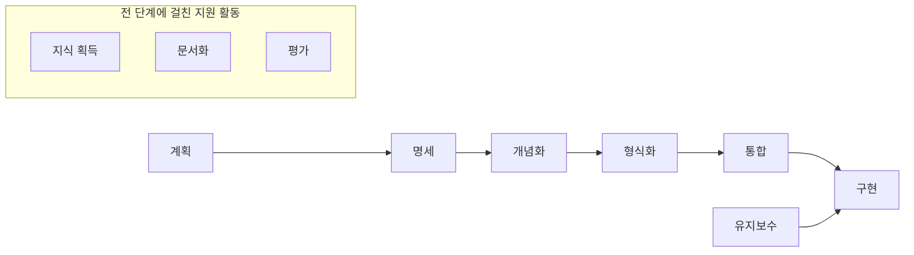
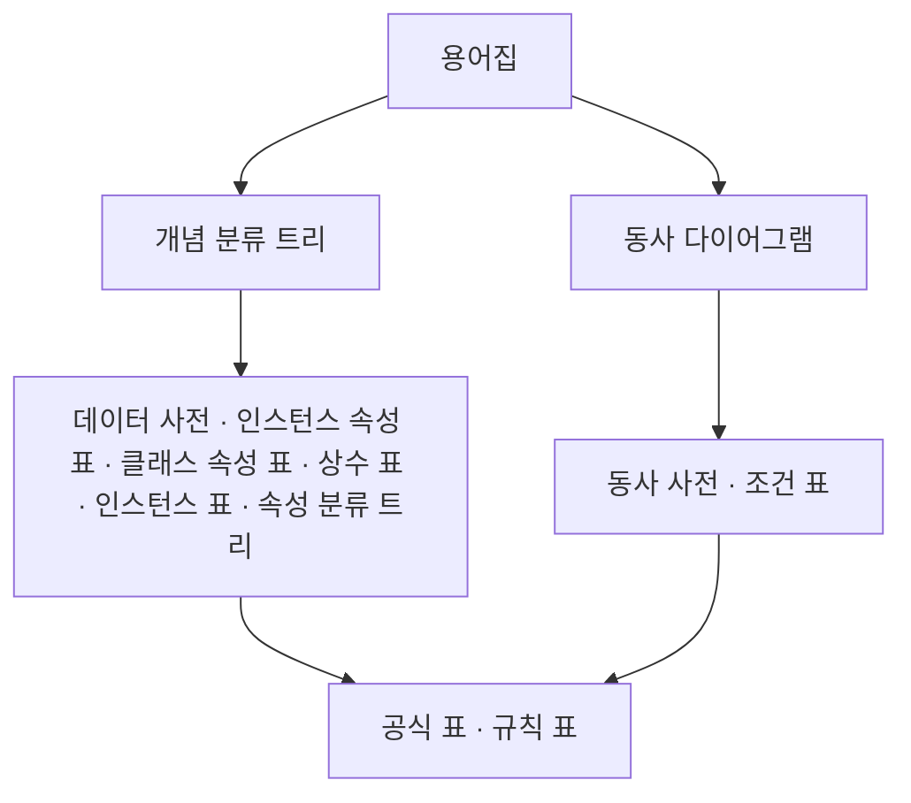

# METHONTOLOGY 상세 해설

> 원문: Fernández, Gómez-Pérez, Juristo, "METHONTOLOGY: From Ontological Art Towards Ontological Engineering", AAAI Technical Report SS-97-06 (1997)

## 초록 — 무엇을 하려는 논문인가

온톨로지를 처음부터 만들려는 사람에게 "어떤 활동을, 어떤 순서로, 어떤 기법으로" 해야 하는지 정리해 주려는 논문이다. 세 가지를 제시한다.

- 온톨로지 개발 과정을 이루는 **활동 목록**
- **진화형 프로토타입(evolving prototype)** 기반의 생명주기
- 이를 묶은 방법론 **METHONTOLOGY**

근거는 저자들이 화학(원소) 도메인 온톨로지를 만든 경험이다.

## 1. 서론 — 왜 "기예(art)"에서 "공학(engineering)"으로 가야 하나

당시 온톨로지는 팀마다 제각각의 방식으로 만들어졌고, 어떻게 만들었는지 공개된 기록은 거의 없었다. 표준화된 활동·생명주기·방법론이 없으니 온톨로지 개발은 장인의 손재주에 가까웠다. 요구사항 정의부터 유지보수까지 이어지는 생명주기와 방법론이 정립되어야 공학이 된다는 것이 저자들의 주장이다.

전문가 시스템(KBS)과의 차이도 짚는다.

- KBS는 전문가가 자기 행동을 명확히 설명하지 못해 요구사항을 미리 쓰기 어렵다. 그래서 프로토타입을 돌려 보고 부족한 점을 다음 사양으로 삼는 식으로 만든다.
- 온톨로지는 특정 애플리케이션의 "행동"이 아니라 재사용·공유를 위한 **어휘**다. 그래서 만들 어휘의 상당 부분을 미리(적어도 일부는) 명시할 수 있다.
- 따라서 KBS 방법론을 그대로 가져다 쓸 수는 없다.

## 2. 온톨로지 개발 과정 — 해야 할 활동 목록

"무엇을 해야 하는가"만 나열하며, 순서는 정하지 않는다. 활동은 동사로 부른다.

| 활동 | 내용 |
|---|---|
| 계획(plan) | 할 일, 배치, 소요 시간, 자원(사람·SW·HW)을 정한다 |
| 명세(specify) | 왜 만드는지, 용도와 최종 사용자는 누구인지 답하고 요구사항 명세서로 적는다 |
| 지식 획득(acquire knowledge) | 도메인 전문가가 아니라면 KBS의 지식 추출 기법으로 지식을 모으고, 출처와 기법을 기록한다 |
| 개념화(conceptualize) | 모은 지식을 문제와 해법을 기술하는 개념 모델로 구조화한다 |
| 형식화(formalize) | 개념 모델을 프레임 기반이나 기술 논리(description logic) 표현으로 바꾼다 |
| 통합(integrate) | 기존 온톨로지를 최대한 재사용해 끌어온다 |
| 구현(implement) | 형식 언어로 코드화해 계산 가능하게 만든다 |
| 평가(evaluate) | 공개 전에 기준(frame of reference)에 비춰 기술적으로 판정한다 |
| 문서화(document) | 재사용·공유를 위해 최대한 문서화한다 (당시 관련 연구 전무) |
| 유지보수(maintain) | 정의 추가·수정 요청을 신중히 반영한다 |

명세의 예로 Enterprise 온톨로지(자연어로 명세)와 TOVE 온톨로지(역량 질문으로 명세)를 든다. 결과물은 둘 다 용어 집합이지만 명세의 형식성 수준이 다르다.

## 3. 온톨로지 생명주기 — 언제, 얼마나 깊이

"지붕부터 집을 짓지 마라"는 스페인 속담으로 시작한다. 2장의 활동에 **순서와 깊이**를 부여하는 것이 생명주기다.

**상태(state)와 지원 활동**

- 온톨로지가 거쳐 가는 상태: 명세 → 개념화 → 형식화 → 통합 → 구현 → 유지보수
- 계획은 맨 앞에서 한 번 수행한다.
- 지식 획득·평가·문서화는 특정 단계가 아니라 **전 생명주기에 걸쳐** 수행한다.
  - 지식 획득은 명세 단계에서 가장 많고 점점 줄어든다.
  - 평가는 오류 전파를 막기 위해 초기에 많이 한다.

**어떤 생명주기 모델이 맞나**

| 모델 | 특징 | 온톨로지에 대한 평가 |
|---|---|---|
| 폭포수(waterfall) | 앞 단계를 완전히 끝내야 다음으로 간다. 모든 용어를 처음에 확정 | 부적합. 처음엔 요구사항이 불완전하고 정의는 시간이 지나며 바뀐다 |
| 점진적(incremental) | 계층을 쌓듯 버전 단위로 확장 | 일부 개선. 하지만 계획에 없던 정의는 다음 버전까지 못 넣는다 |
| 진화형 프로토타입 | 필요에 따라 언제든 정의를 추가·수정·삭제 | **권장** |

온톨로지는 요구사항을 부분적으로라도 미리 명세할 수 있으므로, KBS 생명주기보다는 고전적 소프트웨어 생명주기에 더 가깝다고 본다.

## 4. METHONTOLOGY — 단계별 지침

기존 방법론(Uschold의 Enterprise, Gruninger의 TOVE, 저자들의 화학 온톨로지)을 비교한 뒤, 화학 온톨로지 경험을 바탕으로 정리한 방법이다.

### 4.1 명세(Specification)

자연어·중간 표현·역량 질문 중 하나로 명세서를 만든다. 최소한 다음을 담는다.

- **목적**: 의도한 용도, 사용 시나리오, 최종 사용자
- **형식성 수준**: 매우 비형식 / 준비형식 / 준형식 / 엄밀한 형식 중 어디인가
- **범위**: 표현할 용어 집합, 특성, 세분도(granularity)

**미들아웃(middle-out)** 방식을 권한다. 가장 핵심 개념부터 합의하고, 필요할 때만 위(일반화)나 아래(특수화)로 넓힌다. 용어가 안정적이고 재작업이 적다. 용어집(glossary)과 개념 분류 트리 같은 중간 표현으로 빠진 용어와 동의어를 일찍 걸러낸다.

명세서는 완전성을 증명할 수 없으므로 다음 성질을 갖춰야 한다.

- **간결성**: 모든 용어가 관련 있고 중복이 없다
- **부분 완전성**: 용어의 커버리지와 세분도가 적절하다
- **일관성**: 모든 용어와 의미가 도메인에서 말이 된다

> 예 — 화학 온톨로지 명세서: 목적은 교육·제조·분석에서 원소 정보 조회(예: 나트륨의 원자량), 형식성은 준형식, 범위는 원소 103개와 할로겐·비활성기체·금속 같은 개념, 원자번호·원자량·끓는점 등의 속성, 지식 출처는 CRC 화학·물리 핸드북.

### 4.2 지식 획득(Knowledge Acquisition)

독립 활동이지만 다른 활동과 동시에 진행되며, 명세 단계에서 가장 활발하다. 출처는 전문가, 책, 핸드북, 그림·표, 다른 온톨로지다. 화학 온톨로지에서 쓴 기법은 다음과 같다.

- 비구조화 인터뷰: 명세서 초안 작성
- 비형식 텍스트 분석: 책에서 주요 개념 파악, 중간 표현 채우기
- 형식 텍스트 분석: 정의·단언 같은 구조를 찾고 그것이 기여하는 지식(개념·속성·값·관계)을 식별
- 구조화 인터뷰: 개념·속성·관계의 상세 지식 확보, 개념 모델과 구현 평가

### 4.3 개념화(Conceptualization)

도메인 지식을 개념 모델로 구조화한다. 순서는 이렇다.

1. **용어집(Glossary of Terms)** 완성 — 개념, 인스턴스, 동사, 속성을 모두 모은다
2. 용어를 **개념**과 **동사**로 나누고 관련된 것끼리 묶는다
3. 개념 묶음마다 **개념 분류 트리**, 동사 묶음마다 **동사 다이어그램**을 만든다
4. 이후 개념 팀과 동사 팀으로 나눠 병렬 작업할 수 있다

개념 쪽 중간 표현:

- 데이터 사전: 개념의 의미, 속성, 인스턴스 등
- 인스턴스 속성 표 / 클래스 속성 표: 인스턴스 수준 속성과 개념 자체의 속성을 구분
- 상수 표: 항상 같은 값을 갖는 정보
- 인스턴스 표: 인스턴스 정의
- 속성 분류 트리: 루트 속성을 추론하는 데 쓰이는 속성·상수와 공식·규칙의 순서

동사 쪽 중간 표현:

- 동사 사전: 동작의 의미를 선언적으로 기술
- 조건 표: 동작 실행 전에 만족해야 할 조건, 실행 후 보장되는 조건

공식 표와 규칙 표는 양쪽에서 함께 쓴다. 이 산출물 덕분에 사용자는 소스 코드를 보지 않고도 온톨로지가 쓸 만한지 판단하고, 여러 온톨로지의 범위와 완전성을 비교할 수 있다.

### 4.4 통합(Integration)

처음부터 다 만들지 말고 기존 정의를 재사용해 속도를 높인다.

1. Cyc, Ontolingua 등의 **메타 온톨로지**를 살펴 내 개념화에 맞는 것을 고른다. 새 정의와 재사용 정의가 같은 기본 용어 위에 서도록 하기 위함이다. 맞는 게 없으면 새 메타 온톨로지를 만든다.
2. 의미와 구현이 내 개념화와 맞는 용어를 제공하는 **온톨로지 라이브러리**를 찾는다. 메타 온톨로지가 다르면 번역기가 있는지 확인한다.

필요한 용어가 라이브러리에 없으면(예: Standard-Units에 센티미터가 없음) 그 정의를 넣어야 하는 이유와 이점을 해당 온톨로지 관리자에게 설명해야 한다.

산출물은 **통합 문서**다. 사용할 메타 온톨로지, 그리고 용어마다 "내 개념 모델의 이름 / 가져올 온톨로지 / 그 온톨로지에서의 이름"을 적는다.

> 예: 킬로미터 → Ontolingua의 Standard-Units → Kilometer, 센티미터 → Standard-Units → 정의 없음, 지수 → KIF-Numbers → Expt

### 4.5 구현(Implementation)

통합 단계에서 고른 메타 온톨로지와 온톨로지를 지원하는 환경에서 형식 언어(CLASSIC, BACK, LOOM, Ontolingua, Prolog, C++ 등)로 코드화한다. 개발 환경이 최소한 갖춰야 할 것은 다음과 같다.

- 어휘·구문 분석기, 다른 언어로의 번역기
- 편집기, 브라우저, 검색기
- 불완전성·불일치·중복을 찾는 평가기
- 정의의 추가·삭제·수정을 관리하는 자동 유지보수기

### 4.6 평가(Evaluation)

요구사항 명세서를 기준으로, 각 단계 안에서 그리고 단계 사이에서 온톨로지·소프트웨어 환경·문서를 기술적으로 판정한다.

- **검증(Verification)**: 기준에 비춰 올바르게 만들었는가 (정확성)
- **확인(Validation)**: 표현하려던 실제 대상과 맞는가 (타당성)

산출물은 평가 방법, 사용 기법, 단계별로 발견한 오류 종류, 사용한 지식 출처를 적은 **평가 문서**다.

### 4.7 문서화(Documentation)

당시 온톨로지 문서는 코드와 거기 붙은 자연어 주석, 논문 정도가 전부였다. 저자들은 악순환을 지적한다. 가이드라인이 없으니 아무도 문서화하지 않고, 방법론이 없으니 가이드라인이 없고, 만든 과정을 아무도 기록하지 않으니 방법론이 생기지 않는다.

METHONTOLOGY는 문서화를 전 과정의 활동으로 넣어 이 고리를 끊으려 한다. 단계마다 산출 문서가 정해져 있다.

| 단계 | 산출 문서 |
|---|---|
| 명세 | 요구사항 명세서 |
| 지식 획득 | 지식 획득 문서 |
| 개념화 | 개념 모델 문서 (중간 표현 포함) |
| 형식화 | 형식화 문서 |
| 통합 | 통합 문서 |
| 구현 | 구현 문서 |
| 평가 | 평가 문서 |

## 5. 결론

1. 온톨로지 개발 활동을 정의했다: 계획, 명세, 지식 획득, 개념화, 형식화, 통합, 구현, 평가, 문서화, 유지보수
2. 진화형 프로토타입을 온톨로지에 맞는 생명주기로 제안했다. 정의가 빠지거나 틀리면 어느 상태에서든 다른 상태로 돌아갈 수 있다. 지식 획득·문서화·평가는 대부분의 상태에 걸친 지원 활동이다.
3. 활동, 활동별 기법, 산출물을 갖춘 METHONTOLOGY를 정의했고, 기존 온톨로지 재사용을 강하게 권장한다.
