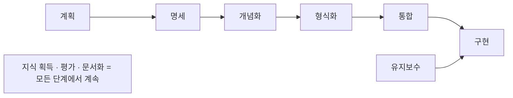

# METHONTOLOGY 요약 — 1학년용

> 한 줄 요약: 온톨로지를 "감으로" 만들지 말고, 소프트웨어 공학처럼 **단계·산출물·생명주기**를 갖춰 만들자는 1997년 논문.

## 먼저, 온톨로지가 뭔데?

어떤 분야(도메인)에서 쓰는 **용어와 그 관계를 컴퓨터가 읽을 수 있게 정리한 사전**이라고 생각하면 된다.

> 예: 화학 온톨로지라면 "나트륨은 금속이다", "나트륨의 원자량은 22.99다" 같은 지식을 정해진 형식으로 적어 둔 것.

## 이 논문이 해결하려는 문제

1997년 당시 온톨로지는 팀마다 자기 방식으로 만들었고, 만든 과정을 기록하지도 않았다. 그래서 남이 따라 하기 어려운 "장인의 기술(art)"이었다. 저자들은 이걸 누구나 따라 할 수 있는 "공학(engineering)"으로 바꾸고 싶었다.

> 비유: 집 짓는 방법이 사람마다 다르고 설계도도 없으면 품질이 들쭉날쭉하다. 건축 공정표와 설계 문서를 표준화하자는 것.

## 핵심 1 — 해야 할 일 10가지

순서 없이 "무엇을 해야 하는지"만 먼저 정한다.

| 할 일 | 쉽게 말하면 |
|---|---|
| 계획 | 일정·인력·도구 정하기 |
| 명세 | 왜, 누구를 위해, 어디까지 만들지 적기 |
| 지식 획득 | 전문가 인터뷰, 책 읽기 |
| 개념화 | 모은 지식을 표·트리로 정리 |
| 형식화 | 정리한 걸 형식적인 모델로 바꾸기 |
| 통합 | 남이 만든 온톨로지 가져다 쓰기 |
| 구현 | 실제 언어로 코딩 |
| 평가 | 제대로 만들었는지 검사 |
| 문서화 | 과정과 결과를 기록 |
| 유지보수 | 나중에 고치고 추가하기 |

## 핵심 2 — 단계는 순서대로, 지원 활동은 내내

- **메인 단계**: 명세 → 개념화 → 형식화 → 통합 → 구현, 그리고 유지보수
- **지원 활동**: 지식 획득·평가·문서화는 특정 단계가 아니라 **처음부터 끝까지 계속** 한다
- 평가는 특히 **초반에 많이** 해야 한다. 초반 실수는 뒤로 갈수록 퍼지기 때문이다.

## 핵심 3 — 폭포수가 아니라 "진화형 프로토타입"

| 모델 | 방식 | 온톨로지에 맞나? |
|---|---|---|
| 폭포수 | 앞 단계를 100% 끝내야 다음으로 | ✗ 처음에 모든 용어를 알 수 없음 |
| 점진적 | 버전 단위로 덧붙이기 | △ 계획에 없던 건 다음 버전까지 대기 |
| **진화형 프로토타입** | 필요하면 언제든 추가·수정·삭제 | ✓ 추천 |

> 비유: 폭포수는 "설계도 확정 후 절대 변경 불가", 진화형은 "살면서 필요하면 방을 고치는 집".

## 핵심 4 — 단계마다 문서가 하나씩 나온다

이 방법론의 가장 실용적인 부분이다.

| 단계 | 산출물 | 예시 내용 |
|---|---|---|
| 명세 | 요구사항 명세서 | 목적, 형식성 수준, 범위, 지식 출처 |
| 지식 획득 | 지식 획득 문서 | 어떤 전문가·책에서 어떤 기법으로 |
| 개념화 | 개념 모델 문서 | 용어집, 개념 분류 트리, 데이터 사전 등 |
| 통합 | 통합 문서 | "센티미터 → 어느 온톨로지의 어떤 정의를 쓸지" |
| 구현 | 구현 문서 | 어떤 언어·환경으로 |
| 평가 | 평가 문서 | 어떻게 검사했고 어떤 오류가 나왔는지 |

> 명세서 예 (화학): 목적 = 교육·제조에서 원소 정보 조회, 범위 = 원소 103개와 원자량·끓는점 등 속성, 출처 = CRC 핸드북.

## 알아 두면 좋은 개념

- **미들아웃(middle-out)**: 가장 핵심 개념부터 정하고 필요할 때만 위·아래로 넓힌다. 재작업이 적다.
- **좋은 명세의 3조건**: 간결성(쓸데없는 용어 없음), 부분 완전성(필요한 건 다 있음), 일관성(말이 됨)
- **검증 vs 확인**: 검증(verification)은 "명세대로 맞게 만들었나", 확인(validation)은 "실제 세상을 제대로 표현하나"
- **용어집 → 개념/동사 분리**: 명사 같은 건 개념 분류 트리로, 동작은 동사 사전과 조건 표로 정리한다

## 한 장 정리

1. 온톨로지 개발도 소프트웨어처럼 **공학적으로** 하자
2. 할 일 10가지를 정의하고, **진화형 프로토타입** 생명주기로 진행하자
3. **단계마다 문서**를 남기고, 평가·문서화·지식 획득은 **내내** 하자
4. 처음부터 다 만들지 말고 **기존 온톨로지를 재사용**하자
