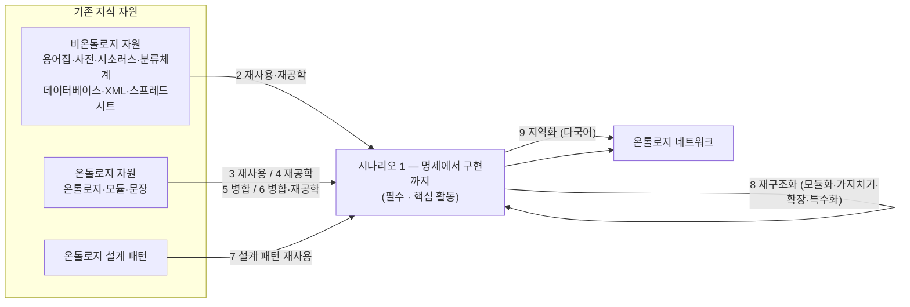

# NeOn 방법론 상세 해설

> 원문(주): Gómez-Pérez, Suárez-Figueroa, "NeOn Methodology for Building Ontology Networks: a Scenario-based Methodology", S3T 2009, pp.160–167 (`neon-원문.pdf`)
> 원문(보조): Suárez-Figueroa 외, NeOn Deliverable D5.4.1 "NeOn Methodology for Building Contextualized Ontology Networks" (2008, `neon-원문-D5.4.1.pdf`) — 요구사항 명세·비온톨로지 자원 재공학 상세
> 원문(보조): Suárez-Figueroa 외, NeOn Deliverable D5.4.3 "Revision and Extension of the NeOn Methodology" (2010, `neon-원문-D5.4.3.pdf`) — 모듈 재사용·매핑·병합·자원 결합 지침
> 정본(유료, 미포함): Suárez-Figueroa, Gómez-Pérez, Fernández-López, "The NeOn Methodology framework: A scenario-based methodology for ontology development", *Applied Ontology* 10(2), 2015, pp.107–145 / 단행본 *Ontology Engineering in a Networked World* (Springer, 2012)

## 초록 — 무엇을 하려는 논문인가

METHONTOLOGY 같은 1990년대 방법론은 온톨로지 구축을 "기예"에서 "공학"으로 바꿨지만, **하나의 온톨로지를 처음부터** 만드는 경우만 다뤘다. 실제 현장에서는 이미 합의된 지식 자원(기존 온톨로지, 시소러스, 분류체계, 용어집, 데이터베이스 등)을 최대한 **재사용·재공학**해 개발 속도를 높이려 한다.

NeOn 방법론은 이 현실을 반영해, 온톨로지(및 온톨로지 네트워크)를 만드는 **9가지 시나리오**를 제시하고, 상황에 맞게 시나리오를 조합해 쓰도록 한다. 근거는 EU NeOn 프로젝트(2006~2010)의 사례(제약 송장 관리, 수산, 유럽 고용 서비스 SEEMP)다.

## 1. 서론 — 왜 새 방법론이 필요한가

- 기존 방법론(METHONTOLOGY, On-To-Knowledge, DILIGENT)은 **단일 온톨로지**를 명세부터 구현까지 만드는 지침이 중심이고, 연구자를 주 독자로 삼았다.
- 실제 프로젝트에서는 온톨로지를 만드는 방식이 다양했다. 처음부터 만들기도 하고, 기존 온톨로지를 정렬·버전 관리하기도 하고, 좋은 명세서 덕분에 기존 자원을 찾아 온톨로지로 재공학하기도 했다.
- 앞으로의 시맨틱 웹은 여러 팀이 협업해 만드는 **온톨로지 네트워크**로 이뤄질 것이다.

> 온톨로지 네트워크: 매핑·모듈화·버전·의존 같은 메타 관계로 서로 연결된 온톨로지들의 집합

## 2. 기존 방법론 비교 — 무엇이 부족했나

세 가지 기준(협업, 동적 진화, 지식 자원 재사용)으로 비교한다.

| 방법론 | 특징 | 협업 | 진화(버전) | 재사용 |
|---|---|---|---|---|
| METHONTOLOGY | 개발 과정 정의, 진화형 프로토타입 생명주기 | 없음 | 언급만, 버전 관리 지침 없음 | 재사용·재공학 활동 목록은 있으나 상세 지침 없음. 비온톨로지 자원·설계 패턴 재사용은 다루지 않음 |
| On-To-Knowledge | 지식관리 **애플리케이션에서의 활용**을 고려해 구축 (타당성 조사 → 착수 → 정제 → 평가 → 유지보수) | 없음 | 애플리케이션 영향 검토 후 새 버전 | 착수 단계에서 재사용 후보 탐색만 언급 |
| DILIGENT | 분산 협업 구축 (구축 → 지역 적응 → 분석 → 개정 → 지역 갱신) | **중심** | 버전 생성은 있으나 관리 지침 없음 | 지침 없음 |

D5.4.1은 기존 방법론의 한계를 이렇게 정리한다.

1. 기존 온톨로지와 **합의된 지식 자원을 재사용·재공학**해 구축하는 지침이 없다.
2. 온톨로지를 맥락에 맞게 조정하고, 계속 진화하는 다른 온톨로지와 연결하는 지침이 없다.
3. 소프트웨어 개발 방법론과 같은 수준·형식으로 과정을 설명하지 않는다.

## 3. 연구 방법 — 어떻게 만들었나

**분할 정복(divide and conquer)**: "온톨로지 네트워크 개발"이라는 큰 문제를 하위 문제(=시나리오)로 나누고, 시나리오의 해법을 조합해 전체를 푼다.

설계 원칙:

- 특정 사례에 치우치지 않을 만큼 일반적일 것
- 특정 기술에 독립적일 것
- 각 과정·활동마다 **목적, 입력·출력, 수행자, 수행 시점, 방법·기법·도구**를 명확히 정의할 것 (D5.4.1은 이를 "채움 카드(filling card)"라는 양식으로 제시)
- 연구자가 아니라 **소프트웨어 개발자와 온톨로지 실무자**가 바로 쓸 수 있을 것
- 완전성·일관성·효율성·유연성·투명성·사용성 등

## 4. NeOn 방법론의 구성 — 네 개의 기둥

2015년 정본 논문 기준으로 NeOn 방법론은 다음 네 가지로 이뤄진다.

| 기둥 | 내용 |
|---|---|
| 용어집 (Glossary of Processes and Activities) | 온톨로지 공학의 과정·활동 이름과 정의를 통일 (예: 명세, 재사용, 재공학, 정렬, 병합, 모듈화, 평가, 진화, 지역화 등) |
| 9가지 시나리오 | 온톨로지·온톨로지 네트워크를 만드는 대표 상황 (아래 5장) |
| 2가지 생명주기 모델 | 폭포수형과 반복·점진형. 프로젝트에 맞게 골라 생명주기를 구성 (상세는 D5.3.1, 정본 논문) |
| 처방적 지침 | 주요 과정·활동별 단계별 수행 지침 (요구사항 명세, 비온톨로지 자원 재사용·재공학, 온톨로지 재사용, 설계 패턴 재사용, 모듈화, 평가, 진화, 지역화 등) |

## 5. 9가지 시나리오

| # | 시나리오 | 상황 | 핵심 활동 |
|---|---|---|---|
| 1 | **명세에서 구현까지** | 재사용 없이 처음부터 개발 | 지식 획득(전 과정) + 요구사항 명세(ORSD) → 지식 자원 빠른 탐색 → 일정 계획 → 개념화·형식화·구현(METHONTOLOGY 또는 On-To-Knowledge 활용) |
| 2 | **비온톨로지 자원 재사용·재공학** | 용어집·분류체계·DB 등 기존 자원을 온톨로지로 변환 | ORSD 요구에 맞는 자원 선정(재사용) → 온톨로지로 변환(재공학) |
| 3 | 온톨로지 자원 재사용 | 기존 온톨로지를 그대로 사용 | 전체·모듈·문장 단위로 재사용 |
| 4 | 온톨로지 자원 재사용·재공학 | 기존 온톨로지를 고쳐서 사용 | 역공학 → 재구조화 → 순공학 (명세·개념화·형식화·구현 수준) |
| 5 | 온톨로지 자원 재사용·병합 | 같은 도메인의 여러 온톨로지를 합침 | 병합 또는 정렬(alignment) |
| 6 | 재사용·병합·재공학 | 병합한 결과를 다시 고침 | 5 + 4 |
| 7 | 온톨로지 설계 패턴(ODP) 재사용 | 반복되는 모델링 문제의 검증된 해법 사용 | 패턴 저장소에서 선택·적용 |
| 8 | 온톨로지 자원 재구조화 | 가져온 자원을 네트워크에 맞게 조정 | 모듈화, 가지치기, 확장, 특수화 |
| 9 | 온톨로지 자원 지역화 | 다국어·다문화 대응 | 레이블 번역 |

- 시나리오는 **조합**해서 쓴다. 단, 어떤 조합이든 **시나리오 1은 반드시 포함**한다. 시나리오 1이 모든 온톨로지 개발의 핵심 활동이기 때문이다.
- 9개가 모든 경우를 망라하지는 않는다(저자 명시).

## 6. 요구사항 명세 — ORSD와 역량 질문 (D5.4.1 5장)

명세는 "왜 만들고, 어디에 쓰고, 누가 쓰고, 무엇을 충족해야 하는가"를 정하는 활동이다. 지식 획득과 **병행**하며, 개발팀이 사용자·도메인 전문가와 함께 수행한다. 산출물은 **온톨로지 요구사항 명세서(ORSD)** 다.

**ORSD 양식**

| 항목 | 내용 |
|---|---|
| 1 목적 | 온톨로지의 목표 |
| 2 범위 | 커버리지와 세분도 |
| 3 형식성 수준 | 비형식 자연어 ~ 엄밀한 형식 언어 |
| 4 대상 사용자 | 주 사용자 |
| 5 용도 | 온톨로지가 쓰일 주요 시나리오 |
| 6 역량 질문(CQ) 그룹 | 온톨로지가 답해야 할 질문과 그 답, 그룹별 우선순위 |
| 7 사전 용어집 | CQ에 등장한 용어와 빈도, 객체(인스턴스)와 빈도 |

**명세 8단계**

1. 목적·범위·형식성 수준 파악
2. 대상 사용자 파악
3. 용도 파악
4. 요구사항(역량 질문) 도출
5. 요구사항 그룹화
6. 요구사항 검증
7. 우선순위 부여
8. 용어와 빈도 추출 → 이후 재사용할 자원을 찾는 검색어로 사용

ORSD는 이후 단계에서 계속 쓰인다. 용어는 재사용 자원 탐색의 입력, CQ는 재사용 후보 평가와 최종 온톨로지 평가의 기준이 된다.

## 7. 비온톨로지 자원의 재사용·재공학 (D5.4.1 6장)

**비온톨로지 자원(NOR)**: 지식을 담고 있지만 그 의미가 아직 온톨로지로 형식화되지 않은 자원. 어느 정도 공동체의 합의를 담고 있어 재사용 가치가 크다.

| 분류 기준 | 예 |
|---|---|
| 자원 유형 | 용어집, 사전, 어휘집, 분류체계·택소노미, 시소러스 |
| 데이터 모델 | 인접 리스트, 경로 열거 등 자원이 지식을 표현하는 구조 |
| 구현 형태 | 데이터베이스, XML, 스프레드시트, 텍스트 파일 |

**재공학 모델** (소프트웨어 재공학 모델을 응용)

**데이터베이스를 온톨로지로 — 두 가지 접근** (D5.4.1 6.2.1의 선행연구 정리)

| 접근 | 방법 | 데이터 |
|---|---|---|
| ① 스키마 변환 + 인스턴스 이전 | DB 관계 모델을 역공학해 온톨로지 스키마를 반자동 생성하고, DB 레코드를 온톨로지 인스턴스로 변환 | DB 내용을 온톨로지에 **복제** |
| ② 매핑 기반 접근 | 기존 온톨로지와 DB 요소 사이의 **매핑**을 찾아 형식 언어(R2O)로 표현하고, 검증한 뒤 질의 처리기(ODEMapster)로 데이터를 가져옴. 온톨로지는 DB 스키마의 거울이 아님 | 복제하지 않고 **질의할 때 매핑으로 인스턴스를 생성** |

XML도 스키마로 온톨로지를 만들고 XML 데이터로 인스턴스를 채우는 방식(XSD2OWL, XML2RDF)이 소개된다.

## 8. 적용 사례

| 사례 | 내용 | 사용한 시나리오 |
|---|---|---|
| NeOn 송장 관리 (제약 산업) | 전자 송장 표준(UBL·EDIFACT·xCBL)을 재공학(2), 상위 온톨로지 SUMO·DOLCE·W3C Time 재사용(3), 제약사별 특수화(8), 스페인 지역 언어 대응(9) | 1, 2, 3, 8, 9 |
| SEEMP (유럽 고용 서비스) | 국가별 로컬 온톨로지 네트워크 + 유럽 기준 참조 온톨로지. 직업·산업 분류 표준(ISCO-88, NACE), 국가 코드(ISO 3166)를 재공학(2), DAML Time 재공학(4), 로컬↔참조 정렬(5) | 1, 2, 4, 5 |

## 9. 결론

1. 9개의 유연한 시나리오를 제시했다. 시나리오는 서로 조합할 수 있어, 처음부터 만드는 경로 하나만 제시한 METHONTOLOGY·On-To-Knowledge·DILIGENT의 경직성을 넘어선다.
2. 기존 지식 자원(온톨로지·비온톨로지 자원·설계 패턴)의 재사용을 적극 권장한다. 이미 합의된 자원을 쓰면 시간과 비용이 줄고 좋은 관행이 확산된다.
3. 유럽 프로젝트 사례에 시나리오를 실제로 적용했다.

## METHONTOLOGY와의 관계 정리

| 구분 | METHONTOLOGY (1997) | NeOn (2008~2015) |
|---|---|---|
| 대상 | 단일 온톨로지 | 온톨로지 네트워크 |
| 출발점 | 처음부터 구축 | 기존 자원 재사용·재공학 우선 |
| 구조 | 활동 목록 + 진화형 프로토타입 생명주기 | 용어집 + 9 시나리오 + 2 생명주기 모델 + 처방적 지침 |
| 명세 | 명세서(목적·형식성·범위) | ORSD + 역량 질문 + 8단계 명세 지침 |
| 통합 | 기존 온톨로지 재사용(메타 온톨로지·라이브러리) | 시나리오 3~6으로 세분화(재사용·재공학·병합·정렬) |
| 비온톨로지 자원 | 다루지 않음 | 시나리오 2 (용어집·분류체계·DB·XML 등) |
| 협업·진화 | 다루지 않음 / 언급만 | 협업·버전·진화 지침 포함 |
| 관계 | — | 시나리오 1의 개념화·형식화·구현은 METHONTOLOGY 활동을 그대로 사용 |

NeOn은 METHONTOLOGY를 대체하기보다 **감싸는** 방법론이다. 같은 연구 그룹(마드리드 공과대학 OEG, Gómez-Pérez)이 METHONTOLOGY를 핵심(시나리오 1)으로 두고, 재사용·재공학·협업·진화를 시나리오로 덧붙였다.
