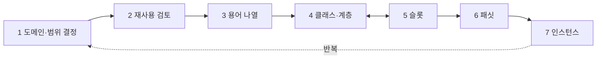

# Ontology Development 101 상세 해설

> 원문: Natalya F. Noy, Deborah L. McGuinness, "Ontology Development 101: A Guide to Creating Your First Ontology", Stanford University

## 1. 왜 온톨로지를 만드는가

온톨로지는 **도메인의 용어와 그 관계를 명시적·형식적으로 정의한 것**(Gruber의 정의)이다. 웹 사이트 분류(Yahoo!), 상품 분류(Amazon), RDF·DAML 같은 웹 표준, 의료의 SNOMED·UMLS, 상품·서비스 분류 UNSPSC 등 이미 곳곳에서 쓰인다.

만드는 이유는 다섯 가지다.

- **공통 이해 공유**: 여러 의료 사이트가 같은 온톨로지를 쓰면 에이전트가 정보를 모아 질의에 답할 수 있다
- **도메인 지식 재사용**: 시간 개념(구간, 시점, 상대적 시간) 같은 걸 한 번 잘 만들면 다른 도메인에서 그대로 쓴다
- **가정 명시화**: 코드에 하드코딩된 가정은 찾기도 바꾸기도 어렵다. 명시해 두면 바꾸기 쉽고 신규 사용자 학습에도 좋다
- **도메인 지식과 운영 지식 분리**: 부품 조립 알고리즘을 PC 부품 온톨로지에도, 엘리베이터 부품 온톨로지에도 똑같이 적용할 수 있다
- **도메인 지식 분석**: 선언적으로 정의돼 있으면 형식적 분석이 가능하다

온톨로지 자체가 목적인 경우는 드물다. 다른 프로그램이 쓸 데이터 구조를 정의하는 일에 가깝다. 이 가이드는 와인·음식 궁합 추천 앱을 위한 온톨로지를 예제로 쓴다.

**객체지향 설계와의 차이**: 객체지향은 클래스의 **동작(메서드)** 중심으로 설계를 결정하지만, 온톨로지는 클래스의 **구조적 성질** 중심으로 결정한다. 그래서 같은 도메인이라도 클래스 구조가 달라진다.

예제 도구는 Protégé-2000이고, 저자들은 정답인 방법론은 없으며 자기 경험상 유용했던 방법을 제시한다고 밝힌다.

## 2. 온톨로지에는 무엇이 들어가나

| 구성 요소 | 다른 이름 | 의미 | 와인 예 |
|---|---|---|---|
| 클래스 | 개념(concept) | 도메인의 개념 | Wine, Winery |
| 슬롯 | 역할, 속성(property) | 클래스·인스턴스의 특징 | body, maker |
| 패싯 | 역할 제약 | 슬롯에 대한 제약 | body는 FULL/MEDIUM/LIGHT 중 하나 |
| 인스턴스 | 개체 | 클래스의 구체적 개체 | Château Lafite Rothschild Pauillac |

온톨로지 + 인스턴스 = **지식 베이스**. 실제로는 어디까지가 온톨로지이고 어디부터 지식 베이스인지 경계가 모호하다.

> 예: Château Lafite Rothschild Pauillac 와인은 Pauillac 클래스의 인스턴스이고, body 슬롯 값은 full, maker 슬롯 값은 Château Lafite Rothschild 와이너리(Winery의 인스턴스)다. 와이너리 쪽에는 그 와인을 가리키는 produces 슬롯이 있다.

실무적으로 온톨로지 개발은 네 가지 일이다: 클래스 정의, 클래스 계층 구성, 슬롯과 허용 값 정의, 인스턴스의 슬롯 값 채우기.

## 3. 간단한 지식공학 방법론

거친 초안을 만든 뒤 반복해서 다듬는 **반복적 접근**이다. 먼저 세 가지 기본 원칙을 둔다.

1. 도메인을 모델링하는 정답은 하나가 아니다. 용도와 예상 확장에 따라 최선이 달라진다.
2. 온톨로지 개발은 반드시 반복적이다.
3. 개념은 도메인의 실제 객체와 관계에 가까워야 한다. 도메인을 설명하는 문장의 **명사(객체)**와 **동사(관계)**가 후보다.

### Step 1. 도메인과 범위 정하기

다음 질문에 답한다: 어떤 도메인을 다루나? 어디에 쓰나? 어떤 질문에 답해야 하나? 누가 쓰고 누가 관리하나?

와인 예에서는 와인 종류, 음식 종류, 좋은/나쁜 궁합이 들어가지만, 와이너리 재고나 식당 직원 관리는 빠진다. 용도에 따라 필요한 정보가 달라진다: 잡지 기사 자연어 처리용이면 동의어·품사, 고객 주문 도움용이면 소매가, 와인 셀러 구매용이면 도매가·재고.

**역량 질문(competency questions)**: 이 온톨로지 기반 지식 베이스가 답할 수 있어야 할 질문 목록. 나중에 "충분한 정보가 있는가"를 확인하는 리트머스 시험지가 된다. 완벽할 필요는 없는 스케치다.

> 예: "보르도는 레드인가 화이트인가?", "카베르네 소비뇽은 해산물과 어울리나?", "구운 고기에 가장 좋은 와인은?", "나파 진판델의 좋은 빈티지는?"

### Step 2. 기존 온톨로지 재사용 검토

다른 사람이 만든 것을 다듬고 확장할 수 있는지 거의 항상 확인할 가치가 있다. 이미 특정 어휘를 쓰는 시스템과 연동해야 한다면 재사용이 필수일 수도 있다. 형식이 달라도 변환은 대개 어렵지 않다. Ontolingua·DAML 라이브러리, UNSPSC·RosettaNet·DMOZ 등이 있다. 이 가이드에서는 기존 것이 없다고 가정하고 처음부터 만든다.

### Step 3. 중요한 용어 나열

말하고 싶거나 사용자에게 설명하고 싶은 용어를 다 적는다. 이 단계에서는 겹침, 관계, 클래스냐 슬롯이냐를 고민하지 않고 **일단 빠짐없이** 모은다.

> 예: wine, grape, winery, location, color, body, flavor, sugar content, fish, red meat, white wine …

Step 4와 5는 서로 얽혀 있어서 하나를 끝내고 다른 걸 하기 어렵다. 보통 클래스 몇 개를 정의하고 속성을 붙이고 다시 클래스로 돌아가기를 반복한다. 가장 중요한 두 단계다.

### Step 4. 클래스와 클래스 계층 정의

세 가지 접근이 있다.

| 접근 | 방식 | 와인 예 |
|---|---|---|
| 하향식(top-down) | 가장 일반적인 개념부터 세분화 | Wine → Red wine → Syrah |
| 상향식(bottom-up) | 가장 구체적인 개념부터 묶어 올라감 | Pauillac, Margaux → Medoc → Bordeaux |
| 혼합(combination) | 눈에 띄는 개념부터 정의하고 위아래로 확장 | Wine과 Margaux를 먼저 → 중간의 Medoc으로 연결 |

어느 쪽이 우월하지 않다. 중간 수준 개념이 가장 설명력이 커서(Rosch 1978) 혼합 방식이 많은 사람에게 가장 쉽다.

Step 3 목록에서 **독립적으로 존재하는 객체**를 나타내는 용어를 클래스로 고른다(다른 걸 묘사하는 용어는 슬롯 후보). 계층은 다음 규칙으로 판단한다.

> A가 B의 상위 클래스라면, B의 모든 인스턴스는 A의 인스턴스이기도 하다. 즉 B는 A의 "일종(kind of)"이다. 예: 모든 Pinot Noir는 레드 와인이므로 Pinot Noir는 Red wine의 하위 클래스.

### Step 5. 클래스의 속성(슬롯) 정의

클래스만으로는 역량 질문에 답할 수 없으니 내부 구조를 기술한다. 클래스로 뽑고 남은 용어 대부분이 슬롯이 된다. 슬롯이 될 수 있는 속성은 네 종류다.

- **내재적** 속성: 와인의 맛
- **외재적** 속성: 와인의 이름, 산지
- **부분**: 구조를 가진 객체의 물리적·추상적 부분 (예: 식사의 코스)
- **다른 개체와의 관계**: 와인의 제조사(maker), 원료 포도(grape)

하위 클래스는 상위 클래스의 슬롯을 **상속**한다. Red wine에만 tannin level을 추가하면 Bordeaux, Beaujolais 등 모든 레드 와인이 이를 상속한다.

> 슬롯은 그 속성을 가질 수 있는 **가장 일반적인 클래스**에 붙인다. body와 color는 Wine에 붙인다.

### Step 6. 슬롯의 패싯 정의

**카디널리티(cardinality)**: 값이 몇 개인가

- 단일(single) vs 다중(multiple): 와인의 body는 하나, 와이너리의 produces는 여러 개
- 최소 N: Wine의 grape는 최소 1개 (모든 와인은 최소 한 품종으로 만든다)
- 최대 M: 단일 품종 와인은 grape 최대 1개. 최대 0은 "이 하위 클래스에서는 값을 가질 수 없음"

**값 타입(value type)**

| 타입 | 설명 | 예 |
|---|---|---|
| String | 단순 문자열 | name |
| Number (Float, Integer) | 수치 | price |
| Boolean | 예/아니오 | 스파클링 여부 (클래스로 안 나눌 경우) |
| Enumerated (Protégé의 Symbol) | 허용 값 목록 | flavor ∈ {strong, moderate, delicate} |
| Instance | 다른 개체와의 관계. 허용 클래스 지정 필요 | Winery의 produces는 Wine 인스턴스 |

**정의역(domain)과 치역(range)**

- 치역(range): Instance 타입 슬롯의 허용 클래스. produces의 치역은 Wine
- 정의역(domain): 슬롯이 붙는 클래스. produces의 정의역은 Winery

규칙은 "모든 값을 포괄하는 가장 일반적인 클래스를 고르되, 너무 일반적이진 않게(THING은 안 됨)"다.

- 목록에 클래스와 그 하위 클래스가 같이 있으면 하위 클래스를 지운다 (Wine과 Red Wine → Wine)
- A의 모든 하위 클래스가 있고 A만 없으면 A 하나로 바꾼다 (Red/White/Rosé Wine → Wine)
- A의 하위 클래스가 거의 다 있으면 A로 바꿀지 고려한다

tannin level은 모든 레드 와인이 가지므로 Red Wine에 붙이고, 화이트 와인엔 쓰지 않으니 Wine까지 올리면 틀린다.

### Step 7. 인스턴스 만들기

클래스 선택 → 인스턴스 생성 → 슬롯 값 채우기.

> 예: Chateau-Morgon-Beaujolais는 Beaujolais 클래스의 인스턴스. body Light, color Red, flavor Delicate, tannin level Low, grape Gamay(Wine grape 인스턴스), maker Chateau-Morgon(Winery 인스턴스), region Beaujolais(Wine-Region 인스턴스), sugar Dry.

## 4. 클래스와 클래스 계층 정의 — 주의할 점

계층에 정답은 없지만, 클래스를 꽤 만든 뒤 한발 물러서서 다음 지침을 점검하면 좋다.

### 4.1 계층이 올바른지 확인

- **is-a 관계**: 계층은 "B는 A의 일종"을 나타낸다. Chardonnay는 White wine의 일종, 여객기는 항공기의 일종, 고기는 음식의 일종.
- **단수와 복수를 섞지 말 것**: Wines 아래에 Wine을 두는 건 오류다. 와인 하나는 "와인들의 일종"이 아니다. 이름을 항상 단수 또는 항상 복수로 통일하면 예방된다.
- **추이성**: B ⊂ A이고 C ⊂ B이면 C ⊂ A. Chardonnay는 Wine의 (간접) 하위 클래스이고, White wine의 직접 하위 클래스다.
- **계층의 진화**: 진판델은 오랫동안 전부 레드였지만 화이트 진판델(실제 색은 로제)이 생기면서 Red zinfandel(Red wine 아래)과 White zinfandel(Rosé wine 아래)로 나눠야 했다.
- **클래스와 이름은 다르다**: 클래스는 개념이지 단어가 아니다. Shrimps를 Prawns로 바꿔도 같은 개념이다. 따라서 **동의어는 별개 클래스가 아니다.** Shrimp, Prawn, Crevette를 따로 만들지 말고 하나만 두고 동의어는 별칭이나 문서로 남긴다.
- **순환 금지**: A가 B의 상위이면서 B가 A의 상위면 A와 B가 같다고 선언한 셈이다.

### 4.2 형제(sibling) 분석

- 루트 바로 아래를 제외하면, **형제는 같은 일반성 수준**이어야 한다. White wine과 Chardonnay를 둘 다 Wine 바로 아래에 두면 안 된다. 책 목차의 같은 수준 절과 같은 이치다.
- 하위 클래스가 **하나뿐**이면 모델링 문제거나 미완성일 수 있다. Red Burgundy 아래 Cotes d'Or만 있고 둘이 사실상 같다면 Cotes d'Or는 불필요하다. Cotes Chalonnaise를 추가하면 둘로 나뉘어 의미가 생긴다.
- 하위 클래스가 **12개를 넘으면** 중간 범주가 필요할 수 있다. Wine 아래에 Beaujolais, Bordeaux, Pauillac, Margaux를 다 나열하는 대신 Red wine, Bordeaux, Medoc 같은 중간 단계를 둔다.
- 단, 자연스러운 그룹이 없으면 억지로 만들지 않는다. 온톨로지는 현실을 반영한다.

### 4.3 다중 상속

클래스는 여러 상위 클래스를 가질 수 있다. Port는 Red wine이면서 Dessert wine이다. Dessert wine에서 sugar=SWEET를, Red wine에서 tannin level과 color 값을 함께 물려받는다.

### 4.4 새 클래스를 만들 때와 만들지 말 때

너무 깊은 계층도, 슬롯에 정보를 몰아넣은 너무 평평한 계층도 다루기 어렵다. 판단 기준은 다음과 같다.

> 하위 클래스는 보통 (1) 상위에 없는 속성을 추가하거나, (2) 다른 제약을 갖거나, (3) 다른 관계에 참여한다. 상위 클래스에 대해 말할 수 없는 무언가를 말할 수 있을 때만 새 클래스를 만든다.

예외도 있다.

- **용어 계층**은 속성이 없어도 된다. 의료 기록의 질병 분류처럼 탐색과 적절한 일반성 수준 선택에 도움이 되기 때문이다.
- 전문가들이 흔히 구분하는 개념이면, 그 구분 자체를 모델링하지 않더라도 클래스로 둘 수 있다.
- 하지만 제약 하나마다 하위 클래스를 만들진 않는다. Red/White/Rosé는 자연스러운 구분이라 만들었지만 Delicate wine, Moderate wine은 만들지 않았다.

### 4.5 새 클래스냐, 속성 값이냐

White wine을 클래스로 만들지, Wine의 color 슬롯 값으로 둘지는 범위에 달렸다. 와인 라벨 공장이라면 색 구분이 중요하지 않으니 슬롯 값으로 충분하다. 와인·음식 궁합에선 레드와 화이트가 어울리는 음식부터 다르니 클래스로 만든다.

> 서로 다른 슬롯 값을 가진 개념이 **다른 클래스의 슬롯 제약**이 되면 클래스로 만든다. 아니면 슬롯 값으로 둔다.

> 도메인에서 중요한 구분이고, 값이 다른 객체를 **서로 다른 종류**로 여긴다면 클래스로 만든다. (예: Red Merlot과 White Merlot)

> 인스턴스가 속한 클래스는 **자주 바뀌면 안 된다.** Chilled wine은 클래스가 아니라 chilled 속성이어야 한다. 차가워졌다 미지근해졌다 할 때마다 클래스를 옮겨 다닐 수는 없다.

숫자, 색, 위치는 보통 슬롯 값이다. 와인의 색은 너무 중요해서 예외다. 갈비뼈 예: 각 갈비뼈의 인접 관계·기능·보호 장기가 다 다르면 갈비뼈마다 클래스를, X선에서 몇 번째가 부러졌는지만 말하면 Rib 클래스 하나에 lateral position, order 슬롯을 둔다.

### 4.6 인스턴스냐, 클래스냐

애플리케이션이 다루는 **가장 낮은 세분도**에 따라 정해진다. 역량 질문의 답이 되는 가장 구체적인 개념이 인스턴스 후보다.

- 와인·음식 궁합만 다룬다면 Sterling Vineyards Merlot이 인스턴스다.
- 식당 재고도 관리한다면 개별 병이 인스턴스가 된다.
- 빈티지마다 속성이 다르다면 빈티지가 인스턴스, Sterling Vineyards Merlot은 클래스가 된다.

> 개념들이 **자연스러운 계층**을 이루면 클래스로 표현한다. 시스템에는 "하위 인스턴스"라는 개념이 없기 때문이다.

와인 산지 예: Bourgogne region을 French region의 인스턴스로 두면, 그 아래 Cotes d'Or region을 둘 수 없다. 어디까지 클래스고 어디부터 인스턴스인지 자의적이므로 모든 산지를 클래스로, 직접 인스턴스를 가질 수 없는 **추상 클래스**로 정의한다. 이때 "region"을 빼면 틀린다. Alsace는 France의 일종이 아니지만, Alsace region은 French region의 일종이다.

### 4.7 범위 제한

> 도메인의 모든 정보를 담을 필요는 없다. 애플리케이션에 필요한 것보다 더 특수화·일반화하지 않는다(위아래로 최대 한 단계 여유).

> 가능한 모든 속성과 구분을 담을 필요도 없다.

라벨 종이 재질, 새우 요리법, 포도알 크기, "좋아하는 와인" 같은 관계는 넣지 않았다. 생물학 실험 온톨로지에서 실험자도 생물학적으론 생물이지만, Experimenter를 Biological organism 아래에 두면 몸무게·종 같은 무관한 슬롯이 따라온다. 오히려 해롭다. 대신 이런 설계 결정은 **문서로 남겨** 재사용하는 사람이 오해하지 않게 한다.

### 4.8 서로소(disjoint) 하위 클래스

공통 인스턴스를 가질 수 없는 클래스들은 서로소로 선언할 수 있다. Red wine과 White wine은 서로소, Dessert wine과 White wine은 아니다(스위트 리슬링). 서로소를 선언해 두면, Riesling(화이트)과 Port(레드)를 동시에 상속하는 클래스를 만들 때 시스템이 오류를 잡아 준다.

## 5. 속성 정의 — 추가 사항

### 5.1 역 슬롯(inverse slot)

Wine의 maker와 Winery의 produces는 서로 역관계다. 한쪽만 있어도 다른 쪽을 추론할 수 있어 중복이지만, 지식 입력 관점에선 양쪽 다 있는 게 편하다. 한쪽을 채우면 시스템이 다른 쪽을 자동으로 채워 일관성을 지킨다.

> 예: Sterling Merlot의 maker에 Sterling Vineyard를 넣으면, Sterling Vineyard의 produces 목록에 Sterling Merlot이 자동으로 추가된다.

### 5.2 기본값(default value)

대부분의 인스턴스가 같은 값을 가지면 기본값으로 지정한다. 인스턴스 생성 시 자동으로 채워지지만 언제든 바꿀 수 있는 편의 기능이다(예: body 기본값 full). 반면 **슬롯 값**은 고정이다. Dessert wine의 sugar=SWEET는 하위 클래스와 인스턴스 어디서도 바꿀 수 없다.

## 6. 이름 짓기

명명 규칙을 정하고 **반드시 지킨다.** 이해도 쉬워지고 모델링 실수도 줄어든다. 시스템 특성부터 확인한다: 클래스·슬롯·인스턴스가 같은 이름 공간인가? 대소문자를 구분하나? 어떤 구분자를 허용하나? (Protégé는 단일 이름 공간·대소문자 구분이라 클래스 Winery와 슬롯 winery 공존 가능, CLASSIC은 반대)

- **대소문자와 구분자**: 클래스는 대문자, 슬롯은 소문자로 시작하는 게 흔하다. 여러 단어는 공백(Meal course), 붙여 쓰기(MealCourse), 밑줄·하이픈(Meal_course) 중 고른다. 공백이 직관적이지만 연동 시스템이 공백을 못 다루면 다른 방식을 쓴다.
- **단수냐 복수냐**: 어느 쪽이든 되지만(실무에선 단수가 흔함) 온톨로지 전체에서 일관되게. Wines 아래 Wine 같은 실수를 막는다.
- **접두사·접미사**: 슬롯에 has-maker, maker-of 같은 규칙을 쓰면 클래스와 슬롯이 바로 구분되지만 이름이 길어진다.
- **기타**:
  - 이름에 "class", "property", "slot"을 붙이지 않는다
  - 약어를 피한다 (Cab 대신 Cabernet Sauvignon)
  - 형제 클래스는 상위 이름을 모두 포함하거나 모두 빼거나 통일한다 (Red Wine/White Wine 또는 Red/White, Red Wine/White는 안 됨)

## 7. 기타 자료

다른 개발 환경 비교(Duineveld 외), 대안 방법론(Gómez-Pérez, Uschold & Gruninger), 형식적 측면(Ontolingua 튜토리얼)을 소개한다. 온톨로지 분석 도구도 늘고 있는데, Chimaera는 논리적 정확성과 흔한 설계 오류를 진단해 준다.

## 8. 결론

선언적 프레임 기반 시스템을 위한 개발 방법론을 단계별로 제시했다. 그래도 가장 중요한 것은 **어떤 도메인에도 정답 온톨로지는 하나가 아니라는 점**이다. 온톨로지 설계는 창의적 과정이고, 품질은 만든 목적의 애플리케이션에서 실제로 써 봐야만 판단할 수 있다.
