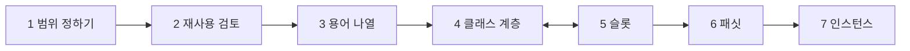

# Ontology Development 101 요약 — 1학년용

> 한 줄 요약: 와인 예제로 배우는 **첫 온톨로지 만들기 7단계**와, 클래스를 나눌 때 자주 하는 실수를 피하는 법.

## 온톨로지 = 클래스 + 슬롯 + 패싯 (+ 인스턴스)

자바·파이썬 클래스를 배웠다면 비슷하게 생각하면 된다. 다만 **메서드(동작)는 없고 구조만** 있다.

| 온톨로지 용어 | 프로그래밍 비유 | 와인 예 |
|---|---|---|
| 클래스 | class | Wine, Winery |
| 슬롯 | 필드(멤버 변수) | body, color, maker |
| 패싯 | 필드의 타입·제약 | body는 FULL/MEDIUM/LIGHT 중 하나 |
| 인스턴스 | 객체 | "샤토 마르곤 보졸레" |

온톨로지에 인스턴스까지 채우면 **지식 베이스**가 된다.

> 차이점: 객체지향은 "이 클래스가 뭘 **하나**"로 설계하고, 온톨로지는 "이 클래스가 뭘 **가지고 어떤 관계인가**"로 설계한다.

## 3대 원칙

1. **정답은 없다.** 용도에 따라 최선이 달라진다.
2. **반복해서 고친다.** 한 번에 완성되지 않는다.
3. 도메인 설명 문장의 **명사는 클래스 후보, 동사는 관계 후보**다.

## 7단계

| 단계 | 할 일 | 와인 예 |
|---|---|---|
| 1. 범위 정하기 | 무엇에 쓰나? 어떤 질문에 답해야 하나?(**역량 질문**) | "구운 고기엔 어떤 와인?" |
| 2. 재사용 검토 | 남이 만든 게 있으면 가져다 쓰기 | 프랑스 와인 온톨로지가 있다면 활용 |
| 3. 용어 나열 | 겹치든 말든 일단 다 적기 | wine, grape, winery, color, body … |
| 4. 클래스 계층 | is-a 관계로 트리 만들기 | Wine → Red wine → Pinot Noir |
| 5. 슬롯 | 클래스가 가질 속성 정하기 | Wine에 color, body, maker |
| 6. 패싯 | 값 개수·타입·허용 범위 정하기 | maker는 Winery 인스턴스 1개 |
| 7. 인스턴스 | 실제 데이터 채우기 | 샤토 마르곤 보졸레: body=Light … |

4와 5는 왔다 갔다 하며 같이 진행한다.

> **역량 질문**은 나중에 "이 온톨로지로 이 질문에 답할 수 있나?"를 확인하는 시험지가 된다.

## 클래스 계층 만들 때 핵심 규칙

**is-a 규칙**
> B가 A의 하위 클래스라면, 모든 B는 A다. 모든 Pinot Noir는 레드 와인이다 → Pinot Noir ⊂ Red wine.

**자주 하는 실수**

| 실수 | 왜 틀렸나 | 고치기 |
|---|---|---|
| Wines 아래에 Wine | 와인 하나는 "와인들의 일종"이 아님 | 단수/복수 중 하나로 통일 |
| Shrimp, Prawn을 별도 클래스로 | 같은 개념의 동의어 | 클래스 하나 + 동의어 메모 |
| White wine과 Chardonnay가 형제 | 일반성 수준이 다름 | Chardonnay를 White wine 아래로 |
| 하위 클래스가 1개뿐 | 나눌 의미가 없거나 덜 만든 것 | 합치거나 형제 추가 |
| 하위 클래스가 12개 초과 | 너무 평평함 | 중간 범주 추가 |
| A ⊂ B 이면서 B ⊂ A | 순환 = 사실상 같은 클래스 | 순환 제거 |

## 클래스로 만들까, 속성 값으로 둘까?

가장 헷갈리는 부분이다. 판단 기준은 이렇다.

- 상위 클래스엔 없는 **새 속성·제약·관계**가 생기면 → 클래스
- 도메인에서 **다른 종류**로 취급하면 → 클래스 (레드 vs 화이트 와인)
- **자주 바뀌는 상태**면 → 속성 값 ("차가운 와인"은 클래스가 아니라 chilled 속성)
- 숫자·색·위치는 보통 → 속성 값 (단, 와인의 색은 너무 중요해서 예외)

> 비유: 학생을 "1학년 학생 클래스"로 만들면 진급할 때마다 클래스를 옮겨야 한다. 학년은 속성(grade=1)이 맞다.

## 클래스로 만들까, 인스턴스로 만들까?

애플리케이션이 다루는 **가장 구체적인 단위**가 인스턴스다.

- 와인·음식 궁합만 다루면 → "스털링 메를로"가 인스턴스
- 식당 재고까지 관리하면 → 와인 **병 하나하나**가 인스턴스

또, 개념끼리 **계층을 이루면 클래스**로 만든다. 인스턴스 밑에 인스턴스를 둘 수는 없기 때문이다. (프랑스 지역 → 부르고뉴 지역 → 코트 도르 지역은 전부 클래스)

## 그 밖에 알아 두면 좋은 것

- **슬롯은 가장 일반적인 클래스에**: color는 Wine에, tannin level은 Red wine에(화이트엔 안 쓰니까)
- **상속**: 하위 클래스는 상위의 슬롯을 물려받는다. 다중 상속도 가능하다(Port = Red wine + Dessert wine)
- **정의역/치역**: produces 슬롯은 Winery에 붙고(정의역) 값은 Wine(치역). 너무 좁지도, THING처럼 너무 넓지도 않게.
- **역 슬롯**: Wine의 maker를 채우면 Winery의 produces가 자동으로 채워진다
- **기본값 vs 고정값**: 기본값은 바꿀 수 있고, 고정 슬롯 값(디저트 와인은 SWEET)은 못 바꾼다
- **서로소(disjoint)**: Red wine과 White wine은 동시에 될 수 없다고 선언하면 시스템이 실수를 잡아 준다
- **범위 제한**: 필요 이상으로 세분화하지 않는다. 라벨 종이 재질까지 넣을 필요는 없다

## 이름 짓기 규칙

- 규칙을 하나 정하고 **끝까지 지키기**
- 클래스는 대문자(Wine), 슬롯은 소문자(maker)로 시작
- 약어 피하기 (Cab ✗ → Cabernet Sauvignon ✓)
- 이름에 "class", "slot" 붙이지 않기
- 형제끼리 형식 통일 (Red Wine / White Wine ✓, Red Wine / White ✗)

## 한 장 정리

1. 온톨로지는 **구조만 있는 클래스 설계**다
2. **범위 → 재사용 → 용어 → 클래스 ↔ 슬롯 → 패싯 → 인스턴스** 순으로, 반복하며 만든다
3. 계층은 **is-a**를 지키고, 단복수 혼용·동의어 클래스·순환을 피한다
4. "클래스냐 속성 값이냐"는 **새로 말할 게 있나, 자주 바뀌나**로 판단한다
5. 정답은 없고, **실제로 써 봐야** 좋은지 안다
