# 팔란티어(Palantir) 온톨로지 플랫폼 조사 보고서

> 작성일: 2026-10-27
> 연관 문서: [protege-ui-features.md](../protege/protege-ui-features.md), [protege-install-run-guide.md](../protege/protege-install-run-guide.md)
> 이미지 출처: Palantir 공식 문서 https://www.palantir.com/docs/foundry (저작권 Palantir, 내부 조사용으로 인용). 문서용 예시 데이터가 들어간 화면입니다.

---

## 0. 요약

| 항목 | 내용 |
|---|---|
| 성격 | **상용 엔터프라이즈 플랫폼** (오픈소스 아님, 가격 비공개) |
| 온톨로지의 의미 | 데이터셋을 현실 세계 객체(Object)·관계(Link)·행동(Action)·로직(Function)으로 매핑한 **운영(operational) 레이어**. OWL/RDF 같은 형식 지식표현 표준이 아님 |
| 핵심 제품 | **Foundry**(데이터 통합 + 온톨로지 + 앱), **AIP**(LLM·에이전트), **Apollo**(배포/운영), **Gotham**(국방·정보기관용) |
| 온톨로지 편집 UI | **Ontology Manager**(웹). 객체 타입, 속성, 링크, 액션, 함수를 폼 기반으로 정의 |
| 시연 가능 여부 | ❌ **현재 직접 시연 불가.** 무료 AIP Developer Tier의 신규 가입이 **2026-10-23부터 중단**됨(대기자 명단만 가능). 정식 도입은 영업 계약이 필요 |
| Protégé와 가장 큰 차이 | Protégé는 **OWL 표준 기반 모델링·추론 도구**, 팔란티어는 **데이터 → 객체 → 의사결정·자동화까지 실행하는 운영 플랫폼**. 둘은 대체재라기보다 계층이 다름 |

---

## 1. 제품 구성

팔란티어는 자사 아키텍처를 "Enterprise Operating System"이라고 부르며, 세 가지 플랫폼으로 설명합니다.

| 플랫폼 | 역할 |
|---|---|
| **Foundry** | 데이터 연결, 파이프라인, **온톨로지**, 분석, 운영 앱 개발 |
| **AIP** (Artificial Intelligence Platform) | LLM 연결, 에이전트 개발, AI 앱, 평가(Evals) 프레임워크. Foundry 온톨로지 위에서 동작 |
| **Apollo** | 인프라와 지속적 배포. 클라우드, 온프레미스, 폐쇄망 등 어디서나 동일하게 운영되게 함 |
| Gotham | 국방·정보기관용 플랫폼 (이 보고서 범위 밖) |

Foundry의 계층은 아래와 같습니다.
- **데이터 계층**: 커넥터로 원천 시스템 데이터를 동기화 → 변환(Transform) → 정제된 데이터셋. 리니지(계보) 자동 추적
- **온톨로지(객체) 계층**: 데이터셋의 **행(row) → 객체**, **열(column) → 속성**, **관계 → 링크**로 매핑

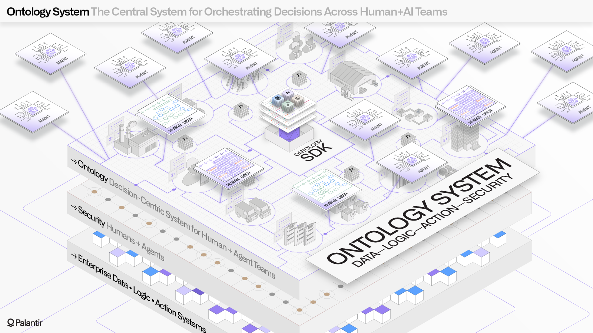
*팔란티어가 제시하는 "Ontology System" 개념도: 데이터·로직·액션·보안을 하나로 묶고, 그 위에서 사람과 AI 에이전트가 함께 일하는 구조*

---

## 2. 온톨로지 구성 요소

팔란티어는 온톨로지를 **Semantic**(무엇이 있는가)과 **Kinetic**(무엇을 할 수 있는가) 요소로 나눕니다.

| 구분 | 요소 | 설명 | OWL 대응 개념(참고) |
|---|---|---|---|
| Semantic | **Object type** | 현실 세계 엔티티/이벤트의 스키마. 기본 키, 타이틀, 백킹 데이터소스를 가짐 | Class |
| | **Object** | Object type의 인스턴스 (예: Airport 타입의 JFK) | Individual |
| | **Property** | 타입이 있는 속성 (string, integer, date, array, geo, time series 등) | Data property |
| | **Link type** | 두 Object type 사이의 관계. 1:1, 1:N, N:N 카디널리티 | Object property |
| | **Interface** | 여러 Object type이 공유하는 추상 형태 (다형성) | 상위 클래스·공통 속성과 유사 |
| | **Shared property / Value type** | 여러 타입에서 재사용하는 속성과 값 제약 | Datatype 제약과 유사 |
| Kinetic | **Action type** | 사용자가 한 번에 수행하는 **객체·속성·링크 변경 묶음**. 파라미터, 규칙, 제출 조건, 부수효과(알림, 웹훅) 포함 | (대응 없음) |
| | **Function** | TypeScript/Python 서버 로직. 온톨로지를 읽고 계산하고 수정 | (SWRL과 일부 유사) |
| | **Object set** | 필터나 검색으로 만든 객체 집합. 함수, 앱, 액션의 입력 | DL Query 결과와 유사 |

**예시: 항공 온톨로지** (공식 문서)
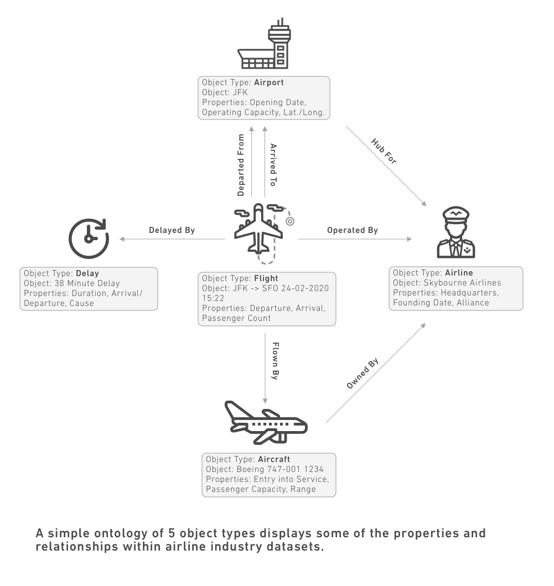
- Object type 5개: Airport, Flight, Aircraft, Airline, Delay
- Link type: Departed From / Arrived To, Operated By, Flown By, Owned By, Delayed By, Hub For

> **핵심 차이:** OWL은 "클래스와 논리적 제약 → 추론기로 새 사실 도출"이 중심입니다. 팔란티어는 논리 추론기가 없는 대신, **실제 데이터와 연결된 객체에 대해 "액션(쓰기)"과 "권한"을 정의해서 업무 시스템처럼 운영**하는 것이 중심입니다.

---

## 3. 화면별 기능

### 3-1. Ontology Manager: 온톨로지 홈 (Discover)
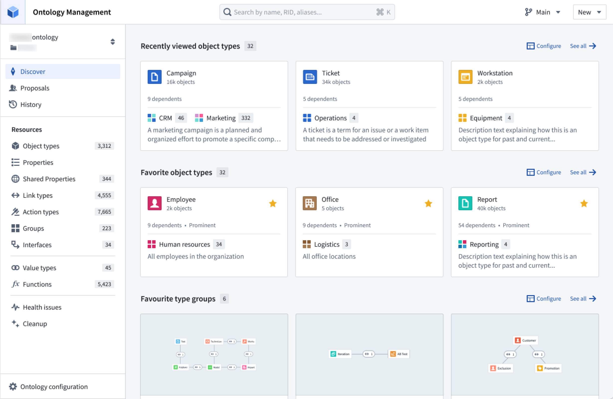

| 영역 | 기능 |
|---|---|
| 상단 검색창 | 이름, RID, 별칭(alias)으로 온톨로지 리소스 검색 (`⌘K`) |
| 상단 우측 **브랜치 선택**(`Main`) / **New** | 온톨로지를 **브랜치에서 수정**하고 병합 가능 (Git과 유사한 변경 관리). 새 리소스 생성 |
| 좌측 Discover / **Proposals** / **History** | 탐색, 변경 제안(리뷰·승인 흐름), 변경 이력 |
| 좌측 Resources | Object types, Properties, Shared Properties, Link types, Action types, Groups, Interfaces, Value types, Functions의 목록과 개수 |
| 좌측 Health issues / Cleanup | 깨진 데이터소스, 사용하지 않는 리소스 같은 품질 이슈 점검 |
| 본문 카드 | 최근 본/즐겨찾기 Object type(객체 수, 의존 앱 수), **Type group**(업무 도메인별 묶음과 미니 그래프) |

### 3-2. Ontology Manager: Object type 상세
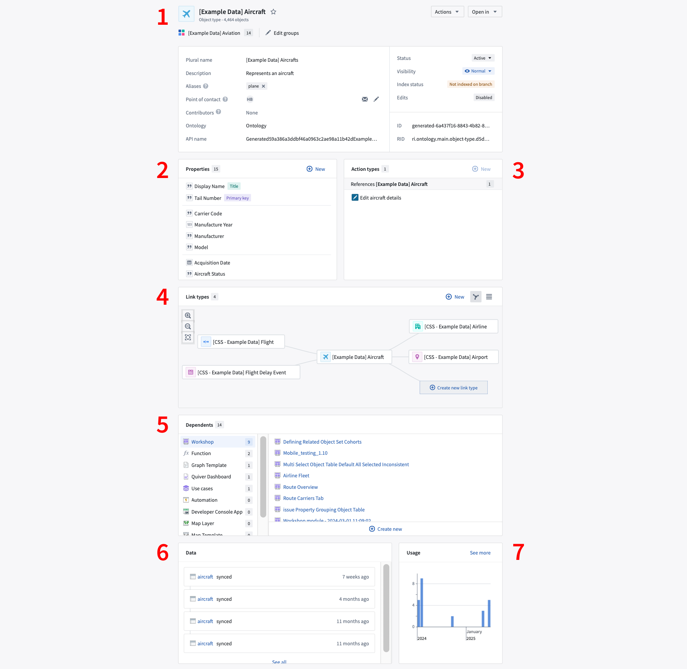

| 번호 | 영역 | 기능 |
|---|---|---|
| 1 | 메타데이터 | 표시 이름, 복수형, 설명, **별칭**, 담당자, API name, 상태(Active/Experimental 등), 가시성, 인덱싱 상태, 편집 허용 여부 |
| 2 | Properties | 속성 목록. **Title**(표시 이름)과 **Primary key** 지정 |
| 3 | Action types | 이 타입을 참조하는 액션 (예: "Edit aircraft details") |
| 4 | Link types | 연결된 Object type들을 **그래프로 시각화**. 그래프에서 새 링크 생성 |
| 5 | Dependents | 이 타입을 쓰는 Workshop 앱, Function, Quiver 대시보드, Automation 등. **변경 영향 분석**에 사용 |
| 6 | Data | 백킹 데이터셋과 동기화 상태 |
| 7 | Usage | 조회·사용량 추이 |

좌측 메뉴(아래 이미지): Overview, Properties, **Security**, **Datasources**, Capabilities, **Object views**, **Interfaces**, **Automations**, Usage
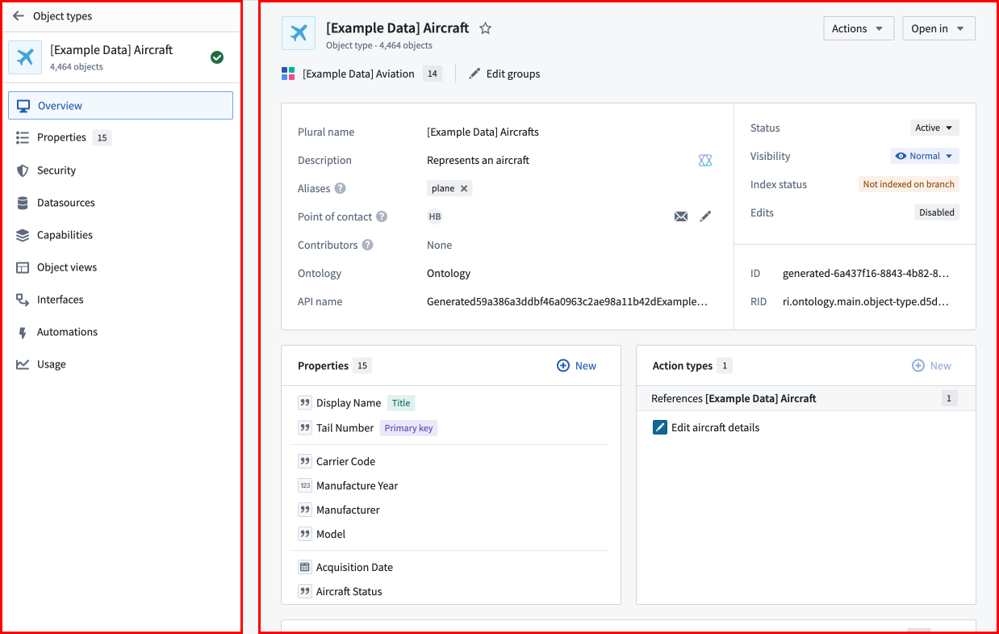

### 3-3. Ontology Manager: 속성 편집기 (컬럼 매핑)
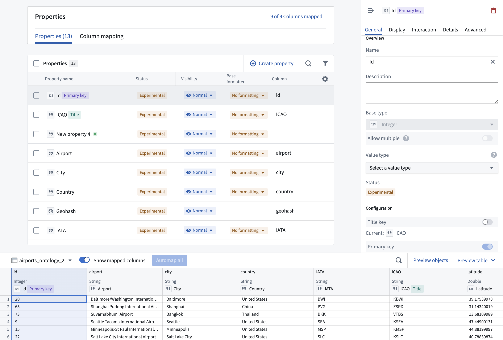
- 상단: 속성 목록(상태, 가시성, 포맷터, **매핑된 컬럼**). `9 of 9 Columns mapped`처럼 매핑 현황 표시
- 우측 패널: 이름, 설명, **Base type**(Integer/String/Double/Geohash…), Allow multiple(배열), **Value type**, Title key / Primary key 토글. 탭은 General, Display, Interaction, Details, Advanced
- 하단: **백킹 데이터셋 미리보기**(`airports_ontology_2`). 컬럼 ↔ 속성 매핑, `Automap all` 자동 매핑, `Preview objects`
- 👉 **데이터 테이블이 곧 객체가 되는 구조**를 가장 잘 보여주는 화면입니다.

### 3-4. Ontology Manager: Link type 설정
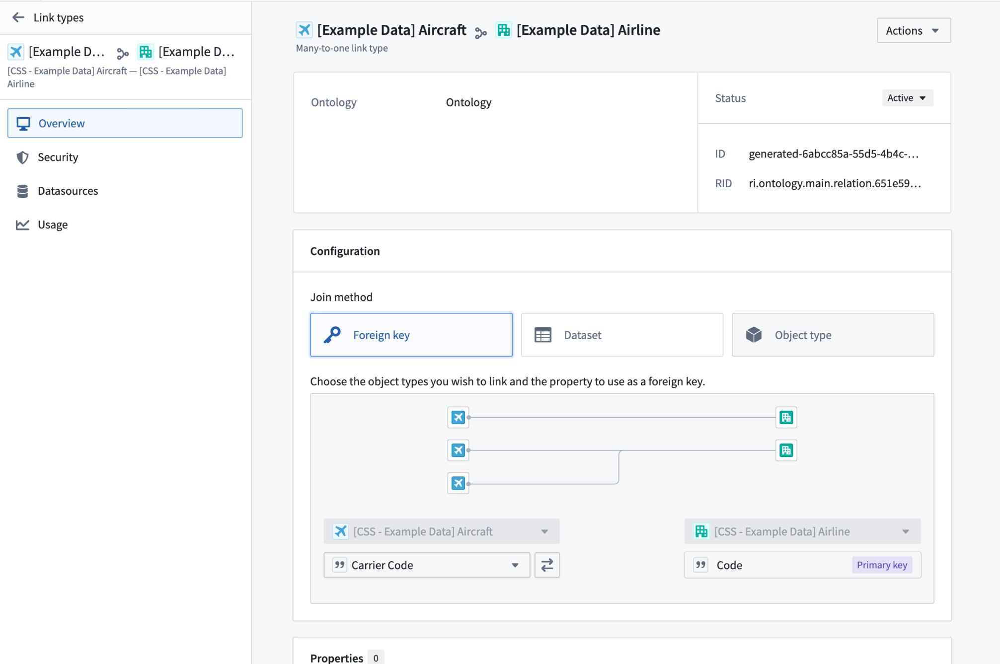
- 카디널리티 표시 (예: Aircraft → Airline **Many-to-one**)
- **Join method** 3가지:
  - **Foreign key**: 한쪽 속성(Carrier Code)이 다른 쪽 기본 키(Code)를 참조
  - **Dataset**: 조인 테이블로 N:N 연결
  - **Object type**: 링크 자체를 객체로 만들어 메타데이터 부여
- 좌측: Overview, Security, Datasources, Usage

### 3-5. Ontology Manager: Action type (쓰기 동작 정의)
**개요 화면**
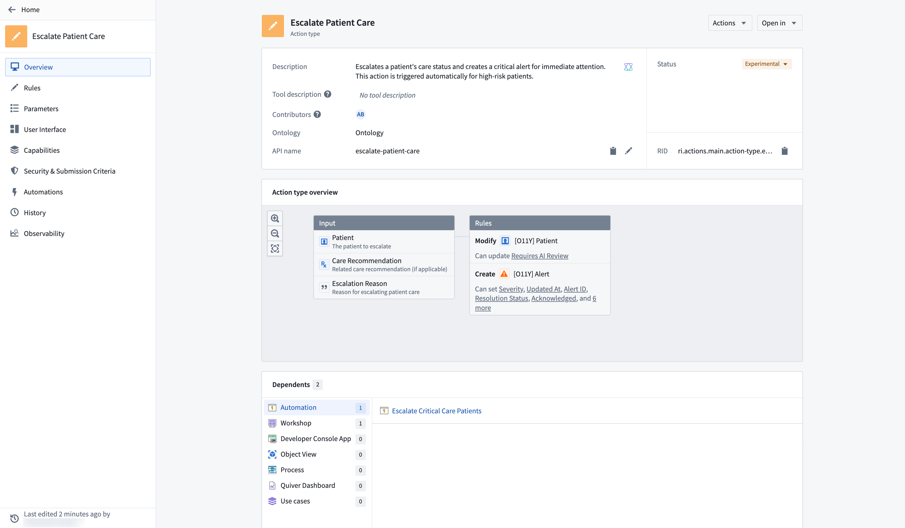
- 예: "Escalate Patient Care". **Input**(Patient, Care Recommendation, Escalation Reason 파라미터) → **Rules**(Patient 객체 **수정**, Alert 객체 **생성**)
- 좌측 메뉴: Rules, Parameters, User Interface, Capabilities, **Security & Submission Criteria**, **Automations**, History, **Observability**(실행 모니터링)
- **Tool description**: AI 에이전트가 이 액션을 "도구"로 호출할 때 쓰는 설명

**폼 편집기**: 사용자 입력 폼을 정의하고 오른쪽에서 실시간 미리보기
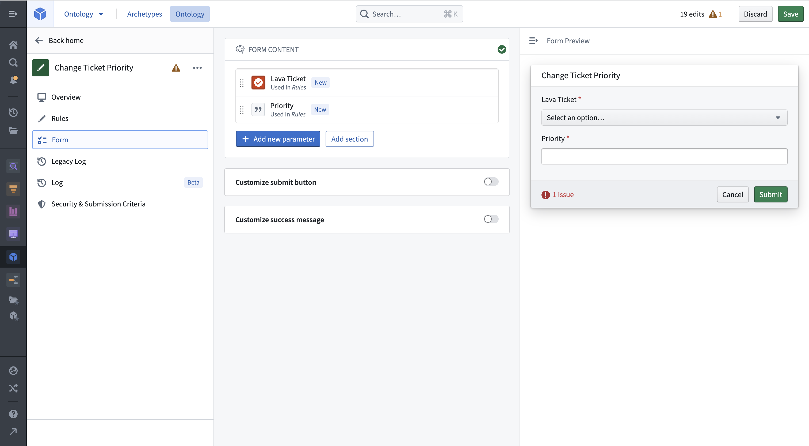

**제출 조건 (Submission Criteria)**: 누가, 어떤 조건에서 실행할 수 있는지
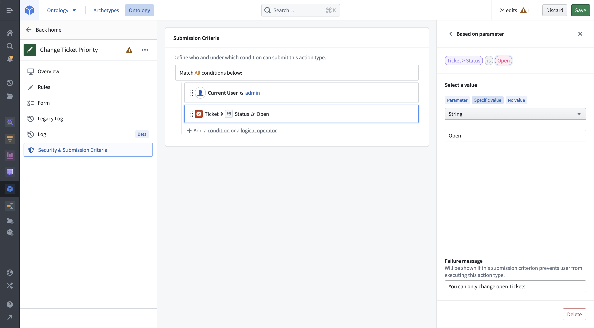
- 예: `Current User is admin` AND `Ticket > Status is Open`. 실패하면 "You can only change open Tickets" 메시지
- 상단 `24 edits` / `Discard` / `Save`: 여러 변경을 모아 한 번에 저장

### 3-6. Ontology Manager: Function
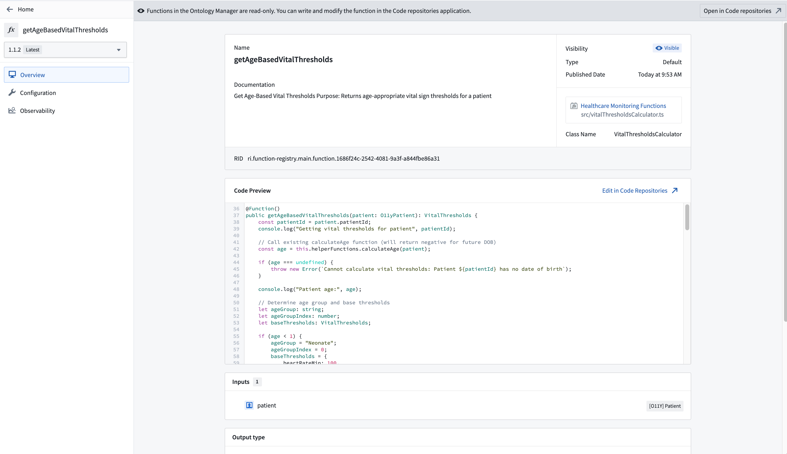
- Ontology Manager에서는 **읽기 전용**으로 보여주고, 수정은 **Code Repositories**에서 합니다.
- 버전(1.1.2 Latest), 문서, **코드 미리보기**(TypeScript `@Function()`), 입력(Patient 객체), 출력 타입, Observability

### 3-7. Object Explorer: 객체 검색과 탐색
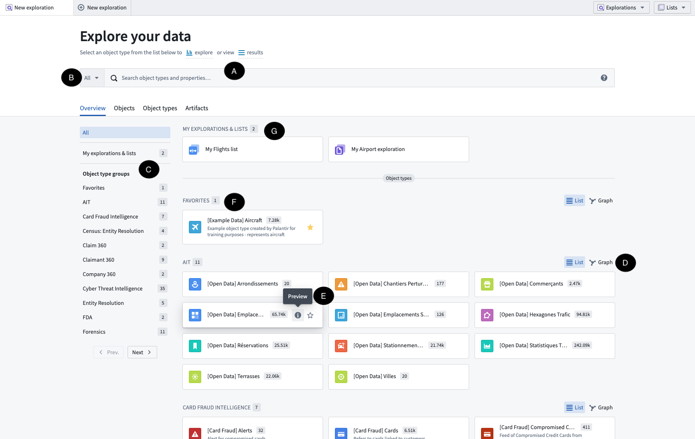

| 표시 | 기능 |
|---|---|
| A | 전체 Object type과 속성을 대상으로 키워드 검색 |
| B | 검색 범위 필터 |
| C | Object type group(업무 도메인별) 내비게이션 |
| D | List / **Graph** 보기 전환 |
| E | Object type 미리보기 |
| F | 즐겨찾기 |
| G | 저장한 탐색(Exploration)과 목록(List) |
- 일반 사용자(비개발자)가 **"데이터베이스"가 아니라 "업무 객체" 단위로 검색**하는 화면입니다. 결과는 대량 액션(bulk action)이나 내보내기로 이어집니다.

### 3-8. Object View: 객체 360° 화면
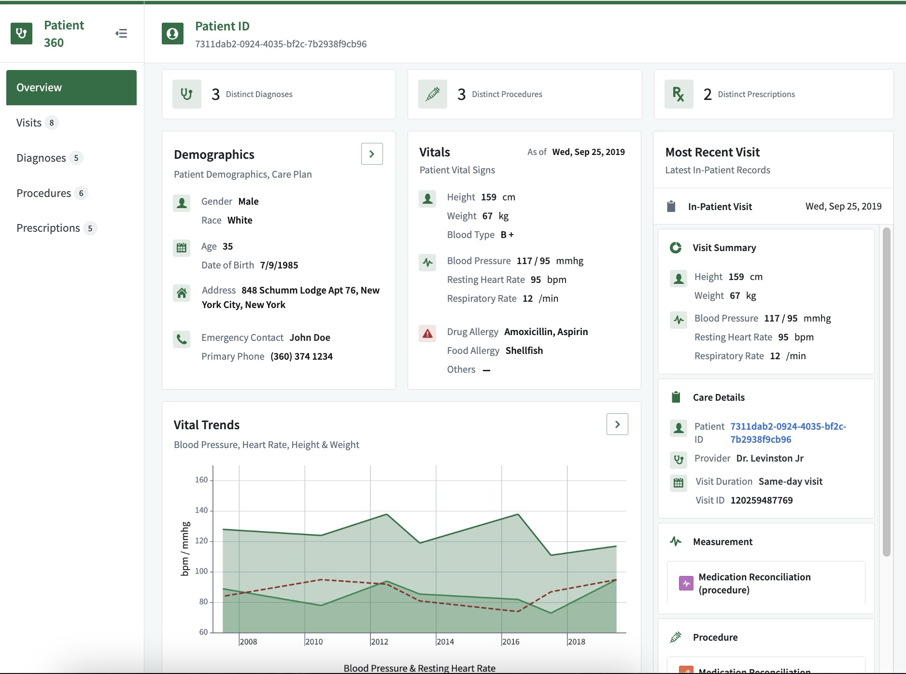
- 한 객체(예: 환자)의 속성, 연결 객체(방문, 진단, 처방), 시계열(활력징후 추이)을 **한 화면에 모은 기본 상세 화면**
- Object type마다 한 번 설정하면 모든 앱에서 재사용 (Core Object Views는 2026년 2월 GA)

### 3-9. Workshop: 로우코드 운영 앱 빌더
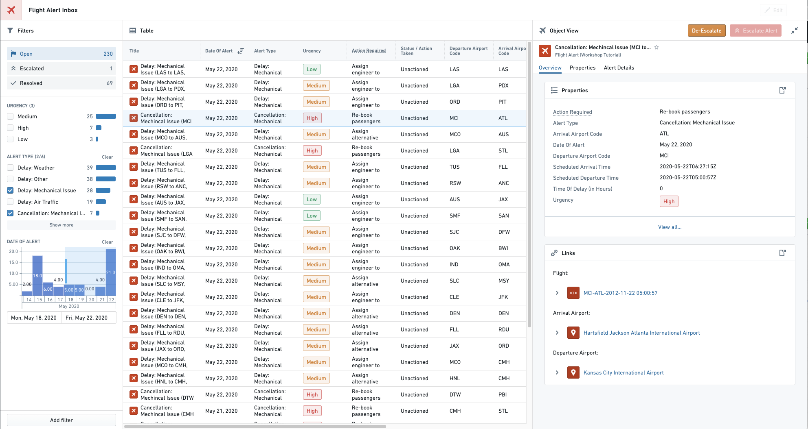
- 예: "Flight Alert Inbox". 좌측 **필터**(상태, 긴급도, 유형, 날짜 히스토그램) → 가운데 **객체 테이블** → 우측 **Object View**(속성, 링크)
- 우상단 **De-Escalate / Escalate Alert** 버튼 = **Action type 호출**. 화면에서 바로 데이터를 수정하는 운영 앱
- 드래그 앤 드롭 위젯 구성. 2026년 10월부터 온톨로지 **Interface** 지원이 기본으로 켜짐

### 3-10. Quiver: 객체·시계열 분석
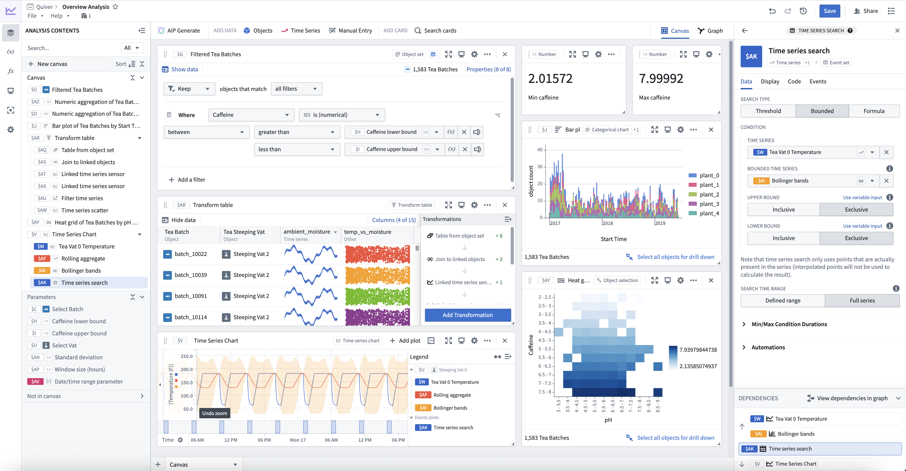
- 객체 집합 필터 → 변환 테이블 → 차트(막대, 히트맵, 시계열) → **파라미터 기반 대시보드**
- 시계열 검색(임계값, 볼린저 밴드 등), 카드 간 **의존성 그래프**, `AIP Generate`로 자연어 기반 카드 생성

### 3-11. Vertex: 시스템 그래프와 시뮬레이션
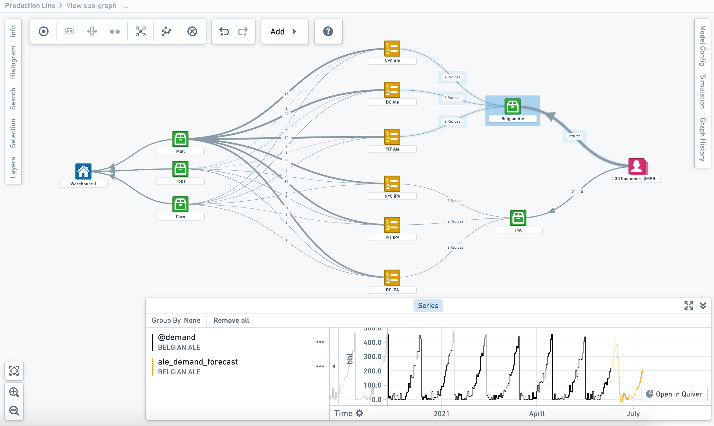
- 온톨로지 객체와 링크를 **흐름 그래프**로 시각화 (예: 창고 → 원재료 → 레시피 → 제품 → 고객)
- 하단에 수요와 예측 시계열. 우측 탭: Model Config, **Simulation**(what-if 분석), Graph History

### 3-12. Pipeline Builder: 데이터 파이프라인 (온톨로지의 입력단)
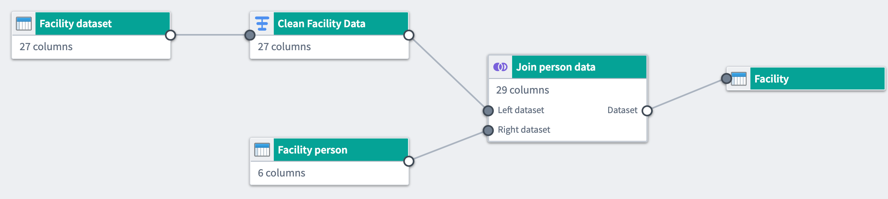
- 포인트 앤 클릭으로 데이터셋 → 정제 → 조인 → 출력. 배치와 스트리밍을 지원하며, 출력 데이터셋이 Object type의 백킹 데이터소스가 됩니다.

### 3-13. AIP Logic: 노코드 LLM 함수
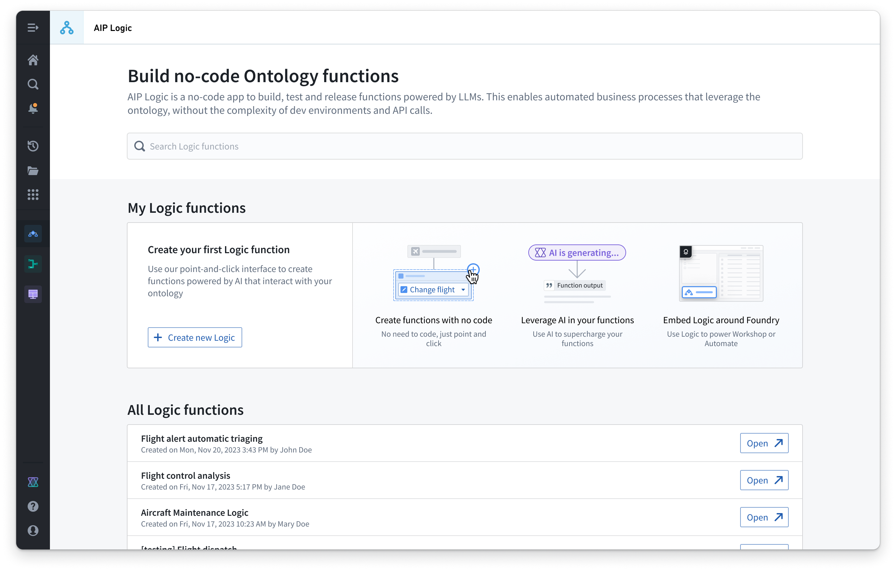
- "Build no-code Ontology functions". 온톨로지를 조회하고 수정하는 **LLM 기반 함수**를 블록 조합으로 만들고, 테스트하고, 배포
- 만든 함수는 Workshop이나 Automate(자동화 트리거)에 연결 (예: "Flight alert automatic triaging")

### 3-14. AIP Agent Studio: 에이전트 빌더
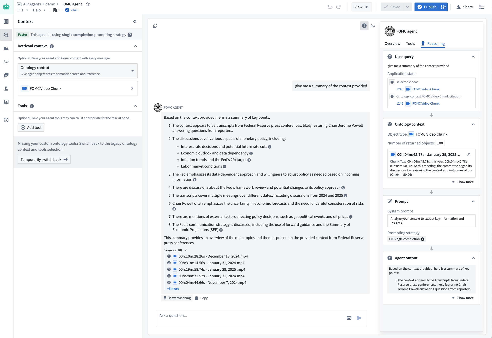
- 좌측 **Retrieval context**: 에이전트에 줄 Object set(시맨틱 검색 대상), **Tools**: 액션, 함수, 쿼리
- 가운데: 대화 테스트. 답변에 **출처 객체 인용**
- 우측 **Reasoning**: 사용자 질의 → 온톨로지 컨텍스트(반환된 객체) → 프롬프트 → 출력 과정을 추적
- 상단: 버전(v14.0), **Publish**, Share

### 3-15. AIP Analyst: 대화형 온톨로지 분석 (2026년 4월 GA)
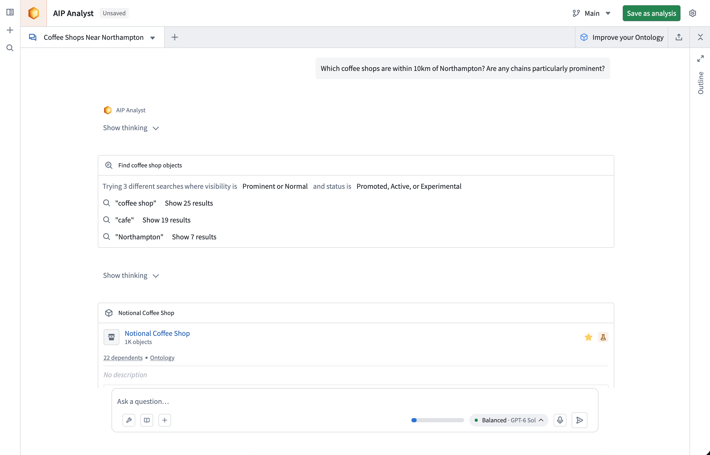
- 자연어 질문 → 관련 Object type 탐색 → 검색, 필터, 집계 → 분석 결과 저장 (`Save as analysis`)
- 우상단 **"Improve your Ontology"**: 분석 과정에서 드러난 온톨로지 개선점을 제안

### 3-16. OSDK (Ontology SDK) / Developer Console
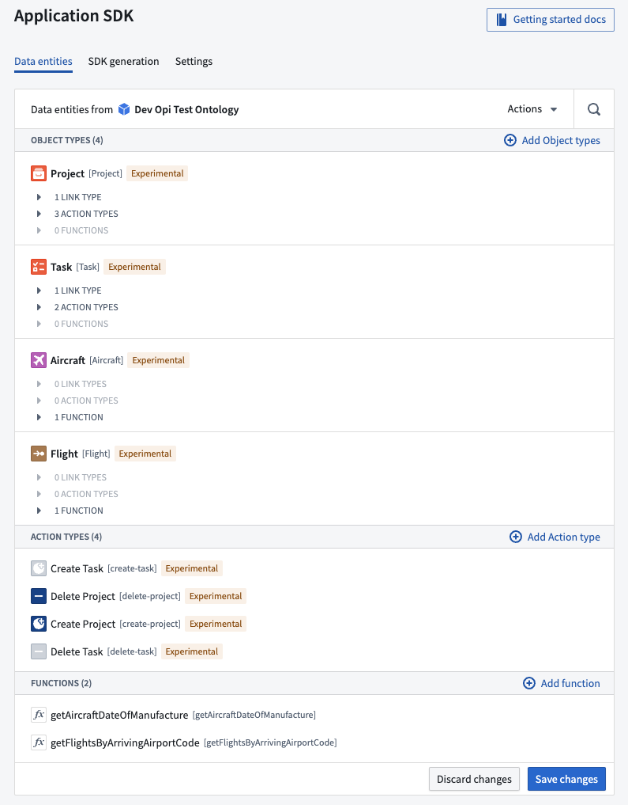
- 외부 앱에서 쓸 Object type, Action type, Function을 골라 **타입 안전한 SDK(TypeScript/Python/Java)를 자동 생성**합니다.
- 생성된 SDK로 React 등 자체 프론트엔드에서 온톨로지를 읽고 쓸 수 있습니다. 2026년 3월에는 자연어로 OSDK 앱을 생성하는 **Pilot**(베타)이 나왔습니다.

---

## 4. 2026년 주요 업데이트 (공식 Release Notes 기준)

| 시기 | 업데이트 |
|---|---|
| 2026-02 | **Core Object Views** GA |
| 2026-03 | **Pilot**(베타): 자연어 → React OSDK 앱 생성 |
| 2026-04 | **AIP Analyst** GA. 객체·속성 단위 **보안 정책** GA |
| 2026-06 | **Ontology MCP**, Palantir MCP GA (외부 AI 에이전트가 MCP로 온톨로지 접근). 보안 정책 테스트 도구 |
| 2026-07 | 프로코드 에이전트 개발·배포 도구 |
| 2026-08 | **SuperRepo**(온톨로지 앱용 모노레포). AIP Analyst에 Interface와 시계열 지원 |
| 2026-09 | AIP Evolve, Vulcan(CAD 리뷰 앱) |
| 2026-10 | Workshop의 Interface 지원 기본 활성화. AIP Analyst 조직 기본값, 그룹 스킬 |

> 흐름: **온톨로지를 AI 에이전트의 "컨텍스트 + 도구"로 쓰는 방향**(MCP, Agent Studio, Analyst)이 2026년 업데이트의 중심입니다.

---

## 5. 도입 방식, 가격, 배포

### 5-1. 접근 경로
| 경로 | 내용 | 현재 상태 (2026-10-27) |
|---|---|---|
| **AIP Developer Tier** (무료) | 개인 개발자용 Foundry/AIP 무료 환경 (용량 제한) | ⚠️ **2026-10-23 신규 가입 중단**. 대기자 명단만 등록 가능, 재개 일정 미정. 기존 가입자는 계속 사용 가능 |
| **AIP Bootcamp** | 팔란티어 엔지니어와 1~5일 동안 고객 데이터로 실제 유스케이스 구축 | 영업 문의 필요 |
| **정식 계약** | 엔터프라이즈 라이선스 + FDE(Forward Deployed Engineer) 지원 | 영업 문의 필요 |
| 학습 자료 | learn.palantir.com (Speedrun 등 튜토리얼), Developer Community | 공개 |

### 5-2. 가격
- **공식 가격표는 없습니다.** 모두 개별 협상입니다.
- 공개된 추정치(제3자, 참고용):
  - 기업 연간 약 **10만 달러 ~ 수백만 달러**. 첫 계약은 주로 50만~200만 달러 수준이라는 분석도 있음
  - 영국 정부 조달 자료 기준: 코어당 연 약 6.6만 파운드, 유스케이스 라이선스는 25만 파운드부터
  - 동일 규모라도 협상에 따라 2~3배 차이가 난다는 분석이 있음
- 첫해에는 구축(FDE, 컨설팅) 비용이 라이선스 비용을 넘는 경우가 많다고 알려져 있습니다.

### 5-3. 배포 형태
- 기본은 **팔란티어 관리형 SaaS**(퍼블릭 클라우드)입니다.
- 전용 인스턴스(Dedicated), 고객 클라우드, 온프레미스, **폐쇄망**까지 가능하며 Apollo가 이를 관리합니다.
- 미국 공공 인증(FedRAMP, DoD IL 등)을 보유하고 있습니다. 세부 등급은 공식 Trust 페이지에서 확인해야 합니다.

---

## 6. 시연 가능 여부와 대안

**현 시점에서는 Protégé처럼 직접 설치해서 시연할 수 없습니다.**
- 설치형 소프트웨어가 아니라 계정 기반 SaaS입니다.
- 유일한 무료 경로인 Developer Tier의 신규 가입이 **3일 전(2026-10-23)부터 중단**되었습니다.

**대안 (권장 순서)**
1. **Developer Tier 대기자 명단 등록** → 재개되면 바로 가입 (https://www.palantir.com 의 Developer Tier 페이지 또는 Developer Community 공지)
2. 사내에 **기존 Developer Tier 계정 보유자**가 있으면 그 계정으로 시연 (기존 계정은 정상 사용 가능)
3. 국내 파트너사 또는 팔란티어 코리아를 통해 **데모나 AIP Bootcamp 요청**
4. 공식 시연 영상과 문서로 대체: learn.palantir.com, Palantir 공식 YouTube(AIPCon 데모), 이 보고서의 화면 캡쳐
5. **개념 시연은 오픈소스로 대체**: WebProtégé에서 같은 도메인(예: 항공) 온톨로지를 구성해 "객체·관계 모델링" 부분을 비교 시연할 수 있습니다. 액션, 운영 앱, AI 에이전트 부분은 대응하는 오픈소스 도구가 없습니다.

---

## 7. Protégé / WebProtégé와 비교

| 항목 | Protégé Desktop | WebProtégé | Palantir Foundry/AIP |
|---|---|---|---|
| 라이선스 | 오픈소스(BSD), 무료 | 오픈소스(BSD), 무료 | 상용, 비공개 가격 |
| 표준 | **OWL 2, RDF**, SWRL, SPARQL(플러그인) | OWL, OBO | **독자 객체 모델**. OWL/RDF 네이티브 입출력은 공식 문서에서 확인되지 않음. REST API와 JSON 기반 설정으로 연동 |
| 모델링 대상 | 개념, 논리 공리 | 개념, 공리(협업) | **실데이터에 연결된** 객체, 링크, 액션, 함수 |
| 데이터 연결 | 없음 (개체를 수동 입력하거나 플러그인 사용) | 없음 | **핵심 기능**. 데이터셋 컬럼 ↔ 속성 매핑, 파이프라인, 리니지 |
| 추론 | **DL 추론기**(HermiT, ELK, Pellet). 분류, 일관성 검사 | 없음 | 형식 논리 추론기 없음. 대신 Function/LLM 기반 계산과 판단 |
| 쓰기/업무 처리 | 없음 | 없음 | **Action type**(검증, 권한, 부수효과, 감사 로그) |
| 앱 개발 | 없음 | 없음 | Workshop(로우코드), Slate, OSDK(프로코드) |
| AI | 없음 | 없음 | AIP Logic, Agent Studio, Analyst, **Ontology MCP** |
| 협업 | 없음 | 권한, 이력, 토론 | 브랜치, 제안(Proposal) 리뷰, 히스토리, 세분화된 보안(마킹, 행·열 수준) |
| 설치/시연 | 즉시 가능 (본 조사에서 실행 완료) | Docker로 즉시 가능 (본 조사에서 실행 완료) | 계정 필요. **현재 무료 가입 중단** |
| 적합한 용도 | 표준 기반 지식 모델 설계와 검증 | 다수 전문가의 어휘·온톨로지 공동 편집 | 기업 데이터 통합 + 운영 의사결정 + AI 자동화 |

**정리하면:**
- Protégé 계열은 **"개념을 정확하게 정의하고 논리적으로 검증하는 도구"**입니다.
- 팔란티어는 **"정의한 개념에 실제 데이터를 붙이고, 그 위에서 사람과 AI가 업무를 실행하는 플랫폼"**입니다.
- 실무에서는 OWL로 설계한 도메인 모델을 팔란티어 Object/Link type 설계의 **참조 모델**로 쓰는 식으로 보완 관계가 될 수 있습니다. 단, 자동 변환 도구는 확인되지 않아 수작업이나 API로 매핑해야 합니다.

---

## 8. 국내 동향 (언론 보도 기준, 참고)
- **HD현대**: 조선 분야 협력. 팔란티어 측은 실제 선박에 모델과 온톨로지를 엣지로 배포했다고 언급했습니다 (2026-10 서울 행사 보도).
- 팔란티어는 한국을 "미국을 제외한 가장 강한 시장"으로 언급했습니다 (2026-10 보도).
- **LG CNS**: 2026년 3월 전략적 파트너십 확대로 알려져 있습니다 (블로그 출처라 원문 확인 필요).
- **KT**: 팔란티어 공식 파트너 합류, 한국형 AIP 부트캠프 추진 (보도 시점 확인 필요).
- 국내 도입 논의에서는 공통적으로 **FDE 상주 모델과 조직 체질 변화**가 성패 요인으로 강조됩니다.

---

## 9. 출처
**공식 문서**
- Ontology 개요: https://www.palantir.com/docs/foundry/ontology
- Core concepts: https://www.palantir.com/docs/foundry/ontology/core-concepts
- Types reference: https://palantir.com/docs/foundry/object-link-types/type-reference/
- Foundry platform summary: https://www.palantir.com/docs/foundry/getting-started/foundry-platform-summary-llm/
- Ontology Manager: https://www.palantir.com/docs/foundry/ontology-manager/overview/
- Action types: https://www.palantir.com/docs/foundry/action-types/getting-started/
- Object Explorer: https://www.palantir.com/docs/foundry/object-explorer/getting-started/
- Object Views / Workshop / Quiver / Vertex / Pipeline Builder / AIP Logic / Agent Studio / AIP Analyst / OSDK: `https://www.palantir.com/docs/foundry/{object-views,workshop,quiver,vertex,pipeline-builder,logic,agent-studio,aip-analyst,ontology-sdk}/overview/`
- 2026 Release notes: https://www.palantir.com/docs/foundry/announcements/2026-10 (월별 페이지)
- 상호운용성: https://palantir.com/docs/foundry/architecture-center/interoperability/

**Developer Tier**
- 가입 중단 공지 (2026-10-23): https://community.palantir.com/t/a-quick-update-on-aip-developer-tier/7404
- 과금 관련 Q&A: https://community.palantir.com/t/developer-tier-billing-and-usage/1074
- Speedrun 튜토리얼: https://learn.palantir.com/speedrun-your-e2e-aip-workflow

**가격·배포 (제3자, 참고용)**
- InfoWorld, Palantir Foundry vs Snowflake: https://infoworld.com/article/4209881/palantir-foundry-vs-snowflake.html
- Redress Compliance: https://redresscompliance.com/palantir-aip-foundry-negotiation.html
- bdemerson, Palantir cost: https://www.bdemerson.com/article/palantir-cost
- Palantir Blog, A sky full of clouds: https://blog.palantir.com/a-sky-full-of-clouds-218b9db3f735
- Palantir Blog, Apollo: https://blog.palantir.com/palantir-apollo-powering-saas-where-no-saas-has-gone-before-7be3e565c379
- Computer Weekly, Inside FDP part 3: https://www.computerweekly.com/opinion/Inside-FDP-part-3-The-data-architecture-that-makes-it-work

**국내 동향**
- 세계일보: https://www.segye.com/newsView/20261022517949
- SBS Biz: https://biz.sbs.co.kr/article/20000341550
- 디일렉 (KT 파트너): https://www.thelec.kr/news/articleView.html?idxno=33646
- cliwant 블로그 (LG CNS·HD현대): https://www.cliwant.com/blog/palantir-korea-landing
- 네이트 뉴스 (2026-04): https://m.news.nate.com/view/20260417n19598
