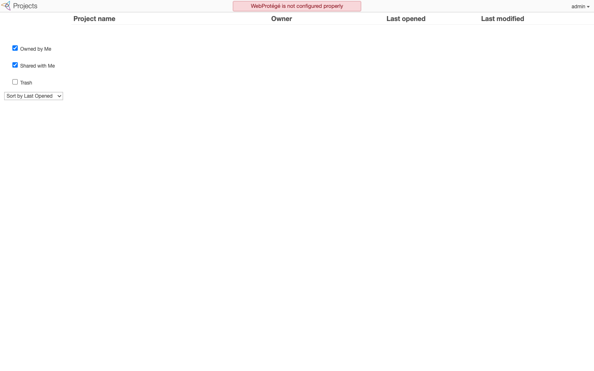
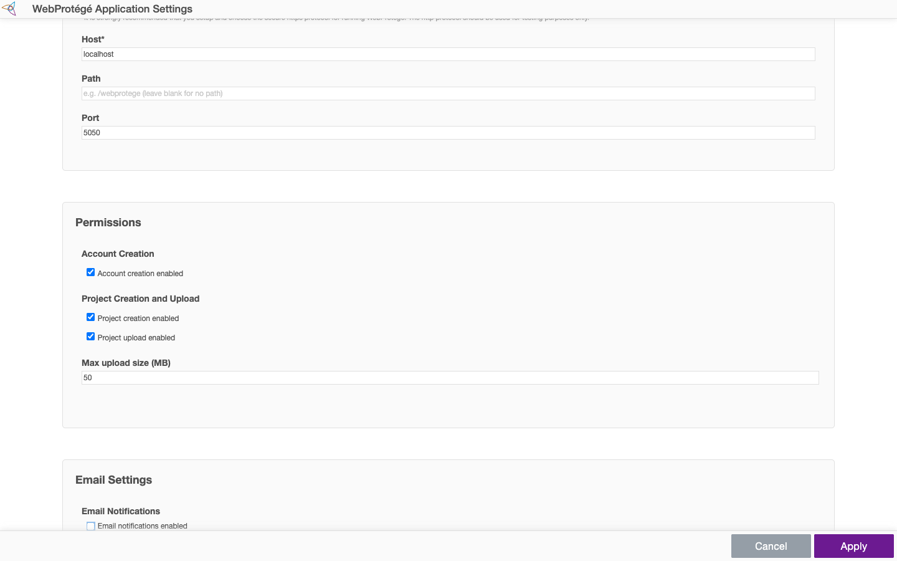
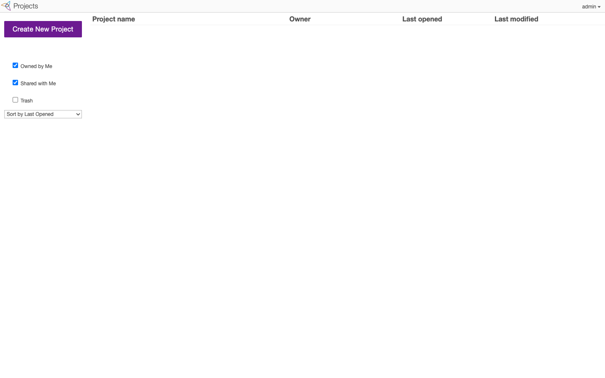
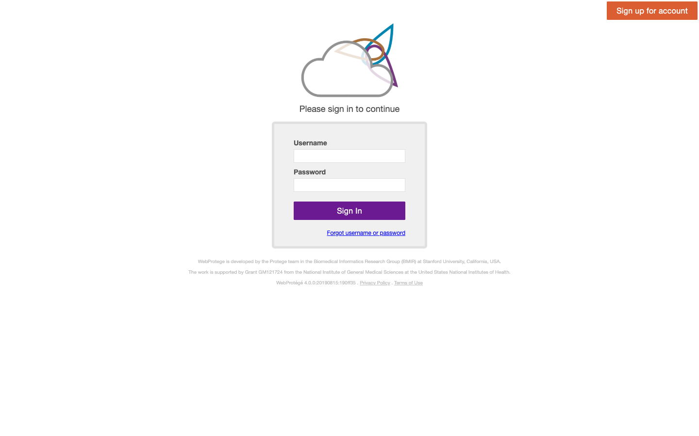
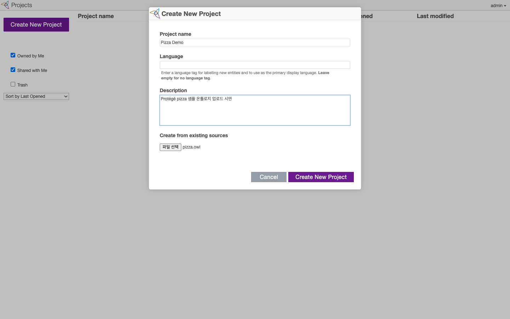
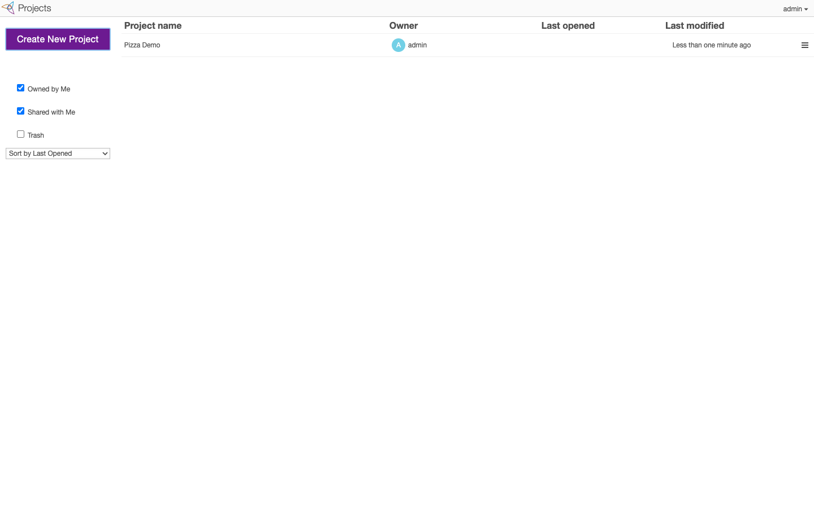
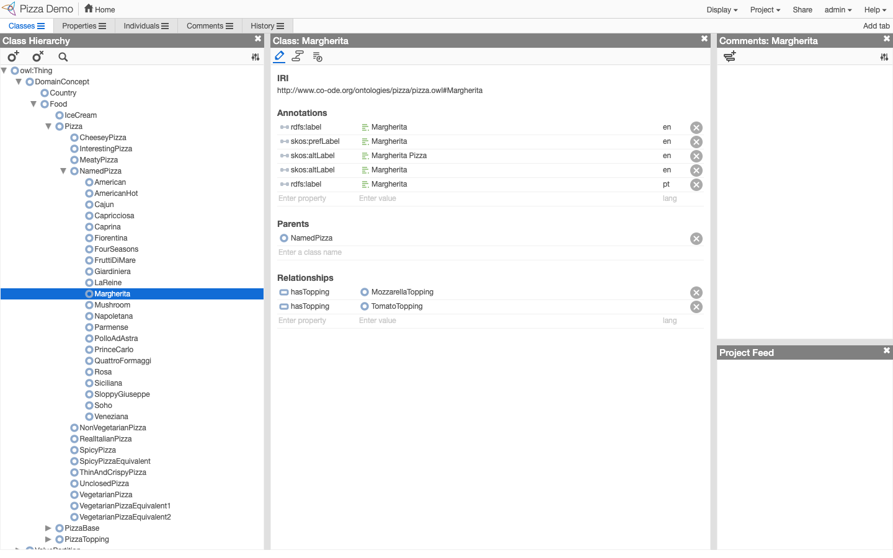
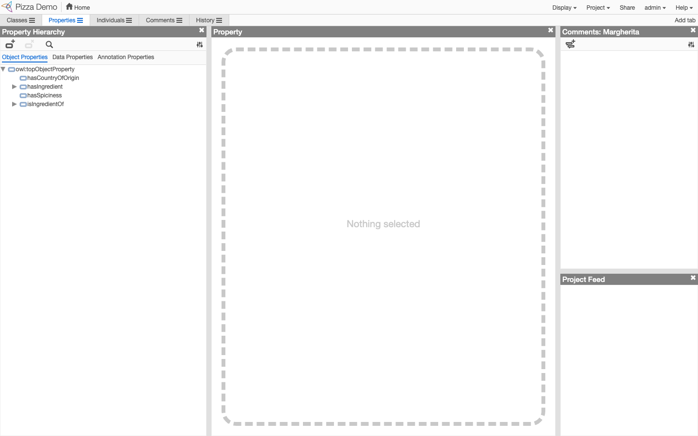
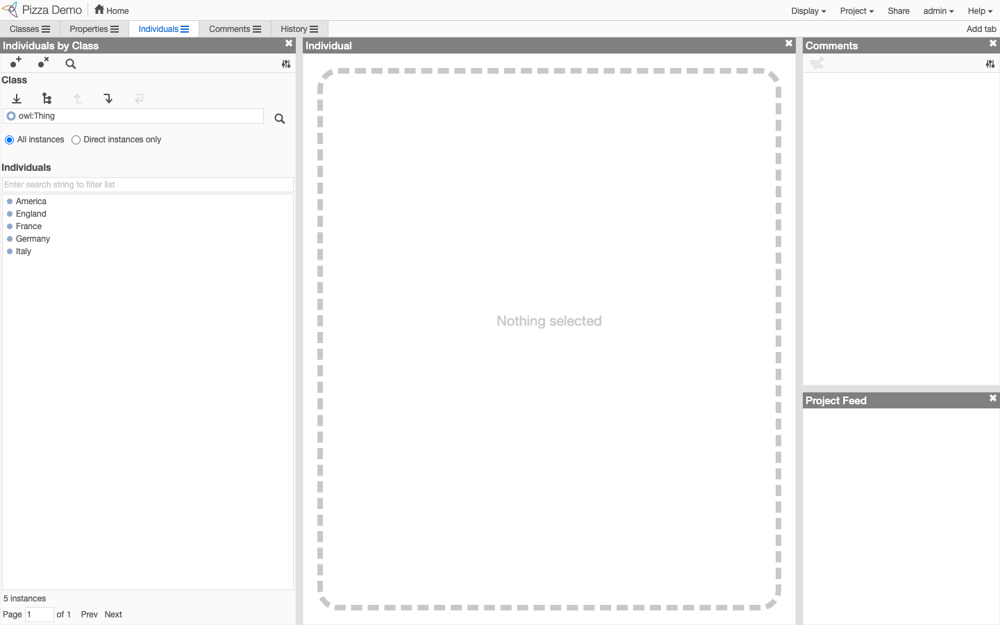
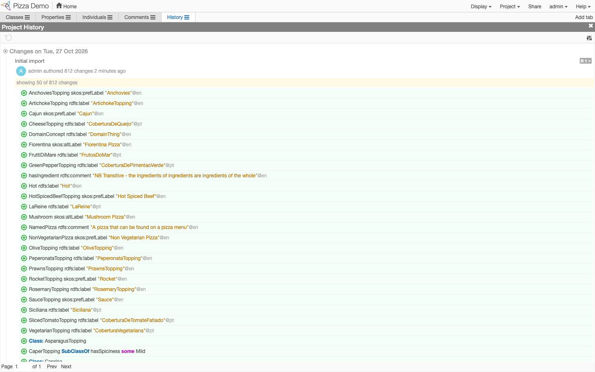

# Protégé Desktop / WebProtégé 설치 및 실행 가이드 (시연 기록 포함)

> 작성일: 2026-10-27
> 연관 문서: [protege-ui-features.md](protege-ui-features.md) (화면별 기능 정리)
> 이 문서의 모든 절차는 아래 환경에서 **실제로 실행하고 결과를 확인**한 기록입니다.

## 0. 시연 환경 및 결과 요약

| 항목 | 값 |
|---|---|
| OS | macOS 26.6.2 (Apple Silicon, arm64) |
| Docker | Docker Desktop (Engine 29.7.2, Compose v5.3.1) |
| Protégé Desktop | **5.6.9** (2026-03-07 릴리스) |
| WebProtégé | **4.0.2** (Docker Hub `protegeproject/webprotege` 이미지) |
| 샘플 온톨로지 | Pizza ontology – https://protege.stanford.edu/ontologies/pizza/pizza.owl |

| 대상 | 결과 | 확인 방법 |
|---|---|---|
| Protégé Desktop 설치 및 실행 | ✅ 성공 | 앱이 실행되고 pizza.owl을 로딩함 (로그: `successfully completed in 10691 ms`) |
| WebProtégé 설치 및 실행 | ✅ 성공 | http://localhost:5050 에 접속, 관리자 로그인, 프로젝트 생성, 편집 화면까지 캡쳐 |

시연 산출물 폴더:
```
demo/
├── protege-desktop/app/Protege-5.6.9/Protégé.app   # Desktop 앱
├── samples/pizza.owl                                # 시연용 온톨로지
├── webprotege/
│   ├── docker-compose.yml                           # 공식 파일 (원본 그대로)
│   ├── docker-compose.override.yml                  # macOS용 수정 사항
│   ├── admin-credentials.local.txt                  # 로컬 관리자 계정 (권한 600)
│   └── wp_demo.py                                   # 브라우저 자동 시연 스크립트(Playwright)
└── screenshots/                                     # 시연 캡쳐 및 로그
```

---

## 1. Protégé Desktop

### 1-1. 사전 요구사항
- **별도의 Java 설치가 필요 없습니다.** 플랫폼별 배포본에 JRE(OpenJDK 11.0.25)가 포함되어 있습니다.
- 디스크 약 300MB, 메모리 4GB 이상 권장 (대형 온톨로지는 8GB 이상)
- 배포본에 기본 포함된 플러그인: HermiT 1.4.3, ELK 0.6.0 (추론기), SPARQL Query, DL Query, OntoGraf, OWLViz, SWRLTab, Explanation Workbench, Cellfie, OWLDoc 등

### 1-2. 다운로드
- 공식 페이지: https://protege.stanford.edu → Download
- GitHub 릴리스: https://github.com/protegeproject/protege-distribution/releases

| OS | 파일 | 크기 |
|---|---|---|
| macOS (Intel/Apple Silicon 공용, Universal) | `Protege-5.6.9-mac.zip` | 약 112MB |
| Windows | `Protege-5.6.9-win.zip` | 약 109MB |
| Linux | `Protege-5.6.9-linux.tar.gz` | 약 109MB |
| JRE 미포함(직접 Java 11+ 설치 시) | `Protege-5.6.9-platform-independent.zip` | 약 68MB |

### 1-3. 설치 및 실행: macOS (이번 시연에서 사용한 방법)
```bash
# 1) 다운로드 및 압축 해제
mkdir -p demo/protege-desktop && cd demo/protege-desktop
curl -L -o Protege-5.6.9-mac.zip \
  https://github.com/protegeproject/protege-distribution/releases/download/protege-5.6.9/Protege-5.6.9-mac.zip
unzip -q Protege-5.6.9-mac.zip -d app

# 2) (선택) 다운로드 격리 속성 제거. "확인되지 않은 개발자" 경고를 피하기 위함
xattr -dr com.apple.quarantine "app/Protege-5.6.9/Protégé.app"

# 3) 실행 (온톨로지 파일을 인자로 넘기면 바로 열림)
open "app/Protege-5.6.9/Protégé.app" --args "$PWD/../samples/pizza.owl"
```
- GUI로 설치할 때는 zip을 풀고 `Protégé.app`을 `/Applications`로 옮긴 뒤 더블클릭하면 됩니다.
- 처음 실행할 때 "확인되지 않은 개발자" 경고가 뜨면 **시스템 설정 → 개인정보 보호 및 보안 → "확인 없이 열기"**를 누르세요.

### 1-4. 설치 및 실행: Windows / Linux
```text
[Windows]
1. Protege-5.6.9-win.zip 압축 해제 (경로에 한글/공백이 없는 곳 권장, 예: C:\tools\Protege-5.6.9)
2. Protege.exe 실행 (또는 run.bat)

[Linux]
tar xzf Protege-5.6.9-linux.tar.gz
cd Protege-5.6.9 && ./run.sh
```
- 메모리를 늘리려면 Windows는 `Protege.l4j.ini`, Linux/플랫폼 독립 버전은 `run.sh`(또는 `run.bat`)의 `-Xmx` 값을 수정합니다. macOS는 `Protégé.app/Contents/conf/jvm.conf`를 수정합니다.

### 1-5. 실행 확인 결과 (이번 시연)
로그 파일 `~/.Protege/logs/protege.log`에서 확인한 내용 (발췌는 [demo/screenshots/desktop-launch-log.txt](demo/screenshots/desktop-launch-log.txt)에 저장):
```
20:46:23 Launcher            Initialising and Starting the OSGi Framework
20:46:25 OWLModelManagerImpl Loading ontology from file:.../demo/samples/pizza.owl
20:46:36 OntologyLoader      Finished loading file:.../demo/samples/pizza.owl
20:46:36 OWLModelManagerImpl Loading for ontology and imports closure successfully completed in 10691 ms
20:46:37 OboFoundryRegistryManager  OBO Foundry registry loaded: 267 entries
```
- 앱 실행부터 pizza.owl 로딩 완료까지 약 13초 걸렸습니다.
- 시작할 때 플러그인 자동 업데이트 확인(Auto-Update)이 백그라운드로 돌기 때문에 **인터넷 연결**이 있으면 플러그인 업데이트 알림이 뜰 수 있습니다.

> ⚠️ **Desktop 화면 캡쳐는 이번 기록에 없습니다.** 작업 환경(VS Code)에 macOS "화면 기록" 권한이 없어 `screencapture`가 실패했습니다. 앱 창은 실제로 화면에 떠 있었습니다. 직접 캡쳐하려면 `⌘+Shift+4 → Space`로 창을 캡쳐하세요. 공식 화면 예시는 [protege-ui-features.md](protege-ui-features.md)에 있습니다.

### 1-6. 시연 시나리오 (직접 해볼 순서, 약 10분)
| # | 동작 | 메뉴/위치 | 확인 포인트 |
|---|---|---|---|
| 1 | 샘플 열기 | `File > Open...` → `demo/samples/pizza.owl` (또는 `File > Open from URL...` → 위 pizza URL) | Active Ontology 탭에 IRI와 메트릭(Class 100개, DL expressivity SHOIN 등) 표시 |
| 2 | 클래스 탐색 | `Entities` 탭 → `Classes` → `Pizza > NamedPizza > Margherita` | Description의 SubClass Of에 `hasTopping some MozzarellaTopping` 같은 제약이 보임 |
| 3 | 클래스 추가 | Class hierarchy 툴바의 "Add subclass" 버튼 → 이름 `KoreanPizza` | 트리에 새 클래스가 생기고 IRI가 자동 생성됨 |
| 4 | 제약 추가 | Description → SubClass Of `+` → Class expression editor에 `hasTopping some MeatTopping` | Manchester 구문 자동완성(Ctrl+Space), 잘못된 이름은 빨간 밑줄로 표시 |
| 5 | **추론 실행** | `Reasoner > HermiT 1.4.3` 선택 → `Reasoner > Start reasoner` (⌘R) | Class hierarchy를 `Inferred`로 바꾸면 `CheeseyPizza`, `VegetarianPizza` 등 **defined class 아래로 자동 분류**된 결과가 노란 배경으로 표시됨 |
| 6 | 추론 근거 보기 | 추론된 행 오른쪽 `?`/`@` 버튼 | Explanation 창에 추론 근거 공리 목록 |
| 7 | 불일치 확인 | `owl:Nothing` 아래 빨간 클래스 확인 (예: `IceCream`의 의도적 오류) | 만족 불가능한 클래스 검출 |
| 8 | DL Query | `Window > Tabs > DL Query` → `Pizza and hasTopping some CheeseTopping` → Execute | 조건을 만족하는 하위 클래스와 개체 목록 |
| 9 | 시각화 | `Window > Tabs > OntoGraf` | 클래스 관계 그래프 |
| 10 | 저장 | `File > Save as...` → 포맷 선택 (RDF/XML, Turtle, OWL/XML, Manchester 등) | 다른 포맷으로 내보내기 |

---

## 2. WebProtégé

### 2-1. 사용 방식 두 가지
| 방식 | 장점 | 단점 |
|---|---|---|
| **A. 공식 호스팅** https://webprotege.stanford.edu | 설치가 필요 없음. 가입 후 바로 사용 | 외부(Stanford) 서버에 데이터가 저장됨. 사내 보안 정책 확인 필요 |
| **B. Docker 자체 설치** (이번 시연 방식) | 사내/로컬에 데이터 보관, 관리자 설정을 직접 제어 | Docker 필요, 초기 설정 필요 |

방식 A: 가입(Sign up for account) → 로그인 → `Create New Project`. 이후 단계는 2-4와 같습니다.

### 2-2. 방식 B: Docker로 로컬 설치 (실행 확인 완료)
**사전 요구사항**: Docker Desktop (또는 Docker Engine + Compose v2), 메모리 4GB 이상 여유

**구성**: 컨테이너 2개
- `webprotege` – Tomcat 위 WebProtégé 웹앱 (컨테이너 8080 포트)
- `webprotege-mongodb` – MongoDB 4.1 (사용자, 프로젝트 메타데이터 저장)

#### Step 1. compose 파일 준비
```bash
mkdir -p demo/webprotege && cd demo/webprotege
curl -L -o docker-compose.yml \
  https://raw.githubusercontent.com/protegeproject/webprotege/master/docker-compose.yml
```

#### Step 2. (macOS 필수) override 파일 작성
공식 compose 파일을 macOS에서 그대로 실행하면 **아래 문제 2가지가 실제로 발생했습니다** (2-5 트러블슈팅 참고). 그래서 다음 파일을 추가했습니다.

`docker-compose.override.yml`
```yaml
services:
  webprotege:
    platform: linux/amd64          # 공식 이미지가 amd64 전용 → Apple Silicon은 에뮬레이션
    ports: !override
      - 5050:8080                  # macOS 5000 포트는 AirPlay 수신기가 사용 중
    volumes: !override
      - wp-data:/srv/webprotege    # bind mount 대신 named volume
  wpmongo:
    platform: linux/amd64
    volumes: !override
      - wp-mongo:/data/db          # ~/Desktop 하위 bind mount 시 MongoDB 권한 오류

volumes:
  wp-data:
  wp-mongo:
```
> Linux 서버나 Windows에서 5000 포트가 비어 있다면 override 없이 공식 파일만 써도 됩니다 (이때 접속 주소는 `http://localhost:5000`).

#### Step 3. 컨테이너 기동
```bash
docker compose up -d
docker ps        # webprotege, webprotege-mongodb 둘 다 Up 인지 확인
```
- 첫 실행 때 이미지 다운로드에 수 분이 걸립니다. Tomcat 기동은 약 30초 걸립니다.
- 기동 확인: `docker logs webprotege | grep "Server startup"` → `Server startup in ... ms`

#### Step 4. 관리자 계정 생성 (최초 1회)
```bash
docker exec -it webprotege java -jar /webprotege-cli.jar create-admin-account
# 프롬프트 순서: 사용자명 → 이메일 → 비밀번호 → 비밀번호 확인
# 성공 메시지: "You have successfully set up the administrator account."
```
> 이번 시연에서 만든 계정: 사용자명 `admin`. 비밀번호는 `demo/webprotege/admin-credentials.local.txt`에 있습니다 (로컬 전용, 권한 600).

#### Step 5. 애플리케이션 설정 (최초 1회, 필수)
처음 로그인하면 상단에 **"WebProtégé is not configured properly"** 경고가 뜨고 `Create New Project` 버튼이 보이지 않습니다.
브라우저에서 **http://localhost:5050/#application/settings** 로 들어가 아래처럼 설정하고 `Apply`를 누릅니다.

| 항목 | 시연에 사용한 값 | 비고 |
|---|---|---|
| Application name | WebProtégé | |
| System notification email address | admin@example.com | 필수 입력 |
| Scheme / Host / Port | `http` / `localhost` / `5050` | 실제 서버라면 도메인과 https 권장 |
| Account creation enabled | ✅ | 사용자 가입 허용 |
| Project creation enabled | ✅ | **꺼져 있으면 프로젝트 생성 버튼이 없음** |
| Project upload enabled | ✅ | OWL 파일 업로드 허용 |
| Max upload size (MB) | 50 | |
| Email notifications enabled | ☐ | 메일 서버가 없어서 끔 |

| 설정 전 | 설정 화면 | 설정 후 |
|---|---|---|
|  |  |  |

### 2-3. 실행 확인 결과: 시연 캡쳐 (실제 로컬 서버 화면)

**① 로그인** – http://localhost:5050


**② 프로젝트 생성: pizza.owl 업로드** – `Create New Project` → 이름, 언어, 설명 입력 → `Create from existing sources`에 파일 선택


**③ 프로젝트 목록에 "Pizza Demo" 생성됨**


**④ Classes 탭: 클래스 계층과 클래스 편집** (Margherita 선택)
- 왼쪽: Class Hierarchy (클래스 생성/삭제/검색)
- 가운데: IRI, **Annotations**(다국어 라벨 `en`/`pt`), **Parents**(상위 클래스), **Relationships**(`hasTopping → MozzarellaTopping`, `TomatoTopping`)를 폼에서 바로 편집
- 오른쪽: Comments(엔티티별 토론), Project Feed
- 상단 메뉴: Display, Project(설정, 다운로드, 병합 등), **Share**(권한), 사용자 메뉴


**⑤ Properties 탭** – Object / Data / Annotation Properties 계층


**⑥ Individuals 탭** – 클래스별 개체 목록 (America, England, France, Germany, Italy)


**⑦ History 탭** – 리비전별 변경 이력 (`R1` Initial import: admin이 812개 변경 작성)


### 2-4. 시연 시나리오 (직접 해볼 순서, 협업 중심, 약 10분)
| # | 동작 | 확인 포인트 |
|---|---|---|
| 1 | http://localhost:5050 로그인 → `Create New Project` → `demo/samples/pizza.owl` 업로드 | 프로젝트가 생성됨 (위 ②③) |
| 2 | Classes 탭 → `NamedPizza` 선택 → 툴바 "Create class" → `KoreanPizza` | 새 클래스 생성. 가운데 폼에서 Annotation과 Parent 편집 |
| 3 | Relationships에 `hasTopping` / `MeatTopping` 입력 | 폼에서 자동완성으로 제약 추가 |
| 4 | 오른쪽 Comments에서 새 토론 작성 | 엔티티 단위 협업 토론 |
| 5 | 상단 `Share` → 다른 사용자 추가 (Can view / comment / edit) | 권한 관리 |
| 6 | 두 번째 사용자로 가입해 같은 프로젝트를 다른 브라우저(시크릿 창)에서 열기 | **동시 편집 시 Project Feed와 History에 실시간 반영** |
| 7 | History 탭 | 변경 작성자, 시간, 리비전 번호, 변경된 공리 diff |
| 8 | `Project > Download` | 리비전과 포맷을 골라 OWL로 다운로드 → Protégé Desktop에서 열어 추론 |

### 2-5. 트러블슈팅 (이번 시연에서 실제로 겪은 문제)
| 증상 | 원인 | 해결 |
|---|---|---|
| `bind: address already in use` (5000) | macOS의 AirPlay 수신기(ControlCenter)가 5000 포트 사용 | 호스트 포트를 5050으로 변경 (override). 또는 시스템 설정 → 일반 → AirDrop 및 Handoff → AirPlay 수신기 끄기 |
| `The requested image's platform (linux/amd64) does not match...` 경고 | 공식 이미지가 amd64 전용 | Apple Silicon에서는 Rosetta 에뮬레이션으로 동작함 (`platform: linux/amd64` 명시). 경고일 뿐 동작에는 문제 없음 |
| MongoDB 컨테이너가 계속 Restarting, 로그에 `WiredTiger.wt: handle-open: open: Operation not permitted` → WebProtégé 로그에 `MongoTimeoutException` | `~/Desktop` 등 macOS 보호 폴더에 bind mount한 볼륨에 MongoDB가 파일을 열지 못함 | named volume 사용 (override). 또는 데이터 경로를 보호 폴더가 아닌 곳으로 변경 |
| 로그인 후 "WebProtégé is not configured properly", 프로젝트 생성 버튼 없음 | 애플리케이션 설정을 하지 않음 | `/#application/settings`에서 Host/Port, Project creation과 upload 활성화 (Step 5) |
| `create-admin-account`가 입력을 받지 못함 | CLI가 `System.console()`을 사용하므로 TTY가 필요함 | 반드시 `docker exec -it`로 실행 |

### 2-6. 운영 명령어
```bash
cd demo/webprotege
docker compose ps                 # 상태
docker compose logs -f webprotege # 로그
docker compose stop               # 일시 중지 (데이터 유지)
docker compose start              # 재시작
docker compose down               # 컨테이너 삭제 (named volume 데이터는 유지)
docker compose down -v            # ⚠️ 데이터까지 완전 삭제
```

---

## 3. 시연 준비 체크리스트
- [ ] Protégé Desktop: 미리 한 번 실행해서 Gatekeeper 경고와 플러그인 업데이트 알림을 처리해 둘 것
- [ ] Protégé Desktop: `Reasoner` 메뉴에 HermiT와 ELK가 보이는지 확인
- [ ] WebProtégé: `docker compose ps`로 두 컨테이너가 Up인지 확인 → http://localhost:5050 접속
- [ ] WebProtégé: 협업 시연용 두 번째 계정을 미리 만들어 둘 것 (Account creation 활성화 상태)
- [ ] 네트워크가 없는 환경이라면 `demo/samples/pizza.owl`을 로컬 파일로 사용

## 4. 현재 상태 (이 문서 작성 시점)
- Protégé Desktop: **실행 중** (pizza.owl이 열려 있음)
- WebProtégé: **실행 중** – http://localhost:5050 (프로젝트 "Pizza Demo" 생성됨)
- 종료하려면 Desktop은 앱 메뉴에서 Quit, WebProtégé는 `docker compose stop`
