# Protégé Desktop / WebProtégé UI 화면별 기능 정리

> 조사일: 2026-10-27
> 대상: ① Protégé Desktop (Stanford BMIR, BSD-2 오픈소스) ② WebProtégé (동일 프로젝트의 웹 버전, BSD-2 오픈소스)

## 이미지 출처

| 구분 | 출처 | 비고 |
|---|---|---|
| Protégé Desktop | 공식 사용자 문서 [protegeproject.github.io/protege](https://protegeproject.github.io/protege/) (`gh-pages` 브랜치 assets) | Protégé 5.x, macOS 화면 |
| WebProtégé (기능 화면) | [Protégé Wiki – WebProtégé User's Guide](https://protegewiki.stanford.edu/wiki/WebProtegeUsersGuide) | **구버전(2.x~3.x) UI**. 현재 4.x/5.x와 디자인은 다르지만 패널 구성과 기능 개념은 같음 |
| WebProtégé (로그인) | https://webprotege.stanford.edu 직접 캡쳐 (headless Chrome, 2026-10-27) | 현재 운영 버전 표기: `WebProtégé 4.0.2` |

> 참고: Desktop 앱은 이 환경에 Java 런타임이 없어 직접 실행해 캡쳐하지 못했습니다. WebProtégé 내부 화면은 로그인이 필요해서 공식 가이드 이미지를 사용했습니다.

---

## 0. 한눈에 비교

| 항목 | Protégé Desktop | WebProtégé |
|---|---|---|
| 실행 형태 | Java 기반 데스크톱 앱 (Win/macOS/Linux) | 브라우저 기반 웹앱 (Stanford 호스팅 서비스 또는 Docker로 자체 설치) |
| 주 용도 | 단독 모델링, 추론기 실행, 플러그인 확장 | 다수 사용자 협업 편집, 공유, 토론 |
| 편집 방식 | 탭 + 뷰(패널) 조합, 프레임 형식 폼 편집 | 탭 + 포틀릿(패널) 조합, 폼 편집 및 Manchester Syntax 텍스트 편집 |
| 추론기(Reasoner) | HermiT, ELK, Pellet 등을 플러그인으로 실행 가능 | 없음 (추론 기능은 사실상 Desktop에서 수행) |
| 협업 | 없음 (파일 단위로 작업) | 사용자/권한 관리, 변경 이력, 리비전, 댓글 및 토론, Watch 알림 |
| 확장성 | 플러그인 생태계가 풍부함 (OWLViz, SPARQL, SWRLTab 등) | 탭과 포틀릿 구성을 커스터마이즈하는 수준 |
| 포맷 | RDF/XML, OWL/XML, Turtle, Manchester, Functional, OBO 등 | 업로드/다운로드 시 주요 OWL 포맷 지원 |

---

## ① Protégé Desktop

### 1-1. 메인 창 공통 레이아웃
화면 상단부터 아래 요소가 공통으로 나타납니다.
- **← / → 내비게이션 버튼**: 이전/다음에 선택했던 엔티티로 이동합니다 (브라우저 뒤로가기와 같은 방식).
- **활성 온톨로지 선택 콤보박스**: 여러 온톨로지(임포트 포함)를 열었을 때 편집 대상을 고릅니다.
- **Search... 버튼**: 엔티티 이름, 주석으로 전체 검색합니다.
- **탭 바**: `Active Ontology`, `Entities`, `Individuals by class` 등. 탭은 추가, 삭제, 재배치할 수 있고 `Window > Tabs` 메뉴로 다른 탭(Classes, Object Properties, DL Query, OntoGraf 등)을 켤 수 있습니다.
- **뷰(View) 헤더 버튼** `? | ▯▯ | ▭ | ▢ | ×`: 도움말, 좌우/상하 분할, 최대화(플로팅), 닫기.
- **하단 상태바**: 추론기 상태(`No Reasoner set...`)와 **Show Inferences** 체크박스(추론 결과를 함께 표시할지 여부).

### 1-2. Active Ontology 탭 (온톨로지 개요)
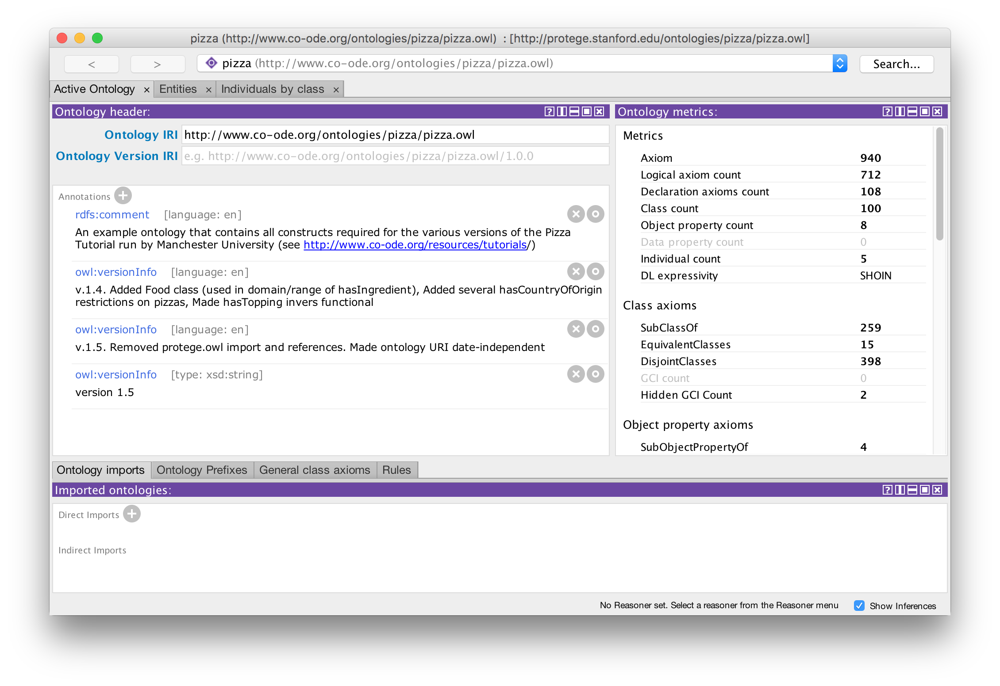

| 영역 | 기능 |
|---|---|
| **Ontology header** | Ontology IRI, Version IRI를 입력하고 수정합니다. 온톨로지 수준의 Annotations(`rdfs:comment`, `owl:versionInfo` 등)를 `+`로 추가하고 `×`로 삭제하며 `○`로 편집합니다. 언어 태그(`[language: en]`)와 데이터타입도 지정합니다. |
| **Ontology metrics** | Axiom 수, Logical axiom 수, Class/Object property/Data property/Individual 개수, **DL expressivity**(예: SHOIN), 축(axiom) 유형별 통계(SubClassOf, EquivalentClasses, DisjointClasses, GCI 등)를 보여줍니다. |
| **Ontology imports** (하단 탭) | Direct Imports에 다른 온톨로지를 `+`로 추가합니다. Indirect Imports(간접 임포트)도 함께 표시합니다. |
| **Ontology Prefixes** | 접두어(prefix)와 네임스페이스 매핑을 관리합니다. |
| **General class axioms** | 이름 없는 클래스 표현식을 좌변으로 하는 GCI 공리를 편집합니다. |
| **Rules** | SWRL 규칙을 편집합니다. |

### 1-3. Entities 탭 (핵심 편집 화면)
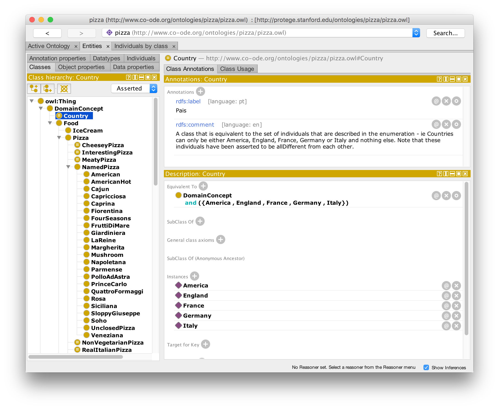

**좌측: 엔티티 유형별 하위 탭**
`Classes`, `Object properties`, `Data properties`, `Annotation properties`, `Datatypes`, `Individuals`

**좌측: Class hierarchy 뷰**
- `owl:Thing`을 루트로 하는 클래스 트리입니다. 노란 원은 primitive class, 가운데 ≡ 표시가 있는 원은 **defined class**(필요충분조건을 가진 클래스)입니다.
- **Asserted / Inferred 드롭다운**: 작성자가 직접 선언한 계층과 추론기가 계산한 계층을 전환합니다.
- 툴바 버튼 (아래 이미지): ① 하위 클래스 추가 ② 형제 클래스 추가 ③ 선택 클래스 삭제
  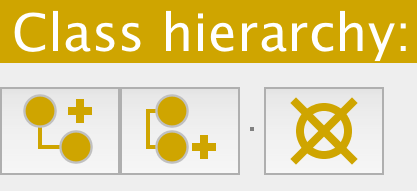
- 드래그 앤 드롭으로 계층을 바꿀 수 있습니다.

**우측 상단: Annotations 뷰** (`Class Annotations` 탭)
- `rdfs:label`, `rdfs:comment` 등 주석을 다국어 태그와 함께 추가하고 편집합니다.
- 각 행 오른쪽 버튼: `@` 공리 자체에 주석 달기, `×` 삭제, `○` 편집.

**우측 상단: Class Usage 탭**: 선택한 엔티티가 참조되는 모든 공리를 보여줍니다 (1-5 참고).

**우측 하단: Description 뷰** (클래스 정의 영역)

| 섹션 | 의미 |
|---|---|
| Equivalent To | 동치 클래스와 필요충분조건 (예: `DomainConcept and ({America, England, ...})`) |
| SubClass Of | 상위 클래스와 필요조건(제약, restriction) |
| General class axioms | 해당 클래스가 관련된 GCI |
| SubClass Of (Anonymous Ancestor) | 상위 클래스로부터 상속된 제약 (읽기 전용) |
| Instances | 이 클래스의 개체(individual) |
| Target for Key | `HasKey` 공리 |
| Disjoint With / Disjoint Union Of | 서로소(disjoint) 선언 |

### 1-4. 클래스 표현식 편집기 (제약 작성 다이얼로그)
Description 뷰에서 `+`를 누르면 열립니다.
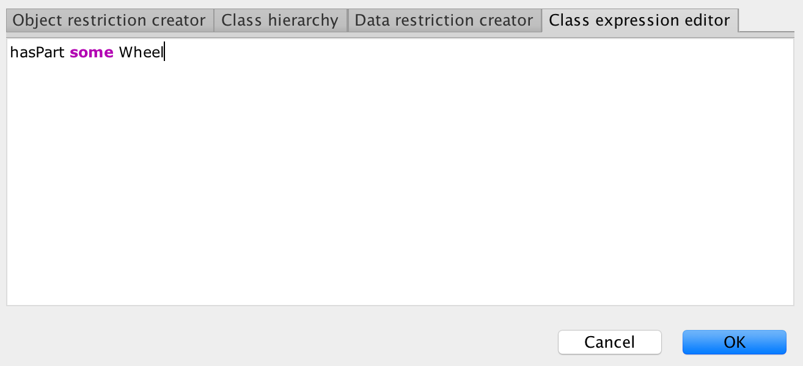

- **Class expression editor**: Manchester OWL Syntax로 직접 입력합니다 (예: `hasPart some Wheel`). 자동완성과 구문 검증을 지원합니다.
- **Object restriction creator / Data restriction creator**: 속성, 제약 유형(some, only, min, max, exactly, value), 대상 클래스를 GUI로 골라 제약을 만듭니다.
- **Class hierarchy**: 트리에서 기존 클래스를 선택해 넣습니다.

### 1-5. 추론 결과 표시
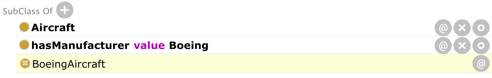
- 추론기를 실행하면(`Reasoner > Start reasoner`) **노란 배경 행**으로 추론된 사실이 표시됩니다 (예: `BoeingAircraft`가 추론으로 하위 클래스가 됨).
- 추론 행의 `@`(설명) 버튼을 누르면 **Explanation**, 즉 그 추론이 나온 근거 공리 집합을 볼 수 있습니다.

**Reasoner 환경설정: 표시할 추론 종류 선택**
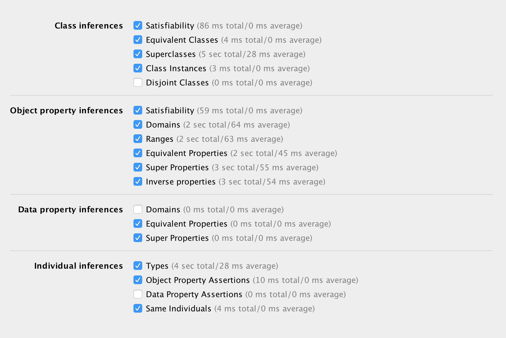
- 클래스, Object property, Data property, Individual별로 어떤 추론(만족가능성, 동치, 상위 클래스, 도메인/레인지, 타입 등)을 계산하고 표시할지 체크합니다. 항목마다 소요 시간도 보여줍니다.

### 1-6. Object Property 관련 뷰
| 화면 | 기능 |
|---|---|
| 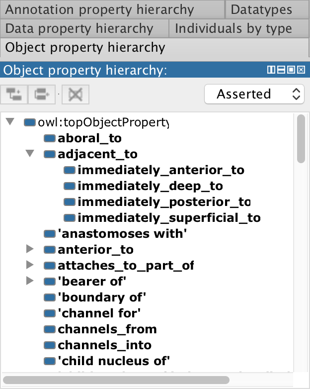 | **Object property hierarchy**: `owl:topObjectProperty` 아래 속성 계층을 트리로 보여줍니다. 하위/형제 속성을 추가하거나 삭제합니다. |
| 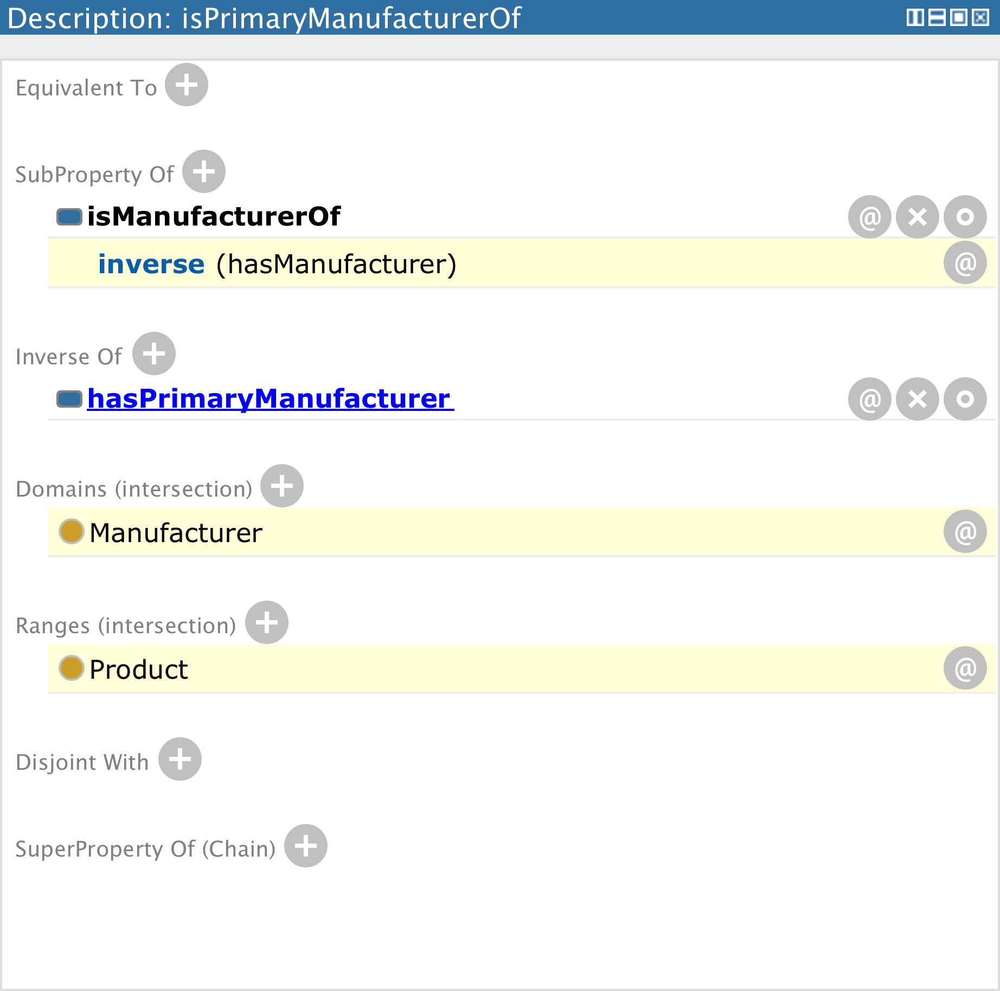 | **Object property description**: Equivalent To, SubProperty Of, Inverse Of, **Domains (intersection)**, **Ranges (intersection)**, Disjoint With, SuperProperty Of (Chain) 등을 정의합니다. |
| 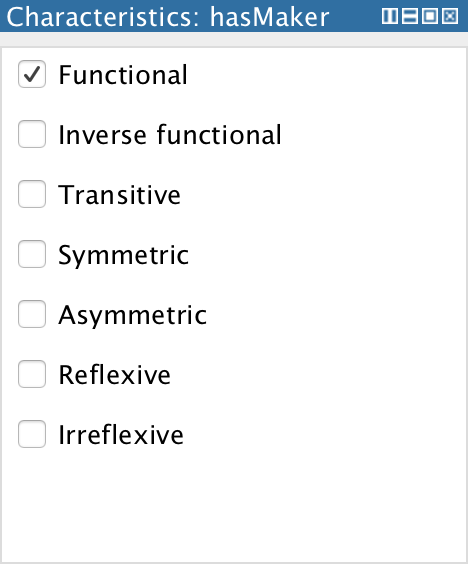 | **Characteristics**: Functional, Inverse functional, Transitive, Symmetric, Asymmetric, Reflexive, Irreflexive를 체크박스로 지정합니다. |

### 1-7. Data Property 뷰
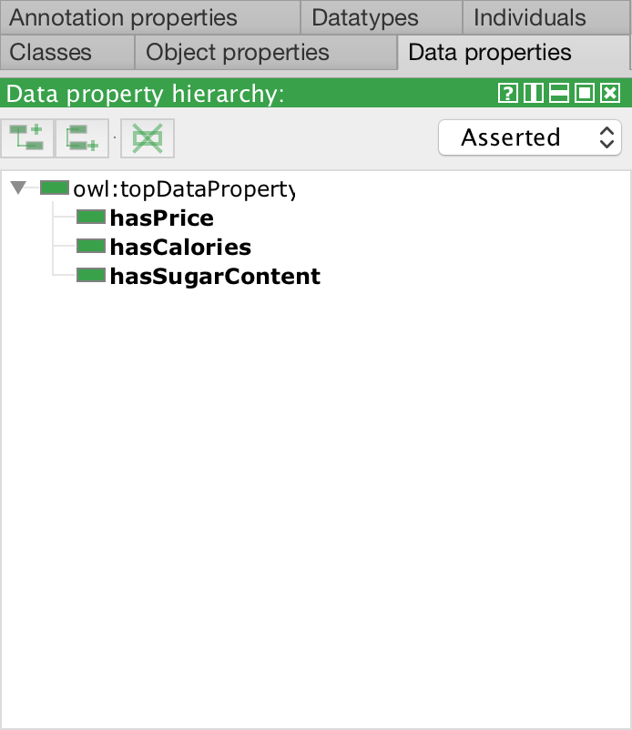
- `owl:topDataProperty` 아래 데이터 속성 계층을 보여줍니다. Description 뷰에서는 Domain, Range(xsd 데이터타입), Functional 여부를 정의합니다.

### 1-8. Individual(개체) 관련 뷰
| 화면 | 기능 |
|---|---|
| 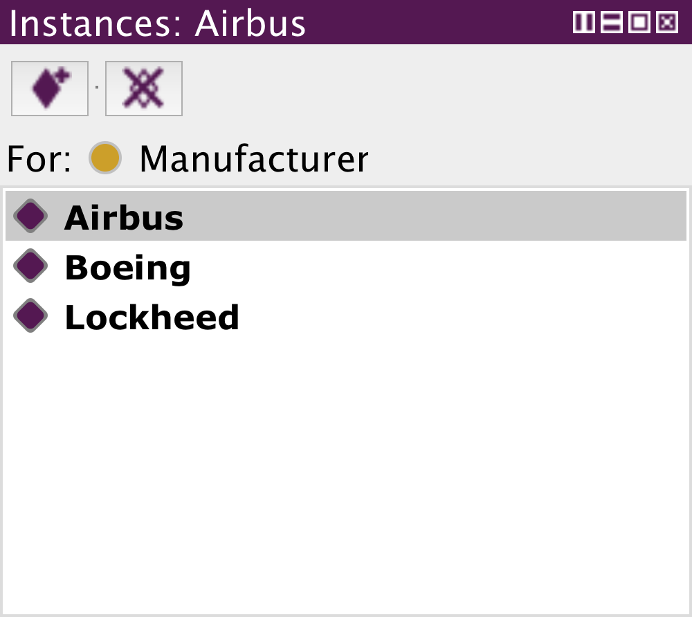 | **Instances 뷰**: 선택한 클래스에 속한 개체 목록을 보여줍니다. 개체 추가, 삭제, 검색이 가능합니다. |
| 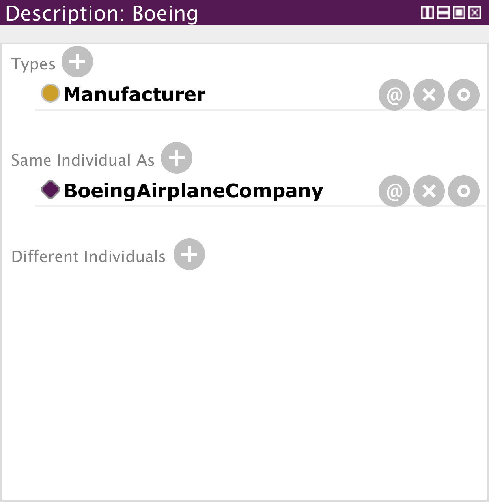 | **Individual description**: **Types**(소속 클래스), **Same Individual As**(동일 개체), **Different Individuals**(다른 개체)를 지정합니다. 별도의 Property assertions 뷰에서 객체/데이터 속성 값을 입력합니다. |

### 1-9. Usage 뷰 (참조 추적)
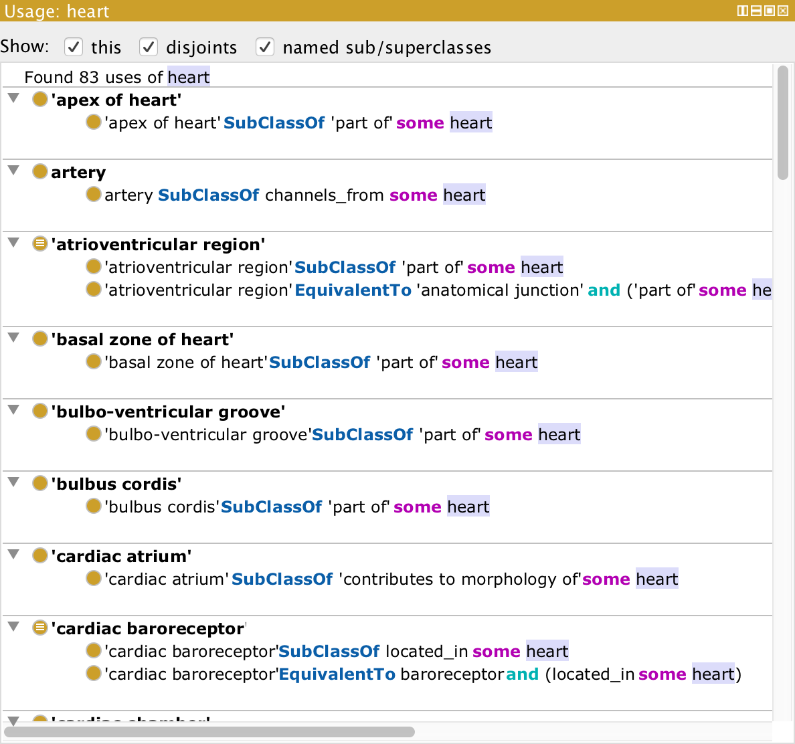
- 선택한 엔티티(예: `heart`)가 **어떤 공리에서 사용되는지** 전부 나열합니다 (`Found 83 uses of heart`).
- `Show: this / disjoints / named sub/superclasses` 필터가 있습니다.
- 온톨로지를 리팩토링하거나 삭제하기 전에 영향 범위를 확인할 때 씁니다.

### 1-10. 그 밖의 뷰
| 화면 | 기능 |
|---|---|
| 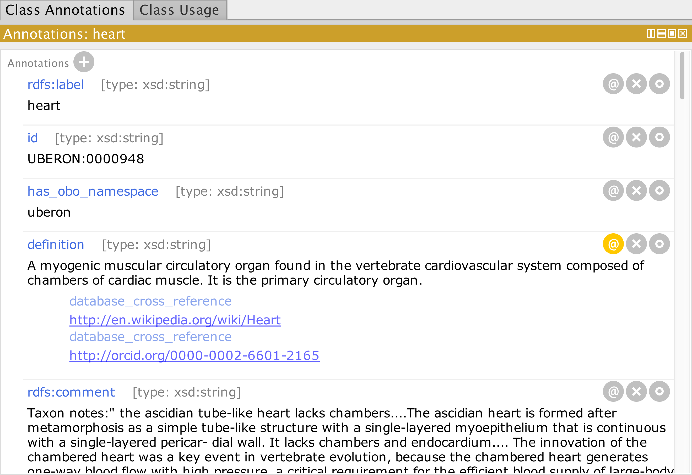 | **Annotations 뷰**: 엔티티 주석 목록. IRI, 문자열, 다국어 리터럴을 지원합니다. |
| 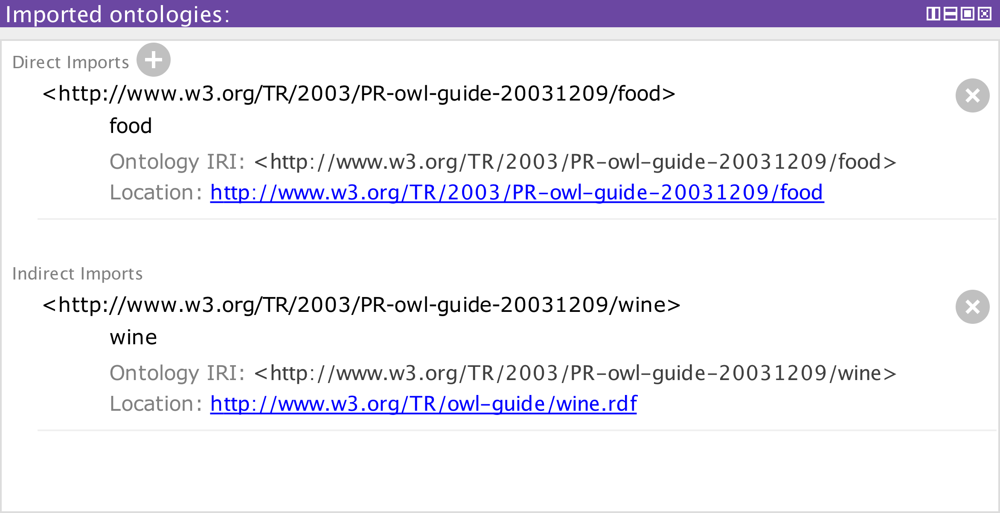 | **Imported ontologies**: 직접/간접 임포트 관리. 로컬 파일, URL, 카탈로그에서 임포트합니다. |

### 1-11. 메뉴 기반 주요 기능 (스크린샷 외)
- **File**: 새로 만들기, 열기(파일/URL), 저장(포맷 선택), 최근 파일, **Check for plugins**(플러그인 설치 및 업데이트)
- **Edit**: Undo/Redo, 찾기, **Rename entity**, 일괄 변경(Refactor)
- **Refactor**: 엔티티 병합(Merge), IRI 일괄 변경, 공리 이동/복사, 온톨로지 분할
- **Reasoner**: 추론기 선택(HermiT/ELK/Pellet...), Start, Synchronize, Stop, Explain
- **Tools**: 엔티티 생성 규칙 설정 등
- **Window > Tabs / Views**: 탭(DL Query, SPARQL Query, OntoGraf, OWLViz, SWRLTab 등)과 뷰 추가. 뷰는 드래그해서 원하는 위치에 배치할 수 있습니다.

---

## ② WebProtégé

### 2-1. 로그인 화면 (현재 운영 버전, 직접 캡쳐)
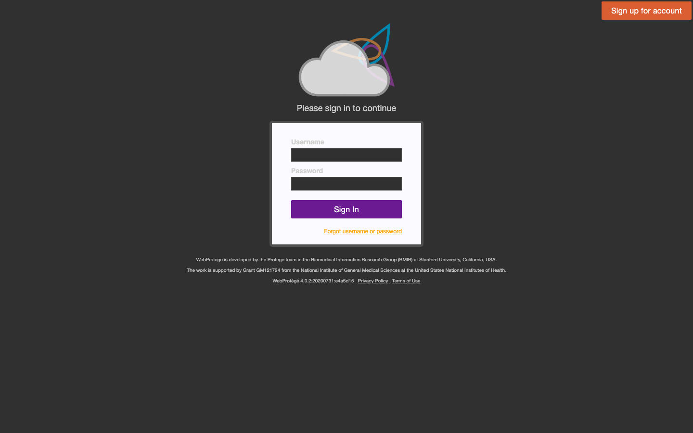
- Username/Password로 로그인합니다. **Sign up for account**로 가입하고, 아이디/비밀번호를 찾을 수 있습니다.
- 하단에 버전 정보가 있습니다: `WebProtégé 4.0.2`
- 공개 서비스: https://webprotege.stanford.edu (Stanford BMIR 운영). 자체 서버에는 Docker로 설치할 수 있습니다 (`docker-compose.yml` 제공).

### 2-2. 홈 화면 (프로젝트 목록)
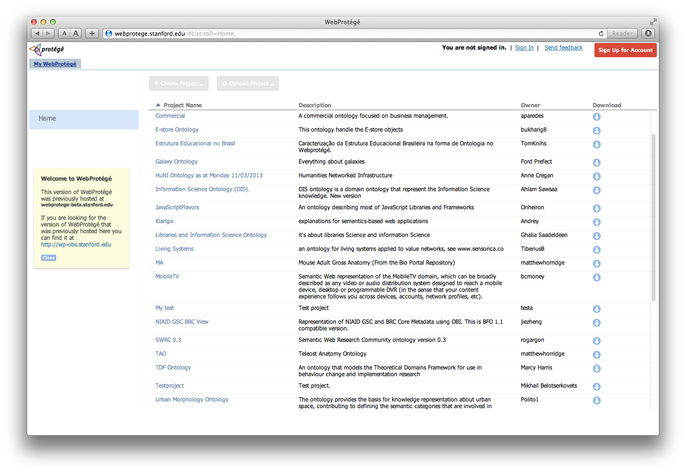
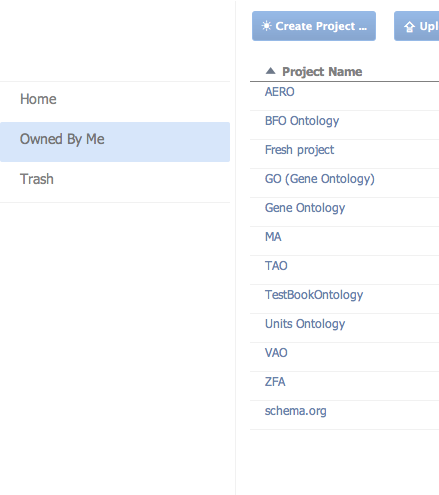

| 영역 | 기능 |
|---|---|
| 좌측 내비게이션 | `Home`(접근 가능한 전체 프로젝트), `Owned By Me`(내 프로젝트), `Shared with me`, `Trash`(휴지통) |
| **Create Project** | 빈 온톨로지 프로젝트를 새로 만듭니다. |
| **Upload Project** | 기존 OWL/OBO 파일(또는 zip)을 업로드해 프로젝트를 만듭니다. |
| 프로젝트 테이블 | Project Name, Description, Owner, **Download**(현재 버전을 내려받기) |
| 상단 우측 | 로그인 사용자, Sign In/Out, Send feedback |

**Upload 다이얼로그**: 프로젝트 이름, 설명, 파일을 지정합니다.
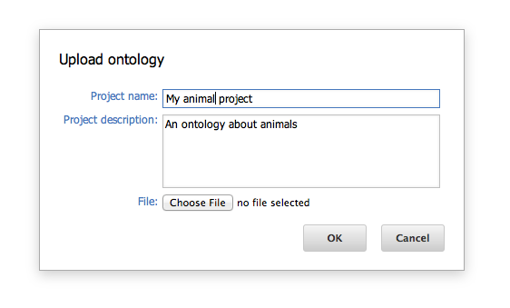

### 2-3. 프로젝트 화면: Classes 탭 (핵심 편집 화면)
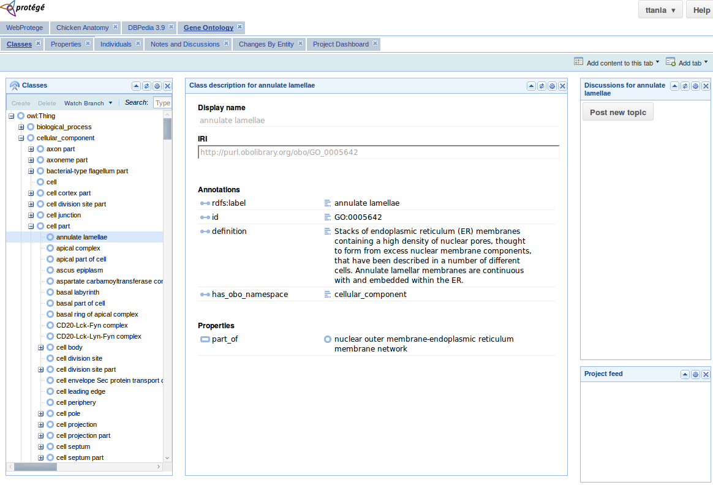

| 영역 | 기능 |
|---|---|
| 상단 1단 탭 | 열려 있는 **프로젝트**들(브라우저 탭처럼 여러 프로젝트를 동시에 열 수 있음) |
| 상단 2단 탭 | 프로젝트 내 **작업 탭**: Classes, Properties, Individuals, Notes and Discussions, Changes By Entity, Project Dashboard 등 |
| **Add content to this tab / Add tab** | 사용자가 탭을 새로 만들고, 탭에 포틀릿(패널)을 자유롭게 추가해 화면을 구성합니다. |
| 좌측 **Classes** 포틀릿 | 클래스 트리. `Create`, `Delete`, **Watch Branch**(이 가지의 변경 알림 구독), `Search` |
| 중앙 **Class description** | Display name, IRI, Annotations(`rdfs:label`, definition 등), Properties(관계)를 폼으로 편집합니다. |
| 우측 **Discussions** | 선택한 엔티티에 대한 **토론 스레드**(`Post new topic`) |
| 우측 **Project feed** | 프로젝트 전체의 최근 변경과 댓글 피드 |
| 포틀릿 헤더 버튼 | 최소화, 새로고침, 설정, 닫기 |

### 2-4. 포틀릿 추가 메뉴 (화면 커스터마이즈)
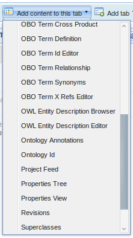
- OBO Term 계열 편집기(Cross Product, Definition, Id, Relationship, Synonyms, XRefs), OWL Entity Description Browser/Editor, Ontology Annotations, Ontology Id, Project Feed, Properties Tree/View, Revisions, Superclasses 등을 원하는 탭에 배치할 수 있습니다.
- **OBO 형식 온톨로지 편집**(Gene Ontology, 해부학 온톨로지 등)을 지원하는 것이 특징입니다.

### 2-5. OWL 엔티티 설명 뷰 및 텍스트 편집기 (Manchester Syntax)
| 화면 | 기능 |
|---|---|
| 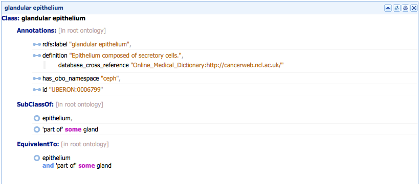 | **OWL Entity Description Browser**: 클래스의 Annotations, SubClassOf, EquivalentTo를 Manchester Syntax로 읽기 좋게 렌더링합니다. 각 공리가 어느 온톨로지(`[in root ontology]`)에 있는지도 표시합니다. |
| 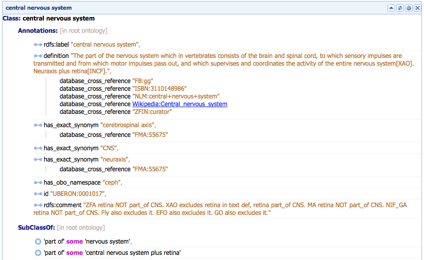 | **공리 주석 표시**: definition 아래에 `database_cross_reference` 같은 공리 수준 주석을 들여쓰기로 보여줍니다. |
| 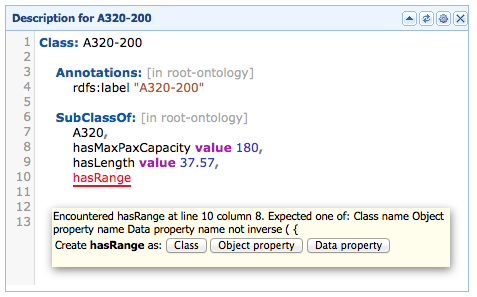 | **OWL Entity Description Editor**: 줄 번호가 있는 텍스트 편집기에서 Manchester Syntax로 직접 편집합니다. 구문 오류가 있으면 위치와 기대 토큰을 알려주고, 정의되지 않은 이름을 **즉석에서 Class / Object property / Data property로 생성**할 수 있습니다. |
| 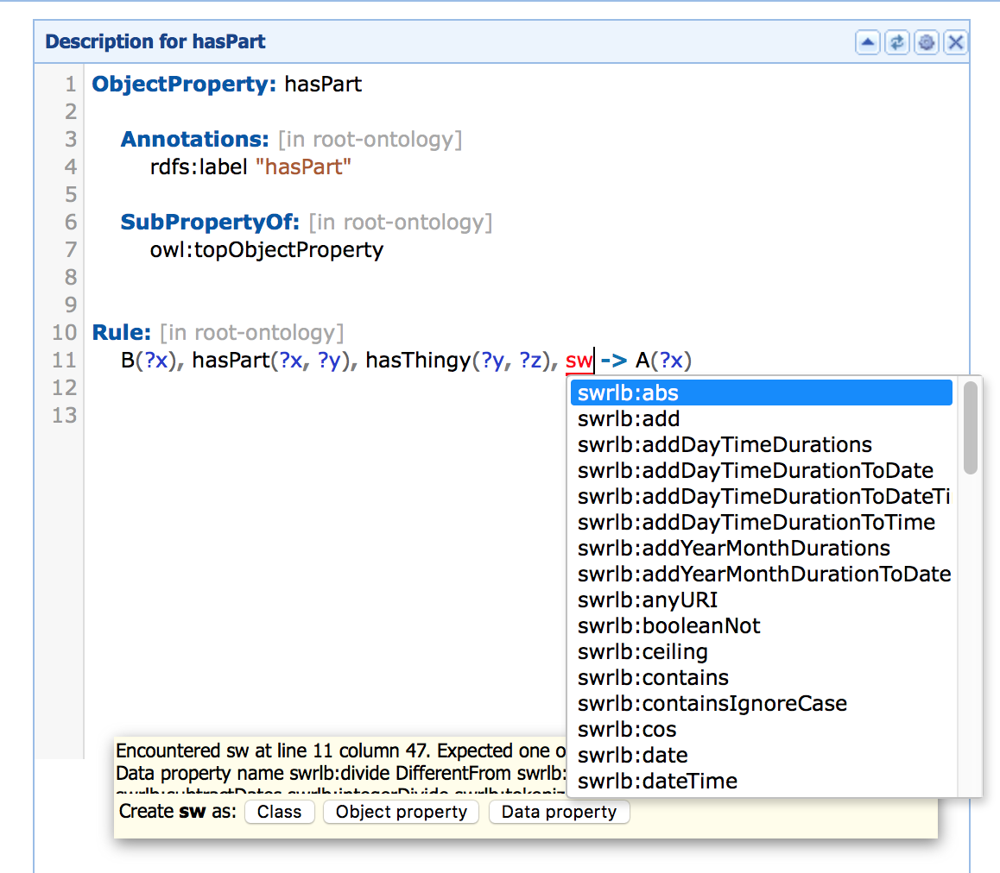 | **SWRL 규칙 편집**: `Rule:` 블록에 SWRL 규칙을 작성합니다. `swrlb:` 내장 함수 **자동완성**을 지원합니다. |

### 2-6. Changes By Entity 탭 (엔티티별 변경 이력)
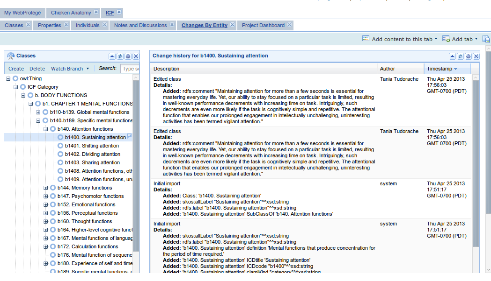
- 좌측 트리에서 엔티티를 고르면 우측에 **그 엔티티의 변경 이력**이 표시됩니다.
- Description(Edited class / Initial import), 상세 내역(Added/Removed 된 공리), **Author**, **Timestamp**를 보여줍니다.
- 트리에서 말풍선 아이콘은 댓글이 달린 엔티티를 뜻합니다.

### 2-7. Project Dashboard 탭
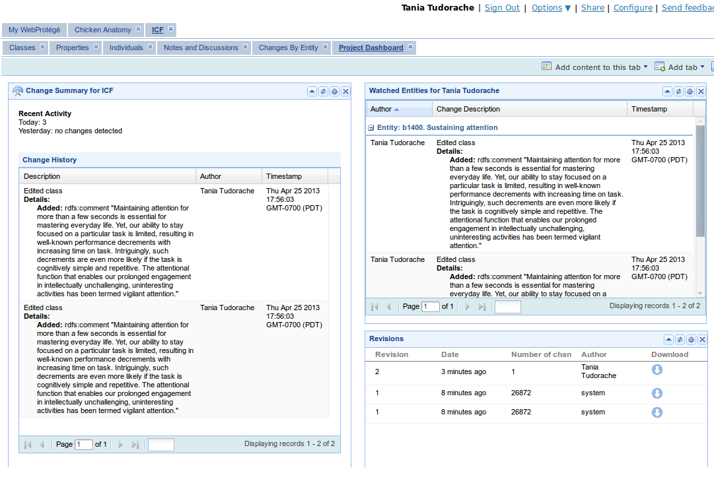

| 포틀릿 | 기능 |
|---|---|
| **Change Summary** | 오늘/어제 변경 건수, 프로젝트 전체 Change History(설명, 작성자, 시각) |
| **Watched Entities** | 내가 Watch한 엔티티와 가지(branch)에서 일어난 변경만 모아 보기 |
| **Revisions** | 리비전 번호, 날짜, 변경 수, 작성자, **해당 리비전 시점의 온톨로지 다운로드** |

### 2-8. 공유 설정 (권한 관리)
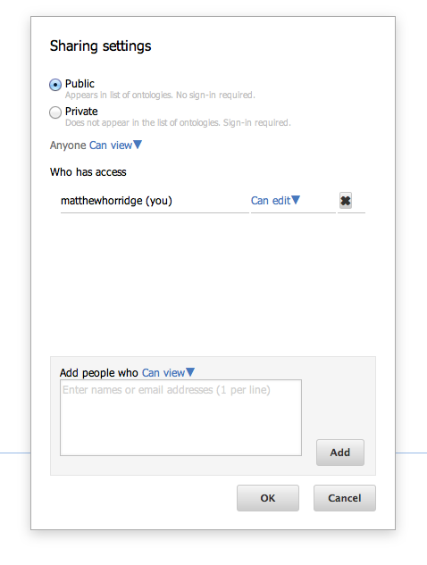
- **Public / Private**: 공개 목록에 노출할지, 로그인이 필요한지 정합니다.
- `Anyone Can view` 같은 기본 권한을 설정합니다.
- **Who has access**: 사용자별 권한(**Can view / Can comment / Can edit / Manage**)을 지정합니다.
- 이메일 또는 사용자명으로 여러 명을 한꺼번에 초대합니다.

### 2-9. 그 밖의 기능 (현재 4.x/5.x 기준, 스크린샷 외)
- **Project Settings**: 엔티티 IRI 자동 생성 규칙(UUID/숫자 접미사), 기본 언어, 표시용 라벨 속성 지정
- **Entity Forms**: 프로젝트별로 커스텀 입력 폼을 정의합니다 (도메인 전문가용 간소화 UI).
- **Tags / Issues**: 엔티티 태깅, 이슈 트래킹 형태의 토론
- **Merge / Import**: 다른 온톨로지 파일을 프로젝트에 병합합니다.
- **Revert**: 특정 변경을 되돌립니다.
- **Download**: 리비전과 포맷을 선택해 다운로드합니다 (Desktop으로 가져가 추론 등을 수행).

---

## 3. 정리: 어떤 경우에 무엇을 쓰나

| 상황 | 추천 |
|---|---|
| 혼자서 정교한 OWL 모델링을 하고 **추론기로 일관성을 검증**해야 할 때 | **Protégé Desktop** |
| SPARQL, 시각화(OntoGraf/OWLViz), SWRL 실행 등 **플러그인**이 필요할 때 | **Protégé Desktop** |
| 여러 명(도메인 전문가 포함)이 **동시에 편집하고 리뷰하고 토론**해야 할 때 | **WebProtégé** |
| 설치 없이 브라우저로 **공유와 열람**이 필요할 때 | **WebProtégé** |
| 실무에서 흔한 조합 | WebProtégé로 협업 편집 → 다운로드 → Desktop에서 추론 검증 |
