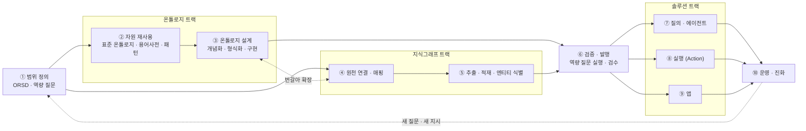
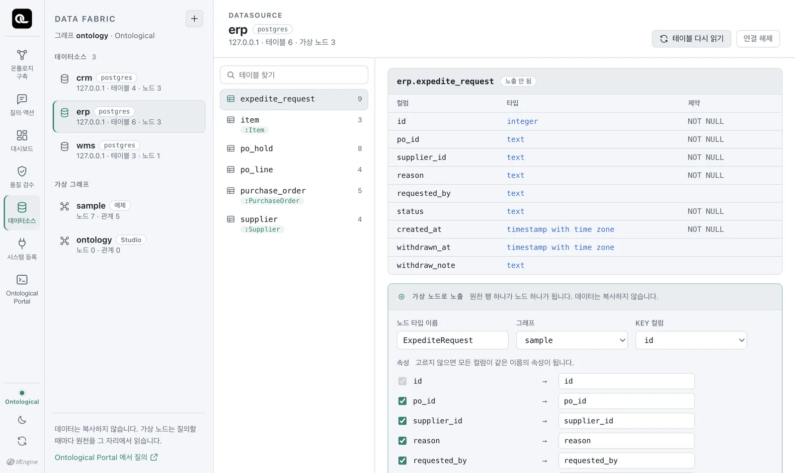
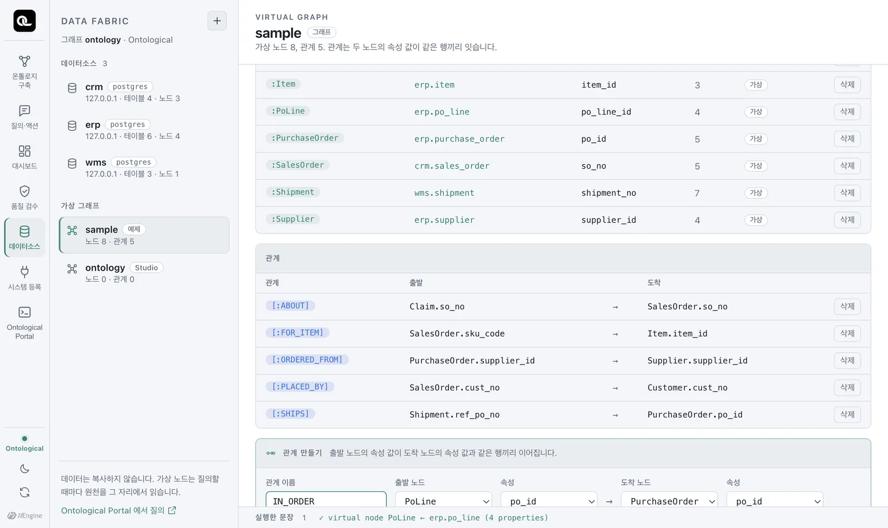

# 보고서 구성안 (예시) — NeOn 방법론 적용

> 이 문서는 `온톨로지_솔루션_오픈소스_조사.md`를 재구성하기 위한 **구성안과 핵심 부분 예시**다. 본문을 교체하기 전에 구조와 표현을 검토하기 위한 용도.

---

## A. 전체 목차

```
조사 목적 / 조사 결론

1. 개념 정의
   1-1. 온톨로지 · 지식그래프 · 온톨로지 솔루션
   1-2. 예시 — 회사의 직급·직책
   1-3. 온톨로지의 필요성

2. 온톨로지 솔루션 구축 과정                     ← 축 1 (고민 지점 ①)
   2-1. 기준 방법론 — NeOn (METHONTOLOGY 포함)과 그 범위
   2-2. 구축 과정 정의 — 4개 트랙 · 10단계
   2-3. 4사 수행 방식 재분류 — base 덱 ①~⑦ → 10단계

3. Ontological Studio 개요
   3-1. 선정 배경  3-2. 개요·구성도  3-3. 라이선스

4. 구축 과정 × Studio 화면·기능                  ← 축 2 (고민 지점 ②)
   4-0. 매핑 총괄표 (단계 × 4사 솔루션 × Studio × 빈칸)
   4-1 ~ 4-10. 단계별 상세 (4사 방식 → Studio 화면 → 기능 → 참조 포인트)

5. 시사점
   5-1. 온톨로지 솔루션에 필요한 기능·화면
   5-2. Studio에 없는 기능 (빈칸)과 보완 방향

부록
   A. METHONTOLOGY 정정 7단계와 base 덱 정정표
   B. NeOn 9개 시나리오
   C. 정의 출처 · 참고문헌
```

현행 문서와의 차이:

| 현행 | 변경 |
|---|---|
| 2장: METHONTOLOGY 7단계 + 지식그래프·솔루션 활동 나열 | NeOn 기준 4개 트랙·10단계로 재정의, 단계마다 근거 명시 |
| 4사 수행 방식 없음 | 2-3 재분류표 신설 |
| 3-4(선정 이유 대응표), 4장(화면 순서 서술), 4-7(정리) 중복 | 4장을 **단계 순서**로 통일, 3-4·4-7은 4-0 총괄표·5장으로 흡수 |
| METHONTOLOGY 상세가 본문에 | 부록 A로 이동 |

---

## B. 고민 지점 ① — 2장 구축 과정 (예시 본문)

### 2-1. 기준 방법론 — NeOn과 그 범위

- **METHONTOLOGY(1997)** 는 단일 온톨로지를 처음부터 만드는 절차다. 원천 데이터 연결·적재나 애플리케이션 개발은 다루지 않는다.
- **NeOn(2008~2015)** 은 같은 연구 그룹의 후속 방법론으로, METHONTOLOGY를 핵심(시나리오 1)으로 두고 **기존 자원 재사용(시나리오 2~8)** 을 덧붙였다. 특히 시나리오 2는 데이터베이스·용어사전 같은 **비온톨로지 자원**을 온톨로지로 바꾸는 방법을 다룬다.
- 그러나 NeOn도 **온톨로지를 만드는** 방법론이다. 대량 적재·동기화, 질의·실행·앱은 범위 밖이므로, 이 구간은 4사 사례에서 도출한다.

| 구간 | 학술 근거 | 사례 근거 |
|---|---|---|
| 범위 정의 | NeOn 요구사항 명세 (ORSD·역량 질문) | 4사 |
| 온톨로지 트랙 | NeOn 시나리오 1 (=METHONTOLOGY), 3~8 | 4사 |
| 지식그래프 트랙 — 원천 연결·매핑 | NeOn 시나리오 2 (DB 복사형 / 매핑형) | 4사 |
| 지식그래프 트랙 — 적재·식별 | — | 4사 |
| 검증·발행 | NeOn·METHONTOLOGY 평가 (역량 질문 기준) | 4사 |
| 솔루션 트랙 | — | 4사 |
| 운영·진화 | NeOn 진화·버전, METHONTOLOGY 유지보수 | 4사 |

### 2-2. 구축 과정 정의 — 4개 트랙 · 10단계



| 단계 | 층 | 하는 일 | 산출물 | 근거 |
|---|---|---|---|---|
| ① 범위 정의 | 공통 | 목적·범위·사용자·용도 정의, 역량 질문(답해야 할 질문)과 실행해야 할 지시 도출, 일정 계획 | ORSD, 역량 질문 목록 | NeOn 명세 8단계 |
| ② 자원 재사용 | 온톨로지 | 표준·상위 온톨로지, 용어사전·분류체계, 설계 패턴을 찾아 재사용·정렬 | 재사용 목록, 정렬 결과 | NeOn 시나리오 2(용어 자원)·3~7 |
| ③ 온톨로지 설계 | 온톨로지 | 개념·관계·속성·제약 정의, 형식 언어로 구현 | 스키마(TBox) | NeOn 시나리오 1 = METHONTOLOGY |
| ④ 원천 연결·매핑 | 지식그래프 | 원천 DB·문서 연결, 원천 구조와 온톨로지의 대응 정의 (복사형 또는 매핑형) | 매핑 규칙 | NeOn 시나리오 2(DB 자원) |
| ⑤ 추출·적재·식별 | 지식그래프 | 정형 변환·비정형 추출, 그래프 적재, 같은 개체 식별, 동기화 | 인스턴스(ABox) | 4사 사례 |
| ⑥ 검증·발행 | 온톨로지 + 지식그래프 | 역량 질문 실행으로 답·근거 확인, 사람 검수, 발행 | 검증 결과, 발행본 | NeOn·METHONTOLOGY 평가 |
| ⑦ 질의·에이전트 | 솔루션 | 자연어·그래프 질의, RAG·에이전트 연결 | 질의 서비스 | 4사 사례 |
| ⑧ 실행 (Action) | 솔루션 | 업무 시스템 호출, 승인·되돌리기 | 액션 정의 | 4사 사례 |
| ⑨ 앱 | 솔루션 | 대시보드·업무 앱 | 앱 | 4사 사례 |
| ⑩ 운영·진화 | 공통 | 변경 제안·검토, 버전·이력, 배포, 범위 확장 | 변경 이력 | NeOn 진화, METHONTOLOGY 유지보수 |

> 온톨로지 트랙(②③)과 지식그래프 트랙(④⑤)은 번갈아 진행한다. 솔트룩스의 "이중나선"(모델 축·데이터 축 교대 확장)과 METHONTOLOGY의 진화형 프로토타입이 이 구조를 뒷받침한다.

### 2-3. 4사 수행 방식 재분류

base 덱은 4사의 활동을 METHONTOLOGY ①~⑦ 칸에 배치했지만, 실제 활동은 세 층에 걸쳐 있다. 각 활동을 2-2의 10단계로 다시 분류하면 다음과 같다. 괄호 안은 base 덱의 원래 칸이다.

| 단계 | 팔란티어 | 인핸스 | 솔트룩스 | 엔코아 |
|---|---|---|---|---|
| ① 범위 정의 | AIP Bootcamp 공동 구현·시험, 유즈케이스·기대효과 합의, 업무 흐름 기준 대상·속성·동작 정리 (①②) | 현장 인터뷰로 병목 확인, 문제·KPI·자동화 범위 합의, 사람 판단 지점 정리 (①②) | AI 혁신 프로그램 문제 정의, 업무 시나리오, **ORSD·역량 질문** (①②) | AI Ready Data 진단, 7일 PoC, 4개 문제 유형 정의 (①②) |
| ② 자원 재사용 | 공통 형태를 Interface로 일반화 (③) | 시스템별 용어·단위 통일 (⑤) | **표준 온톨로지 재사용**, 시스템별 용어 공통 개념 정렬 (③⑤) | 산업별 응용 온톨로지 템플릿, 5W1H·표준 온톨로지, DA# 표준사전 (②③) |
| ③ 온톨로지 설계 | Object·Property·Link Type 도출, PK·속성 타입·Value Type, Functions 규칙 (③④) | 오브젝트·관계 정의(LLM 초안), 현장 규칙·지식사전 등록 (③④) | 클래스·관계·속성 도출(미들아웃), RDF·OWL·SWRL, URI 체계 (③④) | 3단 모델 설계(AI 초안), GraphDB 스키마 (③④) |
| ④ 원천 연결·매핑 | 데이터셋≒Object·컬럼≒Property 매핑, Data Connection·Pipeline Builder (③⑤) | DB·API·파일 수집 (⑤) | 테이블→클래스·컬럼→속성 변환 규칙 (⑤) | 메타데이터·표준사전 연계, 수집 범위 확정 (①⑤) |
| ⑤ 추출·적재·식별 | Backing Dataset 연결·인덱싱·동기화, ML 출력 매핑 (⑤) | ETL·정규화 적재, 비정형 인식 후 지식사전 적재, 하나의 KG로 연결 (④⑤) | RDF 변환·동일 개체 식별(ABox 적재), Document Studio 추출, SOR 적재 (⑤⑥) | Data Build Module, 대용량 파이프라인, AI Agent 적재 (⑤⑥) |
| ⑥ 검증·발행 | — | 테스트케이스·데이터 검증 (⑦) | CQ→SPARQL 작성·실행, 미답·오답 확인 (④⑦) | Cypher 질의·검증, 모델 정합성 검증 (④⑦) |
| ⑦ 질의·에이전트 | AIP Logic (⑥) | Workflow Builder 멀티 에이전트 (⑥) | SPARQL 서비스, A.RAG Studio, Agent Studio (⑥) | Insight Module (⑥) |
| ⑧ 실행 (Action) | Action Type 정의, Write-back (③④⑥) | ACT-2 화면 조작 (⑥) | — | — |
| ⑨ 앱 | Workshop, OSDK (⑥) | Dashboard Generation (⑥) | — | 시각화 (⑥) |
| ⑩ 운영·진화 | Ontology Proposals, AI FDE, Apollo (⑦) | 시뮬레이션 후 운영 전환, 온톨로지·에이전트 수정 (⑦) | 이중나선 확장, 고객 인력 운영 (⑦) | 거버넌스 컨설팅 (⑦) |

**재분류로 드러나는 점**

- base 덱의 **⑤ 통합** 칸은 4사 모두 ④·⑤(지식그래프 트랙)가 중심이다. METHONTOLOGY의 통합(기존 온톨로지 재사용, ②)에 해당하는 것은 솔트룩스의 표준 온톨로지 재사용 정도다.
- base 덱의 **⑥ 구현** 칸은 4사 모두 ⑦~⑨(솔루션 트랙)다. METHONTOLOGY의 구현(형식 언어로 코드화)은 ③에 해당한다.
- **⑧ 실행**은 팔란티어·인핸스만 있다. 솔트룩스·엔코아는 질의·분석까지가 중심이다.
- 솔트룩스는 ORSD·역량 질문(NeOn 용어)을 그대로 쓴다. 학술 방법론이 실무에 쓰이는 사례다.

---

## C. 고민 지점 ② — 4장 Studio 매핑 (예시 본문)

### 4-0. 매핑 총괄표

| 단계 | 4사 대표 솔루션 | Studio 화면 | Studio 기능 | 빈칸 |
|---|---|---|---|---|
| ① 범위 정의 | AIP Bootcamp, Knowledge Studio(ORSD·CQ), KNIT 템플릿 | 온톨로지 구축 › 의도 | 구축 의도·골든 퀘스천·골든 커맨드, 에이전트 초안 | 착수 진단·교육·일정 계획 |
| ② 자원 재사용 | Interface, 표준 온톨로지, DA# 표준사전 | 온톨로지 구축 › 대상 | 기존 스키마에 추가 인제스천, 동명 클래스 병합/분리 | 외부 표준 온톨로지·용어사전 가져오기 (튜토리얼 미확인) |
| ③ 온톨로지 설계 | Ontology Manager, Knowledge Studio, Modeling Module | 온톨로지 구축 › 그래프·정보 탭 | 에이전트 스키마 설계, 클래스·관계 직접 편집, 스키마 지도 | 표준 형식 언어(OWL) 내보내기 (미확인) |
| ④ 원천 연결·매핑 | Data Connection·Pipeline Builder, Transformer, Data Build | 데이터소스 · 가상 그래프 | DB 커넥터, 가상 노드·관계(**매핑형**), 메타데이터 증강 | API·파일 원천 |
| ⑤ 추출·적재·식별 | Backing Dataset, Document Studio, Data Build | 온톨로지 구축 › 구축 | 문서 추출·적재, 엔티티 식별, MATERIALIZE(**복사형**) | 대용량 파이프라인, 동기화 스케줄 |
| ⑥ 검증·발행 | 테스트케이스, SPARQL 검증, 모델 검증 | 구축 보고 · 품질 검수 | 골든 퀘스천 자동 실행, 골든 커맨드 드라이런, 사람 검수, 발행 | 발행 버튼 (현재 대화로 발행) |
| ⑦ 질의·에이전트 | AIP Logic, A.RAG·Agent Studio, Workflow Builder | 질의·액션 · Portal | 근거 제시 자연어 질의, Cypher 콘솔, MCP | 멀티 에이전트 워크플로 |
| ⑧ 실행 (Action) | Action Type·Write-back, ACT-2 | 시스템 등록 · 질의·액션(계획 카드) | OpenAPI 등록, 액션(단계·보상·정책·승인), 사가 | 화면 조작 자동화 |
| ⑨ 앱 | Workshop·OSDK, Dashboard Generation | 온톨로지 앱 | 대시보드, 코드 앱, SDK, 액션 버튼 | — |
| ⑩ 운영·진화 | Ontology Proposals·Apollo, 거버넌스 | Portal(시간 여행·스키마 이력) | 바이템포럴 이력, 스키마 변경 단계, 추가 인제스천 | 변경 제안·리뷰(브랜치), 배포 관리 |

### 4-4. ④ 원천 연결·매핑 (단계별 상세 — 서식 예시)

**4사의 방식**

| 회사 | 방식 | 유형 (NeOn) |
|---|---|---|
| 팔란티어 | Data Connection으로 연결, Pipeline Builder로 정제·결합해 Backing Dataset 생성 → Object Type에 연결 | 복사형 |
| 인핸스 | DB·API·파일 수집 후 ETL·정규화 | 복사형 |
| 솔트룩스 | 테이블→클래스, 컬럼→속성 변환 규칙 작성 → RDF 트리플 변환 | 복사형 |
| 엔코아 | 메타데이터·표준사전(DA#·META#) 연계, Data Build Module로 연결 | 복사형 |
| **Studio** | 원천 테이블을 복사하지 않고 가상 노드·가상 관계로 노출 | **매핑형** |

> NeOn D5.4.1은 DB를 온톨로지로 쓰는 방식을 ① 스키마 변환 + 인스턴스 복제와 ② 매핑으로 질의 시점에 인스턴스 생성의 두 가지로 구분한다. 4사는 ①, Studio는 ②를 기본으로 한다.

**Studio 화면**

| 데이터소스 탭 | 가상 관계 만들기 |
|---|---|
|  |  |

**Studio 기능**

| 기능 | 내용 |
|---|---|
| 데이터소스 등록 | PostgreSQL·MySQL·Oracle·SQL Server. 테이블·컬럼·키를 카탈로그로 수집 |
| 가상 노드 | 테이블 = 노드 타입, 행 = 노드, 컬럼 = 속성. 질의할 때마다 원천을 읽음 (읽기 전용) |
| 가상 관계 | "A.x = B.y" 조인 규칙에 이름을 붙여 저장. 서로 다른 DB를 관계로 연결 |
| 메타데이터 증강 | 에이전트가 컬럼 값과 쓰임새를 보고 `TB507.C041` 같은 코드명에 업무 의미 부여 |

**참조 포인트**

- 복사형은 성능·가공 자유도가, 매핑형은 신선도·권한 일원화가 장점이다. 솔루션 설계 시 **두 방식을 모두 지원**하고 원천 특성에 따라 고르게 하는 것이 바람직하다 (Studio도 `MATERIALIZE`로 복사형 전환 가능).
- 원천을 비춘 그래프(`sample`)와 업무 관점 그래프(`ontology`)를 분리하는 구조는, NeOn SEEMP 사례의 "로컬 온톨로지 + 참조 온톨로지 + 정렬" 구조와 같은 발상이다.
- 빈칸: API·파일 원천, 다중 컬럼 키, 대용량 원천에 대한 성능 검증.
