# 온톨로지 솔루션 오픈소스 조사

## 조사 목적

- 온톨로지 서비스(솔루션)를 구축하는 데 참고할 수 있도록, 관련 오픈소스를 조사·분석함
- 이를 위해 '온톨로지', '지식그래프', '온톨로지 솔루션'의 개념을 구분하고(1장), 솔루션으로 온톨로지를 구축하고 활용하는 과정을 10단계로 정리한 뒤(2장), 오픈소스 Ontological Studio가 제공하는 기능·화면과 관련 개념·처리 과정을 분석함(3·4장)

## 조사 결론

1. **세 개념은 층위가 다르다** (1장, 부록 D)
    - 온톨로지: 개념·관계·제약의 틀 (스키마, TBox)
    - 지식그래프: 그 틀에 실제 데이터를 채운 것 (인스턴스, ABox)
    - 온톨로지 솔루션: 둘을 저장·조회·추론하고, 그 위에서 질의·실행·앱을 제공하는 소프트웨어
2. **온톨로지 구축·활용 과정은 10단계로 정리된다** (2장)
    - 공통: 단계 ① 범위 정의, 단계 ⑥ 검증·발행, 단계 ⑩ 운영·진화
    - 온톨로지 층: 단계 ② 자원 재사용, 단계 ③ 온톨로지 설계
    - 지식그래프 층: 단계 ④ 원천 연결·매핑, 단계 ⑤ 추출·적재·식별
    - 솔루션 층: 단계 ⑦ 질의·에이전트, 단계 ⑧ 실행, 단계 ⑨ 앱
    - 온톨로지 층과 지식그래프 층의 단계는 번갈아 진행
3. **공개된 온톨로지 오픈소스는 대부분 스키마 편집 도구다** (3.1)
    - Protégé 등은 단계 ③ 온톨로지 설계만 다루므로 조사 대상에서 제외
    - 10단계 대부분을 한 제품에서 다루는 Ontological Studio(유엔진솔루션즈)를 분석 대상으로 선정
4. **Ontological Studio는 홈 화면의 8개 메뉴로 10단계 중 9개 단계를 다룬다** (4장)
    - 범위 정의: 골든 퀘스천(답해야 할 질문)·골든 커맨드(할 수 있어야 할 지시)
    - 원천 연결: 복사 없이 읽는 가상 노드와 복사 저장을 함께 제공
    - 구축: 에이전트 기반 설계·적재·자동 검증
    - 활용: 근거를 붙인 질의, 승인·되돌리기 기반 액션, 대시보드·코드 앱
    - 공통 원칙: "AI가 제안하고 사람이 확정한다"

---

## 1. 개념 정의

### 1.1 세 개념

| 구분(층)                                                         | 정의                                                                                                          | 핵심 질문                             | 대표 산출물                                                    |
| ---------------------------------------------------------------- | ------------------------------------------------------------------------------------------------------------- | ------------------------------------- | -------------------------------------------------------------- |
| **온톨로지** (Ontology)                                          | 특정 영역의 개념·속성·관계·제약을 명시적으로 정의한 의미 모델(스키마). TBox에 해당                         | 무엇이 존재하고, 무엇을 뜻하는가?     | 클래스·속성·관계 정의, 제약·규칙 (OWL·RDFS·LinkML·SHACL, 부록 E) |
| **지식그래프** (Knowledge Graph) — 현업에서 '토폴로지'로도 부름 | 온톨로지에 실제 데이터를 연결한 인스턴스 네트워크. ABox에 해당                                                | 실제로 무엇이 무엇과 연결되어 있는가? | 엔티티·관계 인스턴스, 원천 매핑, 적재된 그래프                |
| **온톨로지 솔루션**                                              | 온톨로지와 지식그래프를 저장·조회·추론하고, 그 위에서 업무 앱·에이전트·실행(Action)을 제공하는 소프트웨어 | 그것으로 무엇을 판단하고 실행하는가?  | 플랫폼, 업무 앱, 에이전트, Action·API, 배포                   |

세 개념은 아래에서 위로 의존한다. 지식그래프는 온톨로지를 전제로 하고, 온톨로지 솔루션은 둘을 저장·조회·추론하는 기반 위에서 질의·실행·앱을 제공한다.

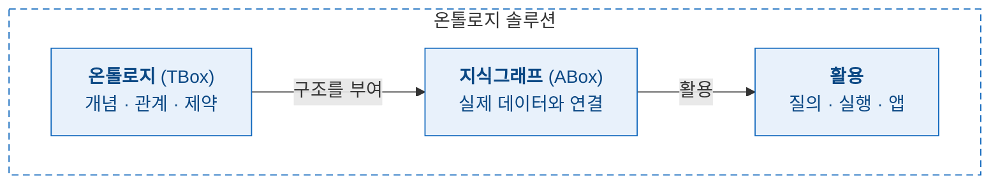

### 1.2 온톨로지와 지식그래프 예시 — 회사의 직급·직책

**과장·팀장·박지훈 같은 구체적인 값은 지식그래프에, "직급·직책이 무엇이고 어떻게 연결되는가"는 온톨로지에 속한다.**

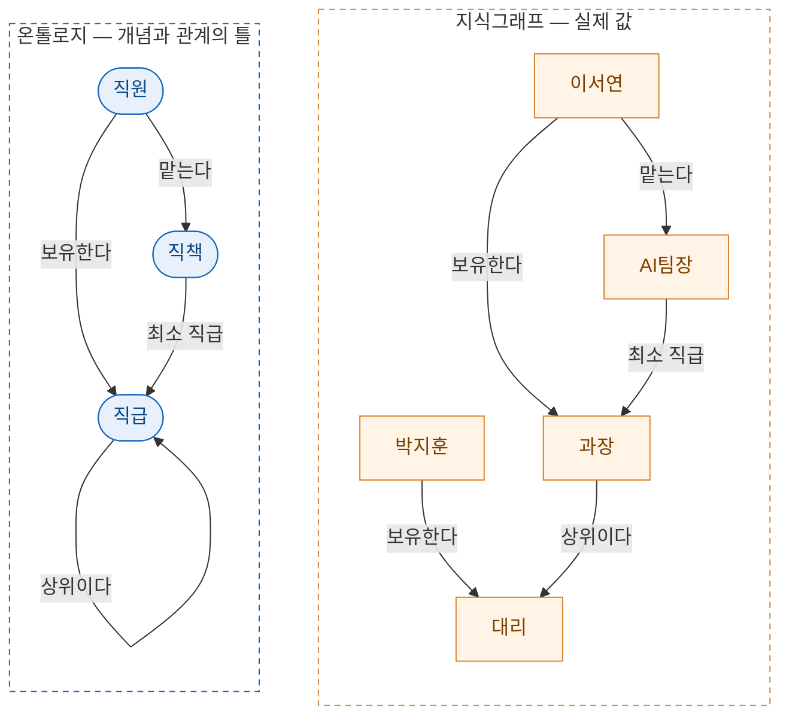

- 지식그래프의 값은 모두 온톨로지의 개념에 속한다. 박지훈·이서연은 '직원', 대리·과장은 '직급', AI팀장은 '직책'이다.
- 다른 회사가 '선임·책임·수석' 체계를 써도 온톨로지는 그대로 두고 지식그래프의 값만 바꾸면 된다.
- 둘이 함께 있어야 판단할 수 있다. 박지훈(대리)을 팀장으로 발령하면, 제약(온톨로지)과 값(지식그래프)을 대조해 위반으로 걸러낸다.

### 1.3 온톨로지의 필요성

**온톨로지는 데이터의 의미와 관계를 명시해 두어, 사람·시스템·AI가 같은 기준으로 데이터를 해석하고 질의·검증·실행하게 한다.**

| 필요성    | 설명                                                       | 예 (1.2)                                                               |
| --------- | ---------------------------------------------------------- | ---------------------------------------------------------------------- |
| 의미 공유 | 시스템마다 다른 이름·코드를 하나의 개념으로 정의          | 인사 DB의`GRD_CD='03'`, 결재 시스템의 `level=3`을 모두 '과장'으로 정의 |
| 가정 명시 | 프로그램 안에 묻힌 업무 규칙을 밖으로 꺼내 관리            | "직급은 직책의 최소 직급 이상"을 코드가 아닌 온톨로지에 정의           |
| 재사용    | 한 번 정의한 개념·규칙을 여러 질의·앱이 함께 사용        | 결재선 조회, 발령 검증, 조직도 앱이 같은 '보고한다' 관계를 사용        |
| AI 활용   | LLM이 테이블 구조를 추측하지 않고 정의된 의미·관계를 따름 | "박지훈의 결재선은?" → 보고한다 관계를 따라 박지훈 → 이서연(AI팀장)  |

**예: 같은 질문을 테이블과 온톨로지로 묻기** — "3일 넘게 늦은 선적은 어느 협력사의 어느 발주 건인가?"

```sql
-- 테이블(SQL): 테이블 3개를 조인 키로 연결. 선적(WMS)과 발주·협력사(ERP)가 다른 DB라 두 DB를 하나로 모으는 작업이 먼저 필요
SELECT sh.shipment_no, po.po_id, s.name
FROM wms.shipment sh
JOIN erp.purchase_order po ON po.po_id = sh.ref_po_no
JOIN erp.supplier s       ON s.supplier_id = po.supplier_id
WHERE sh.delay_days > 3;
```

```cypher
// 온톨로지(그래프): 업무에서 쓰는 관계 이름을 따라 조회
MATCH (sh:Shipment)-[:SHIPS]->(po:PurchaseOrder)-[:ORDERED_FROM]->(s:Supplier)
WHERE sh.delay_days > 3
RETURN sh.shipment_no, po.po_id, s.name
```

| 구분          | 테이블                                                                                                  | 온톨로지                                                                               |
| ------------- | ------------------------------------------------------------------------------------------------------- | -------------------------------------------------------------------------------------- |
| 연결 방법     | 질의할 때마다 조인 키(`po.po_id = sh.ref_po_no`)를 알아야 함                                           | 조인 키는 관계를 정의할 때 한 번만 알면 되고, 이후에는 관계 이름(`SHIPS`)만 쓰면 됨   |
| 여러 시스템   | 다른 DB에 있는 데이터를 한곳으로 모으는 작업이 먼저 필요                                                | 관계로 시스템 간 데이터를 연결                                                         |
| 새로운 질문   | 질문마다 SQL 뷰를 만들면 질문 수만큼 유지보수할 것이 늘어남                                             | 처음 받는 질문("그 협력사의 다른 미결 발주는?")도 이미 있는 관계를 따라 답함          |
| AI 에이전트   | 테이블 수백 개의 정의만 받으면`TB507.C041` 같은 코드명의 뜻과 조인할 컬럼을 매번 추측해야 함            | 의미(속성 설명)·경로(관계)·행위(액션)가 사람이 검수한 형태로 한 번 고정되어 있음      |

출처: 표의 의미 공유·가정 명시·재사용은 Noy & McGuinness(2001)가 제시한 '온톨로지를 만드는 이유'(공통 이해 공유, 도메인 지식 재사용, 가정 명시화, 도메인 지식과 운영 지식 분리, 도메인 지식 분석)를 정리한 것이다. AI 활용과 위의 비교는 Ontological Studio 튜토리얼 3장 「온톨로지란 무엇인가」를 정리한 것이다.

---

## 2. 온톨로지 구축·활용 과정

**요약**

- 온톨로지 솔루션으로 온톨로지를 만들고 활용하는 과정은 **10단계**다. 각 단계는 1장의 세 층(온톨로지·지식그래프·솔루션) 중 하나에 속하거나, 세 층에 공통이다.
- 단계 ① 범위 정의 → 온톨로지 층(단계 ②③)과 지식그래프 층(단계 ④⑤)을 번갈아 확장 → 단계 ⑥ 검증·발행 → 솔루션 층(단계 ⑦⑧⑨) → 단계 ⑩ 운영·진화 순서이며, 유즈케이스 단위로 반복한다.
- 학술 방법론(METHONTOLOGY·NeOn, 부록 A·B)은 온톨로지를 만드는 단계까지만 다루므로, 데이터 적재와 활용 단계를 더해 정리했다.

### 2.1 10단계와 세 층

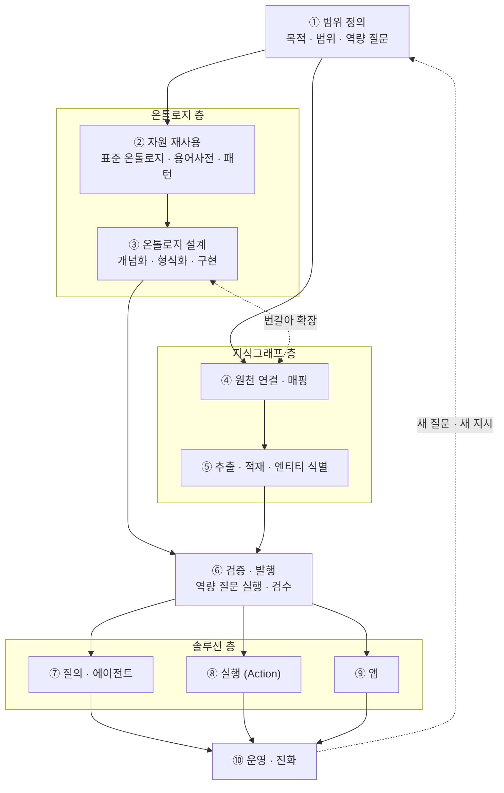

| 단계                | 층                    | 하는 일                                                                                     | 산출물                 | 예 (공급망)                                                                              |
| ------------------- | --------------------- | ------------------------------------------------------------------------------------------- | ---------------------- | ---------------------------------------------------------------------------------------- |
| ① 범위 정의        | 공통                  | 목적·범위·사용자·용도 정의, 역량 질문(답해야 할 질문)과 실행해야 할 지시 도출, 일정 계획 | 요구사항 명세, 역량 질문 목록 | 질문 "3일 넘게 늦은 선적은 어느 협력사의 발주 건인가?", 지시 "그 선적을 긴급 처리해 줘" |
| ② 자원 재사용      | 온톨로지              | 표준·상위 온톨로지, 용어사전·분류체계, 설계 패턴을 찾아 재사용·정렬                      | 재사용 목록, 정렬 결과 | 기존 공급망 용어(협력사·발주·선적·품목)와 사내 표준 코드를 가져와 정렬                 |
| ③ 온톨로지 설계    | 온톨로지              | 개념·관계·속성·제약 정의, 형식 언어로 구현                                               | 스키마(TBox)           | 클래스 `Supplier`·`PurchaseOrder`·`Shipment`, 관계 `ORDERED_FROM`·`SHIPS`           |
| ④ 원천 연결·매핑  | 지식그래프            | 원천 DB·문서 연결, 원천 구조와 온톨로지의 대응 정의 (복사형 또는 매핑형)                   | 매핑 규칙              | WMS `shipment.ref_po_no` = ERP `purchase_order.po_id` → 관계 `SHIPS`                  |
| ⑤ 추출·적재·식별 | 지식그래프            | 정형 변환·비정형 추출, 그래프 적재, 같은 개체 식별, 동기화                                 | 인스턴스(ABox)         | 선적 `SHP-03` 노드 생성, 문서의 "골드라인 PCB"와 ERP의 "Shenzhen Goldline PCB"를 한 협력사로 식별 |
| ⑥ 검증·발행       | 공통                  | 역량 질문 실행으로 답·근거 확인, 사람 검수, 발행                                           | 검증 결과, 발행본      | 질문 실행 → "SHP-03(9일 지연) → PO-002 → Shenzhen Goldline PCB" 확인 후 발행          |
| ⑦ 질의·에이전트   | 솔루션                | 자연어·그래프 질의, RAG·에이전트 연결                                                     | 질의 서비스            | 업무 사용자가 자연어로 질문하고 근거 노드와 함께 답을 받음                             |
| ⑧ 실행 (Action)    | 솔루션                | 업무 시스템 호출, 승인·되돌리기                                                            | 액션 정의              | "SHP-03 긴급 처리" → 승인 후 WMS 우선순위 변경, ERP 납기 독촉                          |
| ⑨ 앱               | 솔루션                | 대시보드·업무 앱                                                                           | 앱                     | 지연 선적 대시보드, 협력사별 미결 발주 화면                                             |
| ⑩ 운영·진화       | 공통                  | 변경 제안·검토, 버전·이력, 배포, 범위 확장                                                | 변경 이력              | 고객 CRM을 추가로 연결해 "지연 선적의 영향을 받는 고객은?"까지 확장                    |

- 온톨로지 층(단계 ②③)과 지식그래프 층(단계 ④⑤)은 번갈아 진행한다. 모델을 조금 만들고 데이터를 붙여 본 뒤 다시 모델을 고치는 방식으로, METHONTOLOGY의 진화형 프로토타입과 같은 구조다.
- 전체 과정은 한 번에 끝나는 직선 공정이 아니라, 유즈케이스 단위로 단계 ①~⑩을 반복하며 범위를 넓힌다.

---

## 3. Ontological Studio 개요

### 3.1 선정 배경

- 온톨로지 오픈소스를 검색하면 Protégé·WebProtégé처럼 **온톨로지(스키마)를 편집하는 도구**가 대부분임. 2장의 10단계로 보면 단계 ③ 온톨로지 설계만 다룸
- 본 조사의 목적은 **온톨로지 서비스(솔루션) 구축에 참고할 오픈소스**를 분석하는 것이므로, 스키마 편집 도구는 대상에서 제외함
- 온톨로지·지식그래프·솔루션 세 층, 즉 10단계 대부분을 한 제품에서 다루는 오픈소스로 **Ontological Studio**를 분석 대상으로 삼음. 라이선스가 확정되지 않은 초기 버전(3.4)이지만, 솔루션의 기능·화면 구성을 참조하기에 적합함

### 3.2 개요

| 항목           | 내용                                                                                                                                                                                                 |
| -------------- | ---------------------------------------------------------------------------------------------------------------------------------------------------------------------------------------------------- |
| 제품명         | Ontological Studio (저장소명 ontology-studio)                                                                                                                                                        |
| 개발사         | 유엔진솔루션즈 (uEngine Solutions) — 2003년부터 BPM·AI·MSA·클라우드 플랫폼 사업                                                                                                                  |
| 성격           | 온톨로지를 구축하고, 질의와 액션을 실행하며, 업무 앱을 만드는 데스크톱 프로그램                                                                                                                      |
| 배포 형태      | 데스크톱 설치 파일(macOS arm64/x64, Windows x64). 그래프 DB·데이터 패브릭·구축 에이전트·액션 실행기·예제 업무 시스템을 한 설치 파일에 포함 |
| 조사 기준      | 다운로드 설치본 v0.1.1(macOS arm64)과 공식 튜토리얼. GitHub 소스는 설치본과 동작이 달라 기준으로 삼지 않음 |
| 버전           | v0.1.0 (2026-10-24) → v0.1.2 (2026-10-28). 초기 단계                                                                                                                                                |
| AI 구동 방식   | 로컬에 로그인된 Claude Code·Codex CLI를 에이전트로 사용(별도 API 키 불필요), 또는 OpenAI 호환 API 키                                                                                                |
| 관련 상용 제품 | Ontologic Platform (Studio의 스키마 설계를 사용), 컨설팅·교육                                                                                                                                       |

### 3.3 아키텍처

> **참고** 이 절의 아키텍처 그림은 이해를 돕기 위해 본 조사에서 추가한 것이다. 공식 문서에 있는 그림이 아니며, GitHub 소스를 보고 그린 뒤 다운로드 설치본에서 일부만 확인했으므로 **실제 구성과 다를 수 있다.**

범례: 진한 파랑 = 사람, 파랑 = 시스템·구성 요소, 회색 = 외부 시스템, 점선 = 경계.

#### 3.3.1 전체 구성 — Studio는 누구와, 어떤 외부 시스템과 연결되는가

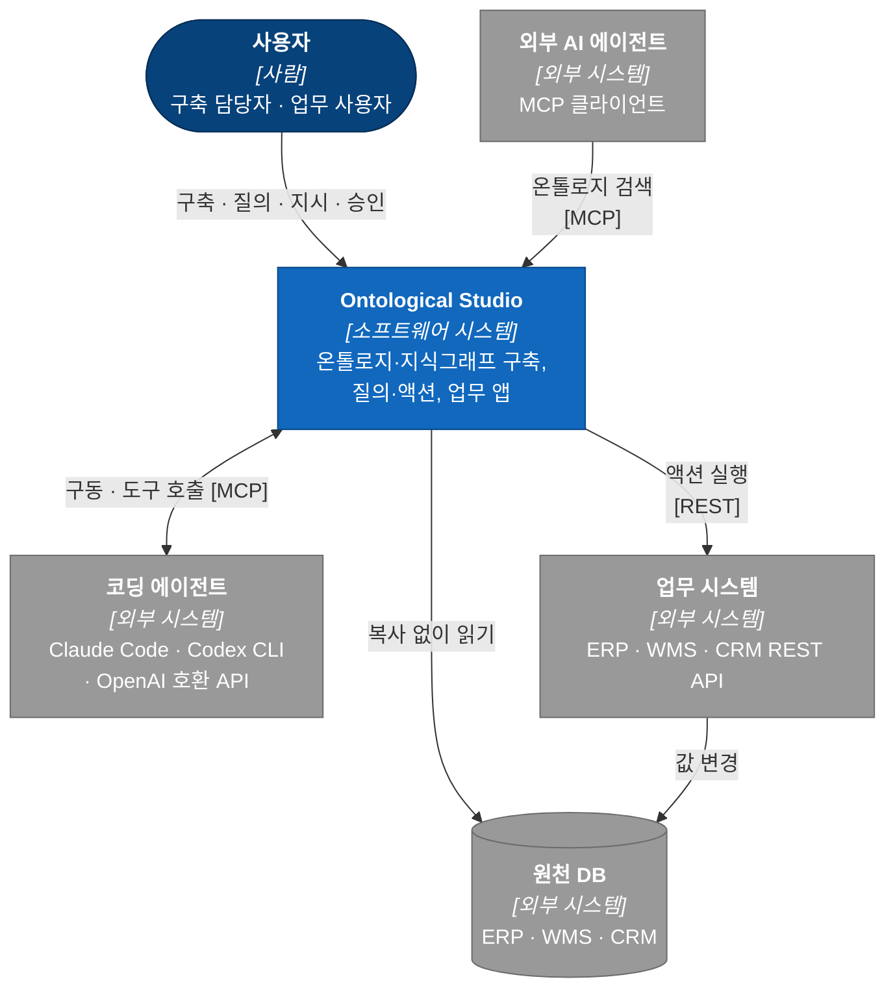

#### 3.3.2 내부 구성 — Studio 안은 어떻게 나뉘는가

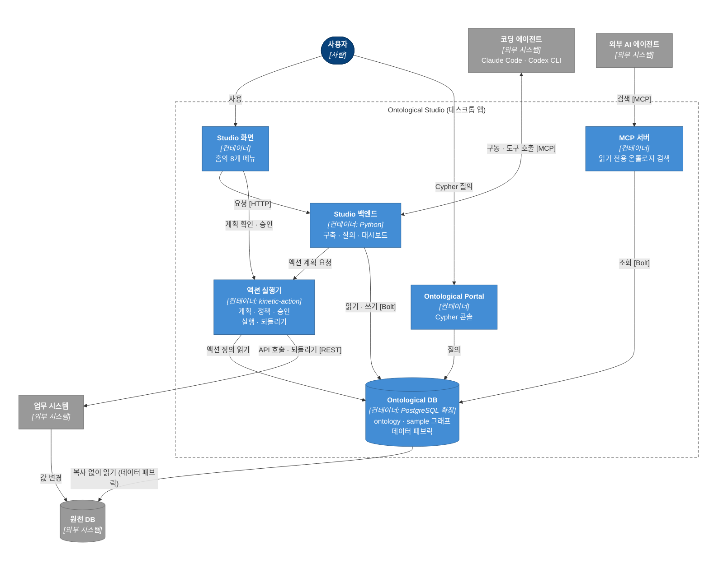

- **Ontological DB는 Cypher를 PostgreSQL SQL로 변환해 실행한다.** 별도 그래프 저장소 없이, 그래프 질의가 PostgreSQL 테이블에 대한 SQL로 바뀌어 실행된다. 변환 결과는 Portal의 SQL 탭에서 볼 수 있다(4.6).
- 데이터 패브릭은 Ontological DB 안의 기능으로, PostgreSQL의 외부 테이블 기능(FDW)을 써서 원천 DB를 복사하지 않고 그 자리에서 읽는다.
- Bolt 게이트웨이는 Neo4j가 쓰는 통신 규약(Bolt)만 지원한다. Neo4j 자체는 쓰지 않는다.
- 설치 파일 하나에 위 컨테이너가 모두 들어 있다. PostgreSQL과 Ontological DB 확장, Bolt 게이트웨이, 포털, 백엔드, MCP 서버, 액션 실행기, 예제 업무 시스템(ERP·WMS·CRM)이 앱 실행 시 함께 뜬다.

#### 3.3.3 구성 요소

| 구성 요소                 | 역할                                                                                                                                               | 해당 층 (1.1)      |
| ------------------------- | -------------------------------------------------------------------------------------------------------------------------------------------------- | ------------------ |
| Studio 백엔드 · 에이전트 | 온톨로지 구축·질의·대시보드 화면과 그 뒤의 에이전트. 로컬의 Claude Code·Codex CLI 또는 OpenAI 호환 API로 구동                                   | 온톨로지 · 솔루션 |
| Ontological DB            | PostgreSQL 확장으로 만든 그래프 DB. Cypher(및 TypeQL)를 SQL로 번역해 실행. 권한·스키마 변경 이력 지원                                  | 지식그래프         |
| Bolt 게이트웨이           | Neo4j가 사용하는 Bolt 프로토콜을 지원한다. Studio는 이를 통해 그래프를 읽고 쓴다. Neo4j 자체는 쓰지 않는다                                       | 지식그래프         |
| 데이터 패브릭             | Ontological DB 안의 기능. 원천 DB 테이블을 복사하지 않고 그래프의 가상 노드로 노출                                                                 | 지식그래프         |
| 액션 실행기               | 별도 서비스(kinetic-action). 액션 계획 → 정책 판정 → 사람 승인 → 업무 시스템 API 호출 → 취소 시 역순 되돌리기. 에이전트·앱은 업무 시스템을 직접 부르지 않고 항상 실행기를 거침 | 솔루션             |
| Ontological Portal        | Cypher 콘솔 (자연어→Cypher 변환, 자동완성, 스키마 지도)                                                                                | 지식그래프         |
| 예제 업무 시스템          | 실습용 구매 ERP·물류 WMS·고객 CRM. 각자 다른 인증 방식을 쓰는 작은 REST 서비스                                                                   | (실습용 원천)      |

> Ontological DB 안에는 원천을 비춘 `sample` 그래프와 구축 결과를 저장한 `ontology` 그래프, 두 개의 그래프가 있다. 데이터소스와 온톨로지 구축 메뉴를 함께 봐야 이해되므로 4.3 끝에서 설명한다.

### 3.4 오픈소스 여부와 라이선스

공식 소개 페이지는 "Ontology Studio는 오픈소스로 제공됩니다"라고 밝히고 GitHub 저장소를 공개하고 있다. 다만 저장소별 라이선스 표기는 다음과 같이 고르지 않다 (2026-10-28 확인).

| 저장소                                                           | 공개            | 라이선스 표기                                         |
| ---------------------------------------------------------------- | --------------- | ----------------------------------------------------- |
| uengine-oss/ontology-studio (본체: 백엔드·프런트엔드·데스크톱) | 공개            | **없음** — LICENSE 파일 없음, GitHub 라이선스 미지정 |
| uengine-oss/ontological-db (그래프 DB)                           | 공개 (서브모듈) | README에**Apache-2.0** 명시, LICENSE 파일은 없음      |
| uengine-oss/cliagents (에이전트 연동)                            | 공개 (서브모듈) | pyproject.toml에**MIT** 명시                          |
| uengine-oss/ontological-studio-releases                          | 공개            | 설치 파일(바이너리)만 배포, 라이선스 표기 없음        |

- 라이선스가 명시되지 않은 저장소는 소스가 공개되어 있어도 법적으로는 저작권자에게 모든 권리가 유보된 상태로 봄. 즉, 본체(ontology-studio)는 **소스 공개(source-available)는 맞지만 사용·수정·재배포 조건이 정해지지 않은 상태**임
- 그래프 DB(Apache-2.0)와 에이전트 연동(MIT)은 허용적 라이선스로 표기되어 있어 상업적 활용·수정이 가능한 것으로 보임
- 제품화·재배포에 활용하려면 유엔진솔루션즈에 본체 라이선스를 확인하거나 별도 협의가 필요함

---

## 4. Ontological Studio 화면·기능

기준: 다운로드 설치본(v0.1.1)과 공식 튜토리얼(2~20장). 홈 화면의 8개 메뉴를 하나씩, **화면 → 주요 기능 → 관련 개념 → 처리 과정** 순서로 정리한다. 각 메뉴가 2장의 10단계 중 어디에 해당하는지는 첫 줄에만 표시한다.

### 4.0 홈 화면

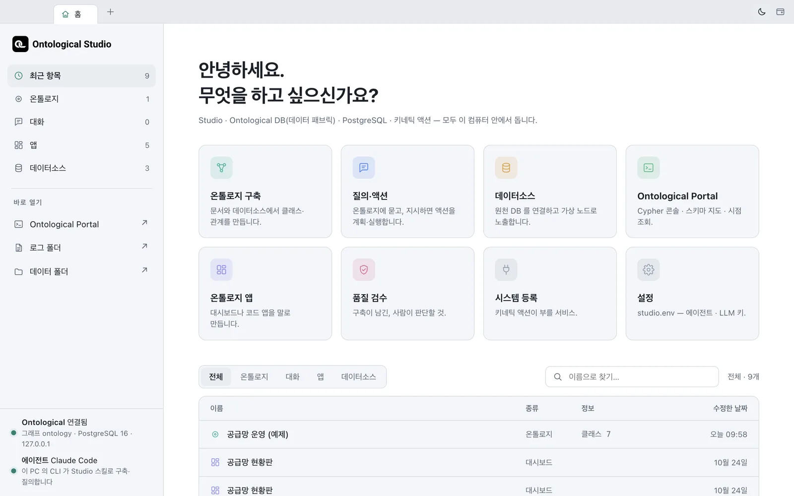

*홈 화면 — 여덟 개의 카드와 최근 항목. 왼쪽 아래에 Ontological 연결 상태와 에이전트가 보인다*

홈 화면의 8개 카드가 각각 하나의 **메뉴**다. 카드를 누르면 그 메뉴가 새 탭으로 열린다(탭 안 왼쪽의 아이콘 줄로도 같은 메뉴를 고를 수 있다). 4.1~4.8은 사용 순서에 따라 **준비**(데이터소스·시스템 등록) → **구축**(온톨로지 구축·품질 검수) → **활용**(질의·액션·Portal·앱) 순으로 정리한다.

| 구분 | 메뉴               | 하는 일                                                                    | 해당 단계   | 절  |
| ---- | ------------------ | -------------------------------------------------------------------------- | ----------- | --- |
| 준비 | 데이터소스         | 원천 DB를 연결하고 테이블을 가상 노드로 노출                               | ④          | 4.1 |
| 준비 | 시스템 등록        | 액션이 호출할 업무 시스템(마이크로서비스) 등록                             | ⑧          | 4.2 |
| 구축 | 온톨로지 구축      | 문서·데이터소스·시스템을 근거로 에이전트가 클래스·관계와 액션을 만들고 채움 | ①②③⑤⑥⑧ | 4.3 |
| 구축 | 품질 검수          | 구축이 남긴, 사람이 판단할 항목 확인                                       | ⑥          | 4.4 |
| 활용 | 질의·액션         | 온톨로지에 말로 묻고, 지시하면 액션을 계획·승인·실행                      | ⑦⑧        | 4.5 |
| 활용 | Ontological Portal | Cypher 콘솔, 스키마 지도, 실행 계획 확인                                   | ⑦⑩        | 4.6 |
| 활용 | 온톨로지 앱        | 대시보드나 코드 앱을 말로 만듦                                             | ⑨          | 4.7 |
| 공통 | 설정               | 에이전트와 LLM 키 (`studio.env`)                                           | 공통        | 4.8 |

메뉴 외에 **MCP 서버**가 있어, 다른 AI 에이전트가 Studio의 온톨로지를 읽기 전용으로 검색할 수 있다.

---

### 4.1 [메뉴] 데이터소스
**해당 단계**: ④ 원천 연결·매핑

원천 DB를 연결하고, 테이블을 **복사하지 않고** 그래프의 노드·관계로 노출한다.

**화면**

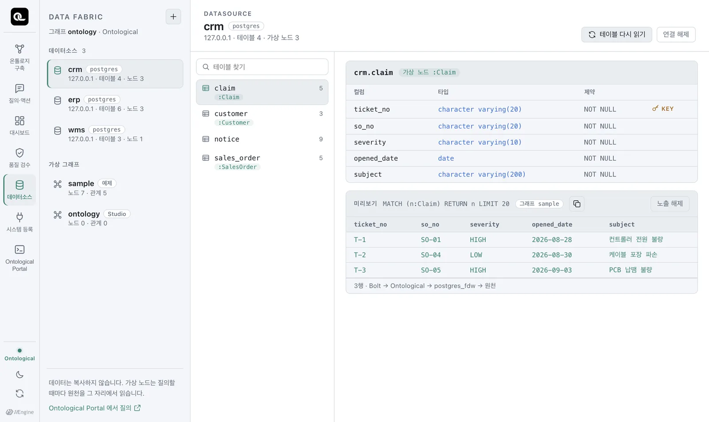

*데이터소스 탭 — 왼쪽에 데이터소스 3개(crm·erp·wms)와 가상 그래프, 가운데 테이블 목록, 오른쪽 테이블 상세와 미리보기*

| 영역                  | 내용                                                                                       |
| --------------------- | ------------------------------------------------------------------------------------------ |
| 왼쪽 위 데이터소스    | 연결된 원천 DB (예제: `crm`, `erp`, `wms`)                                                 |
| 왼쪽 아래 가상 그래프 | 가상 노드가 속한 그래프 (예제: `sample`)                                                   |
| 가운데                | 테이블 목록. 초록 라벨(`:Claim` 등)은 이미 가상 노드로 노출된 테이블                       |
| 오른쪽                | 컬럼·타입·제약, 가상 노드라면 미리보기 20행. 아래 `Bolt → Ontological → postgres_fdw → 원천`은 원천에서 지금 읽어 왔다는 표시 |

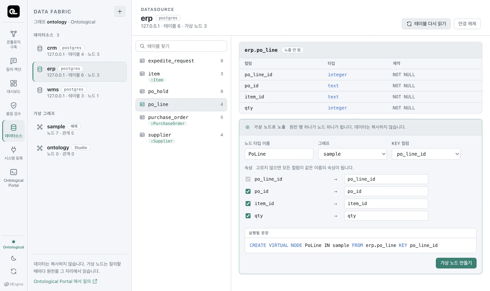

*가상 노드로 노출 — 노드 이름·그래프·KEY 컬럼·속성을 고르면 실행될 문장이 보임*


*가상 노드 생성 직후 — 원천 `erp.po_line`의 9행이 바로 미리보기에 나옴*

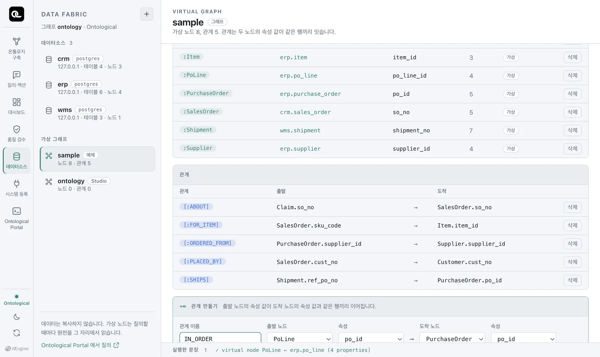

*가상 관계 만들기 — 출발 노드의 속성과 도착 노드의 속성이 같으면 관계로 이음*


*가상 그래프 `sample` — 데이터소스별 가상 노드와 가상 관계, 아래에 실행한 문장*

**주요 기능**

| 기능            | 내용                                                                                                      |
| --------------- | --------------------------------------------------------------------------------------------------------- |
| 데이터소스 연결 | PostgreSQL · MySQL/MariaDB · Oracle · SQL Server. 테이블·컬럼 타입이 카탈로그로 들어오고 데이터는 한 행도 복사되지 않음. 읽기 전용 계정 권장 |
| 가상 노드       | 테이블 하나를 노드 종류로 정의. 질의할 때마다 원천을 읽음 (읽기 전용)                                     |
| 가상 관계       | "A.x = B.y" 조인 규칙에 이름을 붙여 저장. 서로 다른 DB도 관계로 연결                                      |
| 실행한 문장     | 화면 조작이 모두 패브릭 문장으로 실행되고 기록됨. 같은 문장을 포털에서 직접 입력해도 됨                   |
| 복사 저장       | 필요하면 가상 노드의 현재 값을 그래프에 실제 노드로 복사 (MATERIALIZE)                                    |

**관련 개념**

- **데이터 패브릭**: 데이터를 원천에 둔 채 질의할 때마다 읽어 오는 방식. 복사(ETL)와 비교하면 다음과 같다.

  |             | 복사 (ETL)                 | 데이터 패브릭                                   |
  | ----------- | -------------------------- | ----------------------------------------------- |
  | 데이터 위치 | 웨어하우스에 사본          | 원천 그대로                                     |
  | 신선도      | 마지막 적재 시점           | 질의하는 순간                                   |
  | 권한        | 원천과 사본 두 곳          | 원천 한 곳                                      |
  | 쓰기        | 사본에 써도 원천은 그대로  | 가상 노드는 읽기 전용, 쓰기는 원천 시스템으로   |

- **가상 노드와 가상 관계 — 테이블이 그래프로 보이는 방식**: 그래프에서 **테이블은 노드의 종류**, **행 하나가 노드 하나**다. "가상 노드를 만든다"는 정확히는 테이블 하나를 **노드 종류로 등록**한다는 뜻이고, 그 테이블의 행이 전부 노드로 보인다.

  | DB                                 | 그래프                     | 예                                                     |
  | ---------------------------------- | -------------------------- | ------------------------------------------------------ |
  | 테이블                             | 노드 **종류**(타입, 라벨)  | `wms.shipment` 테이블 → `Shipment` 종류                |
  | 행 하나                            | **노드 하나**              | `SHP-03` 행 → `SHP-03` 노드 (8행이면 노드 8개)         |
  | 컬럼                               | 노드의 속성                | `delay_days = 9`                                       |
  | 두 테이블을 잇는 컬럼(외래키 역할) | **관계**                   | `shipment.ref_po_no = purchase_order.po_id` → `SHIPS` |

  | 개념      | 한 줄 정의                                                       | DB에 비유하면        |
  | --------- | ---------------------------------------------------------------- | -------------------- |
  | 가상 노드 | 원천 테이블 하나를 노드 종류로 등록한 정의. 데이터는 복사하지 않음 | 뷰(VIEW)             |
  | 가상 관계 | 두 테이블의 컬럼 값이 같으면 잇는다는 규칙에 이름을 붙인 것      | 이름 붙인 JOIN 조건  |

- **시스템마다 다른 이름**: 같은 "발주 번호"가 ERP에서는 `po_id`, WMS에서는 `ref_po_no`다. 이 차이를 관계로 이어 주는 것이 온톨로지의 역할이다.

**질의할 때의 동작** — 가상 노드·관계는 정의만 있고, 질의하는 순간 원천을 읽는다

```
질의:   MATCH (s:Shipment)-[:SHIPS]->(p:PurchaseOrder)
          │  정의를 찾음: Shipment = wms.shipment 테이블, SHIPS = ref_po_no = po_id
          ▼
실행:   SELECT … FROM wms.shipment JOIN erp.purchase_order ON ref_po_no = po_id   ← 이 순간 원천을 읽음
          ▼
결과:   테이블의 행이 노드처럼, 조인 결과가 관계처럼 보임 (어디에도 저장되지 않음)
```

```
Shipment 노드 (wms.shipment의 행)              PurchaseOrder 노드 (erp.purchase_order의 행)
SHP-03   ref_po_no = "PO-002"  ───SHIPS───▶    PO-002   po_id = "PO-002"
          └──── 규칙: Shipment.ref_po_no = PurchaseOrder.po_id ────┘
```

이 때문에 원천 값이 바뀌면 바로 보이고, 쓰기는 안 되며(읽기 전용, 값 변경은 액션이 업무 시스템 API로, 4.5), 서로 다른 DB(WMS와 ERP)도 규칙만으로 이어진다.

**연결 테이블은 노드가 된다** — 발주 품목(`erp.po_line`)처럼 두 테이블 사이를 잇는 테이블은 관계가 아니라 **그 자체가 노드 종류**가 되고, 양쪽과 **가상 관계 2개**로 이어진다. 수량(`qty`)처럼 연결 테이블에만 있는 값을 속성으로 담기 위해서다.

```
erp.po_line 테이블:   po_line_id | po_id  | item_id | qty        (행 값은 설명용 예시)
                      …          | PO-002 | I-PCB   | …

PurchaseOrder (PO-002) ◀──IN_ORDER── PoLine (qty …) ──OF_ITEM──▶ Item (I-PCB, PCB 기판)
```

**처리 과정** — 발주 품목(`po_line`)을 그래프에 넣기

**1) 데이터소스 연결 (예제는 이미 연결됨)**

```cypher
CREATE DATASOURCE mydb WITH ENGINE = 'postgres', PARAMETERS = {host: '10.0.0.5', port: 5432, database: 'sales', schema: 'public', user: 'reader', password: '••••'}
```

**2) 테이블을 가상 노드로 노출**

```cypher
CREATE VIRTUAL NODE PoLine IN sample FROM erp.po_line KEY po_line_id
```

**3) 가상 관계로 잇기**

```cypher
CREATE VIRTUAL RELATIONSHIP IN_ORDER IN sample FROM PoLine(po_id) TO PurchaseOrder(po_id)
CREATE VIRTUAL RELATIONSHIP OF_ITEM  IN sample FROM PoLine(item_id) TO Item(item_id)
```

**4) 두 시스템(WMS·ERP)에 걸친 질문을 바로 조회 — "3일 넘게 늦은 선적이 싣고 오는 품목과 그 안전재고는?"**

| i.name   | i.safety_stock | sh.shipment_no | sh.delay_days |
| -------- | -------------- | -------------- | ------------- |
| PCB 기판 | 500            | SHP-02         | 7             |
| PCB 기판 | 500            | SHP-03         | 9             |

**참조 포인트**

- 화면 조작과 문장(코드)이 1:1로 대응하고 실행 기록이 남는다. 화면으로 시작해 문장으로 자동화할 수 있다.
- DB를 온톨로지로 쓰는 방식은 **복사형**과 **매핑형**으로 나뉜다(부록 B). Studio의 데이터소스는 매핑형, 구축한 온톨로지의 인스턴스는 복사형이다(4.3 "두 그래프"). 솔루션은 두 방식을 모두 지원하고 원천 특성에 따라 고르게 하는 것이 바람직하다.
- 빈칸: API·파일 원천, 여러 컬럼으로 된 키, 대용량 원천에서의 성능.

---

### 4.2 [메뉴] 시스템 등록
**해당 단계**: ⑧ 실행 (Action)

액션이 호출할 **업무 시스템의 API**를 등록한다. 데이터 패브릭은 원천을 읽기만 하므로, 값을 바꾸는 일은 그 데이터의 주인인 업무 시스템이 하게 한다.

**화면**

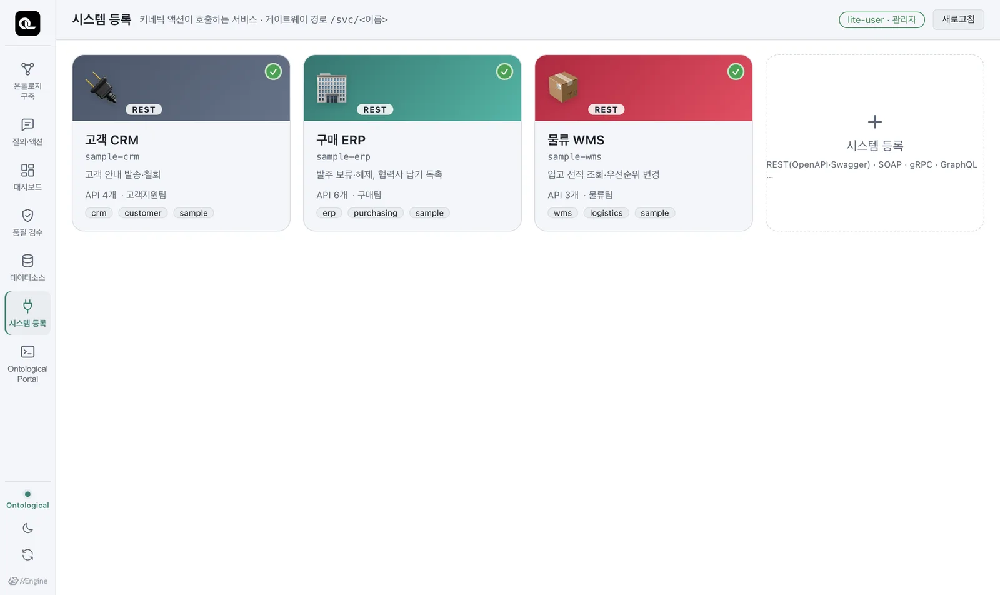

*시스템 목록 — 예제 시스템 3개(고객 CRM, 구매 ERP, 물류 WMS)*

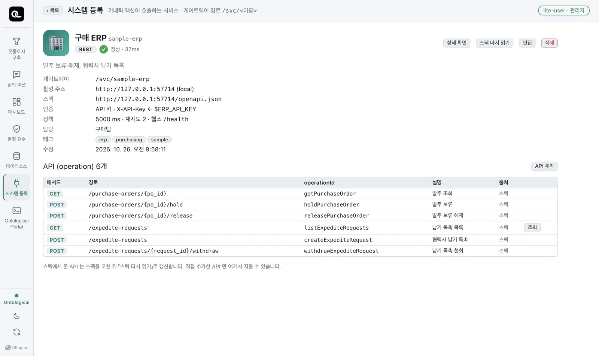

*시스템 상세 (구매 ERP) — 상태(정상, 37ms), 게이트웨이 경로, 스펙, 인증, 호출 정책, API 6개*

**주요 기능**

| 기능          | 내용                                                                                                          |
| ------------- | ------------------------------------------------------------------------------------------------------------- |
| 시스템 등록   | 기본 정보 → 스펙(OpenAPI 파일 또는 주소) → 인증 → 연결 테스트 순서로 등록                                    |
| API 목록      | 스펙에서 메서드·경로·operationId·설명을 읽음. 빠진 API는 직접 추가, 「스펙 다시 읽기」로 갱신                |
| 인증          | API 키 · Basic · Bearer · OAuth 클라이언트 자격 증명 · 로그인 토큰. 비밀 값 대신 **환경 변수 이름**만 기록    |
| 호출 정책     | 타임아웃, 재시도 횟수, 상태 점검 경로                                                                         |
| 상태 확인     | 현재 연결 상태와 응답 시간                                                                                    |

**관련 개념**

- **왜 API를 부르나**: ⓐ 업무 시스템의 검증·승인·이력 규칙을 지키고 ⓑ 권한과 책임이 그 시스템에 남으며 ⓒ 내부 테이블이 바뀌어도 API는 유지되어 액션이 덜 깨진다.
- **예제 시스템**: 실제 회사처럼 인증 방식이 시스템마다 다르다.

  | 시스템                 | 하는 일 (operationId)                                                                 | 인증                  |
  | ---------------------- | ------------------------------------------------------------------------------------- | --------------------- |
  | `sample-erp` 구매 ERP  | 발주 보류·해제(`holdPurchaseOrder`·`releasePurchaseOrder`), 납기 독촉·철회           | API 키 (`X-API-Key`) |
  | `sample-wms` 물류 WMS  | 선적 조회, 우선순위 변경(`setShipmentPriority`)                                      | Basic                 |
  | `sample-crm` 고객 CRM  | 고객 안내 발송·철회(`createNotice`·`withdrawNotice`)                                 | Bearer 토큰           |

**처리 과정**

1. 「＋ 시스템 등록」 → 이름·담당 팀 등 기본 정보
2. OpenAPI(Swagger) 스펙을 끌어다 놓거나 주소 입력 → API 목록이 바로 읽힘
3. 인증 방식과 비밀 값이 든 환경 변수 이름 입력 (값은 `studio.env`에, 실행기만 호출 순간에 붙임)
4. 연결 테스트 통과 후 저장
5. 온톨로지 구축 때 골든 커맨드와 함께 이 시스템을 소스로 고르면, 에이전트가 API로 액션을 만든다(4.3)

**참조 포인트**

- 비밀 값을 등록 정보에 남기지 않는다.
- 빈칸: SOAP·gRPC·GraphQL 시스템은 등록만 되고 액션에는 쓰지 못한다. API가 없는 시스템을 화면 조작으로 실행하는 기능은 없다.

---

### 4.3 [메뉴] 온톨로지 구축
**해당 단계**: ① 범위 정의 · ② 자원 재사용 · ③ 온톨로지 설계 · ⑤ 추출·적재·식별 · ⑥ 검증·발행 · ⑧ 실행(액션 만들기)

문서·데이터소스·업무 시스템을 근거로, 에이전트가 온톨로지(클래스·관계·속성)를 설계하고 인스턴스를 채우며 액션까지 만든다. 사람은 처음에 무엇을 위해 만들지를 정하고, 끝에 검수·발행한다.

**화면**

화면 왼쪽은 **구축 브리프**(위에서 아래로 채우는 입력), 오른쪽은 **온톨로지 그래프**(만들어지는 스키마·엔티티 지도)다.

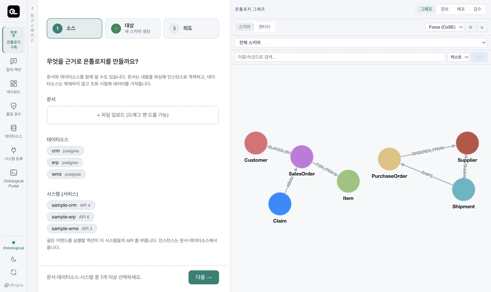

*소스 — 근거 고르기 — 문서 업로드, 데이터소스, 시스템을 구축의 근거로 고름*

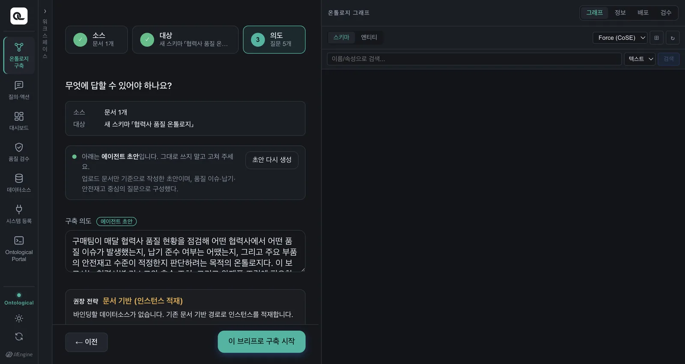

*의도 — 에이전트가 쓴 초안 — 에이전트가 문서를 읽고 구축 의도·골든 퀘스천 초안을 씀*

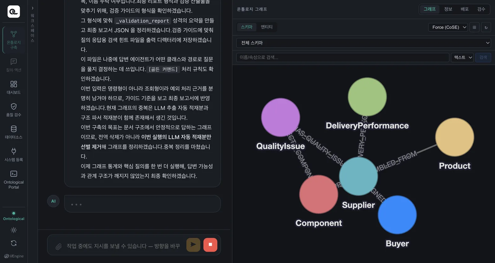

*구축 중 — 에이전트 작업과 개념 지도 — 왼쪽에 도구 호출이 흐르고, 설계가 잡히면 오른쪽에 지도*

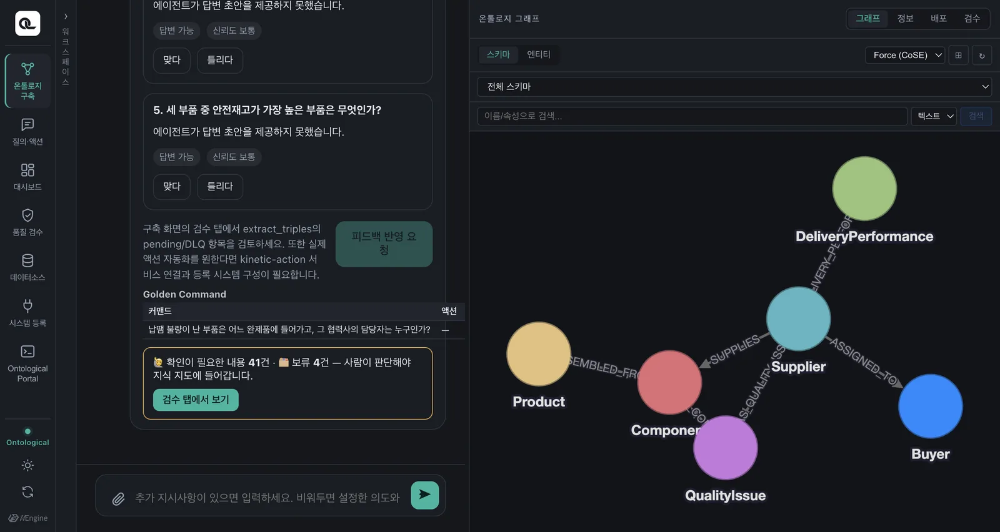

*구축 보고 — 질문별 검증 결과 — 골든 퀘스천별 검증 결과와 사람이 판단할 항목*

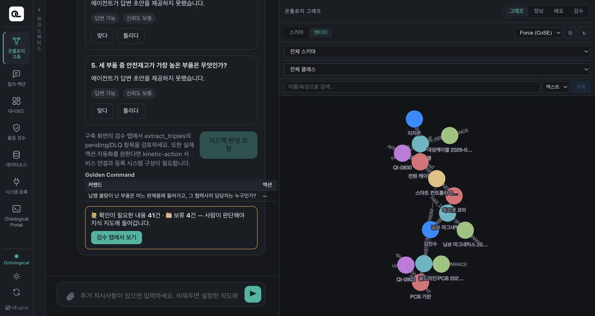

*그래프 탭 — 만들어진 온톨로지 — 「스키마」는 클래스와 관계, 「엔티티」는 인스턴스*

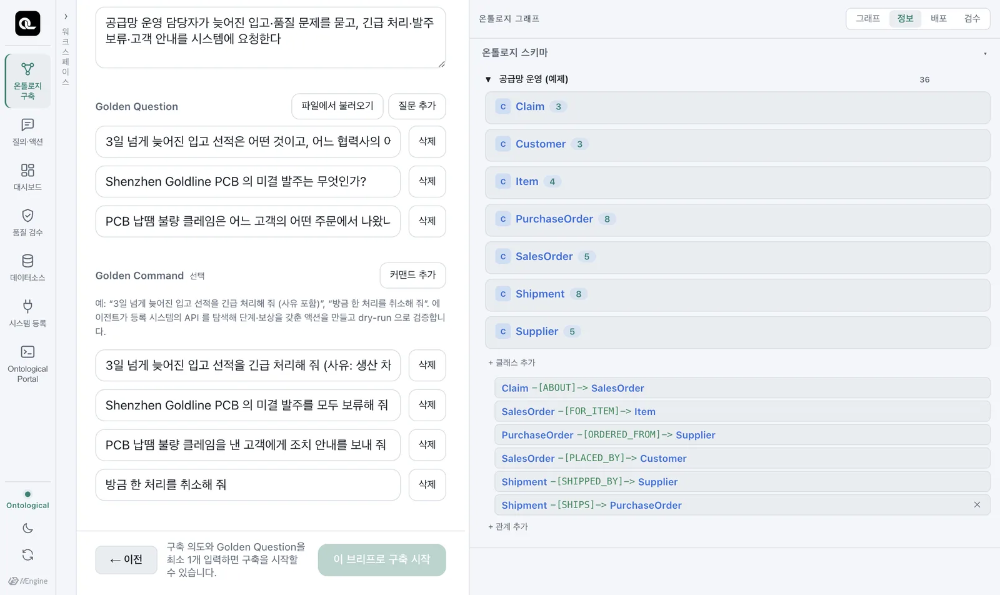

*정보 탭 — 목록으로 보고 고치기 — 클래스별 인스턴스 수, 속성 추가·이름 변경, 클래스·관계 추가*

**주요 기능**

| 기능                  | 내용                                                                                                   | 단계 |
| --------------------- | ------------------------------------------------------------------------------------------------------ | ---- |
| 구축 의도 초안        | 에이전트가 문서를 읽고 구축 의도·골든 퀘스천 초안을 씀(실측 약 50초). 사람이 고쳐 확정                | ①    |
| 추가 인제스천         | 기존 스키마를 대상으로 고르면 새 소스의 내용을 그 스키마에 더함. 같은 이름 클래스는 병합/분리를 물음  | ②    |
| 스키마 우선 설계      | 골든 퀘스천에서 거꾸로 필요한 클래스·관계·속성을 정함                                                 | ③    |
| 직접 편집             | 정보 탭에서 클래스·속성·관계 추가와 이름 변경                                                          | ③    |
| 문서 추출·적재        | 문서의 문장을 노드·관계로 옮김 ("골드라인 PCB가 PCB 기판을 공급한다" → 노드 2개 + 관계 1개)          | ⑤    |
| 엔티티 식별           | 다른 표현이 같은 대상인지 이름·코드·문맥·버전으로 대조해 하나로 연결, 애매하면 사람에게              | ⑤    |
| 메타데이터 증강       | 데이터소스의 테이블·컬럼 실제 값과 쓰임새를 보고 업무 의미를 붙임                                      | ⑤    |
| 액션 만들기           | 골든 커맨드마다 등록된 시스템 API에서 실행할 API와 되돌릴 API를 찾아 액션으로 묶음                    | ⑧    |
| 자동 검증             | 골든 퀘스천을 직접 실행하고, 골든 커맨드를 드라이런. 미충족이면 원인을 분석해 보완 후 재실행         | ⑥    |
| 발행                  | 사람이 결정해야 질의·액션·앱에서 사용 (v0.1.x는 버튼 없이 대화로 "발행해 줘", 실측 약 50초)          | ⑥    |

**관련 개념**

- **구축 브리프**: 구축을 시작하기 전에 채우는 설정서. 소스(무엇을 근거로) · 대상(어디에) · 의도(무엇을 위해)를 적는다.
- **골든 퀘스천**: 온톨로지가 반드시 **답해야** 할 질문. 소프트웨어 공학의 인수 기준과 같다. 설계할 때 출발점이 되고, 검증할 때 시험 문제가 되며, 질의 화면·앱에 예시 질문으로 붙는다. 학술 방법론의 역량 질문(Competency Question)과 같은 역할이다.
- **골든 커맨드**: 온톨로지가 반드시 **할 수 있어야** 할 지시. 액션을 만드는 출발점이다.

  |           | 골든 퀘스천                                                 | 골든 커맨드                                           |
  | --------- | ----------------------------------------------------------- | ----------------------------------------------------- |
  | 예        | 3일 넘게 늦어진 입고 선적은 어느 협력사의 어느 발주 건인가? | 3일 넘게 늦어진 입고 선적을 긴급 처리해 줘           |
  | 만드는 것 | 클래스·관계·속성, 인스턴스                                 | 액션 (단계·되돌리기·정책)                            |
  | 재료      | 문서, 데이터소스                                            | 등록된 업무 시스템의 API                              |
  | 검증 방법 | 질문을 실행해 답과 근거 확인                                | 드라이런으로 계획·정책 확인                          |

- **스키마 우선 설계와 근거 기반 반복 검증**: 질문에서 후보 스키마와 질문별 탐색 경로를 만들고, 실행 결과가 기준에 못 미치면 원인을 분석해 스키마·매핑을 보완한다.

- **엔티티 식별**: 문서에는 같은 대상이 여러 이름으로 나온다(예: 문서의 "골드라인 PCB"와 ERP의 "Shenzhen Goldline PCB"). 후보를 찾고 식별키·문맥·버전으로 비교해 기존 엔티티에 연결하거나, 사람 검토로 넘기거나, 새 엔티티로 판단한다. 원문 표현과 출처는 남긴다.

- **메타데이터 증강**: 데이터소스의 물리 카탈로그(테이블·컬럼·키)에 실제 값·쓰임새 분석으로 업무 의미를 더한 **증강 카탈로그**를 만들어 설계에 쓴다. `TB507.C041` 같은 코드명 컬럼도 업무 용어로 찾을 수 있게 된다.

- **드라이런**: 실제로 실행하지 않고 계획만 세워 보는 것. 대상 수·정책 통과·승인 필요 여부만 확인하고 업무 시스템은 바꾸지 않는다.
- **발행**: 구축한 온톨로지를 질의·액션·앱이 쓸 수 있게 내보내는 것. 발행할지는 사람이 정한다.

**처리 과정**

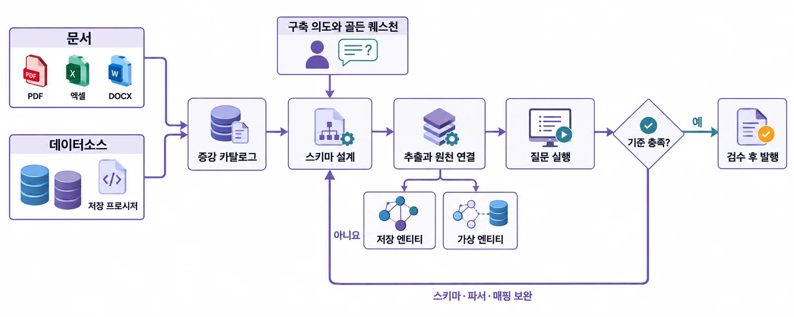

*온톨로지 구축의 전체 흐름 — 문서·데이터소스와 구축 의도·골든 퀘스천에서 출발해 증강 카탈로그, 스키마 설계, 추출과 원천 연결, 질문 실행을 거쳐 기준을 충족하면 검수 후 발행*

| 순서         | 에이전트가 하는 일                                                 | 사람이 하는 일                                   |
| ------------ | ------------------------------------------------------------------ | ------------------------------------------------ |
| 1. 소스      | —                                                                 | 문서를 올리고, 데이터소스·시스템을 고른다        |
| 2. 대상      | —                                                                 | 새 스키마를 만들지, 기존 스키마에 더할지 고른다  |
| 3. 의도      | 문서를 읽고 구축 의도와 골든 퀘스천**초안**을 쓴다               | 초안을 고치고 질문·지시를 더한다                |
| 4. 설계      | 문서 구조를 파악하고, 질문에서 필요한 클래스·관계·속성을 정한다   | 병합/분리 질문에 답한다                          |
| 5. 추출·적재 | 문서의 사실을 인스턴스와 관계로 옮기고, 같은 대상을 하나로 맞춘다 | (지켜본다)                                       |
| 6. 액션      | 골든 커맨드마다 실행 API·되돌릴 API를 찾아 액션을 만든다         | (지켜본다)                                       |
| 7. 검증      | 골든 퀘스천을 실행하고 골든 커맨드를 드라이런해 보고서를 쓴다    | 보고서를 읽는다                                  |
| 8. 검수·발행 | —                                                                 | 품질 검수 항목을 판단하고 발행을 결정한다        |

**예: 설계된 클래스** — 설치본의 예제 온톨로지 「공급망 운영 (예제)」에 실제 저장된 정의

| 클래스                 | 설명 (저장된 값)                                                                                       | 속성                                                                                      | 관계                                   |
| ---------------------- | ------------------------------------------------------------------------------------------------------ | ----------------------------------------------------------------------------------------- | -------------------------------------- |
| `Shipment` (선적)      | 협력사가 보낸 입고 선적(WMS). delay_days 가 납기 대비 지연 일수 … '3일 넘게 늦어진' 은 delay_days > 3 | `shipment_no`, `ref_po_no`, `vendor_code`, `ship_status`, `delay_days`, `eta`, `priority` | `SHIPS` → 발주, `SHIPPED_BY` → 협력사 |
| `PurchaseOrder` (발주) | 협력사에 낸 구매 발주(ERP). status 가 OPEN 이면 미결 발주다                                            | `po_id`, `supplier_id`, `order_date`, `amount_usd`, `status`                              | `ORDERED_FROM` → 협력사                |
| `Supplier` (협력사)    | 자재를 공급하는 협력사. 발주(PurchaseOrder)와 입고 선적(Shipment)의 상대방이다                         | `supplier_id`, `name`, `country`, `tier`                                                  | —                                      |

**좋은 골든 퀘스천 쓰기** (튜토리얼 11장)

| 덜 좋은 예            | 더 좋은 예                                                                | 이유                                                         |
| --------------------- | ------------------------------------------------------------------------- | ------------------------------------------------------------ |
| 협력사 정보를 알려 줘 | Shenzhen Goldline PCB의 미결 발주는 무엇인가?                             | 대상과 조건이 구체적이어야 검증할 수 있다                    |
| 품질이 어때?          | PCB 납땜 불량 클레임은 어느 고객의 어떤 주문에서 나왔나?                  | 답의 모양(고객, 주문)이 정해져 있다                          |
| 선적, 발주, 협력사    | 3일 넘게 늦어진 입고 선적은 어떤 것이고, 어느 협력사의 어느 발주 건인가? | 여러 관계를 따라가는 질문으로 필요한 스키마 경로를 확인한다 |

- 업무 담당자가 **입으로 하는 질문**으로, **두세 관계를 거치는 질문**을 섞고, 답이 하나로 정해지게 쓴다.

**액션 만들기 — 골든 커맨드에서 액션으로**

온톨로지 구축 메뉴는 개념(클래스·관계)뿐 아니라 **할 수 있는 일(액션)**도 만든다. 재료는 문서나 데이터베이스가 아니라 시스템 등록 메뉴(4.2)에 등록된 **업무 시스템의 API**다.

구축 에이전트는 골든 커맨드마다 다음을 한다.

1. 등록된 시스템의 API(OpenAPI 스펙)를 살펴 이 지시를 **실행할 API**를 찾는다
2. 그 일을 **되돌릴 API**(보상)를 짝짓는다
3. 누가 어떤 대상에 쓸 수 있는지 **정책**을 붙여 **액션**을 만든다
4. **드라이런**으로 검증한다 — 대상 수, 정책 통과, 승인 필요 여부가 보고서에 남는다

이미 같은 일을 하는 액션이 있으면 새로 만들지 않고 "기존 액션으로 충족된다"고 보고한다.

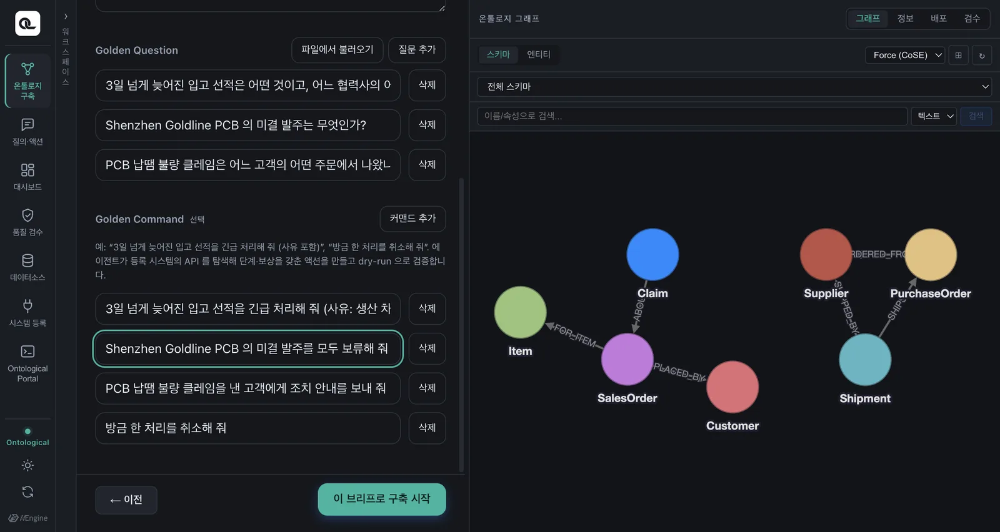

*골든 커맨드 목록 — 두 번째 커맨드에는 아직 연결된 액션이 없다 (시연, 밤 테마)*

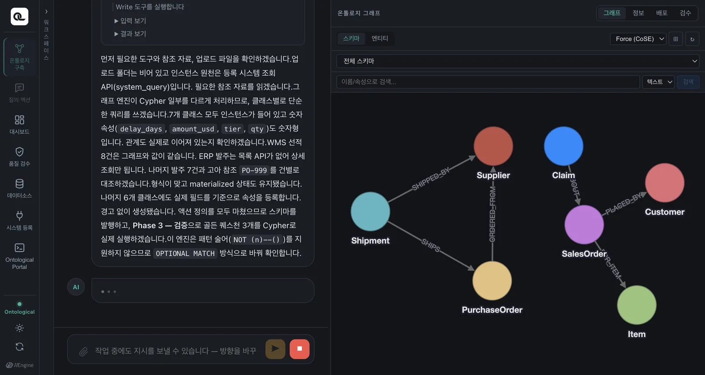

*구축 에이전트가 ERP의 API를 살펴 보류·해제를 단계와 보상으로 묶는 중 (시연, 밤 테마, 실측 약 4분 반)*

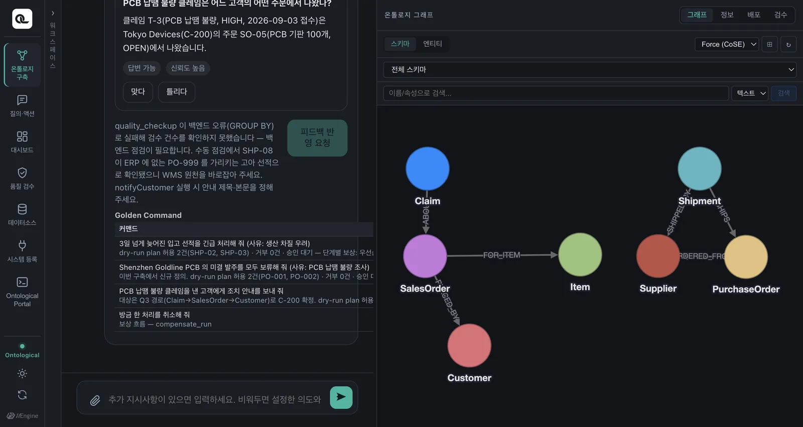

*구축 보고 — 골든 커맨드마다 어떤 액션으로 충족됐고 드라이런 결과가 어땠는지 (시연, 밤 테마)*

**처리 과정 — 액션을 더할 때의 구축 브리프**

| 브리프 칸 | 입력                                                                  |
| --------- | --------------------------------------------------------------------- |
| 소스      | 시스템 `sample-erp` (문서·데이터베이스가 아니라 시스템의 API가 재료) |
| 대상      | 기존 스키마 「공급망 운영 (예제)」 (개념은 이미 있으니 할 수 있는 일만 더함) |
| 의도      | 골든 커맨드: "한빛정밀의 미결 발주를 모두 보류해 줘 (사유: 단가 재협상)" |

**예: 예제의 골든 커맨드와 만들어진 액션**

| 골든 커맨드                                                                  | 액션                              | 실행 (보상)                                              |
| ---------------------------------------------------------------------------- | --------------------------------- | -------------------------------------------------------- |
| 3일 넘게 늦어진 입고 선적을 긴급 처리해 줘 (사유: 생산 차질 우려)           | `Shipment.expediteShipment`       | WMS 우선순위 URGENT (이전 값으로) → ERP 납기 독촉 (철회) |
| Shenzhen Goldline PCB의 미결 발주를 모두 보류해 줘 (사유: PCB 납땜 불량 조사) | `PurchaseOrder.holdPurchaseOrder` | ERP 발주 보류 (해제)                                     |
| PCB 납땜 불량 클레임을 낸 고객에게 조치 안내를 보내 줘                      | `Customer.notifyCustomer`         | CRM 안내 발송 (철회)                                     |
| 방금 한 처리를 취소해 줘                                                     | (별도 액션 없음)                  | 위 액션들의 보상 흐름으로 충족                           |

**액션 정의의 구성** — 설치본에 실제 저장된 `Shipment.expediteShipment`

| 구성           | 뜻                                        | `Shipment.expediteShipment`에서                                     |
| -------------- | ----------------------------------------- | ------------------------------------------------------------------- |
| 대상 키        | 대상 인스턴스를 가리키는 속성             | `shipment_no`                                                       |
| 입력           | 실행할 때 사람이(또는 에이전트가) 주는 값 | `reason` (긴급 처리 사유, 필수)                                     |
| 단계           | 차례로 부를 시스템 API                    | ① WMS 우선순위 URGENT (`setShipmentPriority`) ② ERP 협력사 납기 독촉 (`createExpediteRequest`) |
| 보상(되돌리기) | 단계마다, 그것을 되돌리는 API             | ① 우선순위를 실행 전 값으로 ② 납기 독촉 철회 (`withdrawExpediteRequest`) |
| 정책           | 누가, 어떤 대상에 쓸 수 있나              | 역할 `scm_operator`, 이미 입고된 선적(`ship_status != 'DELIVERED'`) 제외 |
| 승인           | 사람의 승인이 필요한가                    | 예제는 모든 계획에 승인 필요                                        |
| 되쓰기         | 실행 뒤 온톨로지에 반영할 속성            | `priority`                                                          |
| 골든 커맨드    | 이 액션을 만든 지시                       | "3일 넘게 늦어진 입고 선적을 긴급 처리해 줘 (사유: 생산 차질 우려)" |

**인자 매핑 — API에 넘길 값은 어디서 오나**

| 출처                            | 뜻                             | 예                                         |
| ------------------------------- | ------------------------------ | ------------------------------------------ |
| `$this.<속성>`                  | 대상 인스턴스의 속성           | `$this.shipment_no` → `SHP-03`             |
| `$params.<이름>`                | 실행할 때 준 입력              | `$params.reason` → "생산 차질 우려"        |
| `$actor.<클레임>`               | 실행한 사람(또는 에이전트)     | `$actor.sub`                               |
| `$before.<속성>`                | 실행 직전의 대상 속성 값       | `$before.priority` → `NORMAL`              |
| `$steps.<단계>.response.<경로>` | 앞 단계 API 응답의 값          | `$steps.erp.response.id` → 납기 독촉 번호  |
| `$cancel.reason`                | 취소할 때 준 사유              | "사용자 요청으로 긴급 처리 취소"           |

- `$before`와 `$steps`가 보상을 가능하게 한다. 우선순위를 되돌리려면 원래 값을, 독촉을 철회하려면 어느 독촉을 보냈는지를 알아야 하기 때문이다.

**정책 — 누가, 무엇에**

- 정책은 규칙의 목록이다. 규칙마다 **역할**(`roles`)과 **조건**(`when`)이 있고, 하나라도 맞으면 허용, 하나도 맞지 않으면 **거부**한다(기본 거부).
- 조건은 CEL이라는 작은 표현식 언어로 쓴다: `target.status == 'OPEN'`(미결 발주만), `target.plant == actor.plant`(자기 공장의 설비만).
- 정책은 **대상마다** 판정되고, 실행 직전에 한 번 더 판정된다. "한 번에 3대까지" 같은 제한은 정책이 아니라 액션의 최대 대상 수로 건다.

**좋은 골든 커맨드 쓰기**

- **대상을 고르는 조건**을 담는다: "3일 넘게 늦어진", "Shenzhen Goldline PCB의 미결".
- **사유**를 함께 쓴다. 실행 기록과 업무 시스템에 남는다.
- 되돌리는 지시("방금 한 처리를 취소해 줘")도 하나 넣어 두면, 에이전트가 보상까지 검증한다.

**두 그래프 — `sample`과 `ontology`**

Ontological DB 안에는 서로 독립된 그래프(저장 공간)가 두 개 있다. 데이터소스 메뉴(4.1)가 만드는 `sample`과, 온톨로지 구축 메뉴가 만드는 `ontology`다.

|              | `sample` 그래프                                  | `ontology` 그래프                                                    |
| ------------ | ------------------------------------------------ | -------------------------------------------------------------------- |
| 만드는 곳    | 데이터소스 메뉴                                  | 온톨로지 구축 메뉴                                                   |
| 들어 있는 것 | 가상 노드·가상 관계의 **정의만**                 | 클래스·관계·액션 **정의** + 원천에서 **복사해 넣은 인스턴스**        |
| 데이터       | 질의할 때마다 원천을 읽음 (항상 최신)            | 구축(발행) 시점의 값 (스냅숏)                                        |
| 더해지는 것  | 없음 (원천 그대로)                               | 원천에 없던 관계(`SHIPPED_BY`: 선적 → 협력사), 업무 설명, 액션       |
| 쓰는 곳      | Portal에서 원천 탐색, 구축의 재료                | 질의·액션(4.5), 앱(4.7)                                              |

```
원천 DB ──(가상 노드: 매번 읽음)──▶ sample 그래프 ──(구축: 읽어서 복사 + 의미 추가)──▶ ontology 그래프 ──▶ 질의·액션·앱
```

`sample`은 원천을 비춘 거울이고, `ontology`는 그 거울을 보고 업무 관점으로 정리해 저장한 지식이다. 아래는 다운로드 설치본의 `ontology` 그래프에 실제 저장된 선적 `SHP-03` 인스턴스다. `_source_id`가 `sample` 그래프의 어느 노드에서 복사해 왔는지를 가리킨다.

```json
{
  "_type": "Shipment",
  "shipment_no": "SHP-03",
  "ref_po_no": "PO-002",
  "ship_status": "CUSTOMS_HOLD",
  "delay_days": 9,
  "priority": "NORMAL",
  "_source_id": "sample:Shipment:SHP-03",
  "created_at": "2026-10-28 11:25:16+09"
}
```

- 클래스·관계·액션 정의도 `ontology` 그래프에 `_OntologyClass`·`_OntologyRelationship`·`_OntologyBehavior` 노드로 저장된다. 즉 정의(TBox)와 인스턴스(ABox)가 한 그래프에 함께 있다(부록 D).
- 질의 결과가 원천과 다를 수 있는 이유: 질의·액션 메뉴는 `ontology`의 스냅숏을 본다. 액션으로 바꾼 값(`priority`)은 실행할 때 함께 반영된다.
- 둘을 나누는 이유: 원천 테이블과 온톨로지 클래스의 이름이 같은 경우(`Supplier`)가 많아, 한 공간에 두면 읽기 전용 가상 노드와 구축한 노드가 부딪힌다.

**참조 포인트**

- 범위를 질문·지시로 한정해 온톨로지가 과도하게 넓어지지 않고, 완료 기준이 명확하다.
- LLM 설계는 매번 이름이 조금씩 달라지므로, 품질은 "골든 퀘스천에 같은 답을 내는가"로 잰다.
- 클래스·속성 설명에 질문 해석 기준까지 적어 둔다(예: "'3일 넘게 늦어진'은 delay_days > 3"). 질의 에이전트가 이 설명을 읽고 답한다.
- 빈칸: 외부 표준 온톨로지·용어사전 가져오기, OWL·RDF 등 표준 형식 입출력, 대용량 적재와 주기적 동기화, 발행 버튼.

---

### 4.4 [메뉴] 품질 검수
**해당 단계**: ⑥ 검증·발행

구축이 남긴 것 중 **사람이 판단해야 할 항목**을 모아 확정·수정·기각한다. AI가 임의로 확정하지 않는다.

**화면**

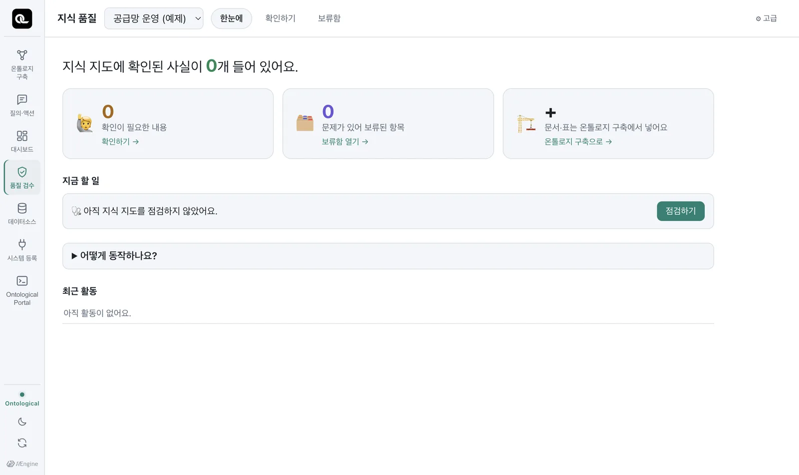

*품질 검수 — 판단할 항목이 없으면 0건으로 나온다*

**주요 기능**

| 기능          | 내용                                                                         |
| ------------- | ---------------------------------------------------------------------------- |
| 검수 항목 모음 | 원문과 다른 값, 확신이 낮은 추출, 원천 간 충돌 등                            |
| 판단          | 맞으면 확정, 틀리면 고치거나 기각                                            |

**관련 개념**

- **적재 전 분기**: 문서에서 추출한 값은 규칙 검사와 신뢰도 점수에 따라 ① 자동 적재 ② 사람 검수(이 메뉴) ③ 재처리 대기로 나뉜다. 추출 결과는 이 경로를 거쳐야만 그래프에 들어간다.

**처리 과정**

1. 구축 중 에이전트가 추출 → 규칙 검사·신뢰도 판정
2. 애매한 항목이 품질 검수 메뉴에 쌓임
3. 사람이 확정·수정·기각
4. 확정된 항목이 그래프에 반영되고, 사람이 발행을 결정

**참조 포인트**

- "AI가 제안하고 사람이 확정한다" 원칙을 구축 결과에 적용하는 화면이다.

---

### 4.5 [메뉴] 질의·액션
**해당 단계**: ⑦ 질의·에이전트 (업무 사용자용) · ⑧ 실행 (Action)

업무 사용자가 **질문**하면 근거와 함께 답하고, **지시**하면 액션을 계획·승인·실행·취소한다. 질문만 했을 때는 아무것도 바뀌지 않는다.

**화면**

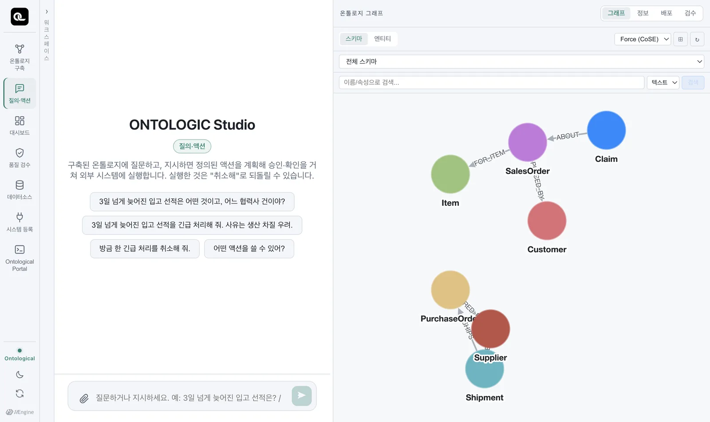

*첫 화면 — 예제 온톨로지의 골든 퀘스천·골든 커맨드가 예시로 나옴*

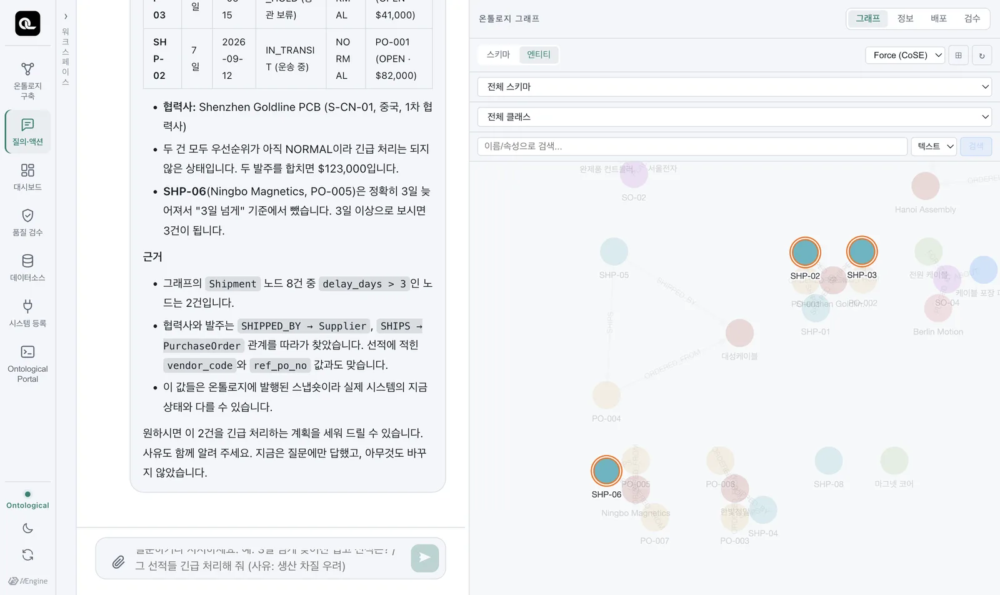

*질문과 답 — 답 아래에 근거, 오른쪽 그래프에 답에 쓰인 노드 강조*

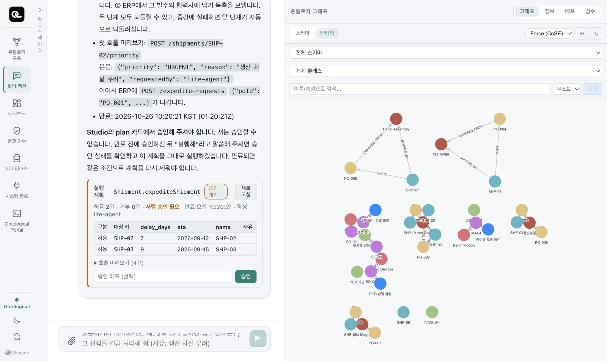

*계획 카드 — 허용 2건·거부 0건, 사람 승인 필요, 만료 시각, 호출 미리보기*

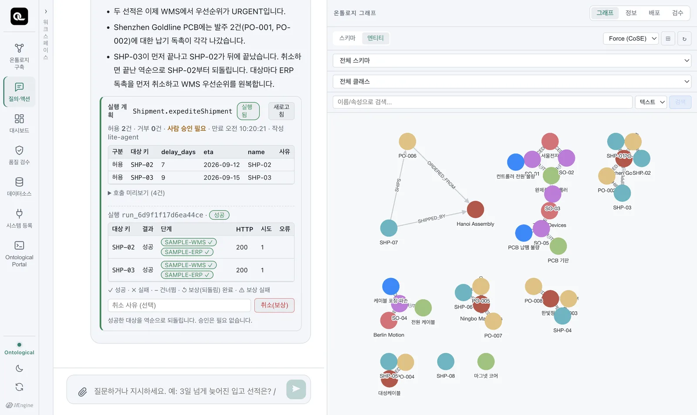

*실행 결과 — 두 선적 모두 WMS 우선순위 NORMAL → URGENT, ERP 납기 독촉 발송*

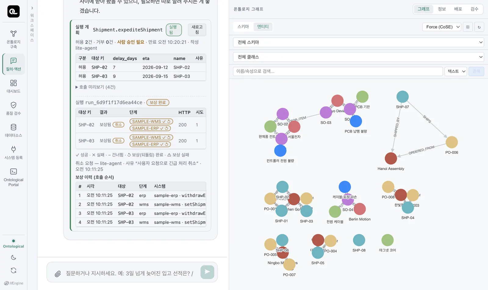

*취소 (보상) — ERP 독촉 철회 → WMS 우선순위 원복 순서로 되돌림*

**주요 기능**

| 기능          | 내용                                                                                                   | 단계 |
| ------------- | ------------------------------------------------------------------------------------------------------ | ---- |
| 자연어 질문   | 발행된 스키마를 읽고 Cypher로 조회해 답 (실측 약 30초), 답에 쓰인 노드를 그래프에 강조                 | ⑦    |
| 이어서 묻기   | 대화 맥락 유지. 처음 받는 질문도 이미 있는 관계를 따라 답하고, 개념이 없으면 "없다"고 답함             | ⑦    |
| 대화 관리     | 지난 대화 목록, 새 대화, 문서 첨부(📎)                                                                 | ⑦    |
| 액션 목록     | "어떤 액션을 쓸 수 있어?" — 내 역할로 허용된 액션과 대상·입력·단계                                     | ⑧    |
| 지시 → 계획   | 맞는 액션을 골라 대상을 정하고 대상별로 정책 판정 (실측 25~50초). 아무것도 바뀌지 않음                | ⑧    |
| 승인          | 계획 카드에서 사람만 승인. 승인자와 시각 기록                                                          | ⑧    |
| 실행          | 승인된 계획을 그대로 실행. 대상마다 단계를 차례로 호출, 실행 직전 정책 재판정                          | ⑧    |
| 취소          | 성공한 단계를 역순으로 되돌림                                                                          | ⑧    |

**관련 개념**

- **답의 세 부분**: ① **결론**("SHP-03(9일)과 SHP-02(7일), 모두 Shenzhen Goldline PCB 발주 건") ② **근거**(따라간 노드·관계) ③ **경계**("SHP-06은 정확히 3일이라 뺐다", "아무것도 바꾸지 않았다"). 근거가 있으니 같은 질문을 Cypher로 다시 실행해 검산할 수 있다.
- **발행된 스냅숏**: 질의 화면은 `ontology` 그래프의 발행된 온톨로지를 본다. 인스턴스는 적재 시점의 값이라 원천이 바뀐 직후에는 다를 수 있고, 에이전트도 답에 그렇게 적는다.
- **액션**: 온톨로지의 클래스에 정의된 업무 수행 기능. 구성(대상 키·입력·단계·보상·정책·승인·되쓰기)과 만드는 법은 4.3의 "액션 만들기" 참고.
- **보상**: 지우는 것이 아니라 **원래 상태로 되돌리는 것**. 실행 직전 값(`$before.priority`)이나 앞 단계 응답(`$steps.erp.response.id`)을 기억해 두었다가 쓴다. 원래 `HIGH`였다면 `HIGH`로 돌아간다.
- **사가**: 여러 시스템을 차례로 부르다 중간에 실패하면, 그 대상의 이미 성공한 단계를 역순으로 자동 보상해 시스템마다 상태가 엇갈리지 않게 한다.

  | 상황                     | 실행기의 처리                                                     |
  | ------------------------ | ----------------------------------------------------------------- |
  | 모든 단계 성공           | 성공                                                              |
  | 한 대상의 2단계 실패     | 그 대상의 1단계를 자동 보상 → 그 대상만 원상태, 결과는 "일부 성공" |
  | 같은 요청이 두 번 감     | 대상마다 멱등성 키가 붙어 업무 시스템이 두 번 처리하지 않음       |
  | 계획 뒤 데이터가 바뀜    | 실행 직전 정책을 다시 판정해, 맞지 않는 대상은 건너뜀             |

**처리 과정**

질문 — "3일 넘게 늦은 선적은?"

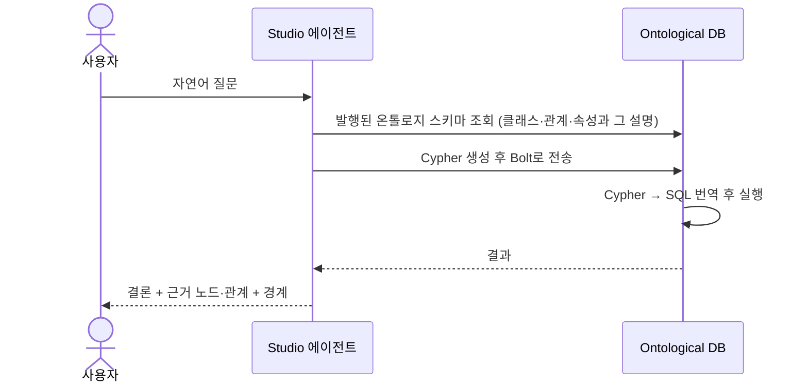

지시 — "3일 넘게 늦어진 입고 선적을 긴급 처리해 줘. 사유는 생산 차질 우려."

```
지시 ──▶ ① 계획 ──▶ ② 승인 ──▶ ③ 실행 ──▶ (필요하면) ④ 취소 = 역순 보상
        대상·정책 판정   사람이       단계별 API 호출      성공한 단계를
        아직 안 바뀜     계획 카드에서  (사가)              거꾸로 되돌림
```

| 대상   | ③ 실행: WMS 우선순위 | ③ 실행: ERP 납기 독촉        | ④ 취소 순서                                  |
| ------ | -------------------- | ---------------------------- | -------------------------------------------- |
| SHP-02 | NORMAL → URGENT      | PO-001 → S-CN-01 독촉 발송   | 3. ERP 독촉 철회 → 4. WMS 우선순위 원복      |
| SHP-03 | NORMAL → URGENT      | PO-002 → S-CN-01 독촉 발송   | 1. ERP 독촉 철회 → 2. WMS 우선순위 원복      |

실행 뒤 포털에서 `sample` 그래프(원천 WMS를 지금 읽는 값)를 조회하면 두 선적의 `priority`가 URGENT로 바뀌어 있다. 업무 시스템이 원천을 바꾸고, 데이터 패브릭이 그 원천을 읽기 때문이다.

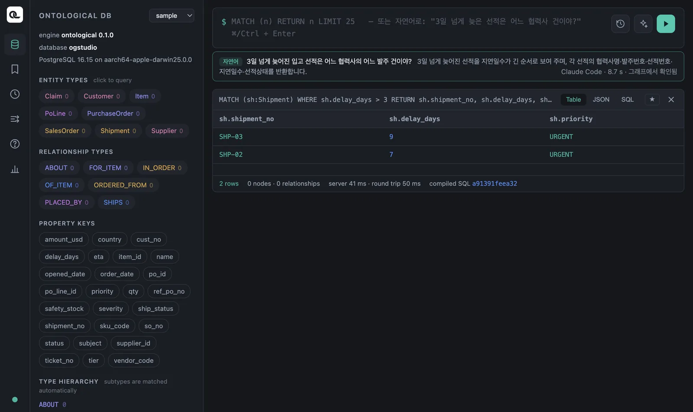

*원천 확인 — 두 선적의 priority가 URGENT로 바뀌었다. 복사본이 아니라 WMS 테이블을 지금 읽은 값이다*

**참조 포인트**

- 질문과 지시를 한 화면에서 받되, 지시는 반드시 **계획 → 사람 승인 → 실행**을 거친다. 에이전트는 승인할 수 없다.
- 액션은 DB에 직접 쓰지 않고 **업무 시스템 API**를 거친다. 원천 시스템의 업무 규칙(검증·승인·이력)을 지킨다.
- 답에 근거와 경계를 붙여 **검산 가능**하게 한다.
- 빈칸: 멀티 에이전트 워크플로 구성 화면은 없다.

---

### 4.6 [메뉴] Ontological Portal
**해당 단계**: ⑦ 질의·에이전트 (개발자·분석가용) · ⑩ 운영·진화

Cypher로 그래프를 직접 조회하는 개발자·분석가용 콘솔. 질의가 어떻게 실행되는지도 들여다본다.

**화면**

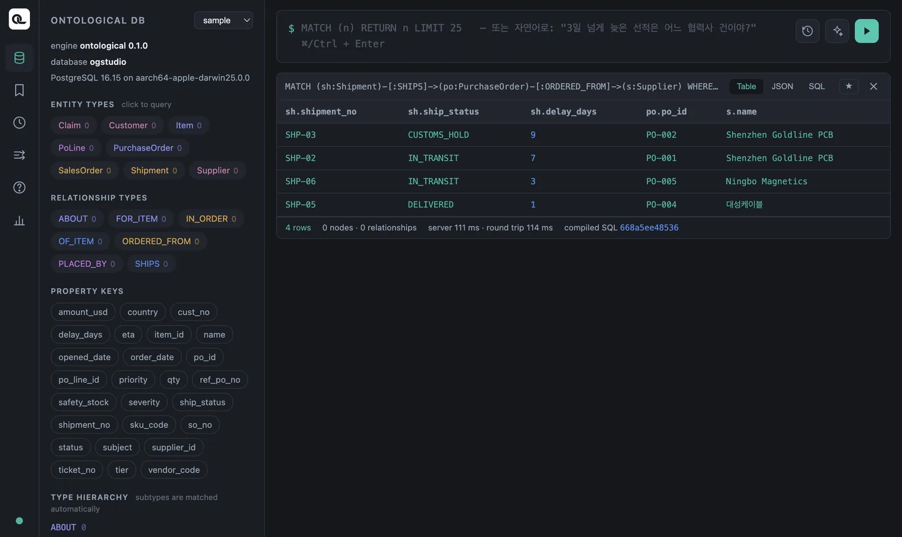

*Cypher 콘솔 — 왼쪽에 타입·관계·속성 목록, 위에 그래프 선택과 입력칸*

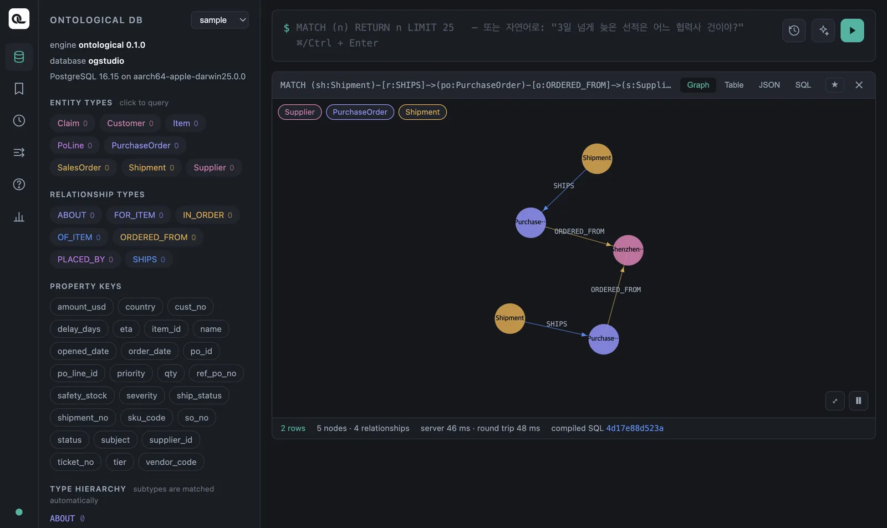

*그래프로 보기 — 결과를 노드·관계 그래프로*

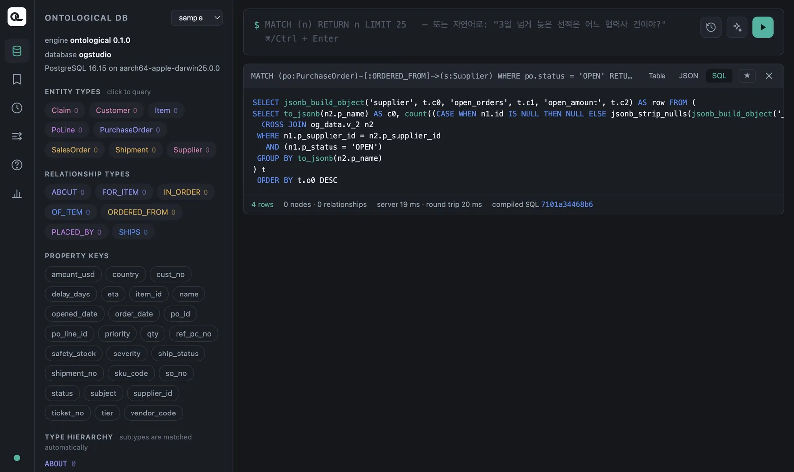

*SQL 탭 — Cypher 한 문장이 PostgreSQL SQL로 변환된 모습*

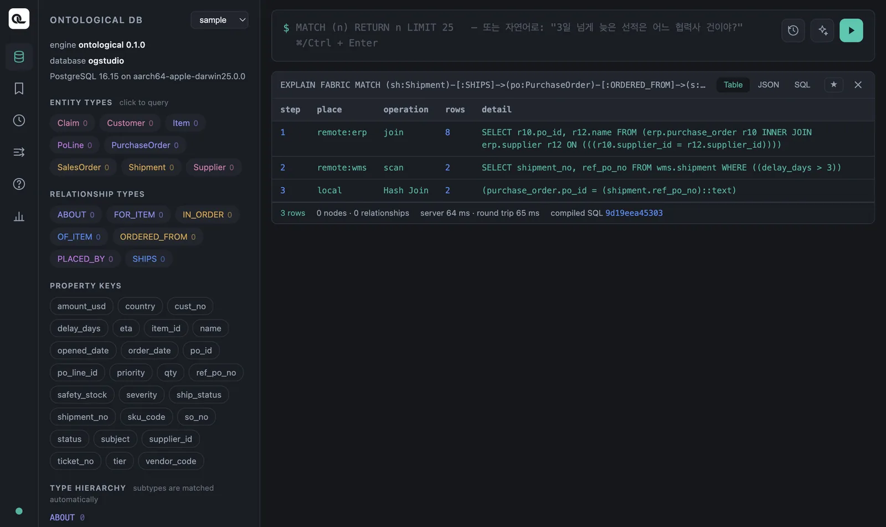

*EXPLAIN FABRIC — 원천마다 내려 보낸 SQL과 넘어온 행 수*

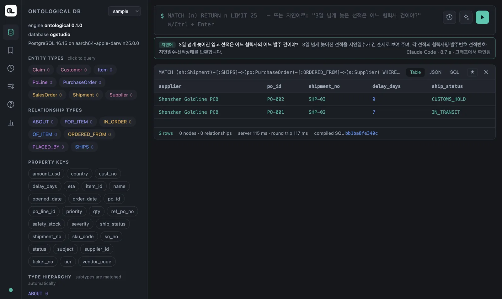

*자연어 질의 — 에이전트가 만든 Cypher와 설명, 그래프에서 미리 실행해 확인했다는 표시*

**주요 기능**

| 기능              | 내용                                                                                                   | 단계 |
| ----------------- | ------------------------------------------------------------------------------------------------------ | ---- |
| Cypher 콘솔       | 그래프 선택(`sample`/`ontology`), 타입·속성 목록, 자동완성, 결과를 표·JSON·SQL·그래프로              | ⑦    |
| SQL 보기          | Cypher가 변환된 PostgreSQL SQL과 그 식별값(같은 Cypher면 같은 값)                                       | ⑦    |
| EXPLAIN FABRIC    | 여러 DB에 걸친 질의를 어느 시스템에서 어떤 작업으로 실행하는지 단계별로 표시                          | ⑦    |
| 자연어 → Cypher   | 한국어 문장을 쓰면 에이전트가 스키마를 읽고 Cypher를 만들어 먼저 시험 실행, 쓰기 문장은 실행하지 않음 | ⑦    |
| 직접 쓰기         | 별도 그래프를 만들어 노드·관계를 직접 쓰고 고침 (`ontology` 그래프는 Studio가 관리하므로 직접 고치지 않음) | ⑦    |
| 스키마 변경 이력  | 스키마 변경을 계획 → 영향 검토 → 단계별 실행 → 검증 → 완료로 진행하고 이력을 남김                      | ⑩    |

**관련 개념**

- **Cypher**: 그래프의 구조를 그림 그리듯 쓰는 질의 언어. Neo4j에서 시작해 ISO 표준 그래프 질의 언어(GQL)의 바탕이 되었다.

```cypher
MATCH (sh:Shipment)-[:SHIPS]->(po:PurchaseOrder)-[:ORDERED_FROM]->(s:Supplier)
WHERE sh.delay_days > 3
RETURN sh.shipment_no, po.po_id, s.name
```

- **Cypher → PostgreSQL SQL 변환**: Ontological DB는 별도 그래프 저장소 없이 Cypher를 PostgreSQL SQL로 변환해 실행한다.
- **패브릭 실행 계획**: 같은 DB 안의 일은 원천에 맡기고, 조건은 원천으로 내려 보내며, 서로 다른 DB를 잇는 마지막 조인만 Ontological DB가 한다.

  | step | place      | operation | rows | detail                                                                  |
  | ---- | ---------- | --------- | ---- | ----------------------------------------------------------------------- |
  | 1    | remote:erp | join      | 8    | `SELECT r10.po_id, r12.name FROM (erp.purchase_order r10 INNER JOIN erp.supplier r12 ON …)` |
  | 2    | remote:wms | scan      | 2    | `SELECT shipment_no, ref_po_no FROM wms.shipment WHERE ((delay_days > 3))` |
  | 3    | local      | Hash Join | 2    | `(purchase_order.po_id = (shipment.ref_po_no)::text)`                   |

  WMS에는 `delay_days > 3` 조건을 붙여 보내 8행 중 2행만 넘어왔다.

**처리 과정** — 질의 한 문장이 실행되기까지

1. 그래프 선택(`sample` 또는 `ontology`) 후 Cypher 입력 (또는 한국어 문장 → 에이전트가 Cypher 생성)
2. Ontological DB가 Cypher를 PostgreSQL SQL로 변환
3. 가상 노드가 있으면 데이터 패브릭이 원천마다 SQL을 내려 보내고 결과를 받음
4. 결과를 표·JSON·그래프로 표시, 변환된 SQL과 실행 계획을 확인 가능

**참조 포인트**

- 업무 사용자 화면(질의·액션, 자연어)과 개발자 화면(Portal, Cypher)을 분리한다.
- 자연어로 만든 질의를 화면에 그대로 보여 주고 먼저 시험 실행한다. 사용자가 읽고 고칠 수 있다.
- 실행 계획을 보여 주어, 여러 원천에 걸친 질의의 성능 문제를 사용자가 찾을 수 있다.
- 빈칸: 변경 제안·리뷰(브랜치) 흐름, 배포 관리 화면은 확인되지 않았다.

---

### 4.7 [메뉴] 온톨로지 앱
**해당 단계**: ⑨ 앱

같은 온톨로지 위에서 **대시보드**(위젯 조합)와 **코드 앱**(에이전트가 코드 작성)을 말로 만든다. 앱에서도 액션 버튼으로 업무를 처리한다.

**화면**

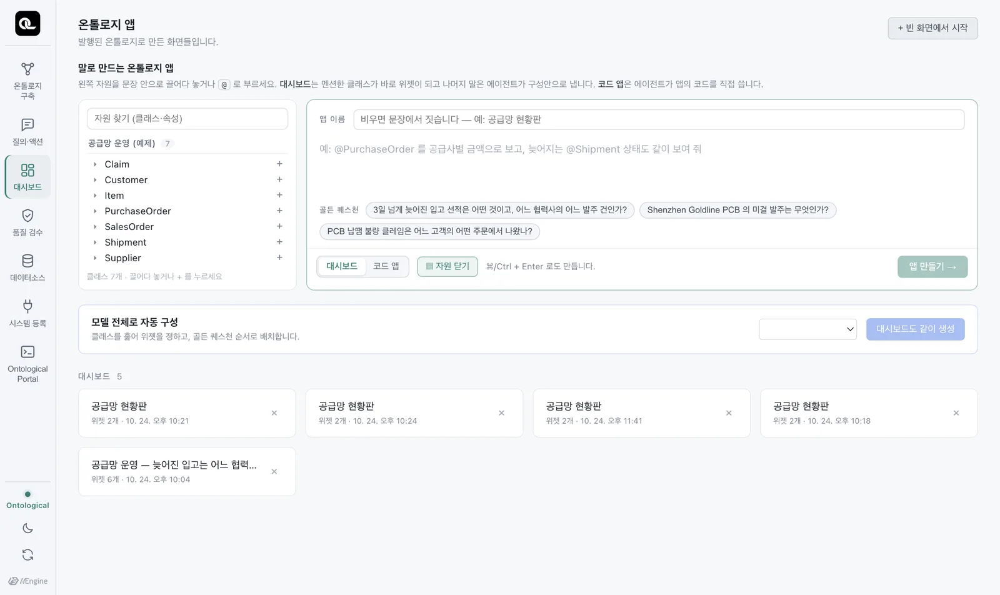

*온톨로지 앱 — 왼쪽 자원 트리(모델 › 클래스 › 속성), 오른쪽 입력창과 골든 퀘스천 예시, 아래에 만든 앱 갤러리*


*`@` 멘션 — `@`를 치면 클래스·속성 후보가 뜸*


*칩이 들어간 요청 문장 — `@PurchaseOrder`, `@Shipment` 칩으로 대상을 정확히 가리킴*

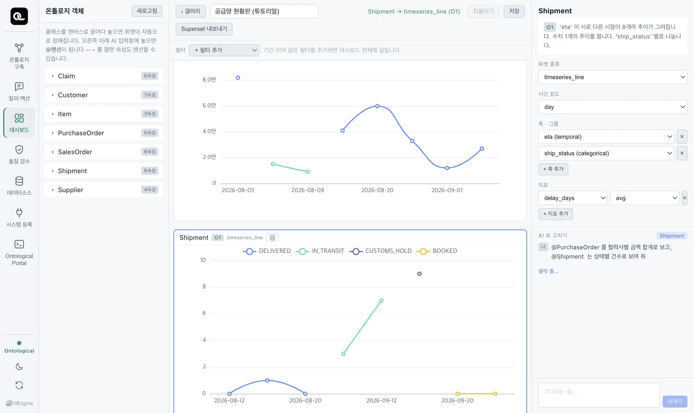

*대시보드 — 엔진이 놓은 위젯 — 약 1초 만에 규칙대로 위젯을 놓음*

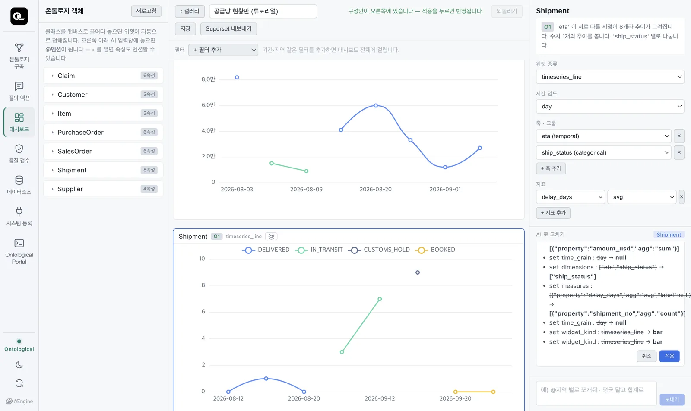

*에이전트의 구성안 — 바꿀 내용을 취소선과 함께 제안 (약 35초)*

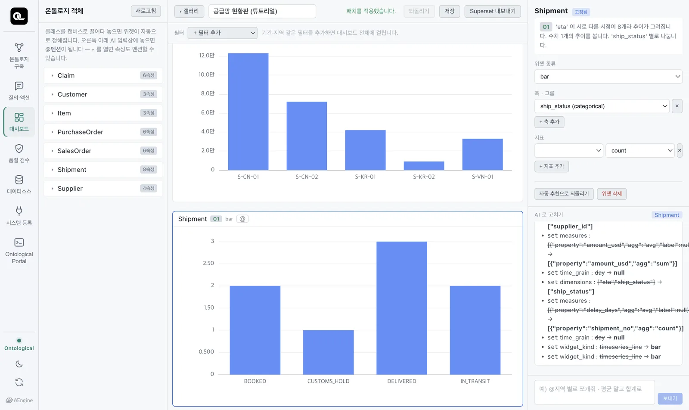

*적용 후 — 협력사별 발주 금액, 선적 상태별 건수*

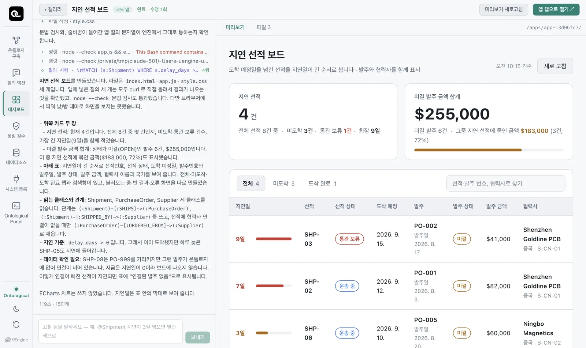

*코드 앱 — 미리보기 — 왼쪽에 에이전트의 보고, 오른쪽에 실제 데이터로 채운 보드 (약 2분)*


*코드 앱 — 파일 — `index.html` · `app.js` · `style.css`*

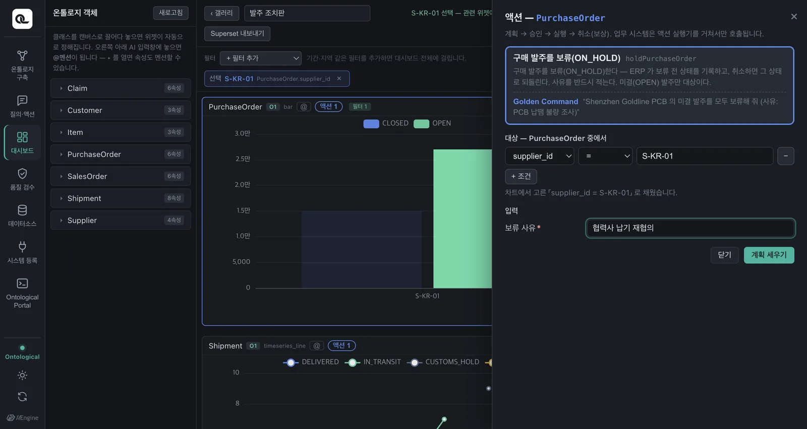

*대시보드의 액션 버튼 — 액션 서랍 — 액션, 그것을 만든 골든 커맨드, 대상 조건, 입력*

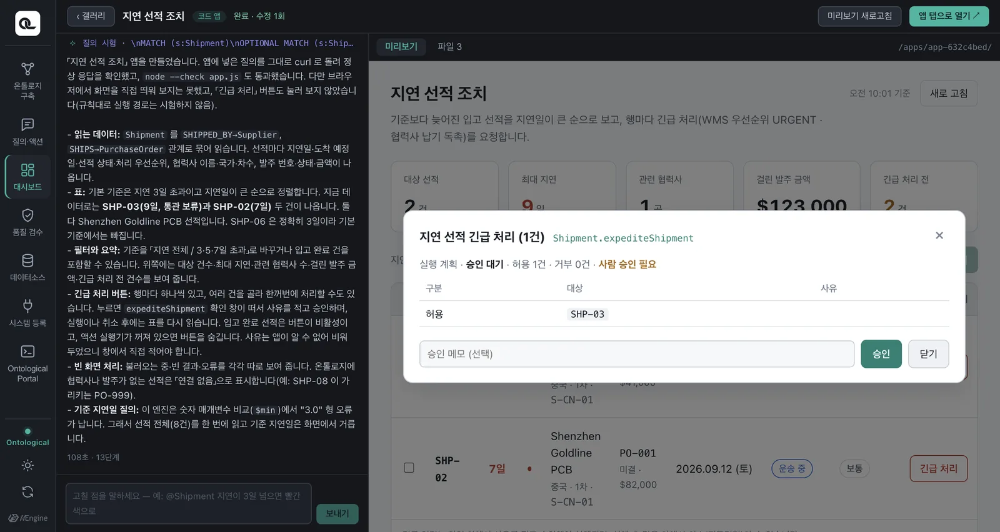

*코드 앱의 액션 버튼 (SDK 확인 창) — 액션, 대상, 정책 판정, 승인 대기*

**주요 기능**

|           | 대시보드                                                                     | 코드 앱                                             |
| --------- | ---------------------------------------------------------------------------- | --------------------------------------------------- |
| 만드는 법 | 엔진이 위젯을 먼저 놓고, 에이전트가 구성안 제안, 사람이 적용                 | 코딩 에이전트가 HTML·JS(Vue 3) 코드 작성           |
| 걸리는 시간 | 위젯 약 1초, 구성안 수십 초                                                 | 1~3분                                               |
| 자유도    | 정해진 위젯 안에서                                                           | 화면 구성·상호작용 자유                            |
| 고치기    | 위젯 멘션·직접 설정·필터·선택 연동, 또는 말로                                | 말로 (같은 에이전트 세션이 이어서 고침), 또는 코드 직접 |
| 데이터    | 발행된 온톨로지                                                              | SDK `query()`로 읽기 전용 Cypher                    |
| 값 바꾸기 | 위젯 상단 「액션」 버튼 → 서랍에서 계획·승인·실행                           | SDK `act()` → 계획·승인·실행 창                     |

**관련 개념**

- **멘션과 칩**: `@`로 고른 클래스·속성은 칩이 되어 문장 안에 남는다. 사람과 에이전트가 같은 대상을 가리킨다.
- **엔진이 먼저, 에이전트가 다음**: 대시보드는 엔진이 속성 타입·값을 보고 규칙대로 위젯을 놓고(늘 같은 결과), 나머지 요청은 에이전트가 구성안(diff)으로 내며, 사람이 「적용」해야 반영된다.
- **코드 앱 SDK** (`og.js`)

  | 함수                            | 하는 일                                                   |
  | ------------------------------- | --------------------------------------------------------- |
  | `query(cypher, params?)`        | 읽기 전용 Cypher 실행. 쓰기 절은 서버가 거절              |
  | `schema()`                      | 발행된 온톨로지의 클래스·속성·관계                        |
  | `actions(className?)`           | 발행된 액션 목록                                          |
  | `act(opts)`                     | 계획 → 승인 → 실행 → 취소 창을 띄움                       |
  | `theme()` · `onTheme()` · `color()` | 낮/밤 테마와 색 토큰                                  |

- **코드 앱 에이전트 규칙**: 앱 폴더 밖을 고치지 않고, 빌드 도구·외부 CDN 없이(오프라인 실행), 목 데이터·하드코딩 없이 온톨로지에서만 데이터를 읽으며, 질의는 먼저 시험하고, 값 변경은 액션 버튼으로만 한다. 계획·승인·실행은 시험하지 않는다(실제 업무 시스템이 바뀌므로).
- **같은 길**: 앱의 액션 버튼은 질의·액션 탭의 계획 카드와 같은 액션 실행기를 쓴다. 앱이 업무 시스템을 직접 부르지 않고, 정책·사람 승인·되돌리기가 그대로 지켜진다.

**처리 과정** — 대시보드 「공급망 현황판」

1. 앱 이름을 적고 「대시보드」 선택
2. "`@PurchaseOrder`를 협력사별 금액 합계로 보고, `@Shipment`는 상태별 건수로 보여 줘" 입력
3. 엔진이 위젯 2개를 바로 놓음 (처음엔 날짜별 추이)
4. 에이전트가 축·집계·차트 종류를 바꾸는 구성안 제안 → 사람이 「적용」
5. 위젯을 멘션하거나 직접 설정해 이어서 고치고 저장
6. 발주 위젯의 「액션」 → 협력사 막대 선택 → 발주 보류 계획(미결 PO-008 허용, 닫힌 PO-003 거부) → 승인·실행 → 막대가 ON_HOLD로 다시 그려짐

**구축 때 적은 것이 앱이 되기까지**

| 구축할 때 적은 것 | 만들어진 것         | 앱에서                                        |
| ----------------- | ------------------- | --------------------------------------------- |
| 골든 퀘스천       | 클래스·관계·속성   | 대시보드 위젯, 코드 앱의 질의                 |
| 골든 커맨드       | 액션(단계·보상·정책) | 위젯의 액션 버튼, 코드 앱의 `act()` 버튼     |

**참조 포인트**

- 규칙 기반(엔진)과 LLM(에이전트)을 나눠, 빠르고 예측 가능한 부분은 엔진이 하고 사람이 에이전트의 제안을 적용한다.
- 앱에서도 값 변경은 액션 실행기를 거치게 해 정책·승인·되돌리기가 화면마다 달라지지 않는다.

---

### 4.8 [메뉴] 설정
**해당 단계**: 공통

| 기능          | 내용                                                                                                         |
| ------------- | ------------------------------------------------------------------------------------------------------------ |
| 에이전트 선택 | 로컬에 로그인된 Claude Code 또는 Codex CLI를 에이전트로 사용 (메뉴 런타임 › 에이전트), 별도 API 키 불필요    |
| LLM 키        | CLI 없이 쓰려면 「설정」 메뉴로 `studio.env`를 열어 OpenAI 호환 API 키를 넣음                                |
| 비밀 값       | 등록한 업무 시스템의 비밀 값(`ERP_API_KEY=...` 등)도 `studio.env`에 둠                                       |

- 그래프 접속 정보·데이터 패브릭 주소·포트는 앱이 정하며, 사용자가 바꾸는 것은 에이전트와 키뿐이다.

---

## 5. 시사점

### 5.1 온톨로지 솔루션에 필요한 기능·화면

Studio 분석에서 도출한, 온톨로지 솔루션 구성 시 참조할 단계별 기능·화면이다.

| 층         | 단계                | 필요한 기능                                           | 필요한 화면             | Studio             |
| ---------- | ------------------- | ----------------------------------------------------- | ----------------------- | ------------------ |
| 공통       | 단계 ① 범위 정의        | 역량 질문·실행 요구사항 정의, AI 초안                | 구축 브리프             | ✅                 |
| 온톨로지   | 단계 ② 자원 재사용      | 표준 온톨로지·용어사전·템플릿 가져오기, 병합·정렬  | 자원 라이브러리         | △                 |
| 온톨로지   | 단계 ③ 온톨로지 설계    | AI 설계 초안, 스키마 편집, 표준 형식 입출력           | 스키마 지도·편집기     | ✅ (입출력 미확인) |
| 지식그래프 | 단계 ④ 원천 연결·매핑  | DB·API·파일 커넥터, 매핑형·복사형, 메타데이터 증강 | 데이터소스·가상 그래프 | ✅ (DB만)          |
| 지식그래프 | 단계 ⑤ 추출·적재·식별 | 문서 추출, 엔티티 식별, 대용량 적재·동기화           | 구축 진행·결과         | △                 |
| 공통       | 단계 ⑥ 검증·발행       | 역량 질문 자동 실행, 드라이런, 사람 검수, 발행        | 구축 보고·품질 검수    | ✅                 |
| 솔루션     | 단계 ⑦ 질의·에이전트   | 근거 제시 질의, 그래프 콘솔, MCP, 워크플로            | 질의 화면·콘솔         | ✅ (워크플로 없음) |
| 솔루션     | 단계 ⑧ 실행             | 시스템 등록, 액션(단계·보상·정책·승인)             | 시스템 등록·계획 카드  | ✅                 |
| 솔루션     | 단계 ⑨ 앱               | 대시보드·코드 앱·SDK·액션 버튼                     | 앱 빌더·갤러리         | ✅                 |
| 공통       | 단계 ⑩ 운영·진화       | 스키마 이력, 변경 제안·리뷰, 배포                   | 콘솔·변경 관리         | △                 |

공통 원칙: **AI가 제안하고 사람이 확정한다** — 골든 퀘스천 초안, 품질 검수, 발행, 대시보드 구성안, 액션 승인이 모두 이 원칙을 따른다.

### 5.2 Studio에 없는 기능 (빈칸)

| 단계 | Studio에 없는 기능                               |
| ---- | ------------------------------------------------ |
| ①   | 착수 진단·교육·일정 계획                       |
| ②   | 외부 표준 온톨로지·용어사전·산업 템플릿 재사용 |
| ③   | OWL·RDF 등 표준 형식 입출력                      |
| ④⑤ | API·파일 원천, 대용량 파이프라인, 동기화 스케줄 |
| ⑦   | 멀티 에이전트 워크플로                           |
| ⑧   | API 없는 시스템 실행(화면 조작)                  |
| ⑩   | 변경 제안·리뷰, 배포 관리                       |

- 빈칸은 튜토리얼과 다운로드 설치본에서 확인되지 않았다는 뜻이다.
- 솔루션 설계 시 이 빈칸을 제품 기능으로 채울지, 구축 서비스(사람)로 채울지 결정이 필요하다.

---

## 부록

### 부록 A. METHONTOLOGY — 단계와 base 보고서 정정 사항

출처: Fernández, Gómez-Pérez & Juristo (1997), "METHONTOLOGY: From Ontological Art Towards Ontological Engineering", AAAI Technical Report SS-97-06 (`00_papers/methontology`)

METHONTOLOGY는 **온톨로지(스키마) 자체**를 만드는 방법론이다. 여기서 '통합'과 '구현'은 데이터 파이프라인 연동이나 앱 개발이 아니다. 그 일은 본문 2.1의 ④~⑨ 단계에서 다룬다.

#### A.1 단계별 활동

| 단계                          | 내용                                                                                                                                                                                               | 산출물                                                           |
| ----------------------------- | -------------------------------------------------------------------------------------------------------------------------------------------------------------------------------------------------- | ---------------------------------------------------------------- |
| ① 계획 (Planification)       | 수행할 작업, 작업 순서, 소요 시간, 필요 자원(인력·S/W·H/W)을 계획                                                                                                                                | 계획서                                                           |
| ② 명세 (Specification)       | 목적(용도·사용 시나리오·최종 사용자), 형식성 수준, 범위(용어 집합·세분도)를 정의. 핵심 개념부터 합의하고 상·하위로 넓히는 미들아웃 방식 권장. 명세는 간결성·부분 완전성·일관성을 갖춰야 함   | 요구사항 명세서 (자연어 또는 역량 질문)                          |
| ③ 개념화 (Conceptualization) | 용어집을 만들고 용어를 개념과 동사로 나눈 뒤, 개념 분류 트리와 동사 다이어그램을 작성. 이를 데이터 사전·속성 표·상수 표·인스턴스 표·동사 사전·조건 표·공식/규칙 표 같은 중간 표현으로 구조화 | 개념 모델 문서 (중간 표현 포함)                                  |
| ④ 형식화 (Formalization)     | 개념 모델을 프레임 기반 또는 기술 논리(Description Logic) 등 형식 모델로 변환                                                                                                                      | 형식화 문서                                                      |
| ⑤ 통합 (Integration)         | 기존 온톨로지를 최대한 재사용. 메타 온톨로지(예: Cyc, Ontolingua)를 고르고, 온톨로지 라이브러리에서 쓸 용어를 찾아 대응시킴                                                                        | 통합 문서 (내 용어 ↔ 가져올 온톨로지 ↔ 그 온톨로지에서의 이름) |
| ⑥ 구현 (Implementation)      | 형식 언어로 온톨로지를 코드화해 계산 가능하게 만듦. 개발 환경은 파서·번역기·편집기·평가기·유지보수기를 갖춰야 함                                                                               | 구현 문서, 온톨로지 코드                                         |
| ⑦ 유지보수 (Maintenance)     | 정의의 추가·수정·삭제 요청을 신중히 반영                                                                                                                                                         | 변경 이력                                                        |

#### A.2 전 과정에 걸친 지원 활동

| 활동      | 내용                                                                                                                                                                           |
| --------- | ------------------------------------------------------------------------------------------------------------------------------------------------------------------------------ |
| 지식 획득 | 전문가·도서·핸드북·도표·기존 온톨로지에서 인터뷰(비구조화/구조화)와 텍스트 분석(비형식/형식)으로 지식을 수집. 명세 단계에서 가장 활발하고 이후 감소                        |
| 평가      | 요구사항 명세서를 기준으로 각 단계 안과 단계 사이에서 검증(Verification, 올바르게 만들었는가)과 확인(Validation, 실제 대상과 맞는가)을 수행. 오류 전파를 막기 위해 초기에 집중 |
| 문서화    | 단계마다 정해진 문서를 산출 (명세서, 지식 획득, 개념 모델, 형식화, 통합, 구현, 평가 문서)                                                                                      |

#### A.3 생명주기: 진화형 프로토타입

- 단계를 ①→⑦ 순서로 나열하지만, 폭포수처럼 앞 단계를 끝내야 다음 단계로 가는 방식이 아님
- 정의가 빠지거나 틀리면 어느 단계에서든 다른 단계로 돌아가 정의를 추가·수정·삭제할 수 있음
- 논문은 폭포수 모델은 부적합, 점진적 모델은 일부 개선, 진화형 프로토타입을 권장함

#### A.4 base 보고서(v2.7) 「1. 온톨로지 구축 프로세스」 대비 정정 사항

| 단계      | 기존 표현                                                  | 정정                                                                     |
| --------- | ---------------------------------------------------------- | ------------------------------------------------------------------------ |
| ④ 형식화 | ③의 초안을 컴퓨터가 처리할 수 있는 형식으로 변환 (코드화) | 개념 모델을 형식 모델(프레임·기술 논리)로 변환. 코드화는 ⑥ 구현의 일   |
| ⑤ 통합   | 기존 데이터 파이프라인 등과 온톨로지 시스템 통합           | 기존 온톨로지·표준 어휘의 재사용. 데이터 연동은 ④ 원천 연결·매핑의 일 |
| ③ 개념화 | 용어·개념과 그 관계·속성을 정리                          | 동사(동작)와 조건 표를 포함한 중간 표현으로 구조화                       |
| ② 명세   | 목적·범위·사용자 정의                                    | 형식성 수준과 미들아웃 방식 추가                                         |
| 전체      | ①→⑦ 직선 흐름                                           | 진화형 프로토타입(단계 간 왕복) 명시                                     |

### 부록 B. NeOn 방법론 — 9개 시나리오

출처: Gómez-Pérez & Suárez-Figueroa (2009), "NeOn Methodology for Building Ontology Networks: a Scenario-based Methodology"; Suárez-Figueroa 외, NeOn D5.4.1 (2008) (`00_papers/neon`)

NeOn은 용어집, 9개 시나리오, 2개 생명주기 모델(폭포수형·반복 점진형), 처방적 지침으로 구성된다. 시나리오는 조합해서 쓰며, 어떤 조합이든 시나리오 1을 포함한다.

| # | 시나리오                       | 상황                                                                                     | 본 보고서 단계 |
| - | ------------------------------ | ---------------------------------------------------------------------------------------- | -------------- |
| 1 | 명세에서 구현까지              | 처음부터 개발 (지식 획득·명세(ORSD) → 일정 → 개념화·형식화·구현, METHONTOLOGY 활용) | ① ③          |
| 2 | 비온톨로지 자원 재사용·재공학 | 용어집·분류체계·DB·XML 등을 온톨로지로 변환                                           | ② ④          |
| 3 | 온톨로지 자원 재사용           | 기존 온톨로지를 전체·모듈·문장 단위로 사용                                             | ②             |
| 4 | 온톨로지 자원 재사용·재공학   | 가져와서 고쳐 사용                                                                       | ②             |
| 5 | 온톨로지 자원 재사용·병합     | 같은 도메인의 여러 온톨로지를 병합 또는 정렬                                             | ②             |
| 6 | 재사용·병합·재공학           | 병합 결과를 다시 고침                                                                    | ②             |
| 7 | 설계 패턴 재사용               | 검증된 모델링 해법 사용                                                                  | ② ③          |
| 8 | 재구조화                       | 모듈화·가지치기·확장·특수화                                                           | ③ ⑩          |
| 9 | 지역화                         | 다국어 대응                                                                              | ③             |

**ORSD (온톨로지 요구사항 명세서) 양식**: 목적, 범위, 형식성 수준, 대상 사용자, 용도, 역량 질문 그룹(답·우선순위), 사전 용어집(용어·빈도)

**DB를 온톨로지로 쓰는 두 방식 (D5.4.1)**

| 방식   | 내용                                                                          | 해당                 |
| ------ | ----------------------------------------------------------------------------- | -------------------- |
| 복사형 | DB 관계 모델을 역공학해 온톨로지 스키마를 만들고, 레코드를 인스턴스로 복제    | ETL 적재 · RDF 변환   |
| 매핑형 | 기존 온톨로지와 DB 사이의 매핑을 정의하고, 질의할 때 매핑으로 인스턴스를 생성 | Studio 데이터 패브릭 |

### 부록 C. 정의 구분의 출처

**온톨로지**

- Gruber (1993): "an explicit specification of a conceptualization" — 개념화에 대한 명시적 명세
- Studer, Benjamins & Fensel (1998): "a formal, explicit specification of a shared conceptualization" — 공유된 개념화에 대한 형식적·명시적 명세
- Noy & McGuinness, *Ontology Development 101* (2001): 클래스·속성·제약으로 온톨로지를 정의하고, 클래스의 개별 인스턴스까지 채운 것을 지식베이스(knowledge base)로 구분 (`00_papers/ontology101`)

**온톨로지 vs 지식그래프 (스키마 vs 인스턴스)**

- Baader et al., *The Description Logic Handbook* (2003): 지식베이스를 용어 정의인 **TBox**(terminological)와 개체에 대한 단언인 **ABox**(assertional)로 구분 — 온톨로지/지식그래프 구분의 이론적 근거
- Hogan et al., "Knowledge Graphs", *ACM Computing Surveys* (2021): 지식그래프를 "실세계 지식을 축적·전달하기 위한 데이터 그래프로, 노드는 관심 개체, 엣지는 개체 간 관계"로 정의하고, 온톨로지는 그 그래프의 의미를 정하는 스키마로 다룸
- Heist et al., "Knowledge Graphs on the Web — an Overview" (2020): 클래스 수·계층 깊이 같은 스키마 지표(온톨로지의 풍부함)와 인스턴스 수 같은 지표(도메인 커버리지)를 구분

**'토폴로지' 용어에 대한 주의**

- 지식그래프의 인스턴스 층을 '토폴로지'라고 부르는 표준 용례는 학술 문헌에서 확인되지 않음
- 본래 의미는 위상수학이며, 지식 표현 분야에서는 부분·연결 같은 공간 관계 이론(mereotopology)을 가리킴
- IT 운영 분야에서는 서비스·인프라 구성요소의 연결 구조(서비스 토폴로지, CMDB)를 뜻하는 업계 용어로 쓰임
- 본 문서는 출처가 분명한 **지식그래프(ABox)** 를 본 용어로 쓰고, '토폴로지'는 "인스턴스가 어떻게 연결되어 있는가"를 가리키는 현업 표현으로 병기함

**온톨로지 솔루션**

- 학술적 표준 정의는 없음. 본 문서의 작업 정의로, 위 두 층을 활용하는 소프트웨어(플랫폼·앱·에이전트·Action)를 가리킴

### 부록 D. TBox와 ABox

출처: Baader et al., *The Description Logic Handbook* (2003)

지식베이스는 두 부분으로 나뉜다. **TBox**(Terminological Box)는 용어의 정의, **ABox**(Assertional Box)는 개체에 대한 사실이다. 본 문서의 온톨로지가 TBox, 지식그래프가 ABox에 해당한다.

| 구분                | TBox — 용어 정의                                                 | ABox — 사실                                                       |
| ------------------- | ---------------------------------------------------------------- | ----------------------------------------------------------------- |
| 담는 것             | 어떤 개념(클래스)·관계·속성이 있고, 어떤 제약을 갖는가           | 어떤 개체가 어떤 개념에 속하고, 누구와 어떻게 연결되어 있는가    |
| 1장의 층            | 온톨로지                                                         | 지식그래프                                                        |
| 직급 예 (1.2)       | "직원은 직급을 하나 보유한다", "직급 사이에는 상위 관계가 있다" | "박지훈은 대리를 보유한다", "과장은 대리보다 상위다"             |
| 공급망 예 (4.3)     | "선적(Shipment)은 SHIPS로 발주(PurchaseOrder)와 연결된다"        | "선적 SHP-03은 발주 PO-002를 싣고 온다", "SHP-03은 9일 늦었다"   |
| 바뀌는 빈도         | 드묾 (업무 개념이 바뀔 때)                                       | 잦음 (업무가 일어날 때마다)                                      |
| Studio의 저장 형태  | `_OntologyClass`·`_OntologyRelationship`·`_OntologyBehavior` 노드 | `Shipment`·`PurchaseOrder`·`Supplier` 등의 일반 노드와 관계       |

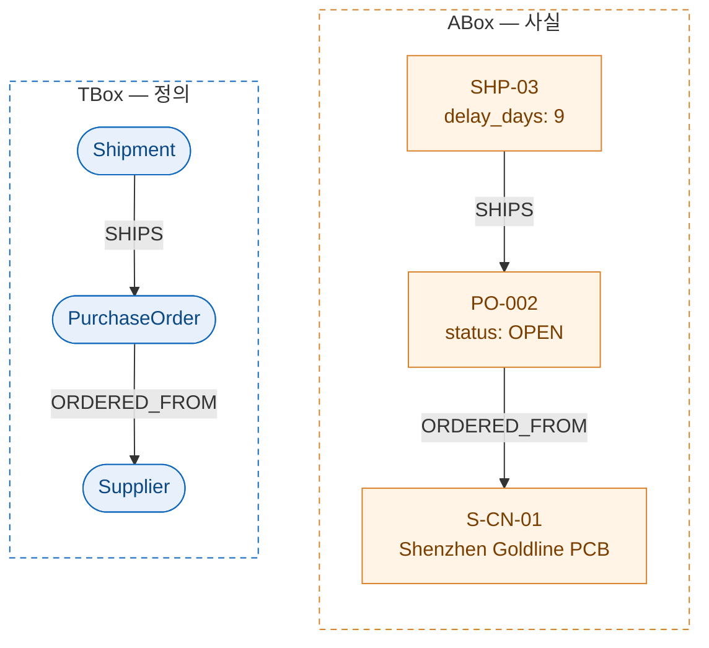

- ABox의 각 개체는 TBox의 개념에 속한다. SHP-03은 `Shipment`, PO-002는 `PurchaseOrder`, S-CN-01은 `Supplier`다.
- ABox의 관계는 TBox에 정의된 관계만 쓴다. `SHIPS`는 TBox에서 "선적 → 발주"로 정의되어 있으므로, ABox에서도 선적에서 발주로만 이어진다.
- Studio에 실제로 저장된 값의 모습은 4.3의 "예: 설계된 클래스"(TBox)와 "두 그래프"의 인스턴스(ABox)를 참고한다.

### 부록 E. 온톨로지 표현 언어 — RDF · RDFS · OWL · SHACL · LinkML

온톨로지를 파일로 적어 다른 도구와 주고받을 때 쓰는 표준 형식이다. 아래 예시는 모두 4.3의 공급망 예제(선적 `SHP-03` → 발주 `PO-002`)를 같은 내용으로 적은 것이다. Ontological Studio는 이 형식들이 아니라 정의를 그래프의 노드(`_OntologyClass` 등)로 저장한다(3.3.4 ④).

| 언어   | 한 줄 설명                                         | 비유                   | 답하는 질문                              |
| ------ | -------------------------------------------------- | ---------------------- | ---------------------------------------- |
| RDF    | 모든 사실을 "주어 – 서술어 – 목적어" 세 칸으로 적는 기본 형식 | 문장의 문법            | 사실을 어떻게 적는가?                    |
| RDFS   | RDF 위에 클래스·상위 클래스·속성의 범위를 정하는 최소한의 어휘 | 단어 사전              | 어떤 종류의 것이 있고, 무엇과 연결되는가? |
| OWL    | RDFS에 개수 제한·서로 배타·역관계 같은 논리 규칙을 더한 언어 | 정교한 규칙집          | 무엇이 논리적으로 참인가? (추론)          |
| SHACL  | 데이터가 정해진 모양을 지키는지 검사하는 규칙 언어   | 입력 양식의 검사 규칙  | 이 데이터가 규칙에 맞는가? (검증)         |
| LinkML | YAML로 스키마를 쓰고 위 형식들로 변환하는 모델링 언어 | 설계도 작성 도구       | 사람이 쓰기 쉬운 한 벌로 여러 형식을 만들 수 있는가? |

RDFS·OWL은 온톨로지(TBox)를 적고, RDF는 지식그래프(ABox)의 사실도 적는다. SHACL은 둘이 맞는지 검사한다.

**RDF — 사실을 세 칸으로** (Turtle 표기)

```turtle
@prefix ex: <http://example.com/scm#> .

ex:SHP-03  a              ex:Shipment ;      # SHP-03은 선적이다
           ex:delayDays   9 ;                # SHP-03의 지연 일수는 9다
           ex:ships       ex:PO-002 .        # SHP-03은 PO-002를 싣고 온다
```

한 줄이 하나의 사실(트리플)이다. 이것은 지식그래프(ABox)에 해당한다.

**RDFS — 클래스와 관계의 틀**

```turtle
ex:Shipment       a  rdfs:Class ;  rdfs:label "선적" .
ex:PurchaseOrder  a  rdfs:Class ;  rdfs:label "발주" .

ex:ships  a rdf:Property ;
          rdfs:domain ex:Shipment ;         # ships의 주어는 선적
          rdfs:range  ex:PurchaseOrder .    # ships의 목적어는 발주
```

"ships는 선적에서 발주로 가는 관계"라는 틀을 정한다. 온톨로지(TBox)의 가장 기본 형태다.

**OWL — 논리 규칙을 더하기**

```turtle
ex:Shipment  a owl:Class ;
    owl:disjointWith ex:PurchaseOrder ;      # 선적이면서 발주일 수는 없다
    rdfs:subClassOf [ a owl:Restriction ;    # 모든 선적은 발주를 정확히 1개 싣는다
        owl:onProperty ex:ships ;
        owl:cardinality 1 ] .

ex:shippedIn  owl:inverseOf  ex:ships .      # "PO-002는 SHP-03으로 운송된다"를 자동으로 알 수 있다
```

추론기는 이 규칙으로 적혀 있지 않은 사실을 끌어내거나(역관계), 모순을 찾는다(선적이면서 발주인 개체).

**SHACL — 데이터 검사**

```turtle
ex:ShipmentShape  a sh:NodeShape ;
    sh:targetClass ex:Shipment ;
    sh:property [ sh:path ex:delayDays ;  sh:datatype xsd:integer ;  sh:minInclusive 0 ] ;
    sh:property [ sh:path ex:ships ;      sh:minCount 1 ;  sh:maxCount 1 ] .
```

"모든 선적의 지연 일수는 0 이상의 정수이고, 발주를 정확히 하나 가진다"를 검사한다. 위반하면 오류 보고서를 낸다. OWL이 "참인지 추론"한다면 SHACL은 "규칙대로 들어왔는지 검사"한다.

**LinkML — YAML로 한 번 쓰고 여러 형식으로 변환**

```yaml
classes:
  Shipment:
    description: 입고 선적
    attributes:
      delay_days:
        range: integer
        minimum_value: 0
      ships:
        range: PurchaseOrder
        required: true
```

이 한 파일에서 RDFS·OWL·SHACL, JSON Schema, SQL DDL 등을 자동으로 만들 수 있다. 사람이 쓰기 쉬워 실무에서 스키마 원본으로 많이 쓴다.

### 부록 F. 용어 풀이

| 용어 | 뜻 | 예 |
| ---- | -- | -- |
| 구축 브리프 | 온톨로지 구축을 시작하기 전에 채우는 설정서. 소스·대상·의도를 차례로 적는다 | 소스: 품질 이슈 문서, 대상: 새 스키마, 의도: 골든 퀘스천 3개 |
| 골든 퀘스천 | 온톨로지가 반드시 답해야 할 질문. 설계의 출발점이자 완성의 기준 | "3일 넘게 늦어진 입고 선적은 어느 협력사의 어느 발주 건인가?" |
| 골든 커맨드 | 온톨로지가 반드시 할 수 있어야 할 지시. 액션을 만드는 출발점 | "3일 넘게 늦어진 입고 선적을 긴급 처리해 줘" |
| 드라이런 | 실제로 실행하지 않고 계획만 세워 보는 것. 대상 수·정책 통과·승인 필요 여부만 확인한다 | 긴급 처리 계획을 세우되 WMS·ERP는 바꾸지 않음 |
| MATERIALIZE (복사 저장) | 데이터소스의 가상 노드는 질의할 때마다 원천을 읽는다. MATERIALIZE는 그 순간의 원천 값을 그래프에 실제 노드로 복사해 저장하는 것이다 | 예제 온톨로지의 인스턴스는 이렇게 복사된 값이다 (4.3 "두 그래프") |
| 보상 (되돌리기) | 액션의 각 단계를 원래 상태로 되돌리는 API 호출 | 우선순위를 URGENT에서 실행 전 값(NORMAL)으로 |
| 사가 (Saga) | 여러 시스템을 차례로 호출하는 작업에서, 중간에 실패하면 이미 성공한 단계를 역순으로 보상해 처음 상태로 맞추는 방식 | "WMS 우선순위 변경 → ERP 납기 독촉" 중 ERP가 실패하면 WMS 우선순위를 원래대로 |
| 가상 노드 / 가상 관계 | 원천 테이블의 행·조인 규칙을 복사하지 않고 그래프의 노드·관계처럼 보이게 한 것 | WMS `shipment` 테이블 → `Shipment` 가상 노드 |
| 메타데이터 증강 | 테이블·컬럼의 이름과 실제 값을 보고 업무 의미를 붙이는 것 | `TB507.C041` → "선적 지연 일수" |

---

## 참고문헌## 참고문헌

- W3C. RDF 1.1 Concepts, RDF Schema 1.1, OWL 2 Web Ontology Language, SHACL (Shapes Constraint Language). https://www.w3.org/
- LinkML. Linked Data Modeling Language. https://linkml.io/
- Baader, F. et al. (2003). *The Description Logic Handbook*. Cambridge University Press.
- Fernández, M., Gómez-Pérez, A., & Juristo, N. (1997). METHONTOLOGY: From Ontological Art Towards Ontological Engineering. AAAI Technical Report SS-97-06.
- Gómez-Pérez, A., & Suárez-Figueroa, M. C. (2009). NeOn Methodology for Building Ontology Networks: a Scenario-based Methodology. *Proc. S3T 2009*, pp.160–167.
- Gruber, T. R. (1993). A Translation Approach to Portable Ontology Specifications. *Knowledge Acquisition*, 5(2).
- Heist, N. et al. (2020). Knowledge Graphs on the Web — an Overview. arXiv:2003.00719.
- Hogan, A. et al. (2021). Knowledge Graphs. *ACM Computing Surveys*, 54(4).
- Noy, N. F., & McGuinness, D. L. (2001). Ontology Development 101: A Guide to Creating Your First Ontology. Stanford KSL.
- Studer, R., Benjamins, V. R., & Fensel, D. (1998). Knowledge Engineering: Principles and Methods. *Data & Knowledge Engineering*, 25(1–2).
- Suárez-Figueroa, M. C. et al. (2008). NeOn Methodology for Building Contextualized Ontology Networks. NeOn Deliverable D5.4.1.
- Suárez-Figueroa, M. C. et al. (2010). Revision and Extension of the NeOn Methodology for Building Contextualized Ontology Networks. NeOn Deliverable D5.4.3.
- Suárez-Figueroa, M. C., Gómez-Pérez, A., & Fernández-López, M. (2015). The NeOn Methodology framework: A scenario-based methodology for ontology development. *Applied Ontology*, 10(2), 107–145.
- 사업개발그룹 사업개발파트 (2026). 국내·외 온톨로지 솔루션 현황 v2.7 (`03_ppt/base`) — 부록 A 정정 사항의 대상
- uEngine Solutions. Ontological Studio 소개. https://www.uengine.org/contents/ontologystudio.html
- uEngine Solutions. Ontological Studio 튜토리얼 (2~20장). https://www.uengine.org/docs/ontological-studio/
- uEngine Solutions. Ontological Studio v0.1.1 데스크톱 설치본 (macOS arm64, 2026-10-28 설치) — 3.3·4장의 실제 값과 구성 확인
- GitHub: uengine-oss/ontology-studio, uengine-oss/ontological-db, uengine-oss/cliagents, uengine-oss/ontological-studio-releases (2026-10-28 확인)
