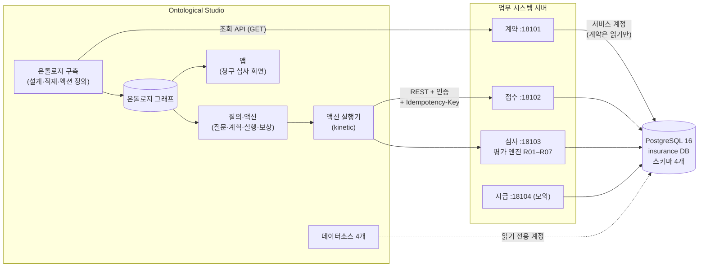
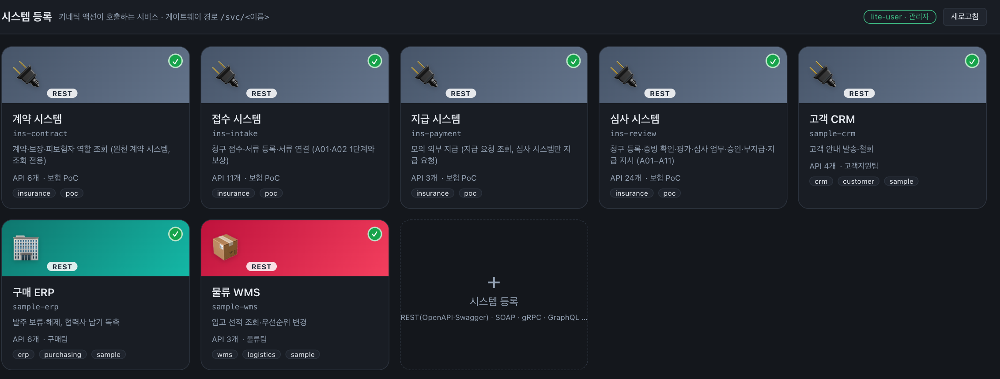
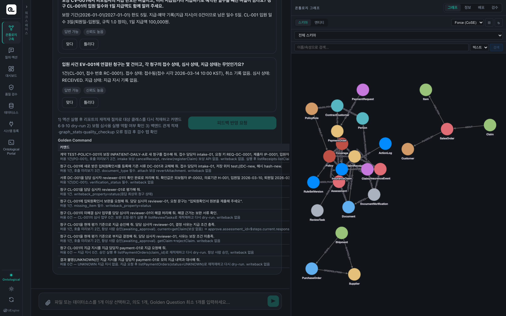
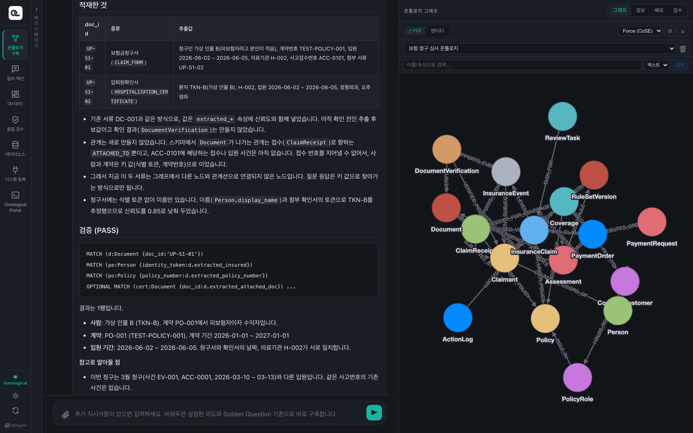
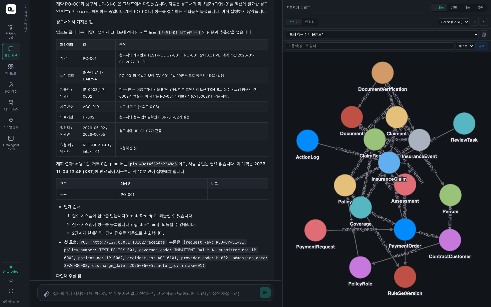
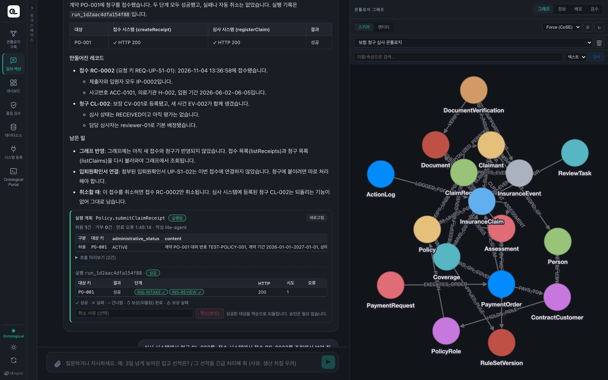
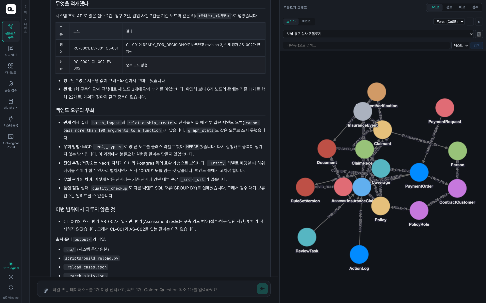
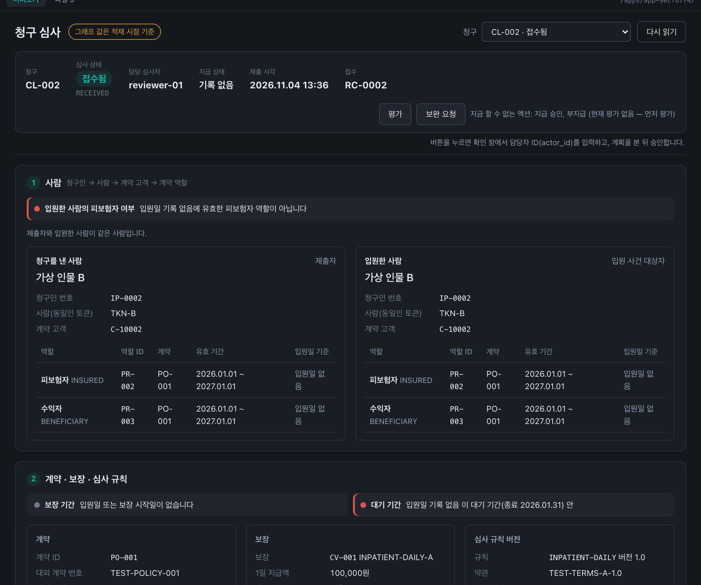

# 보험 청구 심사 온톨로지 PoC

Ontological Studio로 구현한 입원 정액보험 청구 심사: 업무 시스템 연결부터 비정형 서류 접수까지

- 작성: 2026-11-04
- 근거: Ontological Studio 데스크톱 앱 v0.1.1, 앱 안의 코드·지침 파일, PoC 산출물(`04_insurance_ontology_poc/`). 수치는 실행 중인 앱과 업무 시스템에서 직접 조회한 값입니다.
- 모든 인물·의료기관·계약·서류는 가상입니다.

## PoC 목적

- 앞선 조사(「온톨로지 솔루션 오픈소스 조사」)에서 분석한 Ontological Studio를 **실제 업무 시나리오에 적용**해, 구축부터 활용까지 어디까지 되는지 확인함
- 업무는 보험업 온톨로지 설계 시나리오(이하 「명세」)의 **입원 정액보험 청구 심사와 모의 지급**
- 확인할 것
    - 시스템마다 흩어진 고객·계약·청구를 온톨로지로 잇고 질문에 답하는가 (읽기)
    - 온톨로지에서 업무 시스템의 상태를 바꾸는 일을 안전하게 할 수 있는가 (쓰기)
    - 비정형 서류를 올려 업무 시스템에 반영할 수 있는가 (추가 인제스천)

## PoC 결론

1. **온톨로지는 시스템마다 다른 번호를 관계로 잇는다.** 「입원한 사람이 이 계약의 피보험자인가」를 계약자와 구분해 답했다 (1·5장)
2. **액션은 여러 업무 API를 묶은 업무 단위다.** 되돌리기·중복 거르기·원자성은 업무 시스템 API가 맡으므로 **API 설계가 먼저**다 (5장)
3. **비정형 서류도 스키마 변경 없이 업무에 반영된다.** 구축(추가 인제스천)으로 그래프에 넣고, 질의·액션으로 업무 시스템에 접수했다(RC-0002·CL-002) (6장)
4. **운영에 쓰려면 Studio 개선이 필요하다.** 액션 뒤 재적재(동기화 버튼), 질의 범위 선택, 스캔 문서 처리 (7장)

---

## 1. 과제: 입원 정액보험 청구 심사

### 1.1 업무와 등장인물

| 항목 | 내용 |
|---|---|
| 상품 | 테스트 입원일당 A: 입원 1일 100,000원, 보장 기간 1년에 최대 5일, 가입 후 30일 대기 |
| 계약 | PO-001 (대외 번호 TEST-POLICY-001), 2026-01-01 – 2027-01-01 |
| 사람 | 가상 인물 A: **계약자**. 가상 인물 B: **피보험자·수익자** |
| 기본 청구 | CL-001: B가 3월 10일 – 13일 입원(3일), A가 접수 |
| 시스템 | 계약, 접수, 심사, 지급 네 시스템. **같은 사람·계약·사고가 시스템마다 다른 번호**로 기록됨 |

### 1.2 심사 담당자의 질문 (명세 1.2절)

| 번호 | 질문 |
|---|---|
| Q1 | 입원한 분이 이 계약의 피보험자 맞나요? |
| Q2 | 이번 입원은 보상 대상인가요? 어떤 약관과 지급 기준으로 보면 되나요? |
| Q3 | 필요한 서류는 다 들어왔나요? 서류마다 날짜나 인적사항이 다른 곳은 없나요? |
| Q4 | 이미 지급했거나 지급하기로 한 건까지 반영하면, 이번에 얼마를 지급할 수 있나요? |
| Q5 | 같은 입원으로 이미 접수되거나 지급된 건이 있나요? |
| Q6 | 이전에는 누가 어떤 근거로 심사했나요? |
| Q7 | 이 건은 서류 보완, 추가 심사, 지급 진행 중 무엇을 해야 하나요? |

### 1.3 업무 실행 (명세 8.1절 Action)

| 번호 | Action | 하는 일 |
|---|---|---|
| A01 | SubmitClaim | 청구 접수 (접수 시스템 + 심사 시스템) |
| A02 | AttachEvidence | 서류 연결·교체 |
| A03 | VerifyEvidence | 서류 확인값 저장 |
| A04 | EvaluateClaim | 평가 규칙 R01–R07로 평가 |
| A05 | RequestEvidence | 서류 보완 요청 |
| A06 | ResolveReviewTask | 심사 업무 해결 |
| A07 | ApproveClaim | 지급 승인 (지급 지시·한도 예약) |
| A08 | RejectClaim | 부지급 결정 |
| A09 | RequestPayment | 모의 지급 요청 |
| A10 | RecordPaymentResult | 지급 결과 수신 (서명된 콜백) |
| A11 | ReconcilePayment | 결과 불명 지급의 대사 |

명세는 이 밖에 평가 규칙 7개(R01 피보험자 일치 – R07 한도), 청구·지급 상태 전이, 테스트 29개(T01–T29)를 정합니다.

---

## 2. 전체 구성

### 2.1 구성도



Studio는 데스크톱 v0.1.1이고, 업무 시스템 서버는 FastAPI로 만들었습니다.

- **읽기:** 구축 에이전트가 업무 시스템의 조회 API로 읽어 그래프에 적재합니다. 데이터소스 4개도 읽기 전용 계정으로 연결했습니다.
- **쓰기:** 상태 변경은 오직 액션 → 업무 시스템 API입니다. Studio는 DB를 직접 고치지 않습니다.

### 2.2 같은 대상, 다른 번호: 온톨로지가 잇는 것

| 대상 | 계약 시스템 | 접수 시스템 | 심사 시스템 | 잇는 키 |
|---|---|---|---|---|
| 계약자 A | C-10001 | IP-0001 | 제출자 IP-0001 | 동일인 토큰 TKN-A |
| 피보험자 B | C-10002 | IP-0002 | 사건 대상 IP-0002 | 동일인 토큰 TKN-B |
| 계약 | PO-001 | TEST-POLICY-001 | PO-001 | 대외 계약 번호 |
| 보장 | CV-001 | INPATIENT-DAILY-A | CV-001 | 계약 번호 + 보장 코드 |
| 청구 | – | RC-0001 | CL-001 | 접수 번호 |
| 입원 사건 | – | ACC-0001 | EV-001 | 사고번호 |

명세가 전제한 현실: 담당자가 이 번호들을 시스템마다 찾아 대조합니다. 온톨로지는 이 대조를 관계로 만들어 둡니다.

---

## 3. 역할 분담: Studio가 하는 것과 우리가 만든 것

### 3.1 결론

Studio는 **조율**을 맡습니다. 언제, 어떤 순서로, 누구의 승인을 받아 API를 부를지 정하고 기록합니다. **무엇을 어떻게 바꾸고 무엇을 막을지**(업무 의미)는 업무 시스템이 맡습니다.

| 기능 | Studio가 하는 일 | 업무 시스템이 하는 일 |
|---|---|---|
| 보상 (되돌리기) | 단계가 실패하면 성공한 단계를 **역순으로 자동 보상**. 사용자 「취소」도 같은 방식 | 되돌리는 API 제공, 되돌려도 되는지 판단 |
| 멱등성 키 | 단계마다 `Idempotency-Key`를 만들어 보냄 (`계획:대상:단계:a시도`) | 같은 키 재요청을 걸러 처음 결과 반환 |
| 권한 | 역할·조건식으로 계획 때와 실행 직전에 판정 | 업무 권한(담당 심사자인가) 확인 |
| 사람 승인 | 되돌릴 수 없는 액션은 실행 전 사람이 계획을 승인 | – |
| 실행 기록 | 계획, 실행, 단계별 HTTP 결과, 보상 순서 | 업무 이력(`action_log`)과 거절 사유 |
| 업무 규칙 | 없음 | 평가 R01–R07, 상태 전이, 한도·중복 검사 |
| 원자성·동시성 | 없음 (시스템 간 사가 방식일 뿐) | 한 트랜잭션, 잠금, 입력 해시로 최신성 검사 |

근거: 앱 안의 액션 실행기 코드(`kinetic/app/app/plans.py`, `dispatch.py`), 시스템 등록 화면 안내문 「서비스는 Idempotency-Key 로 중복을 걸러야 합니다」.

### 3.2 명세 요구별 담당

| 명세 요구 | 담당 | 비고 |
|---|---|---|
| 객체·속성·관계, 시스템 간 식별자 연결 | Studio | 1차 구축 |
| 질문 Q1–Q5에 근거와 함께 답 | Studio | 골든 퀘스천 |
| 상태 변경은 Action으로만 | Studio + 서버 | 액션 10개 → API |
| 평가 R01–R07, 입력 스냅샷·해시 | 서버 | `evaluation.py` |
| 승인의 원자성, 동시 승인 제어 | 서버 | T18·T19 각 100회 통과 |
| 멱등성 (같은 키 → 같은 결과) | 서버 | Studio는 키만 보냄 |
| 지급 결과 콜백 수신 (A10) | 서버 | **Studio 불가:** 실행기는 부르기만 하고 받지 못함 |
| 역할별 접근 제어 | 서버 | Studio 데스크톱은 사용자 1명 |

---

## 4. 준비: 업무 DB와 업무 시스템

### 4.1 업무 DB

| 스키마 | 시스템 | 테이블 |
|---|---|---|
| `contract` | 계약 | customer, policy, policy_role, coverage |
| `intake` | 접수 | claimant, claim_receipt, document, receipt_document |
| `review` | 심사 | rule_set_version, insurance_event, document_verification, claim, assessment, assessment_evidence, review_task, payment_order, action_log 등 |
| `payment` | 지급 (모의) | payment_request 등 |

- Homebrew PostgreSQL 16의 `insurance` DB에 스키마 4개. Studio 내장 DB와 분리했습니다.
- 기본 데이터 B0와 초기화 스크립트(`reset.sh`). 모든 테스트가 B0에서 출발합니다.
- 계정을 나눴습니다: Studio 데이터소스는 읽기 전용, 업무 서버는 쓰기(계약은 읽기만).

### 4.2 업무 시스템 서버 4개

| 시스템 | 포트 | API | 인증 | 주요 쓰기 |
|---|---|---|---|---|
| 계약 | 18101 | 6 | API 키 | 없음 (읽기 전용 원천) |
| 접수 | 18102 | 11 | Basic | 접수 생성·취소, 서류 등록·연결·되돌리기 |
| 심사 | 18103 | 24 | Bearer | 청구 등록, 서류 확인, 평가, 보완 요청, 승인·부지급, 지급 요청·대사 |
| 지급 | 18104 | 3 | API 키(헤더 `X-Payment-Key`) | 모의 지급, 서명 콜백 |

- 인증을 일부러 세 종류로 나눠 Studio의 인증 전달을 확인했습니다.
- Studio 동작에 맞춰 보완한 것: 되돌리기 API가 심사 시스템을 조회해, 청구가 있는 접수의 취소(`RECEIPT_IN_USE`)와 종결된 청구의 서류 되돌리기(`CLAIM_CLOSED`)를 거절합니다.

### 4.3 시나리오 테스트: 109/109 통과

| 묶음 | 확인한 것 | 예 |
|---|---|---|
| 업무 규칙 T01–T15 | 평가 결과·일수·금액 | T01 지급 후보 3일·300,000원, T09 한도 반영 2일, T11 계약자는 피보험자가 아님 → 부지급 |
| 실행·연계 T16–T29 | 멱등성, 동시성, 최신성, 권한, 지급 결과 | T18·T19 동시 승인 각 100회 모두 한 건만 승인, T23 지급 결과 불명 → 대사 |
| 액션 경로 A01·A02 | 단계·보상·취소 | 보상 `cancelReceipt`, 청구가 있는 접수 취소 거절 |

### 4.4 Studio에 등록

| 메뉴 | 등록한 것 | 확인 |
|---|---|---|
| 데이터소스 | `contract`, `intake`, `review`, `payment` | 테이블 조회 |
| 시스템 등록 | `ins-contract`, `ins-intake`, `ins-review`, `ins-payment` (REST, OpenAPI) | 연결 테스트 4개 통과 |



**확인한 사실:** 액션 실행기는 인증 비밀값을 **자기 프로세스 환경변수**에서 읽습니다. 앱 설정 파일(`studio.env`)은 실행기에 전달되지 않아, 환경변수를 등록하고 앱을 다시 시작해야 했습니다.

---

## 5. 1차 구축: 읽기 모델과 액션

### 5.1 구축 브리프

| 칸 | 넣은 것 |
|---|---|
| 소스 | 데이터소스 4개 + 시스템 4개 (문서 없음) |
| 대상 | 새 스키마 「보험 청구 심사 온톨로지」 |
| 구축 의도 | 사용 목적, 시스템 간 연결 키 6가지, 지켜야 할 의미(사람과 계약 역할 구분, 청구와 사건 구분, 추출값은 확인값이 아님), 상태 변경은 API로만 |
| 골든 퀘스천 | 6개 (Q1–Q5를 B0 값으로 구체화) |
| 골든 커맨드 | 10개 (A01–A09, A11. A10은 서명 콜백이라 제외) |

### 5.2 구축 결과

| 항목 | 결과 |
|---|---|
| 클래스 | **17개**, 모두 그래프 적재 방식(materialized) |
| 관계 | **32개** |
| 액션 | **10개** |
| 골든 퀘스천 | 6개 모두 통과 |

| 영역 | 클래스 |
|---|---|
| 사람·계약 | Person, ContractCustomer, Claimant, Policy, PolicyRole, Coverage, RuleSetVersion |
| 청구·서류 | ClaimReceipt, InsuranceClaim, InsuranceEvent, Document, DocumentVerification |
| 업무 기록 | Assessment, ReviewTask, PaymentOrder, PaymentRequest, ActionLog |

- **사람:** 계약 고객(ContractCustomer)과 접수 청구인(Claimant)을 하나의 사람(Person)으로 잇습니다(동일인 토큰).
- **계약 역할:** 사람과 계약을 바로 잇지 않고 계약 역할(PolicyRole: 역할 종류, 유효 기간)을 둡니다. 그래서 계약자 A와 피보험자 B가 섞이지 않습니다.
- **청구와 사건:** 청구(InsuranceClaim)와 입원 사건(InsuranceEvent)을 나눠, 한 사건에 붙은 여러 청구로 중복을 봅니다.



### 5.3 골든 퀘스천 답 (예)

| 질문 | 답 |
|---|---|
| GQ2 청구 CL-001에서 입원한 사람은 피보험자가 맞나요? | 맞음. 입원자 IP-0002(B) = 계약 고객 C-10002, 입원일에 피보험자 역할(PR-002) 유효. 접수한 사람 IP-0001(A)은 계약자이며 피보험자가 아님 |
| GQ5 남은 지급 한도는? | 한도 5일, 지급·예약 0일, 남은 일수 5일. CL-001 입원 3일, 1일 100,000원 |

### 5.4 액션이란: 정의와 캡슐화

**액션(Action)은** 「청구 접수」처럼 업무 하나를 이름과 입력으로 감싼 실행 단위입니다. 부르는 쪽(질의·액션의 지시, 앱 버튼, 골든 커맨드)은 액션 이름, 대상, 파라미터만 알면 됩니다. 그 안에서 어떤 API를 어떤 순서로 부르고, 응답을 다음 단계에 어떻게 넘기고, 실패하면 무엇을 되돌리고, 누가 실행할 수 있는지는 액션 정의 안에 숨겨집니다. 이것이 **캡슐화**입니다. 같은 액션을 어디서 부르든 같은 단계와 같은 검증을 거치므로, 업무 처리 방식이 화면마다 달라지지 않습니다.

쉽게 말하면, 청구를 접수하려면 실제로는 다섯 가지를 해야 합니다. ① 접수 시스템 API를 부르고 ② 응답에서 접수 번호를 꺼내고 ③ 그 번호로 심사 시스템 API를 부르고 ④ ③이 실패하면 접수 취소 API를 부르고 ⑤ 담당자 ID와 승인 여부를 챙깁니다. 액션이 없다면 질의 에이전트, 앱 버튼, 다른 화면이 **각자** 이 다섯 가지를 해야 하고, 한 곳이라도 ④를 빠뜨리면 「접수만 있고 청구는 없는」 어긋난 데이터가 생깁니다. 액션이 있으면 「청구 접수(계약, 담당자, 청구서 값)」 한마디면 되고, 다섯 가지는 액션 정의 안에 한 번만 적혀 있습니다.

**Studio에서 왜 중요한가:** 질의·액션 에이전트는 쓰기 API를 직접 부르지 못하고(조회 API만 허용) **정의된 액션만 고릅니다.** 그래서 에이전트가 순서를 틀리거나 되돌리기를 빠뜨릴 수 없습니다. 앱의 액션 버튼도 같은 액션을 부르고, API가 바뀌면 액션 정의만 고치면 됩니다.

예: 청구 접수 액션 `submitClaimReceipt`

```text
부르는 쪽이 보는 것:  submitClaimReceipt(대상 계약, actor_id, request_key, 보장 코드, 제출자·입원자, 사고번호, 의료기관, 입원·퇴원일)

액션 안에 감춰진 것:  ① 접수 시스템 createReceipt        보상: cancelReceipt(① 응답의 receipt_no)
                      ② 심사 시스템 registerClaim        receipt_no ← ① 응답
                      정책: 역할 scm_operator · 실행자 actor_id는 서버가 검사
```

**액션은 여러 API로 만들 수 있습니다.** 이 PoC의 액션 10개 중 청구 접수는 2단계(시스템 2개), 서류 교체는 3단계(시스템 2개), 승인·부지급은 2단계(현재 청구 조회 → 결정)입니다. 앞 단계 응답의 값(`receipt_no`, `doc_id`, `attachment_id`)을 다음 단계 입력으로 넘깁니다.

| 비교 | Palantir 액션 타입 | Studio 액션 |
|---|---|---|
| 정의 | 하나 이상의 객체·속성·링크를 바꾸는 **단일 트랜잭션** | 등록 시스템 API를 **단계로 묶은** 실행 |
| 바꾸는 곳 | 온톨로지 자체 (편집이 라이트백 데이터셋에 기록) | 외부 업무 시스템 (그래프는 결과 `status`만 되씀) |
| 원자성 | 편집은 전부 아니면 전무. 알림·웹훅 같은 부수 효과는 예외 | 없음. 실패하면 성공한 단계를 역순으로 **보상** (사가) |
| 외부 시스템 쓰기 | 라이트백 웹훅 **1개**(편집 전 실행, 실패하면 편집 안 함) 또는 부수 효과 웹훅(편집 후) | 단계마다 API 호출, 단계 수 제한 없음 |
| 실행 권한 | 제출 조건 | 정책(역할·조건식) + 사람 승인 |

출처: Palantir 문서 번역본 `02_define-ontologies/03_action-types/`(01_overview, 21_consistency-guarantees, 12_side-effects/04_webhooks), Studio 액션 실행기 코드(`kinetic/app/app/plans.py`)

### 5.5 보상, 그리고 액션을 만들 때 명심할 점

**보상(compensation)은** 이미 성공한 단계의 효과를 **반대 업무로 되돌리는 별도의 API 호출**입니다. 데이터를 지우는 것이 아니라, 접수에는 「접수 취소」, 서류 연결에는 「연결 해제」처럼 업무 의미가 있는 되돌리기입니다. Studio는 두 경우에 보상을 부릅니다.
- **단계가 실패했을 때(자동 보상):** 성공한 단계를 실행의 역순으로 되돌립니다.
- **사용자가 「취소해 줘」라고 할 때:** 성공한 실행 전체를 같은 방식으로 되돌립니다.

보상할 API가 없는 단계는 「보상 없음」으로 남고, 그 액션은 「부분 취소만 가능」이 됩니다. 예: 서류 교체 액션에서 3단계(심사 반영)가 실패하면 2단계 연결은 `revertAttachment`로 되돌아가지만, 1단계 서류 등록은 되돌리는 API가 없어 서류가 연결 없이 남습니다.

액션을 만들 때 명심할 점:

| 번호 | 명심할 점 | 이유 | 이 PoC에서 |
|---|---|---|---|
| 1 | **API를 온톨로지보다 먼저 설계한다** | 구축 에이전트는 등록된 시스템의 OpenAPI에 있는 API로만 액션을 만든다. 없는 API는 지어내지 않는다 | 서버 설계서와 API 44개를 먼저 만들고 시스템 등록 → 그다음 1차 구축 |
| 2 | **쓰기 API마다 되돌리기 API를 짝지어 둔다** | Studio는 보상을 「언제」 부를지만 정한다. 되돌리는 API 자체는 업무 시스템에 있어야 한다 | `createReceipt` ↔ `cancelReceipt`, `attachDocument` ↔ `revertAttachment` |
| 3 | **되돌려도 되는지는 서버가 판단한다** | 보상이 늦게 오면 이미 다음 업무가 진행됐을 수 있다 | 청구가 있는 접수 취소 → `RECEIPT_IN_USE`, 종결된 청구의 연결 해제 → `CLAIM_CLOSED` |
| 4 | **중복 거르기는 서버가 한다** | Studio는 `Idempotency-Key`를 만들어 보내기만 하고, 재시도하면 키가 바뀐다 | 업무 키(`request_key`, 지급 키)로 중복 거르기 |
| 5 | **원자성이 필요한 일은 API 하나 안에 둔다** | Studio의 단계 묶음은 트랜잭션이 아니다 | 승인(지급 지시·한도 예약·상태·이력)은 심사 서버 한 트랜잭션 |
| 6 | **액션 대상은 그래프에 적재된 인스턴스다** | 데이터소스의 가상 클래스는 대상이 될 수 없다. 액션 뒤에는 재적재가 필요하다 | 17개 클래스 모두 적재 방식, 접수 뒤 재적재 |
| 7 | **실행자와 승인을 따로 챙긴다** | 데스크톱 사용자는 1명이고 실행 역할은 정해진 목록뿐이다 | `actor_id` 파라미터로 서버가 권한 검사, 승인·부지급은 항상 사람 승인 |

### 5.6 액션 10개

| 액션 | 대상 | 단계 (시스템 API) | 보상 | 사람 승인 |
|---|---|---|---|---|
| 청구 접수 `submitClaimReceipt` | 계약 | 접수 `createReceipt` → 심사 `registerClaim` | 접수 취소 | 대상 2건 이상 |
| 서류 교체 `replaceClaimDocument` | 청구 | 서류 등록 → 연결·교체 → 심사 반영 | 연결 되돌리기 | 대상 2건 이상 |
| 서류 확인 `verifyDocument` | 서류 | 심사 `verifyEvidence` | – | 대상 2건 이상 |
| 평가 `evaluateClaim` | 청구 | 심사 `evaluateClaim` | – | 대상 2건 이상 |
| 보완 요청 `requestEvidence` | 청구 | 심사 `requestEvidence` | – | 대상 2건 이상 |
| 업무 해결 `resolveReviewTask` | 심사 업무 | 심사 `resolveReviewTask` | – | 대상 2건 이상 |
| 지급 승인 `approveClaim` | 청구 | 현재 청구 조회 → 심사 `approveClaim` | – | **항상** |
| 부지급 `rejectClaim` | 청구 | 현재 청구 조회 → 심사 `rejectClaim` | – | **항상** |
| 지급 요청 `requestPayment` | 지급 지시 | 심사 `requestPayment` | – | **항상** |
| 대사 `reconcilePayment` | 지급 지시 | 심사 `reconcilePayment` | – | 대상 2건 이상 |

- **사람 승인 규칙:** 모든 액션에 사람 승인이 필요한 것은 아닙니다. 실행기(`plans.py`)는 허용 대상 수가 `confirm_threshold`보다 크면 승인을 요구합니다. 지급 승인·부지급·지급 요청은 기준값이 0이라 항상, 나머지 7개는 1이라 대상이 2건 이상일 때만 승인이 필요합니다.
- 실행자 ID는 파라미터(`actor_id`)로 받아 서버가 권한을 검사합니다. Studio 사용자(`lite-user`)는 업무 담당자가 아니기 때문입니다.
- 승인·부지급은 먼저 청구를 다시 읽어 **현재 평가 ID**를 가져옵니다. 그래프의 값이 늦어도 최신 평가로 결정하게 하려는 것입니다.

### 5.7 질의·액션으로 실행한 것

| 시각 (KST) | 지시 | 결과 |
|---|---|---|
| 11-04 10:40 | 「청구 CL-001을 담당 심사자 reviewer-01로 평가해 줘」 | 평가 AS-002: **지급 후보 3일·300,000원**, R01–R07 모두 PASS, 청구 `READY_FOR_DECISION` (명세 10.3절 예시와 일치) |
| 11-04 13:36 | 업로드 청구서로 접수 (6장) | 접수 RC-0002, 청구 CL-002 |

---

## 6. 2차: 비정형 서류 업로드로 청구 접수

### 6.1 목표와 흐름

**목표:** 청구인이 낸 서류를 Studio에 올려, 그 내용이 **업무 시스템 DB에 들어가는 것**을 확인합니다. DB에 직접 넣는 단계는 없습니다.

앱 코드에서 확인한 제약:
- 파일은 **구축 화면에서만** 받습니다. 구축 에이전트는 액션을 정의·미리보기까지만 하고 실행하지 않습니다.
- **질의·액션 화면**은 파일을 받지 않지만, 액션을 실행합니다.

**업로드는 인제스천 기능입니다.** 파일을 받는 모드는 구축뿐이고(`allowsFiles: true`), 질의·액션과 질문 응답은 파일을 받지 않습니다. 올린 파일은 세션의 업로드 폴더에 저장되어 구축 에이전트에게 `[업로드 문서]`로 전달됩니다. 시스템 스펙 파일, 골든 퀘스천 txt, 품질 CSV 업로드는 별도 용도입니다.

그래서 세 화면을 이 순서로 거칩니다. 순서마다 이유가 있습니다.

| 순서 | 화면 | 하는 일 | 이유 |
|---|---|---|---|
| ① | 구축 | 서류를 올려 그래프에 「미접수 서류」로 추가 | 파일은 구축 화면만 받는다 |
| ② | 질의·액션 | 청구 접수 액션 실행 → 업무 DB에 접수·청구 | 업무 DB를 바꾸는 액션 실행은 질의·액션에서만 된다 |
| ③ | 구축 | 업무 시스템 조회 API로 재적재 | 그래프는 복사본이다. 액션은 DB만 바꾸고 그래프는 안 바꾼다 |
| ④ | 앱 | 새 청구 확인 | 앱과 다음 액션은 그래프를 읽는다 |

```text
① 구축 (추가 인제스천)   서류 2개 업로드 → 그래프에 「미접수 서류」 노드 2개
② 질의·액션              「업로드한 청구서대로 접수해 줘」 → 기존 접수 액션 → 업무 DB에 접수·청구
③ 구축 (추가 인제스천)   업무 시스템 조회 API로 재적재 → 그래프에 새 청구
④ 앱                     청구 심사 화면에서 새 청구 확인
```

### 6.2 업로드한 서류

| 파일 | 형태 | 내용 |
|---|---|---|
| `UP-S1-01_보험금청구서.docx` | B가 편지처럼 쓴 글. 표·항목 이름 없음 | 「저는 가상 인물 B입니다. 계약번호 TEST-POLICY-001 보험에 피보험자로 … 입원 일당(하루 10만 원 보장)을 청구 …」, 6월 2일 입원 – 6월 5일 퇴원, H-002, 사고접수번호 ACC-0101, 3월 입원과 별개 |
| `UP-S1-02_입퇴원확인서.pdf` | 병원 발급 양식 (텍스트 PDF) | 환자 B(식별 토큰 TKN-B), 2026년 06월 02일 – 06월 05일 (3박 4일), 정형외과, 요양기관기호 H-002 |

문서에는 **청구인 번호(IP-…)와 보장 코드가 없습니다**. 이 값은 온톨로지가 채워야 합니다.

### 6.3 ① 구축: 엔티티만 추가

| 칸 | 넣은 것 |
|---|---|
| 소스 | 문서 2개 |
| 대상 | 보험 청구 심사 온톨로지 **(추가 인제스천)** |
| 구축 의도 | 한 줄: 「업로드한 청구 서류를 기존 클래스의 인스턴스로 추가한다. 스키마와 액션은 바꾸지 않는다.」 |
| 골든 퀘스천 | 1개: 청구인, 계약, 입원 기간 |
| 골든 커맨드 | 없음 |

- 추가 인제스천을 고르면 에이전트는 「해당 스키마의 기존 클래스만 사용하여 엔티티를 생성하고, 새로운 클래스를 추가하지 마세요」라는 지침을 따릅니다(앱 내장 지침 `SKILL.md`).
- 구축 의도와 골든 퀘스천은 비울 수 없습니다. 「구축 시작」 버튼이 둘 다 있어야 켜집니다.

**결과:** 기존 Document 클래스에 UP-S1-01, UP-S1-02 두 노드가 생겼습니다. 새 클래스와 새 액션은 없고, 업무 클래스(접수·청구·사건)에 가짜 노드도 생기지 않았습니다.

| 속성 | UP-S1-01 (청구서) | 근거 |
|---|---|---|
| 청구인 이름 | 가상 인물 B (신뢰도 0.95) | 원문 |
| 피보험자 토큰 | TKN-B (**신뢰도 0.85**) | 이름만 있어 기존 사람 노드와 첨부 확인서의 토큰으로 추정, 그래서 낮춤 |
| 계약번호, 사고번호 | TEST-POLICY-001, ACC-0101 (0.98) | 원문 |
| 의료기관, 입원·퇴원일 | H-002, 2026-06-02, 2026-06-05 | 원문 (확인서와 일치) |
| 1일 지급액 | 100,000 | 「하루 10만 원」 |
| 첨부 서류 | UP-S1-02 | 청구서가 언급한 파일 이름 |
| 원문 해시 | 업로드 파일의 SHA-256 | 에이전트가 계산 (직접 계산한 값과 일치) |



추출값은 `extracted_*` 속성에 신뢰도와 함께 넣고 **확인값과 구분**했습니다. 기존 서류 DC-001과 같은 방식입니다.

### 6.4 ② 질의·액션: 청구 접수

입력:
```text
업로드한 보험금 청구서 UP-S1-01의 내용대로 계약 PO-001에 청구를 접수해 줘. 요청 키 REQ-UP-S1-01, 접수 담당자 intake-01.
```

에이전트는 기존 접수 액션을 골라 **계획**을 세웠습니다. 실행 전이라 아무것도 바뀌지 않은 상태입니다.

| 액션 인자 | 계획 값 | 온톨로지에서 찾은 길 |
|---|---|---|
| 보장 코드 | INPATIENT-DAILY-A | 계약 PO-001의 보장 CV-001, 1일 10만 원 |
| 제출자·입원자 | IP-0002 / IP-0002 | 이름 → 토큰 TKN-B → 접수 시스템 청구인 IP-0002 (= 계약 고객 C-10002, 피보험자) |
| 사고번호, 의료기관 | ACC-0101, H-002 | 청구서 |
| 입원·퇴원일 | 2026-06-02 / 2026-06-05 | 청구서와 확인서 |

「실행해」 → 두 단계 모두 HTTP 200, 보상 없음. **업무 DB에서 직접 확인한 결과:**

| 시스템 | 생긴 레코드 |
|---|---|
| 접수 | **RC-0002**: 요청 키 REQ-UP-S1-01, 제출자·입원자 IP-0002, INPATIENT-DAILY-A, ACC-0101, H-002, 06-02 – 06-05 |
| 심사 | **CL-002**: 계약 PO-001, 보장 CV-001, 사건 EV-002, 상태 `RECEIVED`, 담당 reviewer-01 |
| 심사 | **EV-002**: 사고 ACC-0101, 대상 IP-0002, `UNVERIFIED` (확인값은 서류 확인 뒤 채워짐) |




### 6.5 ③ 재적재와 ④ 앱

액션은 업무 DB만 바꿉니다. 그래프는 적재해 둔 복사본이라, 새 청구를 앱에서 보려면 다시 적재해야 합니다.

| 칸 | 넣은 것 |
|---|---|
| 소스 | 시스템 4개 (문서 없음) |
| 대상 | 추가 인제스천 |
| 구축 의도 | 조회 API로 접수·청구·사건을 다시 적재, 있는 노드는 키로 갱신, 스키마·액션은 바꾸지 않음 |
| 골든 퀘스천 | 「청구 CL-002는 누가 냈고, 입원한 사람은 피보험자인가요?」 → 통과 |

**결과:** 갱신 3건(RC-0001, CL-001, EV-001), 신규 3건(RC-0002, CL-002, EV-002), 중복 없음. CL-002에서 제출자·계약·보장·접수·사건으로 가는 관계 5개가 생겨, 청구 심사 화면에서 CL-002를 고를 수 있습니다.





앱에서 CL-002의 「입원한 사람의 피보험자 여부」가 빨간색으로 「입원일 기록 없음」이라고 나옵니다. 입원 사건 EV-002의 날짜는 서류 확인(A03)을 마친 뒤 채워지기 때문입니다. 피보험자가 아니라는 뜻이 아닙니다. 청구서의 신고 날짜는 접수 RC-0002에 있으므로, 앱이 확인 전에는 신고값으로 미리 보여 주도록 고칠 수 있습니다.

### 6.6 발표: 시나리오 2 추가

시나리오 1로 액션이 모두 갖춰졌으므로, 발표에서는 **서류만 올리면 같은 흐름이 돈다**는 것을 보여 줍니다.

| 항목 | 시나리오 2 |
|---|---|
| 서류 | 가상 인물 A가 「제가 계약자로 가입한 보험」으로 본인 입원(7월 10일 – 14일, H-004)을 청구 |
| 접수 | 계약자는 청구할 수 있어 **접수는 통과** |
| 심사 | 평가 R01 FAIL: **입원한 사람이 피보험자가 아님** → 부지급 후보 |
| 보여 주는 것 | 서류에 쓴 말("제가 가입한 보험")과 계약상 역할(계약자 ≠ 피보험자)을 온톨로지가 구분 |

---

## 7. 확인한 한계와 문제

### 7.1 구조적 한계 (Studio 설계)

| 한계 | 영향 | 대응 |
|---|---|---|
| 액션은 업무 DB만 바꾸고 그래프는 `status` 하나만 되써 넣음 | 새 청구, 평가 같은 새 레코드는 **재적재해야** 그래프·앱에 보임 | 액션 뒤 구축 화면에서 재적재 (시연 순서에 포함) |
| 액션 대상은 그래프에 적재된 인스턴스만 | 1차 구축에서 17개 클래스 모두 적재 방식이 됨 → 재적재 부담 | 위와 같음 |
| 파일은 구축 화면에서만 받음 | 서류를 바로 업무에 반영할 수 없음 | 구축(적재) → 질의·액션(실행)으로 나눠 진행 |
| 원자성·동시성 제어 없음 | 승인 같은 업무는 Studio만으로 안전하지 않음 | 업무 시스템의 트랜잭션·잠금 |
| 외부 콜백 수신 불가 | A10 지급 결과 수신을 액션으로 못 만듦 | 지급 시스템 → 심사 시스템 직접 콜백 |
| 데스크톱은 사용자 1명(`lite-user`), 실행 역할은 정해진 목록 | 접수·심사·지급 담당자를 역할로 나눌 수 없음 | 서버가 `actor_id`로 권한 검사 |
| 재시도 때 멱등성 키가 바뀜 | 응답 유실 후 재시도는 서버에 새 요청으로 보임 | 업무 키(요청 키, 지급 키)로 중복 거르기 |

### 7.2 이번 시나리오에서 빠진 액션

기존 액션 10개에는 **새 청구에 첫 서류를 붙이는 액션이 없습니다**. 「서류 교체」는 교체할 기존 서류 ID를 반드시 받습니다. 그래서 시나리오 1은 지금 **접수까지만** 진행됩니다. 서류 확인 → 평가 → 승인까지 보이려면 「첫 서류 연결」 액션을 별도 구축으로 한 번 추가해야 합니다(스키마 변경이므로 데이터 추가와 나눠 진행).

### 7.3 Studio 버그 (v0.1.1)

| 증상 | 원인 (확인한 범위) | 영향 |
|---|---|---|
| 그래프(엔티티) 보기, 그래프 통계, 일괄 관계 적재가 실패: 「cannot pass more than 100 arguments to a function」 | 전체 엔티티(`_Entity`) 조회 시 모든 클래스의 속성을 함수 인자로 펼침. 속성 합계가 50개를 넘으면 한도(100) 초과 | 엔티티 화면이 비어 보임. 구축 에이전트가 관계를 Cypher로 직접 만들어 우회. 클래스별 조회는 정상 |
| 품질 점검(`quality_checkup`) 실패: `GROUP BY` 오류 | 백엔드 SQL 오류 | 검수 대기 건수 확인 불가. 적재 결과에는 영향 없음 |
| 구축 화면에서 시스템을 골라도 칩 색이 바뀌지 않음 | 선택 표시 CSS 없음 | 「1 소스」 옆 요약으로 확인 |

### 7.4 Studio의 비정형 문서 처리

파일은 구축 화면에서만 올릴 수 있고, 올린 파일을 무엇으로 만들지는 **구축 에이전트가 파일마다 판단**합니다(내장 지침 `ingestion-patterns.md`, `source-types.md`). 경로는 셋입니다.

| 경로 | 쓰는 경우 | 처리 | 그래프에 들어가는 방식 |
|---|---|---|---|
| ① 파서 스크립트 (이번 PoC) | 문서 구조가 곧 노드인 경우(약관의 관·조·항), 서식이 정해진 서류 | 에이전트가 파일마다 파서를 직접 써서 실행(PDF pdfplumber, DOCX 제목·문단, XLSX openpyxl, PPTX python-pptx) → 결과 JSON | `batch_ingest`로 바로 적재 |
| ② 문장 사실 추출 `extract_triples` | 문장 속에 사실이 흩어진 경우(프로세스 정의, 기술 문서) | 문서 글자(PDF pdfplumber, DOCX 문단)를 조각으로 나눠 LLM이 **같은 조각을 3번** 추출. 스키마가 허용하는 관계만, 원문 인용과 함께 | **신뢰도 게이트**(부록 D.3): 자동 적재 / 검수 대기 / 보류 |
| ③ 표 적재 `table_ingest` | 행이 곧 레코드인 표(Excel 목록, DB 덤프) | 열 → 속성 매핑, ID 열로 관계 연결, 원천 점검 규칙(`expectations`)으로 잘못된 행 거르기 | 신뢰도 게이트를 지나 적재 |

세 경로는 **한 구축 안에서 함께도, 따로도** 쓰일 수 있습니다(지침: 「하나의 프로젝트에서 여러 패턴이 혼합될 수 있습니다」). 어느 경로를 쓸지는 에이전트가 파일마다 고르고 화면에서 고르는 메뉴는 없지만, 구축 의도에 「표는 표 적재로」처럼 지시할 수 있습니다.

**OpenAI 키를 넣으면** ② 문장 추출이 켜집니다(키가 없으면 「OPENAI_API_KEY 가 없어 LLM 추출을 할 수 없습니다」 오류). 하지만 **스캔·사진 PDF는 키가 있어도 처리되지 않습니다.** 세 경로 모두 PDF의 글자층을 읽고, OCR 코드는 v0.1.1에서 연결되어 있지 않기 때문입니다. ③ 표 적재는 LLM 없이 동작합니다.

이번 PoC의 청구서·입퇴원확인서는 ①로 처리됐습니다. 에이전트가 문장을 읽고 해석해 값을 채웠고, 추정한 값의 신뢰도(0.85)도 직접 매겼습니다.

확인한 한계:
- **스캔 문서:** ①②는 모두 PDF에 들어 있는 글자를 읽습니다. 사진이나 스캔으로 만든 PDF는 글자가 나오지 않습니다.
- **OCR:** OpenAI 모델로 PDF를 OCR하고 1,200자 조각·임베딩으로 색인하는 「문서 색인」 코드(`document_indexing/`)가 들어 있습니다. 하지만 v0.1.1 백엔드에서 이 파이프라인을 부르는 화면이나 도구를 찾지 못했습니다. OpenAI 키도 이 PC에는 비어 있습니다.
- **LLM 추출:** ② `extract_triples`도 OpenAI 모델을 씁니다. 키가 없으면 ①③만 쓸 수 있습니다.
- **DOCX의 표:** 문서 색인과 ②의 DOCX 읽기는 문단만 읽고 표 안의 내용은 빠집니다.

### 7.5 Studio 개선 제안

이번 PoC에서 사용자가 실제로 겪은 불편입니다. 개발사(유엔진솔루션즈)에 전달할 목록으로 정리했습니다.

| 번호 | 겪은 상황 | 원인 (확인한 범위) | 개선 제안 |
|---|---|---|---|
| 1 | **액션 뒤 매번 재적재해야 함.** 청구를 접수해도 앱·그래프에 새 청구가 보이지 않음 | 액션은 업무 DB만 바꾸고, 그래프에는 대상 노드의 `status` 하나만 되써 넣음 | **「동기화」 버튼**: 등록 시스템 조회 API로 적재 클래스를 한 번에 다시 적재. 액션 성공 뒤 관련 클래스 자동 재조회 |
| 2 | **재적재도 「구축」으로 해야 함.** 스키마를 바꾸지 않는데도 구축 의도와 골든 퀘스천을 넣어야 시작 버튼이 켜짐 | 시작 버튼 조건이 의도 1개 + 골든 퀘스천 1개 이상 | 의도·골든 퀘스천 없이 도는 「데이터 추가·재적재」 모드 |
| 3 | **엔티티 그래프가 나타나지 않음.** 온톨로지 그래프에서 「엔티티」를 눌러도 빈 화면, 오류 안내 없음 | 전체 엔티티 조회가 모든 클래스의 속성을 함수 인자로 펼쳐 인자 100개 한도를 넘음(속성 합계 50개 초과). 같은 원인으로 그래프 통계, 관계 일괄 적재도 실패 | 클래스별로 나눠 조회해 그리기. 실패하면 화면에 원인 표시 |
| 4 | **소스에서 시스템을 골라도 반응이 없음.** 데이터소스는 노란색으로 선택이 표시되는데 시스템은 그대로 | 시스템 칩의 선택(`active`) 스타일이 없음 | 데이터소스와 같은 선택 표시. 지금은 「1 소스」 옆 요약으로만 확인 가능 |
| 5 | **대화 목록의 대상 표시가 실제와 다름.** 보험 1차 구축 대화가 「공급망 운영 (예제)」로 표시되고, 열기만 해도 시각이 바뀜 | 기본 대화가 처음 만든 대상 이름을 그대로 유지(2026-10-29 생성). 화면을 열 때 상태를 저장 | 구축할 때 대상 스키마로 표시 갱신, 열기만 할 때는 시각 유지 |
| 6 | **품질 점검이 실패함.** 검수 대기·보류 건수를 알 수 없음 | 백엔드 SQL의 `GROUP BY` 오류 | 쿼리 수정 |
| 7 | **용어가 화면마다 다름.** 같은 데이터소스 바인딩을 「가상 노드·가상 관계」, 「가상 클래스」로 부르고, 대상 하나를 「인스턴스·엔티티·노드」로 섞어 씀 | 화면·튜토리얼마다 따로 쓴 용어(부록 E) | 용어 통일, 그래프에 복사한 클래스(`materialized`)에도 화면 이름 부여 |
| 8 | **질의할 온톨로지를 고를 수 없음.** 질의·액션이 모든 온톨로지(보험, 공급망 예제)를 한꺼번에 대상으로 함 | 질의·액션 요청에는 대상 스키마가 없고(구축만 `[대상 스키마]`를 보냄), 스키마 조회 도구 `ontology_graph_schema()`는 인자 없이 그래프 전체를 돌려줌. 오른쪽 스키마 선택은 그래프 그림만 거름 | 질의·액션에도 대상 온톨로지 선택. 선택한 스키마로 조회·액션 범위 제한 |

---

## 8. 시사점과 다음 단계

### 8.1 시사점

- **온톨로지의 가치는 "대조"를 관계로 만들어 두는 데 있다.** 사람·계약·청구의 번호가 시스템마다 달라도, 질문과 액션 인자를 같은 관계로 풀었습니다. 자유 서술 서류의 이름과 문장도 같은 관계를 거쳐 업무 번호로 바뀌었습니다.
- **"AI가 제안하고 사람이 확정한다"가 실행에서도 유지된다.** 업로드 서류는 「미접수·확인 전」으로만 들어오고, 업무 반영은 사람이 확인한 액션 계획을 거칩니다. 추출값의 신뢰도도 낮춰 표시됩니다.
- **업무 규칙은 업무 시스템에 남겨야 한다.** 평가·승인·지급의 정확성(원자성, 동시성, 멱등성)은 서버 테스트로만 보장했습니다. Studio는 이 서버를 안전하게 부르는 조율자입니다.
- **운영에 쓰려면 그래프 동기화가 숙제다.** 지금은 액션마다 사람이 재적재를 돌려야 합니다.

### 8.2 다음 단계

| 순서 | 할 일 | 목적 |
|---|---|---|
| 1 | 「첫 서류 연결」 액션 추가 (별도 구축) | 시나리오 1을 서류 확인 → 평가 → 승인 → 지급까지 |
| 2 | 시나리오 2 업로드 (발표 시연) | 같은 흐름 + 부지급 판정 |
| 3 | 재적재 범위에 평가·심사 업무·지급 지시 포함 | 앱에서 평가·지급 칸 표시 |
| 4 | 청구 심사 화면에 「미접수 제출 서류」 칸 추가 | 업로드 직후 모습 시연 |
| 5 | Studio 개선 제안 8건 전달 (7.5) | 재적재, 엔티티 그래프, 시스템 선택 표시, 품질 점검 등 |
| 6 | (선택) 스캔 서류 처리 방법 확인 | OCR 파이프라인이 연결되지 않음. 쓰려면 문서 이미지의 외부 전송 검토 필요 |

---

## 부록

### 부록 A. 산출물 위치 (`04_insurance_ontology_poc/`)

| 폴더 | 내용 |
|---|---|
| `00_spec/` | 명세 원본, 쉬운 해설, Palantir 설계 가이드 해설 |
| `01_brief/` | 1차·2차 구축 브리프, 골든 퀘스천 |
| `02_data/` | DB 스키마, B0, 테스트 변형, 업로드 서류(`upload/시나리오1·2`), 서류 생성 스크립트 |
| `03_systems/` | 업무 시스템 서버 4개, 서버 설계서, 시나리오 테스트 |
| `04_ontology/` | Studio에서 내보낸 스키마(클래스 17·관계 32)와 액션 10개 정의 |
| `05_tests/` | 서버 테스트 결과 (109/109) |
| `06_app/` | 청구 심사 화면(코드 앱) 소스 |
| `notes/` | 시스템 구성 보고서, Studio 기능 대조 |

### 부록 B. 명세 Action과 Studio 액션 대조

| 명세 | Studio 액션 | 상태 |
|---|---|---|
| A01 SubmitClaim | `submitClaimReceipt` | 정의, **실행** (CL-002) |
| A02 AttachEvidence | `replaceClaimDocument` | 정의 (교체만, 첫 연결 없음) |
| A03 VerifyEvidence | `verifyDocument` | 정의 |
| A04 EvaluateClaim | `evaluateClaim` | 정의, **실행** (CL-001) |
| A05 RequestEvidence | `requestEvidence` | 정의 |
| A06 ResolveReviewTask | `resolveReviewTask` | 정의 |
| A07 ApproveClaim | `approveClaim` | 정의, 사람 승인 필요 |
| A08 RejectClaim | `rejectClaim` | 정의, 사람 승인 필요 |
| A09 RequestPayment | `requestPayment` | 정의 |
| A10 RecordPaymentResult | – | Studio 불가 (콜백 수신) |
| A11 ReconcilePayment | `reconcilePayment` | 정의 |

### 부록 C. 화면 캡처

Studio 화면을 브라우저(`http://127.0.0.1:27900`)로 열어 찍었습니다(2026-11-04). 파일: `04_insurance_ontology_poc/images/`

| 파일 | 화면 | 들어간 곳 |
|---|---|---|
| 01_시스템등록_목록.png | 시스템 등록: 보험 시스템 4개 연결 정상 | 4.4 |
| 02_1차구축_검수와_골든커맨드.png | 1차 구축 보고: 골든 퀘스천 검수, 골든 커맨드 미리보기 | 5.2 |
| 03_업로드구축_적재보고.png, 04_업로드구축_골든퀘스천.png | 업로드 구축 보고 | 6.3 |
| 05_질의액션_접수계획.png, 06_질의액션_접수실행결과.png | 접수 계획 카드와 실행 결과 | 6.4 |
| 07_재적재_적재보고.png, 08_재적재_골든퀘스천.png | 재적재 보고 | 6.5 |
| 09_청구심사화면_CL-002.png | 청구 심사 화면 CL-002 | 6.5 |

오전의 CL-001 평가 대화는 Studio에 저장되어 있지 않아 화면이 없습니다(5.7의 값은 업무 시스템 평가 기록 AS-002).

### 부록 D. 정답 없이 「의심」을 판단하는 방법

구축 화면은 골든 퀘스천마다 「답변 가능 / 부분적으로 답변 가능 / 아직 답변 어려움」과 「신뢰도 높음/보통/낮음」을 붙여 사람에게 맞다·틀리다를 묻습니다. 기대 답(정답)을 넣지 않았는데 무엇으로 판단하는지를 정리했습니다.

#### D.1 RAGAS의 정답 불필요(reference-free) 지표

출처: RAGAS 공식 문서(docs.ragas.io, stable, 2026-11-04 확인)

| 지표 | 입력 | 계산 | 재는 것 |
|---|---|---|---|
| Answer Relevancy (Response Relevancy) | 질문, 답 | 답만 보고 질문을 N개(기본 3) 거꾸로 만들고, 원래 질문과의 임베딩 코사인 평균 | 답이 질문 의도에 맞는가. 사실 여부는 보지 않음 |
| Aspect Critic | 질문, 답 + 기준 정의 | LLM 판정을 여러 번 하고 다수결, 결과는 0/1 | 정한 기준(예: 해로운가, 간결한가)을 만족하는가 |
| Faithfulness | 질문, 답, 검색 근거 | 답을 주장 단위로 나누고, 근거로 뒷받침되는 주장의 비율 | 답이 근거에 기대는가(지어내지 않았나) |
| Response Groundedness | 답, 검색 근거 | 서로 다른 판정 템플릿 2개로 0/1/2 평가 → 0–1로 바꿔 평균 | 위와 같음 (NVIDIA 지표) |
| Context Relevance | 질문, 검색 근거 | 독립 판정 2회로 0/1/2 평가 → 평균 | 가져온 근거가 질문과 관련 있는가 |
| Context Utilization | 질문, 답, 검색 근거 | 근거 조각마다 답에 쓰였는지 LLM 판정, 순위 가중 정밀도 | 쓸모 있는 근거를 앞에 가져왔는가 |

질문과 답만으로 되는 것은 **Answer Relevancy**와 **Aspect Critic**뿐이고, 나머지는 검색 근거가 더 필요합니다. 반대로 Factual Correctness, Answer Accuracy, Context Recall처럼 **정답이 맞는지**를 재는 지표는 기대 답(reference)이 있어야 합니다. 정답이 없으면 「맞다」는 잴 수 없고, 「질문에 맞는가, 근거에 기대는가, 여러 번 해도 같은가」만 잴 수 있습니다.

#### D.2 Studio의 골든 퀘스천 판정: 실행 결과에 근거한 자기 보고

출처: 앱 내장 지침 `skills/ontology-build/references/validation.md`, 백엔드 `agent_session/service.py`, REA 분석 `rea/analysis/ontological-studio/menus/01-ontology-build/code-trace.md` 3절

1. 에이전트가 질문마다 답하는 길(그래프 Cypher / 데이터소스 SQL / 둘 다)을 정하고 **실제로 실행**합니다. 「경로 설명만으로는 불충분합니다. 실제로 실행해야 검증입니다.」
2. 결과 행이 0이면 FAIL입니다. 스키마·데이터를 고쳐 최대 3회 다시 합니다.
3. 에이전트가 최종 보고(`ontology_build_report`)에 질문마다 `status`(answerable / partially_answerable / not_yet_answerable), `confidence`(high / medium / low), `evidence_row_count`를 **직접 적습니다.**
4. 백엔드는 계산하지 않고 정리만 합니다. `status`가 없으면 answerable, `confidence`가 없으면 medium(service.py 708–709행), 보고 블록에 질문이 하나도 없으면 모두 not_yet_answerable / low(805–806행).
5. 화면은 이 값을 배지로 보여 주고, 사람이 맞다·틀리다를 누릅니다. 틀리다와 피드백은 다음 구축에 `[검토 피드백]`으로 들어갑니다.

즉 골든 퀘스천에는 **점수 공식이 없습니다.** 근거는 「실행해서 행이 나왔는가」와 에이전트의 자기 판단이고, 답이 맞는지는 사람이 판정합니다.

#### D.3 추출 사실의 「의심」 판정: 신뢰도 게이트

문서에서 뽑은 사실은 그래프에 바로 쓰지 않고 후보로 쌓은 뒤 복합 신뢰도로 나눕니다. 출처: 백엔드 `quality/confidence.py`, `policy.py`, `pipeline.py`, `extraction.py`

```text
S_c = G_onto × m_vocab × (0.3·S_llm + 0.5·S_ground + 0.2·S_graph)

S_llm    = α·S_logprob + (1−α)·S_freq     S_freq = 같은 청크를 M=3번 추출해 같은 사실이 나온 비율
S_ground = e^(−0.02·d) × (½·어휘 근거 + ½·정규화 코사인)     d = 주어·목적어 사이 단어 수
S_graph  = 기존 그래프의 2–3홉 지지 경로 1−e^(−Σ), 없으면 0.5, 같은 관계가 이미 있으면 1
G_onto   = 스키마 위반(없는 클래스·관계, 정의역·치역 위반 등)이 있으면 0
```

| 결과 | 조건 |
|---|---|
| 자동 적재 | S_c ≥ 0.85, 경고 없음 |
| 검수 대기 (사람이 「확인하기」) | 0.60 ≤ S_c < 0.85, 또는 경고 있음. 스키마 제안·빠진 값 보정·링크 예측·동일 개체 제안은 점수와 무관하게 항상 검수 |
| 보류함 | S_c < 0.60, 또는 스키마 위반 |

이번 PoC에서는 업로드 서류 2건을 에이전트가 파서로 적재했고, 추정한 값의 신뢰도(예: 0.85)도 에이전트가 직접 매겼습니다. 이 게이트의 LLM 추출은 OpenAI 모델을 쓰는데, 이 PC에는 키가 없습니다.

#### D.4 두 방식의 대응 (해석)

| RAGAS 개념 | Studio에서 비슷한 것 |
|---|---|
| Faithfulness, Response Groundedness (근거에 기대는가) | S_ground: 원문 어휘·임베딩 근거 |
| 여러 번 판정해 다수결 (Aspect Critic) | S_freq: 같은 청크 3회 추출의 일치 비율 |
| Context Relevance (쓸 근거가 있나) | 골든 퀘스천 실행 행 수 > 0 |
| Answer Relevancy (질문 의도에 맞나) | 없음. 사람이 맞다·틀리다로 판단 |
| Factual Correctness 등 정답 필요 지표 | 없음. 우리 브리프의 **기대 답**과 사람 검수가 대신함 |

정답 없는 자동 판정은 「의심스러운 것을 걸러 사람에게 보내는」 데까지입니다. 맞는지는 기대 답이 있어야 판정할 수 있어서, 이 PoC는 브리프에 골든 퀘스천마다 기대 답을 따로 적어 두고 검수에 썼습니다.

### 부록 E. Palantir와 Studio의 온톨로지 용어 비교

출처: Palantir Foundry 공식 문서 번역본(`02_research/palantir/ontology-docs/`), Studio 앱 화면 코드·튜토리얼·백엔드(설치본 v0.1.1). 빈도는 앱 화면 코드(FE)와 튜토리얼(TUT)에서 센 횟수입니다.

#### E.1 구조 (무엇이 있는가)

| 개념 | Palantir | Studio 화면·튜토리얼 | Studio 내부 이름 | 차이 |
|---|---|---|---|---|
| 온톨로지 단위 | 온톨로지(Ontology). 그 안에 여러 타입 | 「스키마」, 「온톨로지」(예: 보험 청구 심사 온톨로지). 여러 개를 나란히 둠 | `_OntologyModel`, schema_name | Studio는 같은 DB에 온톨로지를 여럿 둠 |
| 대상의 형 | 객체 타입(object type) | 클래스 | `_OntologyClass` | 이름만 다름 |
| 대상 하나 | 객체(object) | 인스턴스(TUT 26) · 엔티티(FE 20, 그래프 「엔티티」 탭) · 노드(TUT 122) | `_Entity` 라벨 | Studio는 세 말을 섞어 씀 |
| 특성 | 속성(property) | 속성 | properties | 같음. Palantir은 공유 속성·값 타입·구조체가 더 있음 |
| 관계의 형 | 링크 타입(link type). 1:1·1:N·N:N, N:N은 조인 테이블 | 관계, 관계 타입 | `_OntologyRelationship` | 이름만 다름 |
| 원천 데이터 | 백킹 데이터소스(backing datasource): 데이터셋·가상 테이블 | 데이터소스 (DB 스키마 하나) | | |
| 원천을 복사하지 않고 읽는 형 | 별도 개념 없음. 객체는 Funnel이 인덱싱해 객체 DB에 저장 | 데이터소스 화면·튜토리얼: **가상 노드**(FE 12, TUT 52)·**가상 관계**(TUT 15). 구축·스키마 화면: **가상 클래스**(FE 5) | binding_kind = `virtual` | 같은 것을 화면마다 다르게 부름 |
| 그래프에 복사해 둔 형 | 객체 DB에 인덱싱된 객체(기본 방식) | 화면에 한국어 이름 없음. 튜토리얼은 「저장 그래프」 | binding_kind = `materialized` | 이 보고서는 「적재 방식 클래스」로 부름 |
| materialization | 원본 데이터 + 사용자 편집을 합친 **데이터셋** | (그래프에 복사한 클래스) | `materialized` | **같은 단어, 다른 뜻** |
| 공통 형태 | 인터페이스(interface) | 없음 | | Studio에 없는 개념 |

#### E.2 실행과 관리 (무엇을 할 수 있는가)

| 개념 | Palantir | Studio | 차이 |
|---|---|---|---|
| 상태 변경 | 액션 타입: 객체 생성·수정·삭제·링크 변경을 한 트랜잭션으로. 규칙, 부수 효과(웹훅) | 액션: 등록 시스템 API를 단계로 부르고, 실패하면 역순 보상. 계획 → 승인 → 실행 | Palantir은 온톨로지를 편집, Studio는 외부 API를 부름(사가) |
| 실행 권한 | 제출 조건(submission criteria) | 정책: 역할(roles)과 조건식(when) | |
| 외부 시스템 | 웹훅, 부수 효과 | 시스템 등록 | |
| 원천 위 조회 로직 | 함수(Functions on Objects), 객체 집합(object set) | 동작(Behavior): 가상 클래스에 붙는 SQL 템플릿 | 화면에 「동작(Behavior)」으로 표기 |
| 조회 | 객체 집합 서비스(OSS)의 검색·필터·집계, Ontology SDK(OSDK) | Cypher (Ontological DB가 PostgreSQL SQL로 바꿔 실행) | |
| 정의 변경 관리 | Ontology Manager, 브랜치·제안(proposal) | 온톨로지 구축(에이전트) → 발행. 「배포」 탭 | Studio는 에이전트가 설계 |
| 구축 기준 | 별도 개념 없음 | 골든 퀘스천, 골든 커맨드 | Studio 고유 |
| 앱 | Workshop, Object Explorer, OSDK 앱 | 온톨로지 앱(대시보드, 코드 앱 og.js) | |

정리하면, 같은 개념은 대부분 이름만 다릅니다(객체 타입 = 클래스, 링크 타입 = 관계). 주의할 곳은 세 군데입니다.
- **가상 노드·가상 관계·가상 클래스:** Studio 안에서 같은 것(`virtual` 바인딩)을 화면마다 다르게 부릅니다.
- **materialization:** Palantir과 Studio에서 뜻이 다릅니다.
- **액션:** 이름은 같지만, Palantir은 온톨로지 편집이고 Studio는 외부 API 호출입니다.

### 부록 F. 용어

| 용어 | 뜻 |
|---|---|
| 추가 인제스천 | 기존 온톨로지(스키마)에 데이터만 더하는 구축. 기존 클래스만 씀 |
| 재적재 | 업무 시스템의 현재 값을 그래프에 다시 복사하는 추가 인제스천 |
| 적재 방식(materialized) 클래스 | 인스턴스를 그래프에 복사해 둔 클래스. 액션의 대상이 될 수 있음 |
| 골든 퀘스천 / 골든 커맨드 | 온톨로지가 답해야 할 질문 / 할 수 있어야 할 지시. 구축 검증 기준 |
| 계획 (plan) | 액션 실행 전 대상과 인자를 정한 것. 만들기만 해서는 아무것도 바뀌지 않음 |
| 보상 | 실패하거나 취소한 실행을 역순으로 되돌리는 호출 |
| 멱등성 키 | 같은 요청이 여러 번 와도 한 번만 처리하게 하는 키 |
| B0 | 모든 테스트가 출발하는 기본 데이터 세트 |
