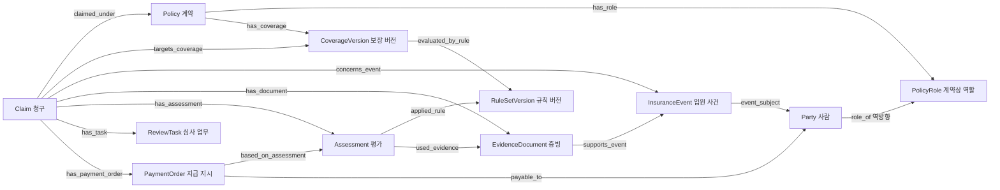

# 보험업 온톨로지 설계 시나리오

> 주제: 입원 정액보험 청구 심사 지원 및 모의 지급
>
> 버전: 0.1 · 작성일: 2026-10-30 · 상태: PoC 설계안
>
> 이 문서의 상품, 고객, 약관 조건, 지급 금액은 모두 실험용으로 만든 것이다. 실제 보험상품의 지급 기준을 설명하지 않는다. 설계와 테스트 명세를 제공하며, 시스템 구현이나 테스트 실행을 완료했다는 의미는 아니다.

## 1. 먼저 풀고자 하는 문제

**“하나의 보험금 청구에 대해, 사고 당시의 계약과 보장, 확인된 증빙, 기존 지급 내역을 연결해 지급 가능 금액과 다음 업무를 일관되게 제시하고 그 근거를 재현할 수 있는가?”**

실험에서는 다음과 같은 업무 상황을 가정한다.

- 계약 시스템에는 계약과 보장이 있다.
- 접수 시스템에는 청구와 첨부 서류가 있다.
- 심사 시스템에는 담당자의 판단이 있다.
- 지급 시스템에는 지급 내역이 있다.
- 각 시스템의 고객·계약·사고 식별자가 달라 담당자가 대조해야 한다.

데이터를 한곳에 모으더라도 ‘가입한 사람’, ‘입원한 사람’, ‘보험금을 받는 사람’을 구분하지 않거나 청구와 입원을 같은 개념으로 취급하면 잘못 연결될 수 있다. 또한 지급 한도를 계산한 뒤 다른 청구가 먼저 승인되면, 처음 계산한 금액은 더 이상 유효하지 않을 수 있다.

따라서 이번 실험의 대상은 **데이터 조회 → 근거를 갖춘 평가 → 권한 있는 담당자의 결정 → 상태 변경 → 모의 지급 확인**의 연결이다.

### 1.1 후보 과제와 선택 이유

| 후보 | 온톨로지로 연결할 대상 | 첫 실험으로서의 판단 |
|---|---|---|
| 보험금 청구 심사 | 계약, 보장, 사고, 증빙, 평가, 지급 | 입력과 정답을 작은 가상 데이터로 정의하기 쉬워 선택 |
| 인수 심사 | 가입 신청, 위험 정보, 상품, 인수 조건 | 위험 평가 및 상품별 조건까지 범위가 넓어 후속 과제로 둠 |
| 이상 청구 조사 | 여러 청구, 사람, 의료기관, 거래 관계 | 관계 탐색에 적합하지만 의심과 확정의 구분, 평가용 정답 마련이 필요 |

### 1.2 심사 담당자가 청구 건을 보며 확인하는 질문

심사 담당자가 실제 청구 건을 확인하는 상황을 가정한 표현이다. Q1~Q7은 이후 설계·테스트와 연결하기 위한 식별자로 유지한다.

| ID | 담당자의 질문 | 확인할 정보 | 화면에서 확인할 내용 |
|---|---|---|---|
| Q1 | 입원한 분이 이 계약의 피보험자 맞나요? | 계약에 등록된 피보험자, 청구 내용과 입퇴원확인서의 인적사항 | 피보험자 일치 여부와 추가로 확인할 사항 |
| Q2 | 이번 입원은 보상 대상인가요? 어떤 약관과 지급 기준으로 보면 되나요? | 가입 담보, 보장 기간, 대기 기간, 해당 계약에 적용되는 약관과 심사 기준 | 보상 대상 여부, 적용 담보·약관·심사 기준과 판단 사유 |
| Q3 | 필요한 서류는 다 들어왔나요? 서류마다 입퇴원 날짜나 인적사항이 다른 곳은 없나요? | 접수된 서류, 필수 서류 목록, 서류별 확인 내용 | 추가로 받을 서류와 내용이 맞지 않아 확인할 항목 |
| Q4 | 이미 지급했거나 지급하기로 한 건까지 반영하면, 이번에 얼마를 지급할 수 있나요? | 같은 담보의 지급 내역과 지급 승인 후 아직 지급되지 않은 건, 남은 보장 한도 | 이번에 지급 가능한 입원 일수·금액과 계산 내역 |
| Q5 | 같은 입원으로 이미 접수되거나 지급된 건이 있나요? | 피보험자, 의료기관, 입원 기간, 관련 청구의 접수·심사·지급 내역 | 중복 여부를 확인할 청구 건과 각 건의 처리 상태 |
| Q6 | 이전에는 누가 어떤 근거로 심사했나요? 그때와 달라진 내용이 있나요? | 이전 심사 결과, 담당자, 당시 확인한 서류와 적용 기준, 이후 변경 내역 | 이전 판단의 사유와 새로 확인되거나 변경된 내용 |
| Q7 | 이 건은 서류 보완을 받아야 하나요, 추가로 심사해야 하나요, 지급 진행해도 되나요? | 현재 처리 단계, 아직 확인하지 못한 사항, 심사·승인 결과, 담당자의 처리 권한 | 지금 처리할 업무, 진행하기 전에 해결할 사항, 담당자가 사용할 수 있는 업무 버튼 |

업무 화면에서는 ‘규칙 버전’ 대신 **‘적용 심사 기준’**으로 표시한다. 가입 담보의 지급 조건, 적용 약관, 심사 기준은 구분해서 보여주고, 내부의 `CoverageVersion`·`RuleSetVersion` 식별자는 상세 근거에서 추적할 수 있도록 한다.

### 1.3 성공의 정의

PoC의 첫 성공 기준은 다음 네 가지다.

1. 모든 평가 결과에서 적용 계약·보장·규칙·증빙·입력 스냅샷까지 추적한다.
2. 확인되지 않은 사실을 임의로 채우지 않고 `UNKNOWN`으로 처리한다.
3. 승인과 지급을 반복 요청해도 한도 초과나 중복 지급을 만들지 않는다.
4. 동일한 입력 스냅샷과 규칙 버전으로 동일한 평가 결과를 재현한다.

처리 시간 단축이나 자동화율은 구현 후 비교할 지표다. 현재 성과로 주장하지 않는다.

## 2. 범위와 가상 상품

### 2.1 포함 범위

- 단일 계약의 단일 입원 정액 보장, 단일 피보험자.
- 청구 1건은 입원 사건 1개와 보장 버전 1개를 대상으로 한다.
- 한 입원 사건에 여러 청구가 연결될 수 있다. 이 관계로 중복을 검토한다.
- 계약자와 피보험자는 다를 수 있다. 이번 상품의 수익자는 피보험자로 고정한다.
- 계약자 또는 피보험자가 청구를 접수할 수 있다. 대리인 접수는 제외한다.
- 최종 지급·부지급 결정은 심사자가 내리고, 지급은 모의 지급 시스템으로 검증한다.

### 2.2 제외 범위

실손 비례보상, 여러 보험사 간 분담, 수익자 변경, 다수 담보 청구, 계약 갱신·부활·중도 변경, 보험금 환수, 재심사·이의신청은 후속 확장으로 둔다. 입원 기간이 보장 기간 경계를 넘으면 자동 계산 대신 수동 검토한다.

### 2.3 실험용 상품 규칙

| 항목 | 가상 규칙 |
|---|---|
| 상품 | 테스트 입원일당 A |
| 통화·일당 | KRW, 1일 100,000원 |
| 보장 기간 | 예시: `[2026-01-01, 2027-01-01)` |
| 대기 기간 | 보장 시작일로부터 30일. 입원일이 시작일 + 30일 이상이어야 함 |
| 입원 일수 | `퇴원일 - 입원일`. 입원일 포함, 퇴원일 제외. 당일 입퇴원은 0일 |
| 지급 한도 | 해당 보장 기간에 피보험자별 총 5일 |
| 한도 집계 | 이미 지급된 일수 + 다른 청구의 유효한 예약 일수 |
| 필수 증빙 | 확인 완료된 입퇴원확인서 1개 이상 |
| 증빙의 확인 항목 | 피보험자, 의료기관 코드, 입원일, 퇴원일 |
| 기간 판단 | 입원일이 보장 기간 안이고 퇴원일이 보장 종료일 이하여야 함 |
| 중복 판단 | 동일 피보험자·동일 보장·동일한 것으로 확인된 입원 사건에 유효한 다른 승인/지급이 있는지 확인 |
| 결정 권한 | 시스템은 후보 결과를 산출하고 심사자가 최종 결정 |

날짜는 `Asia/Seoul`의 달력 날짜를 사용하고, 변경 시각은 시간대가 포함된 시각으로 저장한다. 기간은 시작 포함·종료 제외로 통일한다. 대기 기간 경계는 2026-01-31이며, 2026-01-30 입원은 조건 미충족, 2026-01-31 입원은 조건 충족이다.

## 3. 이번 문서에서 말하는 온톨로지

여기서는 업무 대상과 관계뿐 아니라 실행 가능한 업무까지 묶는 **운영형 온톨로지**로 설계한다. `Object Type`, `Property`, `Link Type`, `Action Type`이라는 구분은 [Palantir의 공식 핵심 개념](https://www.palantir.com/docs/foundry/ontology/core-concepts)을 참고한다. 아래 보험 모델은 이 문서에서 제안하는 설계이며 특정 제품의 기본 제공 보험 모델이 아니다.

| 구성 요소 | 의미 | 이번 사례 |
|---|---|---|
| Object | 식별자와 생명주기를 가진 업무 대상 | 청구 `CL-001`, 입원 사건 `EV-001` |
| Property | 대상의 속성 | 청구 상태, 입원일, 일당 금액 |
| Link | 대상 사이의 의미 있는 관계 | 청구가 대상으로 하는 보장, 사건의 피보험자 |
| Action | 권한과 사전 조건을 확인하고 상태를 변경하는 업무 | 증빙 확인, 청구 평가, 지급 승인 |

Object Type은 ‘청구라는 유형’, Object는 ‘CL-001이라는 개별 청구’다. Link Type 역시 관계의 정의이며, 개별 Link는 CL-001과 CV-001의 실제 연결이다. 관계 모델링에는 [공식 Link Type 설명](https://www.palantir.com/docs/foundry/object-link-types/link-types-overview)을 참고했다. 객체·속성·관계를 변경하는 Action이라는 개념은 [공식 Action Type 설명](https://www.palantir.com/docs/foundry/action-types/overview)을 참고했다.

### 3.1 단순 통합 조회와 구분되는 설계 목표

| 설계 지점 | 이번 설계의 선택 |
|---|---|
| 업무 용어 | 시스템마다 다른 필드를 ‘피보험자’, ‘입원 사건’, ‘보장 버전’이라는 공통 개념으로 연결 |
| 업무 질문 | Q1~Q7을 관계 탐색과 명시적 계산으로 답함 |
| 판단 근거 | 결과뿐 아니라 규칙·증빙·입력 버전을 함께 저장 |
| 업무 실행 | 상태 값을 직접 편집하지 않고 승인된 Action으로 변경 |
| 반복 사용 | 담당자 화면, 배치 평가, 질의 서비스가 같은 의미와 규칙을 사용 |

이 목표는 관계형 DB로도 구현할 수 있다. 그래프 DB 도입 자체가 성공 기준은 아니다. 이번 PoC는 공통 업무 의미와 행동 제약을 정의하는 데 초점을 둔다. OWL/RDF 논리 추론 체계는 필수 범위에 넣지 않는다.

## 4. Object 설계

### 4.1 최소 객체 집합: 12개

| Object Type | 한국어 | 식별자 예시 | 존재 이유 |
|---|---|---|---|
| `Party` | 업무 당사자 | PT-001 | 계약자·피보험자·수익자가 되는 사람을 동일인 기준으로 식별 |
| `Policy` | 보험 계약 | PO-001 | 계약의 기준 식별 및 계약 기간 |
| `PolicyRole` | 계약상 역할 | PR-001 | 누가 어느 계약에서 어떤 역할을 언제 갖는지 표현 |
| `CoverageVersion` | 보장 버전 | CV-001 | 특정 계약에 가입된 보장의 조건과 적용 기간을 고정 |
| `InsuranceEvent` | 입원 사건 | EV-001 | 실제 입원을 청구와 분리하고 여러 청구를 연결 |
| `Claim` | 보험금 청구 | CL-001 | 접수와 심사 상태를 관리하는 업무 단위 |
| `EvidenceDocument` | 증빙 문서 | DC-001 | 원문과 추출값, 검증 상태를 관리 |
| `RuleSetVersion` | 심사 규칙 버전 | RV-001 | 평가 로직과 근거가 되는 가상 약관 버전을 고정 |
| `Assessment` | 평가 기록 | AS-001 | 당시 입력·규칙·결과·근거를 변경 불가 기록으로 보관 |
| `ReviewTask` | 심사 업무 | TK-001 | 서류 보완, 사실 충돌, 중복 검토 등 해결할 업무 관리 |
| `PaymentOrder` | 지급 지시·한도 예약 | PY-001 | 승인 시 한도를 예약하고 모의 지급 결과까지 추적 |
| `ActionLog` | 업무 실행 이력 | AL-001 | 누가 언제 무엇을 변경했는지 기록 |

`PolicyRole`을 별도 Object로 만든 이유는 관계에 역할 종류와 유효 기간이 필요하기 때문이다. 단순히 `Party → Policy`만 연결하면 계약자와 피보험자의 의미가 섞인다.

`Assessment`는 매번 새로 생성한다. 재평가가 이전 평가를 덮어쓰지 않도록 한다. `PaymentOrder`는 승인과 실제 지급 사이의 예약 상태를 나타내므로 청구의 금액 속성만으로 대체하지 않는다.

### 4.2 모델링 결정

- 의료기관은 이번 실험에서 표준화된 `provider_code` 속성으로만 표현한다. 기관 간 관계를 분석할 때 `Provider` Object로 확장한다.
- 상품 카탈로그는 제외하고 실제 가입된 `CoverageVersion`에 필요한 조건을 저장한다.
- 증빙이 여러 청구에 쓰일 수 있으므로 문서와 청구는 다대다 관계다.
- 입원 일자 후보는 증빙에 저장한다. 확인 Action을 거친 값만 사건의 확정 속성으로 반영한다.
- 유사한 입원 기록은 중복 후보일 뿐이다. 사람·의료기관·날짜가 비슷하다는 이유만으로 동일 사건이라고 확정하지 않는다.

## 5. Property 설계

### 5.1 표기 및 공통 속성

`!`는 필수 값이다. `id`는 문자열 식별자, `date`는 날짜, `timestamp`는 시간대 포함 시각, `enum`은 허용 목록, `int`는 정수, `ref`는 다른 Object의 식별자다. `ref`는 물리 구현용 참조이며, 이를 바탕으로 6절의 Link를 제공한다.

모든 Object는 `id!`, `created_at!`, `source_system!`, `source_record_id!`를 갖는다. 변경 가능한 Object는 `updated_at!`, `revision!: int`를 추가한다. `Assessment`, 발행된 `RuleSetVersion`, `ActionLog`는 생성 후 수정하지 않는다. 규칙과 평가의 정정은 새 버전·새 기록으로 남긴다.

### 5.2 핵심 속성 사전

| Object | 핵심 Property와 자료형 | 제약·작성 주체 |
|---|---|---|
| `Party` | `party_type!: enum(PERSON)`, `display_name!: string`, `identity_token!: string` | 가상 인물만 사용. 동일인 매핑 결과는 시스템 관리 |
| `Policy` | `policy_number!: string`, `contract_from!: date`, `contract_to!: date`, `administrative_status!: enum(ACTIVE, EXPIRED)` | `from < to`. 현재 상태만으로 과거 보장을 판단하지 않음 |
| `PolicyRole` | `policy_id!: ref`, `party_id!: ref`, `role_type!: enum(POLICYHOLDER, INSURED, BENEFICIARY)`, `valid_from!: date`, `valid_to!: date` | 역할별 기록 생성. MVP에서는 기간 중 변경 없음 |
| `CoverageVersion` | `policy_id!: ref`, `coverage_code!: string`, `version!: string`, `valid_from!: date`, `valid_to!: date`, `daily_amount_krw!: int`, `max_days!: int`, `waiting_days!: int`, `rule_set_version_id!: ref` | 발행 후 고정. 일당 양수, 한도·대기 일수 0 이상 |
| `InsuranceEvent` | `insured_party_id!: ref`, `event_type!: enum(HOSPITALIZATION)`, `provider_code: string`, `admission_date: date`, `discharge_date: date`, `fact_status!: enum(UNVERIFIED, VERIFIED, CONFLICT)` | 사건 생성 시 날짜 미확인 허용. `VERIFIED`에는 모든 핵심 사실 필수 |
| `Claim` | `policy_id!: ref`, `coverage_version_id!: ref`, `event_id!: ref`, `submitted_by_party_id!: ref`, `submitted_at!: timestamp`, `status!: enum`, `current_assessment_id: ref`, `assigned_reviewer_id!: string` | 유효한 계약·보장을 식별하지 못한 원천 접수는 적재 오류 큐에서 해소 후 생성 |
| `EvidenceDocument` | `document_type!: enum(HOSPITALIZATION_CERTIFICATE, OTHER)`, `content_hash!: string`, `storage_ref!: string`, `verification_status!: enum(PENDING, VERIFIED, REJECTED)`, `extracted_facts: struct`, `verified_facts: struct`, `verified_by: string`, `verified_at: timestamp` | 추출값과 확인값 분리. 증빙 교체는 새 문서 생성 및 기존 관계 해제 |
| `RuleSetVersion` | `rule_code!: string`, `version!: string`, `published_at!: timestamp`, `clause_reference!: string`, `logic_hash!: string`, `required_document_types!: list` | 이번 문서의 가상 약관 식별자 및 평가 로직 체크섬 |
| `Assessment` | `claim_id!: ref`, `rule_set_version_id!: ref`, `evaluated_at!: timestamp`, `input_snapshot_ref!: string`, `input_hash!: string`, `rule_results!: list`, `recommendation!: enum`, `eligible_days: int`, `candidate_amount_krw: int`, `reason_codes!: list` | 후보 금액은 계산 가능할 때만 저장. 확인 필요 상태를 0원과 혼동하지 않음 |
| `ReviewTask` | `claim_id!: ref`, `task_type!: enum`, `status!: enum(OPEN, RESOLVED)`, `assignee_id!: string`, `reason!: string`, `resolution: string`, `resolved_by: string`, `resolved_at: timestamp` | 해결 근거와 실행자 필수. 과거 업무를 삭제하지 않음 |
| `PaymentOrder` | `claim_id!: ref`, `assessment_id!: ref`, `beneficiary_party_id!: ref`, `coverage_version_id!: ref`, `insured_party_id!: ref`, `benefit_period_key!: string`, `reserved_days!: int`, `amount_krw!: int`, `status!: enum`, `payment_key!: string`, `external_transaction_id: string`, `decided_by!: string`, `decided_at!: timestamp` | 승인된 평가와 수익자 고정. `payment_key` 유일. 계좌는 가상 토큰만 사용 |
| `ActionLog` | `action_type!: string`, `actor_id!: string`, `target_refs!: list`, `executed_at!: timestamp`, `idempotency_key!: string`, `before_hash: string`, `after_hash: string`, `outcome!: enum(SUCCESS, REJECTED)`, `reason: string` | 서버 생성. 실패 시 업무 데이터 변경 없이 거절 이력만 남길 수 있음 |

`EvidenceDocument.verified_facts`의 공통 구조는 `insured_party_id`, `provider_code`, `admission_date`, `discharge_date`다. `extracted_facts`는 같은 항목의 후보와 추출 신뢰도를 포함할 수 있다. 신뢰도가 높아도 확인 완료와 동일하게 취급하지 않는다.

### 5.3 파생 속성 및 계산 위치

| 값 | 정의 | 저장·계산 방식 |
|---|---|---|
| `hospital_days` | 퇴원일 − 입원일 | 확인된 사건 값으로 계산 |
| `waiting_end_date` | 보장 시작일 + 대기 일수 | 보장 버전으로 계산 |
| `paid_days` | 동일 한도 집계 키의 `PAID` 일수 합계 | 지급 지시에서 계산 |
| `reserved_days_other` | 다른 청구의 유효한 예약 일수 합계 | `RESERVED`, `REQUESTED`, `UNKNOWN`, `FAILED` 포함 |
| `remaining_days` | `max(0, max_days - paid_days - reserved_days_other)` | 평가 시 스냅샷에 저장, 승인 시 다시 계산 |
| `eligible_days` | 모든 필수 조건 통과 시 `min(hospital_days, remaining_days)` | 평가 기록에 저장 |
| `candidate_amount_krw` | `eligible_days × daily_amount_krw` | 정수 원 단위, 평가 기록에 저장 |
| `is_assessment_stale` | 현재 관련 입력 해시와 평가 입력 해시가 다름 | 승인 직전 검사 |

한도 집계 키는 `(policy_id, coverage_version_id, insured_party_id, benefit_period_key)`다. MVP에서는 보장 버전 1개가 한 보장 기간을 나타낸다. 향후 기간 중 보장 버전을 변경한다면 버전들을 묶는 별도의 한도 계정이 필요하다.

### 5.4 결과·업무 코드

`Assessment.recommendation`은 `PAYABLE_CANDIDATE`, `NOT_PAYABLE_CANDIDATE`, `NEED_INFO`, `MANUAL_REVIEW` 중 하나다. 청구와 지급 지시의 상태 목록은 9절에 정의한다.

`rule_results`의 항목은 `{rule_id, result, reason_code, observed_values, evidence_refs}` 구조다. 근거가 없는 값은 만들지 않으며, 외부 조회 실패도 사유로 남긴다.

| 대표 reason_code | 의미 | 필요한 ReviewTask.task_type |
|---|---|---|
| `MISSING_DOCUMENT` | 필수 증빙 누락·미확인 | `EVIDENCE_REQUEST` |
| `FACT_CONFLICT` | 증빙과 사건 또는 증빙 간 사실 충돌 | `FACT_REVIEW` |
| `INVALID_DATES` | 입퇴원일 역전 등 데이터 오류 | `DATA_REPAIR` |
| `UNCONFIRMED_FACT` | 피보험자 역할·사건 핵심 사실 미확인 | `FACT_REVIEW` |
| `PERIOD_CROSSING` | 입원이 보장 종료 경계를 넘음 | `PERIOD_REVIEW` |
| `DUPLICATE_REVIEW` | 동일 사건 중복 또는 동일성 검토 필요 | `DUPLICATE_REVIEW` |
| `DEPENDENCY_UNAVAILABLE` | 규칙·한도 등 필수 조회 불능 | `DATA_REPAIR` |
| `IDENTITY_MISMATCH`, `OUTSIDE_COVERAGE`, `WAITING_NOT_MET`, `ZERO_STAY`, `LIMIT_EXHAUSTED` | 확인된 조건 미충족 | 자동 생성 없음. 부지급 후보 근거로 기록 |

미해결 업무는 `(claim_id, task_type, reason_code, 관련 문서/사건 ID)`로 중복 생성을 막는다. `reason_code`와 관련 ID는 업무의 구조화된 필드로 저장하고 `reason`에는 설명을 쓴다. 업무 해결 후 같은 문제가 다시 발생하면 새 업무를 생성해 과거 해결 이력을 보존한다.

## 6. Link 설계

아래의 ‘대상 수’는 **출발 Object 1개 기준**이다. 관계 생성 시 참조 존재 여부와 계약·보장 연결의 구조적 일관성을 검사한다. 피보험자 불일치나 보장 기간 미충족처럼 심사해야 할 사실은 접수 데이터를 보존한 뒤 평가 규칙으로 판정한다.

| Link 이름 | 출발 → 도착 | 대상 수 | 역방향 의미·주요 제약 |
|---|---|---|---|
| `has_role` | Policy → PolicyRole | 1..N | 역할은 정확히 한 계약에 속함 |
| `role_of` | PolicyRole → Party | 1 | 사람은 여러 계약 역할을 가질 수 있음 |
| `has_coverage` | Policy → CoverageVersion | 1..N | 보장 버전은 정확히 한 계약에 속함 |
| `evaluated_by_rule` | CoverageVersion → RuleSetVersion | 1 | 여러 보장이 같은 규칙 버전을 사용할 수 있음 |
| `claimed_under` | Claim → Policy | 1 | 계약은 0..N 청구를 가짐 |
| `targets_coverage` | Claim → CoverageVersion | 1 | 청구의 계약과 보장의 계약이 일치해야 함 |
| `concerns_event` | Claim → InsuranceEvent | 1 | 사건은 0..N 청구를 가짐 |
| `submitted_by` | Claim → Party | 1 | 접수 권한은 계약상 역할로 검증 |
| `event_subject` | InsuranceEvent → Party | 1 | 입원한 사람을 연결. 계약 피보험자와의 일치 여부는 R01에서 판정 |
| `has_document` | Claim → EvidenceDocument | 0..N | 문서는 0..N 청구에 연결 가능 |
| `supports_event` | EvidenceDocument → InsuranceEvent | 0..1 | 입퇴원확인서는 사건 1개에 연결, 일반 문서는 미연결 가능 |
| `has_assessment` | Claim → Assessment | 0..N | 평가는 정확히 한 청구에 속함 |
| `current_assessment` | Claim → Assessment | 0..1 | 반드시 해당 청구의 평가여야 함 |
| `applied_rule` | Assessment → RuleSetVersion | 1 | 평가가 사용한 규칙 버전 고정 |
| `used_evidence` | Assessment → EvidenceDocument | 0..N | 해당 평가 시 사용한 문서 ID와 해시를 스냅샷에도 고정 |
| `has_task` | Claim → ReviewTask | 0..N | 업무는 정확히 한 청구에 속함 |
| `has_payment_order` | Claim → PaymentOrder | 0..1 | MVP에서는 청구당 지급 지시 최대 1개 |
| `based_on_assessment` | PaymentOrder → Assessment | 1 | 승인 시점 평가, 청구 일치 필수 |
| `payable_to` | PaymentOrder → Party | 1 | 가상 상품의 수익자 역할과 일치 |
| `consumes_coverage` | PaymentOrder → CoverageVersion | 1 | 청구의 보장과 일치 |
| `consumes_for` | PaymentOrder → Party | 1 | 한도를 소비하는 피보험자, 사건의 사람과 일치 |
| `affects` | ActionLog → 업무 Object | 1..N | 대상 유형과 ID를 함께 기록하는 감사용 참조 |

감사 대상처럼 여러 유형을 참조하는 관계를 지원하지 않는 구현에서는, `affects`를 `affects_claim`, `affects_payment_order` 등 대상 유형별 Link로 나눈다.

### 6.1 핵심 관계도



## 7. 평가 규칙과 결과

### 7.1 규칙 결과의 세 값

- `PASS`: 필요한 사실을 확인했고 조건을 충족한다.
- `FAIL`: 필요한 사실을 확인했고 조건을 충족하지 않는다.
- `UNKNOWN`: 입력 누락·충돌·미확인으로 판단할 수 없다.

데이터가 없다는 이유만으로 ‘피보험자 아님’, ‘보장 아님’, ‘중복 아님’이라고 추론하지 않는다. Link가 없으면 참조 데이터 누락인지 실제 관계 부재인지 구분해야 한다.

### 7.2 평가 규칙 목록

| 규칙 | 검사 내용 | 미충족·불확실 시 처리 |
|---|---|---|
| R01 `IDENTITY_MATCH` | 사건의 사람과 입원일 기준 계약 피보험자 일치 | 불일치는 `FAIL`, 역할 미확인은 `UNKNOWN` |
| R02 `COVERAGE_PERIOD` | 입원일이 보장 기간 내에 있고 전체 입원이 기간 안에 존재 | 입원일이 기간 밖이면 `FAIL`, 기간을 걸치면 `UNKNOWN` 및 수동 검토 |
| R03 `WAITING_PERIOD` | 입원일 ≥ 보장 시작일 + 30일 | 확인된 미충족은 `FAIL` |
| R04 `EVIDENCE_COMPLETE` | 필수 문서가 확인 완료이고 핵심 값이 사건과 일치 | 누락·충돌은 `UNKNOWN`; 누락과 충돌 사유를 구분 |
| R05 `POSITIVE_STAY` | 확인된 퇴원일 > 입원일 | 같은 날짜는 `FAIL`, 역전 날짜는 데이터 오류로 `UNKNOWN` |
| R06 `DUPLICATE_CLEAR` | 동일 보장·동일 확정 사건의 다른 유효한 승인/지급 없음 | 다른 건이 있거나 사건 동일성 미해결이면 `UNKNOWN` 및 중복 검토 |
| R07 `LIMIT_AVAILABLE` | 다른 건의 지급·예약 반영 후 잔여 일수 > 0 | 모두 소진됐으면 `FAIL`, 조회 불능이면 `UNKNOWN` |

중복 후보가 있어도 이 문서에서는 시스템이 부정 청구나 사기를 확정하지 않는다. 대상 건을 연결한 심사 업무를 만든다. 담당자가 별개 사건임을 확인하면 근거를 남기고 사건 연결을 정정한 뒤 재평가한다.

### 7.3 결과 집계의 우선순위

1. 데이터 오류, 규칙 버전 누락, 증빙 충돌, 기간 경계, 중복 검토, 증빙 보완만으로 해소되지 않는 사실 미확인·필수 조회 불능이 있으면 `MANUAL_REVIEW`.
2. 수동 검토 사유 없이 필수 증빙이 부족하면 `NEED_INFO`.
3. 모든 필수 사실이 확인됐고 규칙에 `FAIL`이 있으면 `NOT_PAYABLE_CANDIDATE`.
4. 모든 규칙이 `PASS`이고 후보 금액이 양수면 `PAYABLE_CANDIDATE`.

여러 사유가 있으면 모두 기록하되 위 순서로 대표 결과를 정한다. 후보 결과 자체로 지급·부지급 결정을 내리지는 않는다. `UNKNOWN`이 있는 평가의 후보 금액은 `null`이며 0원이 아니다.

### 7.4 평가 의사코드

```text
snapshot := 청구, 계약 역할, 보장, 규칙, 확인된 사건, 증빙,
            관련 청구 및 지급·예약 상태의 일관된 스냅샷

rule_results := R01..R07을 PASS / FAIL / UNKNOWN으로 평가
recommendation := 우선순위에 따라 집계

if recommendation == PAYABLE_CANDIDATE:
    remaining_days := max(0, max_days - paid_days - reserved_days_other)
    eligible_days := min(hospital_days, remaining_days)
    candidate_amount_krw := eligible_days * daily_amount_krw
else if recommendation == NOT_PAYABLE_CANDIDATE:
    eligible_days := 0
    candidate_amount_krw := 0
else:
    eligible_days := null
    candidate_amount_krw := null

새 Assessment를 생성하고 Claim.current_assessment를 갱신
필요한 ReviewTask를 생성하거나 기존 미해결 업무를 재사용
```

스냅샷에는 입력 Object의 ID·revision, 역할 기간, 증빙 해시·확인값, 한도 집계에 포함된 지급 지시 ID·상태·일수, 규칙 및 로직 해시를 포함한다. 현재 객체만 다시 조회하는 방식으로 과거 결과를 재현하지 않는다.

`input_hash`는 이 중 판단에 영향을 주는 업무 값과 관련 집계에 대해 정렬·정규화 후 계산한다. 청구 상태, `current_assessment_id`, 평가 생성 시각, 감사 이력 및 이들 변경만으로 증가한 revision은 해시 입력에서 제외한다. 전체 revision은 감사용 스냅샷에 보존하고, 동시 편집은 별도의 `expected_revision`으로 검사한다. 평가 결과를 저장했다는 이유로 방금 생성한 평가가 즉시 오래된 것으로 판정되지 않도록 한다.

## 8. Action 설계

상태 변경은 아래 Action을 통해서만 허용한다. 조회·설명 생성은 상태를 바꾸지 않는 Query로 구분한다.

### 8.1 Action 목록

| Action | 실행 주체 | 주요 입력 | 사전 조건 | 변경 결과 |
|---|---|---|---|---|
| A01 `SubmitClaim` | 접수 담당자 | 계약, 보장, 사건, 제출자, 요청 키 | 제출자의 역할·권한 및 참조 일관성 확인 | Claim 생성, 상태 `RECEIVED` |
| A02 `AttachEvidence` | 접수 담당자·담당 심사자 | 청구, 문서, 교체할 문서 ID(선택), revision | 종결·지급 승인 전, 해당 청구 접근권한 | 문서 연결·교체, 교체 시 기존 연결 해제, 기존 평가가 있으면 `UNDER_REVIEW`로 전환 |
| A03 `VerifyEvidence` | 담당 심사자 | 문서, 확인값, 확인 근거, 관련 revision | 문서 접근권한, 아직 승인되지 않은 관련 청구 | 문서 확인값 저장, 사건 사실 갱신 또는 충돌 표시, 관련 청구 평가를 재평가 대상으로 전환 |
| A04 `EvaluateClaim` | 평가 서비스·담당 심사자 | 청구, revision | 승인·종결 전, 필수 참조 해소 | 새 평가 생성, 결과에 따라 청구 상태 및 업무 갱신 |
| A05 `RequestEvidence` | 담당 심사자 | 청구, 누락 항목, 요청 문구 | 승인·종결 전, 부족 항목 특정 | 보완 업무 생성, `NEED_INFO`; PoC에서는 요청 내용만 저장 |
| A06 `ResolveReviewTask` | 담당 심사자 | 업무, 해결 근거, 수정된 사실 참조, 정정할 사건 ID(선택) | 담당 권한 및 해결 근거 존재, 승인·종결 전 | 필요 시 확인된 사건으로 청구 재연결, 업무 `RESOLVED`, 청구 `UNDER_REVIEW`; 이후 재평가 필요 |
| A07 `ApproveClaim` | 담당 심사자 | 청구, 평가, revision, 결정 사유 | 최신 지급 후보, 미해결 업무 없음, 수익자 확인, 한도 재검증 | 지급 지시와 한도 예약 생성, 청구 `APPROVED` |
| A08 `RejectClaim` | 담당 심사자 | 청구, 평가, 부지급 사유 | 최신 부지급 후보, 미해결 업무 없음 | 청구 `REJECTED`, 결정 사유와 실행 이력 저장 |
| A09 `RequestPayment` | 지급 담당자 | 지급 지시, 요청 키 | `RESERVED` 또는 안전한 재시도가 확인된 `FAILED` | 모의 지급 요청 등록, 지급 지시 `REQUESTED` |
| A10 `RecordPaymentResult` | 지급 연계 서비스 | 지급 키, 거래 ID, 결과 | 서명·상관관계 확인, 허용된 상태 전이 | 성공 `PAID`, 명확한 실패 `FAILED`, 결과 불명 `UNKNOWN` |
| A11 `ReconcilePayment` | 지급 담당자·연계 서비스 | 지급 키, 외부 조회 근거 | `UNKNOWN` 또는 결과 충돌 | 모의 지급 내역 조회 후 결과 확정. 불명이면 유지 |

모든 Action은 성공·거절 이력을 남긴다. A05는 고객에게 실제 메시지를 전송하지 않는다. 외부 알림이 필요하면 발송 요청과 발송 결과를 별도 모델로 확장한다.

확인된 증빙을 다른 청구가 이미 승인 근거로 사용했다면 A03으로 덮어쓸 수 없다. 정정 문서를 새로 만들고 재심사 절차로 처리해야 하며, 그 절차는 이번 MVP 범위 밖이다.

### 8.2 승인 Action의 상세 계약

```text
Action: ApproveClaim
입력: claim_id, assessment_id, expected_revision,
      decision_reason, idempotency_key
권한: 해당 청구의 담당 심사자

1. 동일 요청 키의 완료 기록이 있으면 기존 결과 반환
2. 청구 revision과 평가의 최신성을 검사
3. PAYABLE_CANDIDATE 및 미해결 업무 0건 확인
4. 수익자·보장·피보험자·입원 사건 연결 확인
5. 한도 집계 키와 동일 보장·사건 키에 대해 동시 승인 충돌 방지
6. 최신 지급·예약 내역으로 한도와 중복 재검사
7. 기존 평가 이후 관련 입력이 바뀌었다면 STALE_ASSESSMENT로 거절
8. PaymentOrder(RESERVED), Claim(APPROVED), ActionLog를
   하나의 원자적 업무 변경으로 기록

실패: 업무 변경 전체 취소, 거절 사유 기록
```

온톨로지에 Action 이름만 정의한다고 원자성이나 동시성 제어가 자동 보장되는 것은 아니다. 구현 환경에서 조건부 쓰기, 잠금 또는 직렬화 가능한 거래를 제공해야 한다. 이를 제공하지 못하면 동시 승인 테스트는 통과한 것으로 간주하지 않는다.

### 8.3 멱등성·지급 연계

- `idempotency_key`는 `(action_type, 요청자/서비스, 요청 키)` 범위에서 유일하다. 같은 키로 다른 입력을 보내면 거절한다.
- `payment_key`는 지급 지시별로 고정하며 재시도에서도 바꾸지 않는다.
- 승인 거래와 함께 지급 요청용 발송 대기 기록을 저장하고, 별도 전달기가 모의 지급 시스템에 전송한다. 이 전달 기록은 연계용 저장소이며 업무 Object와 구분한다.
- 요청 결과를 모르면 `UNKNOWN`으로 유지하고 조회로 확인한다. 새 지급 지시를 만들지 않는다.
- `FAILED`는 외부 시스템이 미지급을 확인한 경우다. 재시도는 같은 지급 지시·같은 지급 키로 한다.
- `PAID`는 종결 상태다. 같은 성공 결과의 재수신은 기존 결과를 반환하고, 상충하는 결과는 덮어쓰지 않고 조사 이력을 남긴다.
- `FAILED`에서도 한도 예약은 유지한다. 예약 취소·청구 철회·환수는 MVP에 포함하지 않으며, 재시도 또는 후속 수동 절차가 필요하다.

## 9. 상태와 허용 전이

### 9.1 청구 상태

| 현재 상태 | 허용 업무 및 다음 상태 |
|---|---|
| `RECEIVED` | 평가·증빙 확인 → `UNDER_REVIEW`, 보완 요청 → `NEED_INFO` |
| `UNDER_REVIEW` | 평가 결과에 따라 `NEED_INFO`, `READY_FOR_DECISION`, 또는 유지 |
| `NEED_INFO` | 증빙 연결·확인 또는 업무 해결 → `UNDER_REVIEW`, 재평가 후 다음 상태 결정 |
| `READY_FOR_DECISION` | 지급 승인 → `APPROVED`, 부지급 결정 → `REJECTED`, 입력 변경 → `UNDER_REVIEW` |
| `APPROVED` | 모의 지급 성공 확인 → `PAID`; 요청·실패·결과 불명 동안은 유지 |
| `REJECTED` | MVP 종결 |
| `PAID` | MVP 종결 |

평가 결과가 `PAYABLE_CANDIDATE` 또는 `NOT_PAYABLE_CANDIDATE`이고 미해결 업무가 없을 때만 `READY_FOR_DECISION`이다. `MANUAL_REVIEW`는 `UNDER_REVIEW`, `NEED_INFO`는 동일한 이름의 청구 상태로 매핑한다. 평가만으로 미해결 업무를 자동 종료하지 않는다.

### 9.2 지급 지시 상태

```text
RESERVED → REQUESTED → PAID
                    → FAILED → REQUESTED  (미지급 확인 후 같은 지급 키)
                    → UNKNOWN → PAID / FAILED  (조회로 확인)
```

`RESERVED`, `REQUESTED`, `UNKNOWN`, `FAILED`는 예약으로 집계하고 `PAID`는 지급으로 집계한다. 한 지급 지시를 예약과 지급에 동시에 더하지 않는다. 청구의 `APPROVED` 상태만으로 실제 지급 완료라고 표시하지 않는다.

## 10. 가상 데이터와 정상 업무 시나리오

### 10.1 기본 데이터 세트 B0

아래 기준 데이터는 각 테스트 시작 전에 독립적으로 복원한다. ‘없음’은 샘플에서 관련 기록을 생성하지 않았다는 뜻이다.

| Object | 식별자 | 초기 값 |
|---|---|---|
| Party | PT-001 | 가상 인물 A, 계약자 |
| Party | PT-002 | 가상 인물 B, 피보험자·수익자 |
| Policy | PO-001 | 계약 번호 TEST-POLICY-001, 계약 기간 2026-01-01~2027-01-01(종료 제외) |
| PolicyRole | PR-001 | PO-001 / PT-001 / POLICYHOLDER |
| PolicyRole | PR-002 | PO-001 / PT-002 / INSURED |
| PolicyRole | PR-003 | PO-001 / PT-002 / BENEFICIARY |
| RuleSetVersion | RV-001 | INPATIENT-DAILY / 1.0, 가상 약관 TEST-TERMS-A-1.0 |
| CoverageVersion | CV-001 | PO-001, 동일 보장 기간, 일당 100,000원, 총 5일, 대기 30일, RV-001 |
| InsuranceEvent | EV-001 | PT-002, 가상 의료기관 H-001, 2026-03-10 입원 / 03-13 퇴원, VERIFIED |
| Claim | CL-001 | PO-001 / CV-001 / EV-001, 제출자 PT-001, 담당 심사자 reviewer-01, RECEIVED |
| EvidenceDocument | DC-001 | 입퇴원확인서, VERIFIED, EV-001·CL-001 연결, 확인값은 사건과 일치 |

세 역할의 유효 기간은 계약 기간과 같다. `CV-001`의 `benefit_period_key`는 `2026-01-01/2027-01-01`이다. 모든 필수 공통 필드와 검증자·시각은 적재 시 생성하고, 문서·규칙 해시는 실제 테스트 파일 내용으로 계산한다. 기본 데이터에는 평가·심사 업무·지급 지시가 없다.

### 10.2 정상 경로

1. 접수 담당자가 계약자 PT-001의 청구 권한을 확인하고 CL-001을 생성한다.
2. 담당 심사자가 DC-001의 핵심 사실을 확인한다. 사건의 사람 PT-002가 계약 피보험자임을 연결로 확인한다.
3. `EvaluateClaim`이 AS-001을 생성한다. 입원 3일, 잔여 5일이므로 지급 후보는 300,000원이다.
4. AS-001에는 R01~R07의 `PASS`와 사용한 문서·규칙·집계 내역을 저장한다. 청구는 `READY_FOR_DECISION`이다.
5. 담당 심사자가 `ApproveClaim`을 실행한다. 한도를 재검사한 뒤 PY-001에 3일·300,000원을 예약하고 청구를 `APPROVED`로 변경한다.
6. 지급 담당자가 같은 PY-001의 지급을 요청한다. 연계 서비스가 모의 성공 결과를 수신하면 PY-001과 CL-001을 각각 `PAID`로 바꾼다.
7. 사용자는 CL-001에서 PT-002, CV-001, RV-001, DC-001, AS-001, PY-001 및 변경 이력까지 탐색할 수 있다.

### 10.3 설명 결과 예시

```text
청구: CL-001
판단: 지급 후보 300,000원 / 담당자 결정 대기
피보험자: PT-002 (계약자 PT-001과 구분)
입원 사건: EV-001, 2026-03-10~2026-03-13, 3일
적용 보장: CV-001, 규칙 RV-001
대기 기간: 2026-01-31 종료, 조건 충족
한도: 총 5일 - 기지급 0일 - 다른 청구 예약 0일 = 잔여 5일
계산: min(3일, 5일) × 100,000원 = 300,000원
증빙: DC-001, 담당자 확인 완료
평가 기록: AS-001
가능한 다음 업무: 지급 승인
```

이 설명은 조회 시점의 청구 상태와 평가 기록을 함께 표시한다. 지급 후에도 과거 평가 금액을 현재 미지급 금액처럼 안내하지 않는다.

## 11. 테스트 시나리오

### 11.1 실행 원칙

- 각 테스트는 B0에서 시작하고 아래에 명시한 차이만 적용한다.
- 일자·사람을 변경하는 정상 조건 테스트는 사건과 확인된 증빙을 함께 변경한다. 증빙 불일치 테스트는 예외다.
- 기존 지급을 추가하는 테스트는 별개의 입원 사건과 청구·평가·지급 지시를 함께 생성해 참조 무결성을 유지한다.
- 평가 결과만 검사하지 않고 Object 변경, Link, ActionLog, 금액, 상태, 예약 합계를 함께 확인한다.
- 아래 표는 **실행할 테스트와 기대 결과**다. 현재 실행 결과는 아니다.

### 11.2 업무 규칙 테스트

| ID | B0 대비 입력·사전 조건 | 실행 | 기대 결과 |
|---|---|---|---|
| T01 정상 | 변경 없음 | 평가 → 승인 → 모의 지급 성공 | 후보 3일·300,000원, 평가·지급 지시 각 1개, 최종 PAID |
| T02 대기 기간 미충족 | 입원 01-30, 퇴원 02-02 | 평가 | R03 FAIL, 부지급 후보 0원. 자동 부지급 결정 없음 |
| T03 대기 기간 경계 | 입원 01-31, 퇴원 02-03 | 평가 | R03 PASS, 후보 300,000원 |
| T04 보장 종료 경계 | 입원 12-29, 퇴원 2027-01-01 | 평가 | 전체 입원 구간이 기간 안, 후보 300,000원 |
| T05 보장 밖 입원 | 입원 2027-01-01, 퇴원 01-04 | 평가 | R02 FAIL, 부지급 후보 0원 |
| T06 증빙 누락 | DC-001 연결 제거 | 평가 | NEED_INFO, 금액 null, 보완 업무 1개. 반복 평가로 같은 미해결 업무 증식 금지 |
| T07 증빙 충돌 | 사건 퇴원일 03-13, 문서 확인값 03-14 | 평가 | MANUAL_REVIEW, 금액 null, 사실 충돌 업무 생성 |
| T08 동일 사건 다른 청구 | 같은 EV-001·CV-001에 다른 APPROVED 청구와 3일 예약 추가 | 평가 | R06 UNKNOWN, 중복 검토 업무. 승인 불가 |
| T09 잔여 한도 2일 | 별도 사건의 기존 PAID 3일 추가 | 평가 | 후보 `min(3, 5-3)=2일`, 200,000원 |
| T10 한도 소진 | 별도 사건의 기존 PAID 5일 추가 | 평가 | R07 FAIL, 부지급 후보 0원 |
| T11 피보험자 불일치 | 사건·증빙의 사람을 PT-001로 변경, 계약 역할은 그대로 | 평가 | R01 FAIL, 부지급 후보. 계약자라는 이유로 피보험자 취급 금지 |
| T12 기간 경계 초과 | 입원 12-30, 퇴원 2027-01-02 | 평가 | MANUAL_REVIEW, 금액 null. 일부 일수 자동 산정 금지 |
| T13 당일 입퇴원 | 입원·퇴원 03-10 | 평가 | R05 FAIL, 부지급 후보 0원 |
| T14 날짜 오류 | 입원 03-13, 퇴원 03-10 | 평가 | MANUAL_REVIEW, 데이터 오류 사유, 음수 지급액 생성 금지 |
| T15 규칙 누락 | 적재 시 CV-001의 규칙 참조를 찾지 못함 | 적재 검증 | 참조 오류로 격리, 정상 업무 객체로 배포 금지. 운영 중 조회 불능이면 평가 보류 |

### 11.3 Action·상태·연계 테스트

| ID | 사전 조건·실행 | 기대 결과 |
|---|---|---|
| T16 승인 재요청 | 정상 평가 후 같은 키로 ApproveClaim 2회 | 동일 지급 지시 반환, 예약 3일, 유효 지급 지시 1개 |
| T17 다른 키의 중복 승인 | 같은 청구를 서로 다른 키로 연속 승인 | 첫 승인만 성공, 두 번째 상태 조건 거절, 추가 예약 없음 |
| T18 동시 승인·한도 | 기존 지급 2일, 서로 다른 확정 사건의 3일 청구 A·B를 각각 평가한 뒤 동시에 승인 | 최대 한 건만 3일 예약. 다른 건은 오래된 평가로 거절. 지급+예약 합계 ≤ 5일 |
| T19 동시 승인·같은 사건 | 같은 사건·보장의 서로 다른 청구 A·B를 둘 다 미승인 상태에서 평가 후 동시 승인 | 동일 사건 승인 잠금/제약으로 최대 한 건 승인. 다른 건은 중복 검토 대상으로 재평가 |
| T20 입력 변경 후 승인 | 평가 후 승인 전 증빙 정정·사건 revision 변경 | STALE_ASSESSMENT로 승인 거절, 새 평가 필요 |
| T21 권한 없는 승인 | 담당자가 아닌 사용자로 승인 | 거절 이력, 청구·예약·지급 지시 변화 없음 |
| T22 보완 후 재평가 | T06 → 문서 연결·확인 → 보완 업무 해결 → 재평가 | 새 평가 생성, 이전 평가 보존, 지급 후보 300,000원 |
| T23 지급 타임아웃 | 지급 요청 후 성공 여부 불명 | 지급 지시 UNKNOWN, 청구 APPROVED, 예약 3일 유지, 추가 지급 지시 없음 |
| T24 지급 결과 중복 | 성공 콜백을 같은 거래 ID로 2회 수신 | PAID 1건, 지급 일수 3일, 중복 집계 없음 |
| T25 미지급 확인 후 재시도 | FAILED에서 같은 지급 키로 재요청, 모의 성공 | 지급 지시 1개 유지, 최종 PAID, 지급 1회 |
| T26 과거 평가 재현 | 정상 평가 저장 후 별도 복제 환경에서 현재 규칙·문서를 새 버전으로 변경 | 저장된 과거 스냅샷·RV-001로 기존 결과와 동일한 해시·금액 재현 |
| T27 미해결 업무가 있는 후보 | 업무 1개 OPEN 상태에서 지급 후보 평가 생성 후 승인 | READY_FOR_DECISION 진입 불가, 승인 거절 |
| T28 동일 요청 키·다른 입력 | 같은 승인 요청 키로 다른 assessment_id 전달 | 멱등성 충돌 거절, 원래 결과 유지 |
| T29 계약 연결 오류 | 다른 계약의 보장에 CL-001을 연결하려고 시도 | 참조 일관성 검증 거절, 잘못된 Link 생성 없음 |

T18의 한도는 평가 시점이 아니라 승인 시점에 재확인한다. T19는 한도가 충분해도 같은 사건이 중복 승인되지 않는지를 별도로 검증한다.

### 11.4 합격 기준과 측정 방법

| 구분 | 합격 기준 | 측정 방법 |
|---|---|---|
| 모델 무결성 | 필수 참조의 고아 객체 0개, 계약·보장 불일치 0개 | 전체 Object 및 Link 제약 검사 |
| 업무 정답 | T01~T15의 결과·금액·사유가 기대값과 일치 | 기대값 표와 평가 결과 비교 |
| 상태·행동 | T16~T29에서 금지된 변경 0건 | 상태·지급 지시·로그 비교 |
| 한도·중복 | 동시 승인 반복 실험에서 초과·중복 승인 0건 | T18·T19를 각각 100회, 매회 초기화 후 실행 |
| 설명 가능성 | 모든 평가에서 원천 입력·규칙·문서 해시 조회 가능 | 평가별 근거 경로 점검 |
| 재현성 | 동일 스냅샷과 로직으로 결과 일치 | T26 실행, 평가 시각·새 ID는 비교에서 제외 |
| 사용성 | 담당자가 Q1~Q7을 추가 원천 대조 없이 답변 | 시나리오별 업무 확인 |
| 처리 시간 | 수동 대조 기준과 PoC 사용 시 시간을 측정 | 같은 사례·같은 업무 범위로 비교, 목표치는 기준 측정 후 결정 |

동시성 합격은 정확성 검증이다. 실서비스 처리량·지연 시간까지 입증하는 부하 시험은 별도로 필요하다.

## 12. 데이터 연결과 구현 경계

### 12.1 원천 매핑

| 가정한 원천 | 생성할 Object | 매핑·검증 |
|---|---|---|
| 고객 마스터 | Party | 원천 고객 ID → 통합 party_id, 불확실한 동일인은 병합 보류 |
| 계약·가입 담보 | Policy, PolicyRole, CoverageVersion | 계약 ID, 역할, 보장 기간, 담보 버전 매핑 |
| 가상 약관·규칙 저장소 | RuleSetVersion | 버전, 조항 위치, 평가 로직 해시 고정 |
| 청구 접수 | Claim, InsuranceEvent | 접수 ID와 사건 ID 분리, 확정 전 동일 사건 병합 금지 |
| 문서 저장소 | EvidenceDocument | 원문 위치·해시·추출값·검증값 분리 |
| 업무 서비스 | Assessment, ReviewTask, ActionLog | 평가·업무·행동 결과가 생성한 기록을 원본으로 관리 |
| 모의 지급 서비스 | PaymentOrder의 지급 결과 | 고정 지급 키와 외부 거래 ID로 대사 |

### 12.2 읽기와 쓰기의 책임

- 계약·보장 정보는 원천 계약 시스템이 관리하며 화면에서 임의 수정하지 않는다.
- 증빙 확인, 평가, 심사 업무, 승인·예약은 업무 서비스가 관리한다.
- 외부 지급 완료 여부는 지급 시스템의 확인 결과로 반영한다.
- 원천 데이터 재적재가 담당자의 심사 기록을 덮어쓰지 않도록 소유 필드를 구분한다.
- 공유 증빙·사건을 수정하면 승인 전 관련 청구들의 기존 평가를 모두 오래된 것으로 처리한다.
- 규칙 버전이나 문서 원문이 바뀌면 기존 해시를 수정하지 않고 새 버전을 생성한다.

평가 엔진은 연결된 사실을 읽고 규칙을 계산한다. 온톨로지는 사실과 관계 및 허용 행동을 제공한다. LLM은 필수 구성 요소가 아니며, 추가한다면 근거가 있는 설명 초안에만 사용하고 날짜 계산·금액 계산·최종 결정은 명시적 규칙과 Action이 담당한다.

### 12.3 접근 제어

| 역할 | 읽기 | 실행 가능 업무 |
|---|---|---|
| 접수 담당자 | 배정 범위의 계약·청구·필요 증빙 | 접수, 증빙 연결 |
| 담당 심사자 | 담당 청구의 계약·증빙·평가·관련 한도 내역 | 증빙 확인, 평가, 보완·업무 해결, 지급·부지급 결정 |
| 지급 담당자 | 승인 결과, 금액, 수익자 토큰 | 지급 요청·대사 |
| 감사 담당자 | 허용 범위의 평가·행동 기록 | 조회 |
| 평가 서비스 | 평가에 필요한 연결 사실 | 평가 기록·심사 업무 생성 |
| 지급 연계 서비스 | 해당 지급 지시와 외부 결과 | 지급 결과 반영·대사 |

관계 탐색으로 권한 밖의 의료 증빙에 접근할 수 없도록 객체·속성·문서 다운로드에 같은 접근 범위를 적용한다. PoC는 가상 인물·가상 문서·가상 지급 수단만 사용한다.

## 13. PoC 진행 순서

| 단계 | 할 일 | 검토 가능한 결과 |
|---|---|---|
| 1. 문제·규칙 확정 | Q1~Q7, 가상 상품, 역할·날짜 의미 검토 | 업무 질문과 규칙에 대한 합의 |
| 2. 읽기 모델 생성 | 12개 Object, Link, 원천 식별자 매핑 구현 | B0를 탐색해 Q1~Q5에 답변 |
| 3. 평가 구현 | 삼값 평가, 입력 스냅샷, 계산·설명 구현 | T01~T15 결과 |
| 4. 업무 실행 구현 | 상태 전이, 권한, 멱등성, 승인 예약, 모의 지급 | T16~T29 및 동시성 결과 |
| 5. 업무 시연 | 정상·보완·중복·한도·결과 불명 경로 시연 | 담당자의 질문·행동·근거 확인 |
| 6. 다음 범위 결정 | 실제 현업과 가정 차이 확인 | 실제 약관 연결 또는 다중 담보 확장 여부 결정 |

첫 구현에는 그래프 탐색 화면보다 **청구 1건의 판단과 행동을 끝까지 따라갈 수 있는 화면**을 우선한다. 화면에는 청구 상태, 피보험자·계약자 구분, 규칙별 결과, 증빙, 한도 계산, 미해결 업무, 허용 Action, 변경 이력을 표시한다.

## 14. 검토 시 결정할 사항과 확장 방향

아래 항목은 PoC를 시작하기 위한 장애물이 아니라, 실제 업무 적용 전에 가상 가정을 교체할 지점이다.

| 검토 항목 | 현재 가정 | 확장 시 변경 |
|---|---|---|
| 첫 상품 | 단일 입원 정액 보장 | 상품별 보장·규칙 버전 분리 |
| 청구 단위 | 청구 1개 = 사건 1개 × 보장 1개 | `ClaimLine`을 추가해 여러 사건·담보 분리 |
| 보장 이력 | 기간 중 변경 없음 | 계약·역할·보장의 업무 유효 시점과 시스템 기록 시점을 함께 관리 |
| 한도 | 보장 기간별 5일 | 공통 `BenefitAccount`와 예약 원장으로 여러 보장 버전·청구를 집계 |
| 승인 주체 | 담당 심사자 | 금액·위험별 결재 단계와 승인자 분리 |
| 예외 처리 | 미해결 사실은 수동 검토 | 재심사·정정·철회·예약 해제·환수 Action 추가 |
| 실제 지급 | 모의 지급 | 외부 지급 서비스의 멱등성·조회·대사 계약 확인 후 연계 |
| 업무 효과 | 정답과 근거 재현 우선 | 현업 기준 시간·오류율을 측정해 효과 비교 |

## 15. 설계 검토 체크리스트

- [ ] 문제 정의가 실제 사용자의 결정과 다음 업무로 이어지는가?
- [ ] 계약자·피보험자·수익자·제출자를 구분했는가?
- [ ] 사건과 청구를 분리하고 중복 후보와 확정 사실을 구분했는가?
- [ ] 모든 핵심 Property의 작성 주체와 단위·기간 의미가 명확한가?
- [ ] Link의 방향·대상 수·참조 일관성을 구현했는가?
- [ ] 미확인 정보를 UNKNOWN으로 처리하고 0원과 구분했는가?
- [ ] 평가가 규칙·증빙·입력 스냅샷을 고정하는가?
- [ ] 승인 시점에 최신 한도와 중복을 다시 검사하는가?
- [ ] Action의 권한·멱등성·동시성·실패 처리를 검증했는가?
- [ ] 지급 성공 전에는 실제 지급 완료라고 표시하지 않는가?
- [ ] 테스트 기대값과 실제 실행 결과를 구분해서 기록하는가?
- [ ] 원천 재적재와 관계 탐색에서도 심사 이력·접근권한을 지키는가?

## 참고 자료

개념 정의를 참고한 공식 문서다. 보험 규칙, 데이터 모델, 테스트 조건은 이 문서의 제안이다.

- [Palantir — Ontology core concepts](https://www.palantir.com/docs/foundry/ontology/core-concepts)
- [Palantir — Link types overview](https://www.palantir.com/docs/foundry/object-link-types/link-types-overview)
- [Palantir — Action types overview](https://www.palantir.com/docs/foundry/action-types/overview)

확인일: 2026-10-30.
