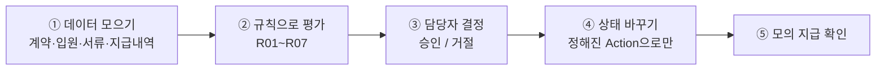
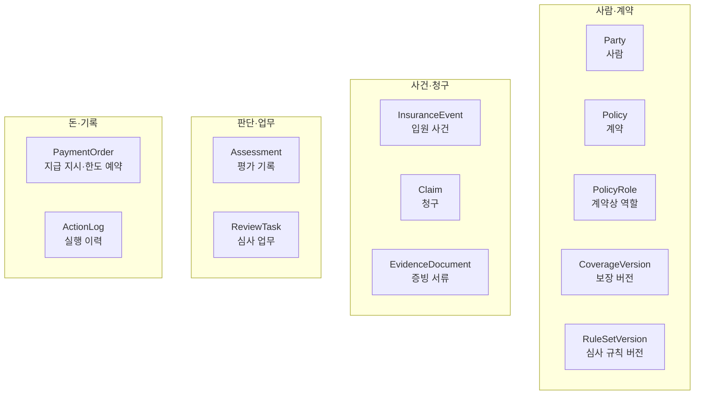
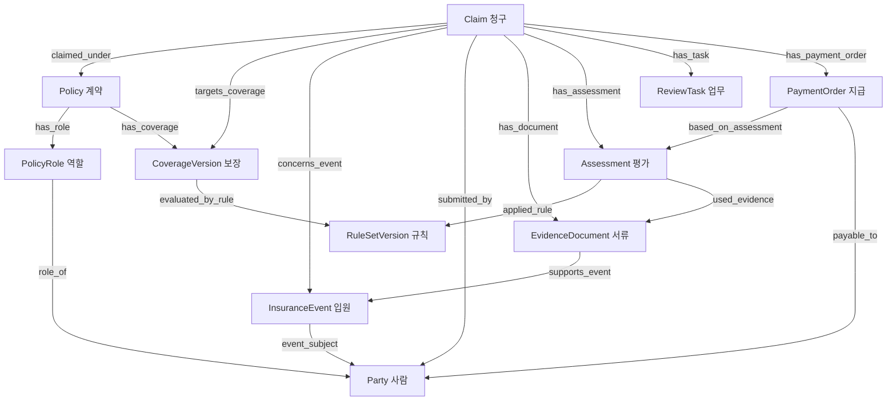
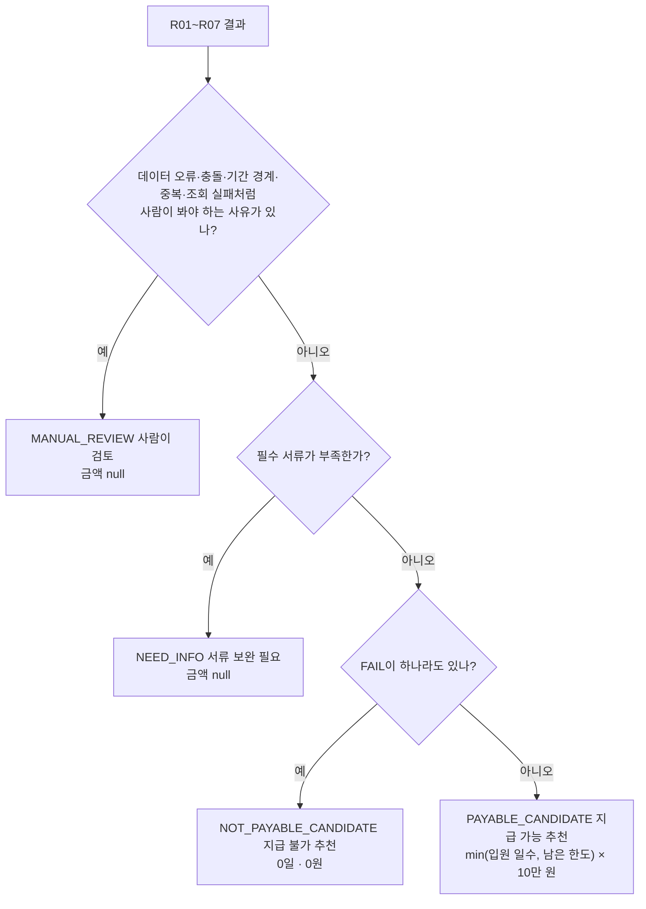
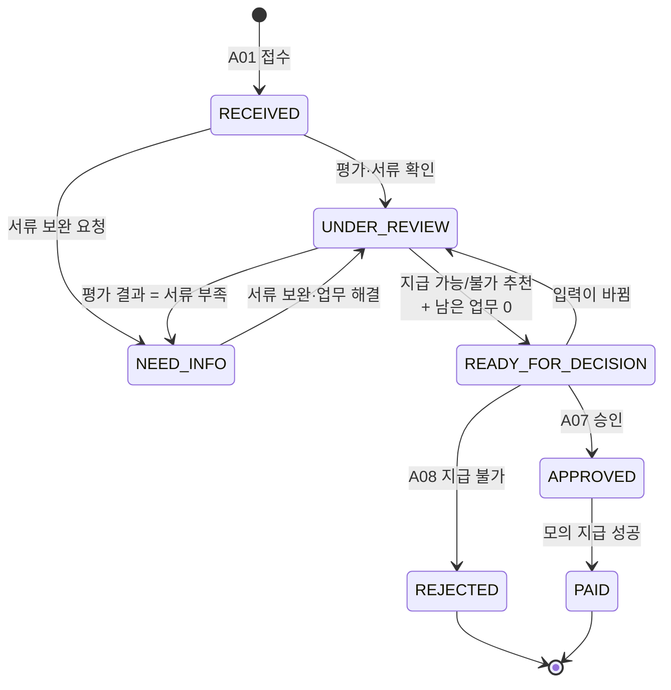
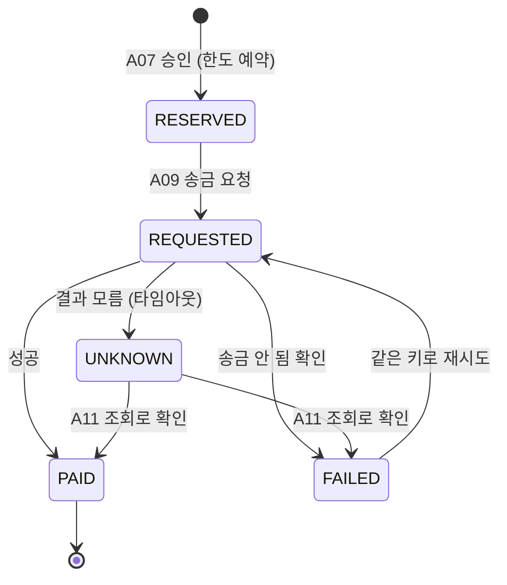
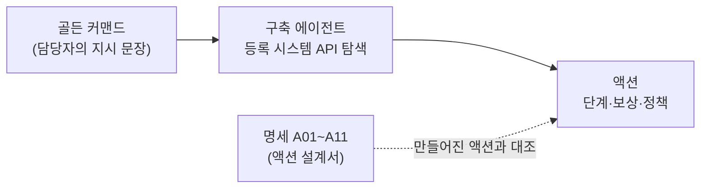

# 보험 온톨로지 시나리오 해설

> 이 문서는 명세서 [insurance-ontology-design-scenario.md](insurance-ontology-design-scenario.md)(v0.1, 2026-10-30)를 쉽게 풀어 쓴 해설입니다.
> 컴퓨터공학 2학년을 앞둔 학생이 읽는다고 생각하고 썼습니다. 변수, 클래스, if문 정도를 알면 따라올 수 있습니다. 보험이나 데이터베이스를 몰라도 괜찮습니다.
> 명세의 내용을 새로 정하지는 않았습니다. 해설과 명세가 다르면 **명세가 기준**입니다. 절 제목 옆의 `원문 n절`은 명세의 몇 번째 절인지를 뜻합니다.
> 낯선 용어는 맨 뒤 「용어 정리」에 모아 두었습니다.
> 절마다 있는 **「Palantir 가이드와 연결」** 상자와 15절은 Palantir의 온톨로지 설계 가이드를 참고해 덧붙인 내용입니다. 명세에는 없습니다. 가이드 자체의 해설은 [팔란티어_온톨로지_설계가이드_해설.md](팔란티어_온톨로지_설계가이드_해설.md)에 있습니다.

---

## 0. 이 과제를 한 문단으로

**하루 입원할 때마다 10만 원을 주는 가상의 보험이 있습니다.** 누군가 "입원했으니 보험금을 주세요"라고 청구하면, 회사는 다음을 확인해야 합니다. 그 사람이 정말 보험 대상인지, 서류는 맞는지, 이미 받은 돈은 없는지. 이 확인을 거쳐 **얼마를 줄 수 있는지 계산하고, 담당자가 승인하면 돈을 보내는(흉내만 내는) 것**까지가 이 과제입니다.

여기서 중요한 것은 정답 금액 하나가 아닙니다. 다음 네 가지가 함께 지켜져야 합니다.

- **"왜 이 금액인가?"를** 언제든 근거와 함께 보여 줄 수 있어야 합니다.
- 모르는 것은 **모른다고** 말해야 합니다.
- 버튼을 두 번 눌러도 **돈이 두 번 나가지 않아야** 합니다.
- 나중에 다시 계산해도 **같은 답**이 나와야 합니다.



> **정리**
> - 과제: 가상 입원보험의 **청구 → 평가 → 승인 → 모의 지급** 흐름을 온톨로지로 만듭니다.
> - 핵심 가치는 **근거 추적, 모름의 정직한 표시, 중복 지급 방지, 재현 가능성** 네 가지입니다.

---

## 1. 무엇이 문제인가 `원문 1절`

### 1.1 데이터가 네 군데 흩어져 있다

보험회사 안에는 시스템이 여러 개 있다고 가정합니다.

| 시스템 | 가진 데이터 |
|---|---|
| 계약 시스템 | 누가 어떤 보험에 가입했는지 |
| 접수 시스템 | 청구서와 첨부 서류 |
| 심사 시스템 | 담당자가 내린 판단 |
| 지급 시스템 | 실제로 돈을 보낸 기록 |

문제는 **시스템마다 같은 사람을 다른 ID로 부른다**는 것입니다. 계약 시스템에서는 `C-1029`인 고객이 접수 시스템에서는 `U-77`일 수 있습니다. 지금은 담당자가 화면 네 개를 띄워 놓고 눈으로 맞춰 봅니다.

### 1.2 한곳에 모아도 생기는 함정 세 가지

데이터를 하나의 DB에 몰아넣는다고 끝나지 않습니다.

1. **사람이 셋이다.** 보험에는 서로 다를 수 있는 세 사람이 있습니다.
   - **계약자**: 보험에 가입하고 돈을 내는 사람 (예: 엄마)
   - **피보험자**: 보험의 대상, 즉 아프거나 다치면 보장받는 사람 (예: 자녀)
   - **수익자**: 보험금을 받는 사람 (이 과제에서는 피보험자와 같은 사람으로 고정)

   이 셋을 구분하지 않으면 "엄마가 가입했으니 엄마가 입원해도 보장된다"는 식의 오류가 생깁니다.
2. **청구와 입원은 다른 것이다.** 입원은 한 번 했는데 청구서는 두 번 들어올 수 있습니다. 둘을 같은 것으로 취급하면 중복 청구를 잡지 못합니다.
3. **한도는 계속 바뀐다.** "남은 한도 5일"이라고 계산한 직후에 다른 청구가 먼저 승인되면, 방금 계산한 값은 이미 틀린 값입니다. (공연 좌석 예매에서 "1석 남음"을 보고 결제했는데 이미 팔린 상황과 같습니다.)

### 1.3 왜 '보험금 청구 심사'를 골랐나

후보는 세 가지였습니다.

| 후보 | 판단 |
|---|---|
| **보험금 청구 심사** | 작은 가상 데이터로 입력과 정답을 정하기 쉬워서 **선택** |
| 인수 심사 (가입을 받아 줄지 판단) | 위험 평가와 상품별 조건까지 다뤄야 해서 범위가 너무 넓음 |
| 이상 청구 조사 (보험 사기 탐지) | "의심"과 "확정"의 구분이 어렵고, 채점용 정답을 만들기 어려움 |

### 1.4 담당자가 답을 얻어야 하는 질문 7개 (Q1\~Q7)

이 과제의 **기준 질문**입니다. 설계와 테스트가 전부 이 7개로 연결됩니다. 소프트웨어 공학에서 말하는 **요구사항**이라고 생각하면 됩니다.

| ID | 담당자의 질문 | 한 단어로 |
|---|---|---|
| Q1 | 입원한 분이 이 계약의 피보험자 맞나요? | 사람 확인 |
| Q2 | 이번 입원은 보상 대상인가요? 어떤 약관·기준으로 보나요? | 보장 확인 |
| Q3 | 서류는 다 왔나요? 서류끼리 날짜나 인적사항이 다르진 않나요? | 서류 확인 |
| Q4 | 이미 줬거나 주기로 한 것까지 빼면, 이번에 얼마 줄 수 있나요? | 금액 계산 |
| Q5 | 같은 입원으로 이미 접수되거나 지급된 건이 있나요? | 중복 확인 |
| Q6 | 전에는 누가 무슨 근거로 심사했고, 그 뒤 뭐가 바뀌었나요? | 이력 확인 |
| Q7 | 서류를 더 받아야 하나요, 더 심사해야 하나요, 지급해도 되나요? | 다음 할 일 |

화면에는 개발자 용어인 '규칙 버전' 대신 **'적용 심사 기준'이라고** 보여 줍니다. 내부 ID는 상세 화면에서만 보여 줍니다.

### 1.5 성공했다고 말하려면

1. **추적성**: 모든 결과에서 "어떤 계약, 어떤 규칙, 어떤 서류, 어떤 입력을 썼는지" 따라갈 수 있다.
2. **정직성**: 확인 안 된 사실을 추측으로 채우지 않고 `UNKNOWN`(모름)으로 둔다.
3. **안전성**: 승인이나 지급 요청이 여러 번 들어와도 한도 초과나 중복 지급이 생기지 않는다.
4. **재현성**: 같은 입력과 같은 규칙이면 언제 다시 계산해도 같은 결과가 나온다.

"처리 시간이 줄었다", "자동화율이 몇 %다" 같은 성과는 **아직 주장하지 않습니다.** 만든 뒤에 측정할 값입니다.

> **Palantir 가이드와 연결**: 가이드는 *"실제 업무 질문이 최고의 인수 테스트"라고* 말합니다. Q1\~Q7이 바로 그 역할입니다. (Studio의 **골든 퀘스천**으로 쓰려면 B0의 ID를 넣는 등 구체화가 필요합니다. 14.2 참고) 가이드는 질문을 **상황 파악 → 원인 추적 → 영향 평가** 순서로 이어 가라고 권하는데, Q1\~Q7도 "이 사람 맞나(Q1·Q2) → 서류와 중복은(Q3·Q5) → 얼마 줄 수 있나(Q4) → 이제 뭘 하나(Q7)"로 같은 흐름을 탑니다.

> **정리**
> - 데이터가 네 시스템에 흩어져 있고, ID도 제각각입니다.
> - 함정은 세 가지입니다: **사람 셋의 구분**, **청구 ≠ 입원**, **계속 바뀌는 한도**.
> - Q1\~Q7은 이 시스템이 반드시 답해야 하는 질문, 즉 요구사항입니다.
> - 성공 기준은 추적성, 정직성, 안전성, 재현성 네 가지입니다.

---

## 2. 가상 상품 「테스트 입원일당 A」 `원문 2절`

### 2.1 상품 규칙

| 항목 | 값 | 풀이 |
|---|---|---|
| 일당 | 1일 100,000원 | 입원 하루당 10만 원 |
| 보장 기간 | `[2026-01-01, 2027-01-01)` | 2026년 한 해. 끝 날짜는 **포함하지 않음** |
| 대기 기간 | 30일 | 가입 직후 30일 동안은 보장하지 않음. 입원일이 **2026-01-31 이후**여야 함 |
| 입원 일수 | `퇴원일 − 입원일` | 입원일은 세고 퇴원일은 안 셈. 당일 퇴원은 0일 |
| 지급 한도 | 1년에 1인당 총 5일 | 여러 번 입원해도 합쳐서 5일까지만 |
| 필수 서류 | 확인된 입퇴원확인서 1장 이상 | 병원이 발급하는 입원 증명서 |
| 서류에서 볼 것 | 환자, 병원 코드, 입원일, 퇴원일 | |
| 최종 결정 | 담당자 | 시스템은 **추천만** 함 |

`[a, b)` 표기는 **a는 포함하고 b는 포함하지 않는다**는 뜻입니다. 파이썬의 `range(a, b)`가 a부터 b-1까지인 것과 같은 규칙입니다. 이렇게 하면 기간을 이어 붙일 때 겹치거나 비는 날이 생기지 않습니다.

> 대기 기간이 왜 있을까요? 아픈 걸 알고 나서 급히 가입한 뒤 바로 보험금을 받는 일을 막기 위해서입니다.

### 2.2 계산해 보기

```
입원 3/10, 퇴원 3/13 → 13 − 10 = 3일 (10일, 11일, 12일 밤)
남은 한도 = 5일 − 이미 받은 0일 − 다른 청구가 잡아 둔 0일 = 5일
줄 수 있는 일수 = min(3일, 5일) = 3일
금액 = 3일 × 100,000원 = 300,000원
```

경계값 두 가지는 꼭 기억해 두세요. 테스트에 그대로 나옵니다.

- **대기 기간**: 1/30 입원은 안 되고, 1/31 입원은 됩니다.
- **보장 종료**: 퇴원일이 2027-01-01이면 괜찮습니다(기간 안). 2027-01-02이면 기간을 넘기므로 시스템이 계산하지 않고 **사람이 직접 검토**합니다.

### 2.3 이번에 하는 것과 안 하는 것

| 이번에 한다 | 이번에 안 한다 (나중에) |
|---|---|
| 계약 1개, 보장 1개, 피보험자 1명 | 실제 쓴 병원비만큼 주는 실손보험 계산 |
| 청구 1건 = 입원 1건 × 보장 1개 | 한 청구에 여러 보장 묶기 |
| 한 입원에 청구 여러 건 연결 (중복 검사용) | 수익자 변경, 대리인 접수 |
| 계약자 ≠ 피보험자 가능 | 계약 갱신, 중간 변경 |
| 계약자나 피보험자 본인이 접수 | 이미 준 돈 돌려받기(환수), 재심사, 이의신청 |
| 담당자가 최종 결정, 지급은 **모의(가짜)** 시스템으로 | 보장 기간을 넘는 입원의 자동 계산 |

> **정리**
> - 하루 10만 원, 1년 5일 한도, 가입 후 30일 대기.
> - 날짜 구간은 `[시작, 끝)`이고 끝 날짜는 빠집니다.
> - 입원 일수는 `퇴원일 − 입원일`, 금액은 `min(입원 일수, 남은 한도) × 10만 원`입니다.
> - 범위를 일부러 좁게 잡은 PoC(개념 검증)입니다.

---

## 3. 이 문서에서 말하는 '온톨로지' `원문 3절`

### 3.1 온톨로지를 객체지향으로 이해하기

**온톨로지**는 원래 철학 용어지만, 여기서는 이렇게 이해하면 됩니다.

> "우리 업무에 어떤 **것**들이 있고, 각각 어떤 **속성**을 가지며, 서로 어떻게 **연결**되고, 그것으로 무엇을 **할 수 있는지**를 정의한 설계도."

1학년 때 배운 **클래스와 객체**를 떠올리면 거의 그대로 대응합니다.

| 온톨로지 용어 | 뜻 | 프로그래밍에 비유하면 | 이 과제의 예 | Ontological Studio 용어 |
|---|---|---|---|---|
| Object Type | 업무 대상의 종류 | 클래스 `class Claim` | 청구 | 클래스 |
| Object | 개별 대상 하나 | 인스턴스 `cl = Claim("CL-001")` | 청구 CL-001 | 인스턴스 |
| Property | 대상의 속성 | 필드 `cl.status` | 청구 상태, 입원일 | 속성 |
| Link | 대상 사이의 관계 | 다른 객체를 가리키는 참조 `cl.policy` | 청구 → 계약 | 관계 |
| Action | 상태를 바꾸는 업무 | 권한 검사가 붙은 메서드 `cl.approve()` | 지급 승인 | 액션 |

이 과제의 온톨로지는 데이터 구조만 정의하지 않고 **"무엇을 할 수 있는지"(Action)까지** 포함합니다. 그래서 명세는 이것을 **운영형 온톨로지**라고 부릅니다. 용어는 Palantir라는 회사의 개념을 빌렸습니다.

### 3.2 그냥 DB에 모아 두는 것과 무엇이 다른가

| 관점 | 이 설계가 하는 일 |
|---|---|
| 용어 | 시스템마다 다른 필드를 '피보험자', '입원 사건' 같은 **공통 개념**으로 통일 |
| 질문 | Q1\~Q7을 관계를 따라가는 탐색과 명시적인 계산으로 답함 |
| 근거 | 결과뿐 아니라 **그때 쓴 규칙, 서류, 입력값**까지 같이 저장 |
| 변경 | `status = "APPROVED"`처럼 값을 직접 고치지 못하게 하고, **정해진 Action으로만** 변경 |
| 재사용 | 담당자 화면, 일괄 처리, 질의 서비스가 모두 같은 정의와 규칙을 사용 |

그래프 DB를 쓰는 것 자체가 목표는 아닙니다. 관계형 DB(MySQL, PostgreSQL 같은 표 형태의 DB)로 만들어도 됩니다. OWL/RDF 같은 논리 추론 기술도 이번 범위가 아닙니다.

> **Palantir 가이드와 연결**: 가이드의 첫 번째 원칙은 **"원천 시스템이 아니라 현실을 모델링하라"입니다**. 계약 시스템의 표, 접수 시스템의 표를 그대로 Object로 옮기면 **System Silos**(시스템별 칸막이) 안티패턴이 됩니다. 이 설계가 네 시스템의 데이터를 '피보험자', '입원 사건' 같은 **공통 개념**으로 바꾸는 것이 바로 이 원칙을 따르는 것입니다.

> **정리**
> - 온톨로지 ≈ **클래스(Object Type) + 필드(Property) + 참조(Link) + 메서드(Action)로** 만든 업무 설계도입니다.
> - 핵심 규칙: 상태는 **Action으로만** 바뀌고, 결과에는 항상 **근거**가 붙습니다.

---

## 4. 12개 Object 살펴보기 `원문 4절`

12개 Object를 역할에 따라 네 묶음으로 나누면 이해하기 쉽습니다.



| 묶음 | Object | ID 예 | 무엇인가 |
|---|---|---|---|
| 사람·계약 | `Party` | PT-001 | 사람. 계약자, 피보험자, 수익자가 모두 여기서 출발 |
| | `Policy` | PO-001 | 보험 계약 한 건 |
| | `PolicyRole` | PR-001 | "누가, 어느 계약에서, 무슨 역할을, 언제부터 언제까지" 맡는지 |
| | `CoverageVersion` | CV-001 | 가입한 보장의 조건(일당, 한도, 대기 기간). 한번 발행하면 고정 |
| | `RuleSetVersion` | RV-001 | 심사 규칙과 약관(보험 계약서의 세부 조항)의 버전. 발행하면 고정 |
| 사건·청구 | `InsuranceEvent` | EV-001 | **실제로 일어난 입원.** 청구와 따로 관리 |
| | `Claim` | CL-001 | 접수된 청구서. 심사 진행 상태를 관리하는 단위 |
| | `EvidenceDocument` | DC-001 | 제출된 서류. 기계가 읽은 값과 사람이 확인한 값을 따로 저장 |
| 판단·업무 | `Assessment` | AS-001 | 평가 결과. **매번 새로 만들고, 이전 것을 덮어쓰지 않음** |
| | `ReviewTask` | TK-001 | 사람이 처리해야 할 일 (서류 더 받기, 내용 충돌 확인, 중복 확인 등) |
| 돈·기록 | `PaymentOrder` | PY-001 | 승인할 때 한도를 **미리 잡아 두고**, 지급 결과까지 추적 |
| | `ActionLog` | AL-001 | 누가, 언제, 무엇을 바꿨는지 (실패한 시도 포함) |

### 4.1 왜 이렇게 나눴을까

- **`PolicyRole`을 따로 둔 이유**: 사람과 계약을 바로 연결(`Party → Policy`)하면 그 사람이 계약자인지 피보험자인지 알 수 없습니다. 관계에 "역할"과 "기간"이라는 정보가 붙어야 해서, 관계 자체를 하나의 Object로 만들었습니다. DB 수업에서 배울 **연결 테이블**(N:M 관계를 풀 때 쓰는 중간 테이블)과 같은 발상입니다.
- **입원(`InsuranceEvent`)과 청구(`Claim`)를 나눈 이유**: 입원 1건에 청구 여러 건이 붙을 수 있어야 "같은 입원으로 또 청구했네?"를 잡을 수 있습니다.
- **평가(`Assessment`)를 매번 새로 만드는 이유**: 다시 평가할 때 이전 결과를 덮어쓰면, Q6 "전에는 무슨 근거로 판단했나?"에 답할 수 없습니다. git이 커밋을 덮어쓰지 않고 계속 쌓는 것과 같은 원리입니다.
- **지급 지시(`PaymentOrder`)를 따로 둔 이유**: 승인과 실제 송금 사이에는 "주기로 했지만 아직 안 보낸 돈"이라는 상태가 있습니다. 청구서의 금액 필드 하나로는 이 상태를 표현할 수 없습니다.
- **비슷하다고 같은 입원은 아니다**: 사람, 병원, 날짜가 비슷하면 **중복 후보**일 뿐입니다. 같은 입원이라고 확정하려면 사람이 확인해야 합니다.
- **단순화한 부분**: 병원은 Object로 만들지 않고 `provider_code`라는 속성 하나로만 둡니다. 서류 1장이 여러 청구에 쓰일 수 있으므로 서류와 청구는 **다대다(N:M)** 관계입니다.

> **Palantir 가이드와 연결**
> - `PolicyRole`은 가이드가 말하는 **객체를 거친 링크**(object-backed link)의 교과서적인 예입니다. 가이드의 예 `Employee → VentureStaffing → Venture`에서 중간 객체가 역할과 시작일을 담는 것과 똑같습니다.
> - 입원과 청구를 나눈 것은 가이드의 **"정체(identity)와 관측(observation)을 분리하라"와** 같은 생각입니다.
> - 사람을 `Party` 하나로 모으고 계약자, 피보험자, 수익자를 **역할**로 구분한 것은 **Department Silos**(부서별 칸막이)를 피한 설계입니다. "계약자 타입", "피보험자 타입"을 따로 만들었다면 같은 사람이 여러 객체로 쪼개졌을 것입니다.
> - 반대로 `CoverageVersion`, `RuleSetVersion`처럼 **버전마다 객체를 만드는 것**은 가이드의 **Time Machine** 안티패턴과 겉모습이 닮았습니다. 그래도 이렇게 한 이유가 있습니다. 15.2에서 자세히 봅니다.

> **정리**
> - Object 12개는 **사람·계약 / 사건·청구 / 판단·업무 / 돈·기록**의 네 묶음입니다.
> - 핵심 분리는 세 가지입니다: **역할**은 별도 Object, **입원과 청구**는 따로, **평가**는 덮어쓰지 않고 계속 쌓기.

---

## 5. Property — 속성 설계에서 꼭 알아 둘 것 `원문 5절`

전체 속성 목록은 명세 5.2절에 있습니다. 여기서는 규칙과 함정만 정리합니다.

### 5.1 자료형 표기

명세는 속성을 `이름!: 자료형` 형태로 적습니다.

| 표기 | 뜻 |
|---|---|
| `!` | 필수 값 (비어 있으면 안 됨) |
| `id`, `string` | 문자열 |
| `date` | 날짜 (2026-03-10) |
| `timestamp` | 시간대까지 포함한 시각 (2026-03-10T09:00:00+09:00) |
| `int` | 정수 |
| `enum(A, B, C)` | 정해진 값 중 하나만 허용 (예: `PENDING`, `VERIFIED`, `REJECTED`) |
| `ref` | 다른 Object의 ID (다른 객체를 가리키는 참조) |
| `list`, `struct` | 목록, 여러 필드를 묶은 구조체 |

### 5.2 모든 Object에 공통으로 붙는 것

- `id`, `created_at`(만든 시각), `source_system`, `source_record_id`가 있습니다. 마지막 둘은 **이 데이터가 원래 어느 시스템의 어느 레코드에서 왔는지**를 기록합니다.
- 바뀔 수 있는 Object에는 `updated_at`과 `revision`(수정 번호)이 붙습니다. 수정할 때마다 revision이 1씩 올라갑니다.
- **`Assessment`, 발행된 `RuleSetVersion`, `ActionLog`는 한번 만들면 절대 수정하지 않습니다(불변).** 바꿔야 하면 새로 만듭니다.

### 5.3 헷갈리기 쉬운 속성

| 속성 | 함정 |
|---|---|
| `InsuranceEvent.fact_status` | `UNVERIFIED`(미확인) / `VERIFIED`(확인됨) / `CONFLICT`(충돌). `VERIFIED`가 되려면 입원일·퇴원일 같은 핵심 사실이 모두 있어야 함 |
| `EvidenceDocument.extracted_facts` vs `verified_facts` | 앞의 것은 OCR(이미지에서 글자를 읽는 기술) 같은 기계가 읽은 값, 뒤의 것은 사람이 확인한 값. **기계가 99% 확신해도 확인 완료가 아님** |
| `Policy.administrative_status` | 지금 상태(유지 중 / 만료)일 뿐. **과거 입원의 보장 여부를 이 값으로 판단하면 안 됨** (작년엔 유효했는데 지금 만료됐을 수 있음) |
| `Assessment.candidate_amount_krw` | 판단할 수 없으면 **`null`. 0원이 아님.** "0원 드립니다"와 "아직 모릅니다"는 완전히 다른 뜻 |
| `PaymentOrder.payment_key` | 지급 1건마다 고정된 키. 재시도해도 바뀌지 않음. 중복 송금을 막는 열쇠 |

### 5.4 계산으로 얻는 값

저장하지 않고 다른 값에서 계산하는 값입니다(**파생 속성**).

| 값 | 계산식 | 뜻 |
|---|---|---|
| `hospital_days` | 퇴원일 − 입원일 | 입원 일수 |
| `waiting_end_date` | 보장 시작일 + 30일 | 대기 기간이 끝나는 날 |
| `paid_days` | 같은 한도 묶음의 `PAID` 일수 합 | 이미 지급한 일수 |
| `reserved_days_other` | **다른** 청구가 잡아 둔 일수 합 | 승인됐지만 아직 지급 안 된 일수 |
| `remaining_days` | `max(0, 5 − paid_days − reserved_days_other)` | 남은 한도 (음수가 되지 않게 `max(0, …)`) |
| `eligible_days` | 모든 규칙 통과 시 `min(hospital_days, remaining_days)` | 이번에 줄 수 있는 일수 |
| `candidate_amount_krw` | `eligible_days × 100,000` | 이번에 줄 수 있는 금액 (정수, 원 단위) |
| `is_assessment_stale` | 평가 이후 입력이 바뀌었나? | 평가가 낡았는지. 승인 직전에 검사 |

**한도 묶음 키**는 `(계약, 보장 버전, 피보험자, 보장 기간)`입니다. 이 네 값이 같은 지급과 예약을 모두 더해서 5일을 넘지 않게 합니다. DB 수업에서 배울 **복합 키**(여러 컬럼을 묶어 하나의 키로 쓰는 것)입니다.

### 5.5 사유 코드와 자동으로 생기는 업무

평가 결과에는 왜 그런 결과가 나왔는지 **사유 코드**가 붙습니다. 일부 사유는 사람이 처리할 업무(`ReviewTask`)를 자동으로 만듭니다.

| 사유 코드 | 뜻 | 생기는 업무 |
|---|---|---|
| `MISSING_DOCUMENT` | 필수 서류가 없거나 아직 확인 안 됨 | `EVIDENCE_REQUEST` (서류 더 받기) |
| `FACT_CONFLICT` | 서류와 입원 기록, 또는 서류끼리 내용이 다름 | `FACT_REVIEW` (사실 확인) |
| `UNCONFIRMED_FACT` | 피보험자 역할이나 입원 사실이 미확인 | `FACT_REVIEW` |
| `INVALID_DATES` | 퇴원일이 입원일보다 빠름 같은 데이터 오류 | `DATA_REPAIR` (데이터 수정) |
| `DEPENDENCY_UNAVAILABLE` | 규칙이나 한도 정보를 불러오지 못함 | `DATA_REPAIR` |
| `PERIOD_CROSSING` | 입원이 보장 종료일을 넘김 | `PERIOD_REVIEW` (기간 검토) |
| `DUPLICATE_REVIEW` | 같은 입원으로 다른 청구가 있음 | `DUPLICATE_REVIEW` (중복 검토) |
| `IDENTITY_MISMATCH`, `OUTSIDE_COVERAGE`, `WAITING_NOT_MET`, `ZERO_STAY`, `LIMIT_EXHAUSTED` | 확인해 보니 조건 미충족 (사람 다름, 기간 밖, 대기 기간 중, 당일 퇴원, 한도 소진) | 업무 없음. "지급 불가" 추천의 근거로만 기록 |

> **Palantir 가이드와 연결**
> - 가이드는 **"사실은 한 번만 저장하고, 나머지는 파생 속성으로 계산하라"고** 합니다. 5.4의 값들은 모두 이 원칙대로 **저장하지 않고 계산**합니다. `paid_days`, `reserved_days_other`는 연결된 지급 지시를 더하는 **집계형 파생 속성**, `hospital_days`는 **계산식형 파생 속성**에 해당합니다.
> - 다만 평가할 때 계산한 값은 `Assessment`에 **저장**합니다. 그 순간의 값을 증거로 남겨야 하기 때문입니다. "계산 값은 저장하지 말라"는 원칙의 예외이고, 이유가 분명한 예외입니다.
> - `extracted_facts`처럼 **값과 신뢰도를 함께** 담는 필드는 가이드의 **구조체**(struct) 사례와 같습니다. 가이드도 "AI가 뽑은 값은 신뢰도, 출처와 함께 저장하라"고 합니다.
> - 모든 Object에 붙는 `source_system`, `source_record_id`, 각종 해시는 업무 담당자에게는 의미 없는 기술 값입니다. 가이드의 **Kitchen Sink** 안티패턴을 피하려면 이 값들은 **기본 화면에서 숨기고** 상세 근거 화면에서만 보여 주는 것이 좋습니다. 명세 1.4의 "내부 ID는 상세 화면에서만"과 같은 방향입니다.

같은 문제로 아직 안 끝난 업무가 있으면 **새로 만들지 않습니다.** 판단 기준은 `(청구, 업무 종류, 사유, 관련 ID)`입니다. 평가를 10번 돌려도 같은 업무가 10개 쌓이면 안 되기 때문입니다. 업무가 해결된 뒤 같은 문제가 다시 생기면, 그때는 새 업무를 만들어 과거 기록을 보존합니다.

> **정리**
> - `!`는 필수, `enum`은 정해진 값만, `ref`는 다른 객체 참조입니다.
> - 평가, 규칙, 이력은 **불변**이어서 고치지 않고 새로 만듭니다.
> - **`null`(모름) ≠ 0(안 줌)**, **기계가 읽은 값 ≠ 사람이 확인한 값**.
> - 남은 한도 = `5 − 지급 − 다른 청구의 예약`이고, 같은 문제의 업무는 중복 생성하지 않습니다.

---

## 6. Link — 무엇이 무엇과 연결되나 `원문 6절`



중심에 **청구(Claim)가** 있고, 거기서 계약, 보장, 입원, 서류, 평가, 업무, 지급으로 뻗어 나갑니다. 담당자는 청구 하나에서 출발해 화살표를 따라가며 Q1\~Q7의 답을 찾습니다.

### 6.1 대상 수(cardinality) 읽는 법

명세의 Link 표에는 '대상 수'가 있습니다. **출발 Object 하나가 도착 Object 몇 개와 연결되는지**를 뜻합니다.

| 표기 | 뜻 | 예 |
|---|---|---|
| `1` | 정확히 하나 | 청구 하나는 계약 **하나**에 속함 |
| `0..1` | 없거나 하나 | 청구 하나에 지급 지시는 **없거나 하나** |
| `0..N` | 없거나 여러 개 | 청구 하나에 서류가 **여러 장**일 수 있음 |
| `1..N` | 최소 하나, 여러 개 가능 | 계약 하나에 역할이 **최소 하나** |

### 6.2 지켜야 할 연결 규칙

- 청구가 가리키는 **계약**과, 그 청구가 가리키는 **보장이 속한 계약**은 같아야 합니다. 다르면 연결을 아예 만들지 않습니다. (테스트 T29)
- 입원한 사람과 계약 피보험자가 같은지는 **연결할 때 막지 않습니다.** 일단 접수된 그대로 보존하고, 평가 규칙 R01에서 판정합니다. 들어온 데이터를 버리지 않고 근거로 남기기 위해서입니다.
- `current_assessment`(현재 평가)는 반드시 **그 청구의** 평가여야 합니다.
- 이번 범위에서는 청구 하나에 지급 지시가 최대 1개입니다.

> **연결이 없다고 "관계가 없다"는 뜻은 아닙니다.** 데이터가 빠졌을 수도 있습니다. 둘을 구분할 수 없으면 결과는 `UNKNOWN`입니다.

> **Palantir 가이드와 연결**: 가이드는 **링크 이름이 양쪽 방향에서 자연스럽게 읽혀야** 한다고 합니다 (직원 쪽에서 `department`, 부서 쪽에서 `employees`). 명세의 Link 이름은 `claimed_under`, `has_document`처럼 한 방향 동사형입니다. Studio에 만들 때는 **역방향 이름**(계약 쪽에서 `claims`, 서류 쪽에서 `claims`)도 함께 정해 두면 질의하기 쉬워집니다. 또 `affects`처럼 무엇과 무엇의 관계인지 흐린 이름은 가이드의 **Misnomer**(잘못된 이름) 신호이므로, 명세가 제안한 대로 `affects_claim`, `affects_payment_order`처럼 나누는 편이 낫습니다.

> **정리**
> - **청구가 중심**이고, 모든 정보는 청구에서 화살표를 따라 찾습니다.
> - 대상 수 `1`, `0..1`, `0..N`, `1..N`은 연결 개수의 규칙입니다.
> - 구조가 틀린 연결은 막고, 업무적으로 따져 볼 문제는 평가 규칙에 맡깁니다.

---

## 7. 평가 — 시스템은 어떻게 판단하나 `원문 7절`

### 7.1 참·거짓이 아니라 세 가지 값

보통 조건문은 `true`/`false` 두 값이지만, 여기서는 **세 값**을 씁니다.

| 값 | 뜻 | 예 |
|---|---|---|
| `PASS` | 사실을 확인했고 조건을 충족 | 입원일이 대기 기간 이후로 확인됨 |
| `FAIL` | 사실을 확인했고 조건을 충족하지 않음 | 입원일이 대기 기간 안으로 확인됨 |
| `UNKNOWN` | 데이터가 없거나, 충돌하거나, 미확인이라 **판단 불가** | 입원일 서류가 아직 없음 |

왜 세 번째 값이 필요할까요? 데이터가 없다고 `false`로 처리하면, "피보험자 정보가 없다"가 "피보험자가 아니다"로 바뀌어 버립니다. SQL을 배우면 나오는 `NULL`과 비슷한 개념입니다.

### 7.2 규칙 7개

| 규칙 | 묻는 것 | `FAIL`인 경우 | `UNKNOWN`인 경우 |
|---|---|---|---|
| R01 `IDENTITY_MATCH` | 입원한 사람이 입원일 기준 계약의 피보험자인가? | 다른 사람 | 역할 정보가 없음 |
| R02 `COVERAGE_PERIOD` | 입원이 보장 기간 안인가? | 입원일이 기간 밖 | 기간 경계를 넘김 → 사람이 검토 |
| R03 `WAITING_PERIOD` | 입원일 ≥ 시작일 + 30일인가? | 대기 기간 중 입원 | — |
| R04 `EVIDENCE_COMPLETE` | 확인된 입퇴원확인서가 있고 입원 기록과 일치하나? | — | 서류 없음, 또는 내용 충돌 (둘을 구분해 기록) |
| R05 `POSITIVE_STAY` | 퇴원일 > 입원일인가? | 당일 퇴원(0일) | 날짜가 거꾸로임(데이터 오류) |
| R06 `DUPLICATE_CLEAR` | 같은 입원·보장으로 이미 승인되거나 지급된 건이 없는가? | — | 있음, 또는 같은 입원인지 미확정 → 중복 검토 |
| R07 `LIMIT_AVAILABLE` | 남은 한도 > 0인가? | 한도 다 씀 | 한도 정보 조회 실패 |

중복 후보가 나와도 시스템이 "사기다"라고 **단정하지 않습니다.** 담당자가 볼 업무를 만들 뿐입니다.

### 7.3 규칙 7개의 결과를 하나로 합치기

규칙마다 결과가 나오면, 아래 순서대로 검사해서 **처음 걸리는 것**을 최종 추천으로 정합니다. `if … elif … elif … else` 구조와 같습니다.



- 사유가 여러 개면 **모두 기록**하고, 대표 결과만 위 순서로 정합니다.
- 결과 이름에 `CANDIDATE`(후보)가 붙는 이유는 **추천일 뿐 결정이 아니기** 때문입니다. 결정은 담당자가 합니다.

### 7.4 의사코드로 보기

```text
snapshot = 지금 시점의 청구, 역할, 보장, 규칙, 입원, 서류, 관련 지급·예약 정보

results = [R01(snapshot), ..., R07(snapshot)]   # 각각 PASS / FAIL / UNKNOWN
recommendation = 위 순서도로 합치기(results)

if recommendation == PAYABLE_CANDIDATE:
    remaining = max(0, max_days - paid_days - reserved_days_other)
    days = min(hospital_days, remaining)
    amount = days * daily_amount
elif recommendation == NOT_PAYABLE_CANDIDATE:
    days, amount = 0, 0
else:                       # MANUAL_REVIEW, NEED_INFO
    days, amount = null, null   # 0이 아님!

새 Assessment 저장, Claim의 현재 평가를 이것으로 변경
필요한 ReviewTask 생성 (같은 업무가 이미 열려 있으면 재사용)
```

### 7.5 스냅샷 — 재현성의 핵심

평가할 때는 그 순간의 입력을 **통째로 복사해서(스냅샷)** 평가 결과와 함께 저장합니다. 시험 답안을 채점할 때 답안지 사진을 찍어 두는 것과 같습니다. 나중에 원본이 바뀌어도 "그때 무엇을 보고 채점했는지" 확인할 수 있습니다.

"그때 왜 30만 원이었지?"를 확인할 때 **현재 데이터를 다시 읽으면 안 됩니다.** 그 사이에 서류나 규칙이 바뀌었을 수 있기 때문입니다. 저장된 스냅샷으로 다시 계산해야 합니다.

스냅샷에서는 `input_hash`라는 **지문 값**도 만듭니다. 해시는 내용이 한 글자만 바뀌어도 완전히 다른 값이 나오는 함수라서, 입력이 바뀌었는지 빠르게 비교할 수 있습니다.
이때 **판단에 영향을 주는 값만** 해시에 넣어야 합니다. 청구 상태나 "현재 평가 ID"처럼 평가를 저장하면서 바뀌는 값까지 넣으면, 방금 만든 평가가 저장되자마자 "입력이 바뀌었으니 낡은 평가"로 판정되는 모순이 생깁니다.

> **정리**
> - 규칙 결과는 **PASS / FAIL / UNKNOWN** 세 값입니다. 데이터가 없으면 FAIL이 아니라 UNKNOWN입니다.
> - 최종 추천은 **사람 검토 → 서류 보완 → 지급 불가 → 지급 가능** 순서로 정합니다.
> - 판단할 수 없으면 금액은 **`null`입니다**.
> - 평가 순간의 입력을 **스냅샷과 해시**로 고정해서 나중에 똑같이 재현합니다.

---

## 8. Action — 상태를 바꾸는 11가지 업무 `원문 8절`

### 8.1 왜 Action으로만 바꾸나

누구나 DB에서 `UPDATE claim SET status='APPROVED'`를 실행할 수 있다면 권한 검사도, 한도 검사도, 기록도 건너뛸 수 있습니다. 그래서 **상태 변경은 정해진 Action으로만** 허용합니다. 클래스의 필드를 `private`으로 막고, 검사 로직이 들어간 메서드로만 바꾸게 하는 **캡슐화**와 같은 생각입니다.

조회나 설명 생성처럼 상태를 바꾸지 않는 작업은 **Query**라고 해서 Action과 구분합니다.

### 8.2 업무 흐름 순서로 본 Action 11개

| 단계 | Action | 누가 | 하는 일 |
|---|---|---|---|
| **접수** | A01 `SubmitClaim` | 접수 담당자 | 청구 생성 → `RECEIVED` |
| | A02 `AttachEvidence` | 접수 담당자·심사자 | 서류 붙이기·교체. 이미 평가가 있었다면 `UNDER_REVIEW`로 |
| **심사** | A03 `VerifyEvidence` | 심사자 | 서류 내용 확인 → 입원 사실 갱신 또는 충돌 표시 → 다시 평가해야 함 |
| | A04 `EvaluateClaim` | 평가 서비스·심사자 | 새 평가 생성, 청구 상태와 업무 갱신 |
| | A05 `RequestEvidence` | 심사자 | 서류 보완 업무 생성 → `NEED_INFO` (실제 연락은 보내지 않음) |
| | A06 `ResolveReviewTask` | 심사자 | 업무 해결 (근거 필수). 필요하면 입원 연결 정정 → 다시 평가해야 함 |
| **결정** | A07 `ApproveClaim` | 심사자 | 한도를 다시 확인 → 지급 지시 + 한도 예약 → `APPROVED` |
| | A08 `RejectClaim` | 심사자 | 지급 불가 결정 → `REJECTED` |
| **지급** | A09 `RequestPayment` | 지급 담당자 | 모의 지급 시스템에 송금 요청 → `REQUESTED` |
| | A10 `RecordPaymentResult` | 지급 연계 서비스 | 결과 반영: 성공 `PAID` / 실패 `FAILED` / 모름 `UNKNOWN` |
| | A11 `ReconcilePayment` | 지급 담당자·연계 서비스 | 결과를 모르는 건을 외부 시스템에 물어 확정 |

모든 Action은 **성공이든 거절이든 기록(`ActionLog`)을 남깁니다.**

> **Palantir 가이드와 연결**
> - 가이드에는 **Action Sprawl**(액션 난립) 안티패턴이 있습니다. "상태 변경", "금액 변경"처럼 속성 하나씩 바꾸는 Action을 잔뜩 만드는 것입니다. 명세의 11개는 모두 **업무 행위 이름**(접수, 확인, 평가, 승인)이라 이 함정을 피하고 있습니다. 청구 하나에 걸린 Action도 10개를 넘지 않습니다.
> - 각 Action의 '사전 조건'은 Foundry의 **Submission criteria**(제출 조건)에 해당합니다. "담당 심사자인가"는 *Current user* 조건, "청구 상태가 결정 대기인가"는 *Parameter* 조건입니다. Studio에서는 액션 **정책**의 `roles`와 `when`이 같은 역할을 합니다.
> - 가이드의 **Golden Hammer**(황금 망치) 안티패턴은 "모든 일을 한 도구로 하지 말라"는 뜻입니다. 이 과제라면 사람의 결정(A07 승인, A08 거절)은 **Action**, 계산(남은 한도)은 **파생 속성이나 평가 서비스**, 지급 결과 수신(A10)은 외부 신호에 반응하는 **자동화**가 어울립니다.

### 8.3 가장 중요한 Action: `ApproveClaim`

승인은 돈이 걸린 단계라 검사가 가장 많습니다.

```
1. 같은 요청 키로 이미 처리했나?          → 그렇다면 그때 결과를 그대로 돌려줌  (멱등성)
2. 청구의 revision이 내가 본 값과 같나?    → 다르면 거절 (그 사이 누가 고침)     (낙관적 잠금)
3. 추천이 "지급 가능"이고 남은 업무가 0건인가?
4. 수익자·보장·피보험자·입원 연결이 맞나?
5. 같은 한도·같은 입원에 다른 승인이 동시에 못 끼어들게 잠금         (동시성 제어)
6. 최신 지급·예약 내역으로 한도와 중복을 다시 계산
7. 평가 이후 입력이 바뀌었나?              → 바뀌었으면 STALE_ASSESSMENT로 거절
8. 지급 지시(RESERVED) + 청구(APPROVED) + 기록을 한 번에 저장               (원자성)

실패하면: 아무것도 바꾸지 않고, 거절 사유만 기록
```

여기에 나오는 컴퓨터공학 개념 네 가지를 짚어 보겠습니다.

- **멱등성**: 같은 요청을 여러 번 보내도 결과는 한 번 보낸 것과 같아야 합니다. 엘리베이터 버튼을 10번 눌러도 엘리베이터는 한 번만 옵니다. 네트워크가 끊겨 클라이언트가 같은 요청을 재전송해도 승인이 두 번 되지 않게 합니다.
- **낙관적 잠금**: "아마 아무도 동시에 안 고치겠지"라고 가정하고 작업하다가, 저장 직전에 revision을 비교해서 누군가 먼저 고쳤으면 거절하는 방식입니다.
- **동시성 제어**: 두 승인이 **동시에** 들어오면, 둘 다 "남은 한도 3일"을 보고 각각 3일을 예약해 버릴 수 있습니다(**경쟁 조건**, race condition). 잠금 같은 장치로 하나씩 처리하게 해야 합니다.
- **원자성**: 여러 변경이 **전부 되거나 전부 안 되거나** 해야 합니다. 계좌이체에서 내 돈은 빠졌는데 상대 계좌에 안 들어가면 안 되는 것과 같습니다. DB의 **트랜잭션**이 이것을 보장합니다.

> **주의 (명세가 강조하는 점)**: 온톨로지에 `ApproveClaim`이라는 Action 이름을 정의한다고 원자성이나 동시성이 저절로 보장되지 않습니다. 실제 구현에서 트랜잭션, 잠금, 조건부 쓰기를 제공해야 합니다. 그렇지 못하면 동시 승인 테스트(T18, T19)는 **통과로 인정하지 않습니다.**

> **Palantir 가이드와 연결**: Foundry도 Action을 **하나의 트랜잭션**으로 처리하지만, 원자성은 **온톨로지 변경까지만** 보장하고 웹훅이나 외부 시스템 호출은 보장 밖이라고 분명히 적습니다. 명세가 "Action 이름만으로는 보장되지 않는다"고 경고한 것과 같은 이야기입니다. 그리고 Foundry 문서는 **스냅샷 격리로도 막지 못하는 경우(쓰기 왜곡)를** 따로 설명하는데, 이것이 T18과 정확히 같은 구조입니다. 15.3에서 자세히 봅니다.

### 8.4 지급 연계에서 지킬 규칙

외부 지급 시스템과 통신할 때는 "요청은 보냈는데 응답이 안 온" 상황이 언제든 생깁니다.

- `payment_key`는 지급 지시마다 하나로 고정합니다. 재시도할 때도 **같은 키**를 씁니다. 지급 시스템은 이 키를 보고 "이미 처리한 요청"인지 알아봅니다.
- 응답이 안 오면(**타임아웃**) 상태를 `UNKNOWN`으로 두고 조회해서 확인합니다. **새 지급 지시를 만들지 않습니다.** 새로 만들면 돈이 두 번 나갈 수 있습니다.
- `FAILED`는 외부 시스템이 "송금 안 됐음"을 확인해 준 경우입니다. 이때만 같은 지급 지시, 같은 키로 재시도합니다.
- `PAID`는 끝 상태입니다. 같은 성공 알림(**콜백**)이 또 오면 무시하고, 서로 다른 결과가 오면 덮어쓰지 않고 조사 기록을 남깁니다.
- `FAILED`여도 **한도 예약은 유지**합니다. 예약을 풀거나 취소하는 기능은 이번 범위 밖입니다.

> **정리**
> - 상태는 **Action으로만** 바뀝니다 (캡슐화와 같은 생각).
> - 11개 Action은 **접수 → 심사 → 결정 → 지급** 순서로 흐릅니다.
> - 승인에는 **멱등성, 낙관적 잠금, 동시성 제어, 원자성**이 모두 필요합니다. 이것은 온톨로지가 아니라 **구현 환경**이 보장해야 합니다.
> - 지급 결과를 모르면 새로 보내지 말고 **조회해서 확인**합니다.

---

## 9. 상태 흐름 `원문 9절`

청구와 지급 지시는 정해진 상태 사이에서만 움직입니다. 택배 조회 화면의 "접수 → 집하 → 배송 중 → 배송 완료"처럼, 허용된 화살표로만 이동할 수 있습니다. 이런 모델을 **상태 기계**(state machine)라고 합니다.

### 9.1 청구(Claim)의 상태



| 상태 | 뜻 |
|---|---|
| `RECEIVED` | 접수됨 |
| `UNDER_REVIEW` | 심사 중 (사람 검토가 필요한 경우도 여기) |
| `NEED_INFO` | 서류 보완 대기 |
| `READY_FOR_DECISION` | 담당자 결정 대기 |
| `APPROVED` | 승인됨. **아직 돈이 나간 것은 아님** |
| `REJECTED` | 지급 불가로 종결 |
| `PAID` | 지급 완료로 종결 |

평가가 남은 업무를 **자동으로 닫지는 않습니다.** 업무는 사람이 A06으로 닫아야 합니다.

### 9.2 지급 지시(PaymentOrder)의 상태



한도를 계산할 때 `RESERVED`, `REQUESTED`, `UNKNOWN`, `FAILED`는 **예약**으로, `PAID`는 **지급**으로 셉니다. 한 건을 양쪽에 모두 더하면 안 됩니다.

> **정리**
> - 청구와 지급은 **상태 기계**로 관리하고, 허용된 화살표로만 이동합니다.
> - **`APPROVED`는 "주기로 함", `PAID`는 "실제로 줌"입니다**. 둘을 헷갈리면 안 됩니다.
> - 아직 지급되지 않은 지급 지시는 모두 한도에서 **예약**으로 빠집니다.

---

## 10. 정상 시나리오를 처음부터 끝까지 `원문 10절`

### 10.1 등장인물과 기본 데이터 (B0)

모든 테스트는 이 데이터에서 출발합니다. 이름은 **B0**(Baseline 0, 기준 데이터)입니다.

| 무엇 | ID | 내용 |
|---|---|---|
| 사람 A | PT-001 | **계약자** (보험 가입) |
| 사람 B | PT-002 | **피보험자 겸 수익자** (입원했고, 돈을 받음) |
| 계약 | PO-001 | TEST-POLICY-001, 2026-01-01 \~ 2027-01-01 |
| 역할 | PR-001 / 002 / 003 | A = 계약자, B = 피보험자, B = 수익자 |
| 규칙 | RV-001 | INPATIENT-DAILY 1.0, 가상 약관 TEST-TERMS-A-1.0 |
| 보장 | CV-001 | 일당 10만 원, 한도 5일, 대기 30일, 규칙 RV-001 사용 |
| 입원 | EV-001 | B가 병원 H-001에 3/10 \~ 3/13 입원, 확인됨 |
| 청구 | CL-001 | A가 접수, 담당 reviewer-01, 상태 RECEIVED |
| 서류 | DC-001 | 입퇴원확인서, 확인됨, 내용이 입원 기록과 일치 |

처음에는 평가, 업무, 지급 지시가 **하나도 없습니다.** 각 테스트는 매번 이 상태로 되돌린 뒤 시작합니다.

### 10.2 흐름 따라가기

1. **접수**: A에게 청구할 권한이 있는지(계약자이므로 있음) 확인하고 CL-001을 만듭니다.
2. **서류 확인**: 심사자가 DC-001을 확인합니다. 입원한 B가 계약의 피보험자인지 관계를 따라가 확인합니다.
3. **평가**: AS-001이 생깁니다. 입원 3일, 남은 한도 5일 → **지급 가능 추천 300,000원**. R01\~R07이 모두 PASS. 청구는 `READY_FOR_DECISION`.
4. **승인**: 한도를 한 번 더 확인한 뒤 PY-001에 3일·30만 원을 예약합니다. 청구는 `APPROVED`.
5. **지급**: 지급 담당자가 송금을 요청하고, 모의 지급 시스템이 성공을 알려 오면 PY-001과 CL-001이 모두 `PAID`.
6. **추적**: CL-001에서 출발해 사람, 보장, 규칙, 서류, 평가, 지급, 변경 기록까지 모두 따라갈 수 있습니다.

### 10.3 화면에 나와야 하는 설명

```text
청구: CL-001
판단: 지급 후보 300,000원 / 담당자 결정 대기
피보험자: PT-002 (계약자 PT-001과 구분)
입원 사건: EV-001, 2026-03-10~2026-03-13, 3일
적용 보장: CV-001, 규칙 RV-001
대기 기간: 2026-01-31 종료, 조건 충족
한도: 총 5일 - 기지급 0일 - 다른 청구 예약 0일 = 잔여 5일
계산: min(3일, 5일) × 100,000원 = 300,000원
증빙: DC-001, 담당자 확인 완료
평가 기록: AS-001
가능한 다음 업무: 지급 승인
```

> **정리**
> - B0는 계약자 A, 피보험자 B, 3일 입원 1건으로 이루어진 기준 데이터입니다.
> - 정상 흐름은 **접수 → 서류 확인 → 평가(30만 원) → 승인(예약) → 지급(PAID)입니다**.
> - 화면에는 금액뿐 아니라 **계산 과정과 근거**가 함께 나와야 합니다.

---

## 11. 테스트 29개 `원문 11절`

명세의 테스트 표는 **앞으로 실행할 테스트와 기대 결과**입니다. 이미 실행한 결과가 아닙니다.
테스트할 때는 평가 결과만 보지 말고, Object 변경, Link, 실행 기록, 금액, 상태, 예약 합계를 **모두 함께** 확인합니다.

### 11.1 판단이 맞는가 (T01\~T15)

B0에서 한 가지씩만 바꿔 평가해 봅니다. 경계값을 집중적으로 찌르는 테스트가 많습니다.

| 묶음 | 테스트 | 바꾸는 것 | 기대 결과 |
|---|---|---|---|
| 정상 | T01 | 없음 | 30만 원 → 승인 → PAID |
| 대기 기간 | T02 | 1/30 입원 | R03 FAIL, 지급 불가 추천 0원 |
| | T03 | 1/31 입원 (경계) | PASS, 30만 원 |
| 보장 기간 | T04 | 12/29 \~ 2027-01-01 | 기간 안, 30만 원 |
| | T05 | 2027-01-01 입원 | R02 FAIL, 0원 |
| | T12 | 12/30 \~ 2027-01-02 | 사람 검토, null. **일부 일수만 계산하면 안 됨** |
| 서류 | T06 | 서류 연결 제거 | 서류 보완, null, 업무 1개. **다시 평가해도 업무가 늘면 안 됨** |
| | T07 | 서류 퇴원일 3/14 (입원 기록은 3/13) | 사람 검토, null, 사실 충돌 업무 |
| 중복 | T08 | 같은 입원으로 이미 승인된 다른 청구가 있음 | R06 UNKNOWN, 중복 검토, 승인 불가 |
| 한도 | T09 | 다른 입원으로 이미 3일 받음 | min(3, 2) = 2일, 20만 원 |
| | T10 | 다른 입원으로 이미 5일 받음 | R07 FAIL, 0원 |
| 사람 | T11 | 입원한 사람을 A(계약자)로 바꿈 | R01 FAIL. **계약자를 피보험자로 착각하면 안 됨** |
| 날짜 | T13 | 당일 퇴원 | R05 FAIL, 0원 |
| | T14 | 퇴원일이 입원일보다 빠름 | 사람 검토, **음수 금액이 나오면 안 됨** |
| 규칙 | T15 | 보장의 규칙 참조가 없음 | 데이터를 불러오는 단계에서 걸러내고, 서비스에 올리지 않음 |

### 11.2 행동이 안전한가 (T16\~T29)

버튼을 여러 번 누르거나, 동시에 누르거나, 권한 없이 누르거나, 네트워크가 끊기는 상황을 시험합니다.

| 묶음 | 테스트 | 상황 | 기대 결과 |
|---|---|---|---|
| 멱등성 | T16 | 같은 키로 승인 2번 | 지급 지시 1개, 예약 3일 |
| | T17 | 다른 키로 승인 2번 | 두 번째는 "이미 승인됨"으로 거절 |
| | T28 | 같은 키에 다른 평가 ID | 충돌로 거절, 원래 결과 유지 |
| 동시성 | T18 | 이미 2일 지급 + 3일짜리 청구 A·B를 동시에 승인 | **한 건만** 예약, 지급 + 예약 합계 ≤ 5일 |
| | T19 | 같은 입원의 청구 A·B를 동시에 승인 | 한 건만 승인, 나머지는 중복 검토 |
| 최신성 | T20 | 평가 후 서류를 고치고 승인 | 낡은 평가라서 거절 |
| | T27 | 남은 업무가 있는데 승인 | 결정 대기 상태로 못 감, 승인 거절 |
| 권한 | T21 | 담당자가 아닌 사람이 승인 | 거절 기록만 남고 아무것도 안 바뀜 |
| | T29 | 다른 계약의 보장에 청구 연결 | 연결 거절 |
| 재평가 | T22 | T06 → 서류 보완 → 업무 해결 → 다시 평가 | 새 평가 생성, 이전 평가 보존, 30만 원 |
| 지급 | T23 | 송금 요청 후 응답 없음 | UNKNOWN, 예약 유지, 지급 지시 추가 없음 |
| | T24 | 성공 알림이 2번 옴 | PAID 1건, 3일만 집계 |
| | T25 | 실패 후 같은 키로 재시도 | 지급 지시 1개, PAID, 송금 1회 |
| 재현성 | T26 | 규칙과 서류를 새 버전으로 바꾼 뒤 과거 평가 재계산 | 저장된 스냅샷 + RV-001로 **같은 해시와 금액** |

### 11.3 합격 기준

| 구분 | 기준 |
|---|---|
| 모델 무결성 | 연결 대상이 없는 객체 0개, 계약·보장 불일치 0개 |
| 업무 정답 | T01\~T15의 결과, 금액, 사유가 기대값과 일치 |
| 상태·행동 | T16\~T29에서 금지된 변경 0건 |
| 한도·중복 | T18, T19를 **각각 100번**(매번 초기화) 돌려서 초과·중복 0건 |
| 설명 가능성 | 모든 평가에서 입력, 규칙, 서류 해시를 조회할 수 있음 |
| 재현성 | T26 통과 (평가 시각과 새 ID는 비교에서 제외) |
| 사용성 | 담당자가 다른 시스템을 따로 확인하지 않고 Q1\~Q7에 답할 수 있음 |
| 처리 시간 | 수작업과 비교해 측정. 목표치는 측정한 뒤 정함 |

동시성 테스트를 100번이나 반복하는 이유는, 경쟁 조건 버그가 **가끔만** 나타나기 때문입니다. 한두 번 통과했다고 안전하다고 볼 수 없습니다.

> **Palantir 가이드와 연결**: 합격 기준 중 **사용성**("담당자가 Q1\~Q7에 답할 수 있음")은 측정 방법이 막연합니다. 가이드의 Validation 문서가 구체적인 방법을 줍니다. Q1\~Q7을 **온톨로지를 만들지 않은 사람**에게 풀게 하고, 정답 여부와 함께 **걸린 시간, 망설인 곳, 도움을 받았는지, 데이터를 내보내서 손으로 맞춰 봤는지**를 기록합니다. 같은 질문을 **Studio의 질의 에이전트**에게도 시켜서 결과를 비교합니다. 15.4에 정리했습니다.

> **정리**
> - T01\~T15는 **판단이 맞는지**(특히 경계값), T16\~T29는 **행동이 안전한지**(중복, 동시, 권한, 장애)를 봅니다.
> - 표의 값은 **기대 결과**이고, 실제 결과는 따로 기록해야 합니다.
> - 동시성 테스트는 버그가 가끔만 나타나므로 **100번 반복**합니다.

---

## 12. 데이터 출처와 책임 나누기 `원문 12절`

### 12.1 데이터가 어디서 오나

| 원천 시스템 (가정) | 만드는 Object | 주의할 점 |
|---|---|---|
| 고객 마스터 | Party | 같은 사람인지 불확실하면 합치지 않고 보류 |
| 계약·가입 정보 | Policy, PolicyRole, CoverageVersion | |
| 가상 약관·규칙 저장소 | RuleSetVersion | 버전, 조항, 로직 해시 고정 |
| 청구 접수 | Claim, InsuranceEvent | 접수 ID와 입원 ID 분리, 확정 전 합치기 금지 |
| 문서 저장소 | EvidenceDocument | 원본 위치, 해시, 기계 추출값, 사람 확인값 분리 |
| 업무 서비스 | Assessment, ReviewTask, ActionLog | 여기서 만든 기록이 원본 |
| 모의 지급 서비스 | PaymentOrder의 지급 결과 | 지급 키와 외부 거래 ID로 맞춰 봄 |

### 12.2 누가 무엇을 책임지나

- 계약과 보장 정보는 계약 시스템이 주인입니다. **화면에서 고치지 않습니다.**
- 원천 데이터를 다시 불러와도 **심사 기록이 덮어써지면 안 됩니다.** 필드마다 주인을 정합니다.
- 여러 청구가 함께 쓰는 서류나 입원 기록을 고치면, 아직 승인 전인 관련 청구의 평가는 **모두 낡은 것**으로 처리합니다.
- **LLM(대형 언어 모델, ChatGPT 같은 AI)은 필수가 아닙니다.** 쓴다면 근거가 있는 설명 초안만 맡깁니다. 날짜 계산, 금액 계산, 최종 결정은 명시적인 규칙과 Action이 담당합니다. LLM은 계산을 틀릴 수 있고, 같은 질문에 매번 다르게 답할 수 있어서 재현성 원칙과 맞지 않기 때문입니다.

### 12.3 누가 무엇을 볼 수 있나 (접근 제어)

| 역할 | 할 수 있는 일 |
|---|---|
| 접수 담당자 | 청구 접수, 서류 붙이기 |
| 담당 심사자 | 서류 확인, 평가, 업무 해결, 승인·거절 |
| 지급 담당자 | 송금 요청, 결과 확인 |
| 감사 담당자 | 기록 조회만 |
| 평가 서비스 | 평가 기록과 업무 생성 |
| 지급 연계 서비스 | 지급 결과 반영 |

관계를 따라가다 **권한 밖의 의료 서류에 닿으면 안 됩니다.** 의료 정보는 민감한 개인정보이기 때문입니다. 그래서 Object, 속성, 문서 다운로드에 같은 권한 범위를 적용합니다. 이번 PoC는 가상 인물과 가상 서류만 씁니다.

> **Palantir 가이드와 연결**: 가이드는 보안 때문에 `PublicPatient`, `RestrictedPatient`처럼 **타입을 복제하지 말고**, 타입 하나에 **행 수준 보안**(어떤 객체를 보나)과 **열 수준 보안**(어떤 속성을 보나)을 걸라고 합니다. 이 과제라면 "담당 청구만 보기"는 행 수준, "입퇴원확인서의 의료 내용은 심사자만"은 열 수준입니다. 가이드는 또 **새 링크를 추가할 때마다 그 링크를 따라 제한된 데이터에 닿지 않는지** 확인하라고 하는데, 바로 위 문단과 같은 이야기입니다.

> **정리**
> - 데이터마다 **주인 시스템**이 정해져 있고, 다시 불러와도 심사 기록을 덮어쓰지 않습니다.
> - **LLM은 설명 초안까지만** 쓰고, 계산과 결정은 규칙과 Action이 맡습니다.
> - 관계 탐색에도 **권한 검사**가 똑같이 적용됩니다.

---

## 13. 진행 순서 `원문 13절`

| 단계 | 할 일 | 끝났다는 증거 | 이 폴더에서 |
|---|---|---|---|
| 1. 문제·규칙 확정 | Q1\~Q7, 상품 규칙, 역할과 날짜 의미 검토 | 합의 | `01_brief/` |
| 2. 읽기 모델 | 12개 Object, Link, 원천 ID 연결 | B0로 Q1\~Q5에 답함 | `02_data/`, `04_ontology/` |
| 3. 평가 | 세 값 평가, 스냅샷, 계산과 설명 | T01\~T15 결과 | `03_systems/`, `05_tests/` |
| 4. 업무 실행 | 상태 전이, 권한, 멱등성, 예약, 모의 지급 | T16\~T29와 동시성 결과 | `03_systems/`, `04_ontology/`, `05_tests/` |
| 5. 시연 | 정상, 보완, 중복, 한도, 결과 불명 경로 | 담당자 확인 | `06_app/` |
| 6. 다음 범위 | 실제 업무와의 차이 확인 | 확장 여부 결정 | `notes/` |

첫 화면은 멋진 그래프 화면보다 **청구 1건을 처음부터 끝까지 따라가는 화면**을 먼저 만듭니다. 한 화면에 다음이 보여야 합니다: 상태, 피보험자와 계약자 구분, 규칙별 결과, 서류, 한도 계산, 남은 업무, 누를 수 있는 버튼, 변경 기록.

Studio로 구현할 때는 이 앞에 **B0 데이터와 업무 시스템 등록**이 들어갑니다. 바뀐 순서는 14.4에 있습니다.

> **정리**
> - **읽기(조회) → 평가 → 쓰기(Action) → 시연** 순서로 쌓아 올립니다.
> - 단계마다 끝났다는 증거가 정해져 있습니다 (Q1\~Q5 답변, T01\~T15, T16\~T29).

---

## 14. Ontological Studio로 구현할 때 (해석, 확인 필요)

> 명세에 없는 절입니다. 두 가지 자료를 근거로 명세를 Studio 기능에 대응시켜 보았습니다.
> - [Ontological Studio 공식 튜토리얼](../../01_ontological-studio/tutorials/ontological-studio-tutorial-full.md) 5, 11, 12, 14, 15, 16장
> - 데스크톱 앱(v0.1.1) 안에 들어 있는 **구축 에이전트의 작업 지침** (`ontology-build` 스킬과 그 참고 문서 `golden-commands.md`, `validation.md`). 구축 에이전트가 실제로 따르는 규칙이라 튜토리얼보다 자세합니다.
>
> 그래도 해석이므로, 데스크톱 앱에서 직접 해 보고 확인해야 합니다.

### 14.1 Studio에서 말하는 골든 퀘스천과 골든 커맨드

Studio는 구축을 시작하기 전에 **구축 브리프**에 세 가지를 적게 합니다.

| 항목 | 뜻 | 튜토리얼 예제 「공급망 운영」 |
|---|---|---|
| 구축 의도 | 누가, 무엇을 하려고 쓰나 | 공급망 운영 담당자가 늦어진 입고·품질 문제를 묻고, 긴급 처리·발주 보류·고객 안내를 시스템에 요청한다 |
| 골든 퀘스천 | 이 온톨로지로 반드시 **답해야** 할 질문 | 3일 넘게 늦어진 입고 선적은 어떤 것이고, 어느 협력사의 어느 발주 건인가? |
| 골든 커맨드 | 이 온톨로지로 반드시 **할 수 있어야** 할 지시 | 3일 넘게 늦어진 입고 선적을 긴급 처리해 줘 (사유: 생산 차질 우려) |

둘 다 소프트웨어 공학의 **인수 기준**(acceptance criteria)입니다. "이게 되면 완성"이라는 기준을 먼저 적고, 구축 에이전트가 그 기준에 맞춰 만든 뒤 스스로 검사합니다.

| | 골든 퀘스천 | 골든 커맨드 |
|---|---|---|
| 형태 | 담당자가 **입으로 하는 질문** 한 문장 | 담당자가 **시스템에 내리는 지시** 한 문장 |
| 좋은 문장의 조건 | 대상과 조건이 구체적이다. 답이 하나로 정해진다. 관계를 두세 개 거친다 | 대상을 고르는 조건이 있다("3일 넘게 늦어진"). 사유가 있다 |
| 구축 에이전트가 만드는 것 | 클래스, 관계, 속성 | **액션** (단계, 보상, 정책) |
| 재료 | 문서, 데이터소스 | **등록된 업무 시스템의 API** |
| 검증 방법 | 질문을 실제로 실행해 답이 나오는지 본다. **결과 행이 0개면 FAIL** | 실제로 실행하지 않고 계획만 세우는 **드라이런**. 허용된 대상이 1건 이상이면 통과 |
| 문장 취급 | 에이전트가 **원문을 다듬지 않습니다.** 보고서에 그대로 남습니다 | 같음. 액션 정의에 원문이 그대로 저장됩니다 |

골든 커맨드와 액션의 관계는 일대일이 아닙니다.

- 보통은 커맨드 하나가 액션 하나가 됩니다.
- 이미 있는 액션으로 할 수 있는 지시라면 **새 액션을 만들지 않고** "기존 액션으로 충족"이라고 보고합니다.
- "방금 한 처리를 취소해 줘" 같은 취소 커맨드는 새 액션이 아니라, 앞 액션에 정의된 **보상**(되돌리기)으로 처리합니다.

> **정리**
> - 골든 퀘스천과 골든 커맨드는 **구체적인 대상이 들어간 자연어 문장**이고, 구축 에이전트는 이것을 기준으로 만들고 검증합니다.
> - 골든 커맨드는 **입력**, 액션은 그 결과로 생기는 **출력**입니다.

### 14.2 Q1\~Q7은 골든 퀘스천인가 — 그대로는 아니다

Q1\~Q7은 **골든 퀘스천의 원형**(질문의 유형)입니다. 명세의 표현은 "이 계약", "이번 입원"처럼 화면에 청구 하나를 띄워 둔 상황을 전제로 합니다. 사람에게는 자연스럽지만, 구축 에이전트가 실행해서 검증하기에는 대상이 없습니다. 튜토리얼의 기준에 대 보면 이렇습니다.

| 골든 퀘스천의 조건 | Q1\~Q7의 상태 | 해야 할 일 |
|---|---|---|
| 대상이 구체적이다 | "이 계약", "이번 입원" — 어느 건인지 문장에 없음 | B0의 ID를 넣는다 (`CL-001`, `PT-002` 등) |
| 답이 하나로 정해진다 | Q2, Q3, Q6, Q7은 한 문장에 질문이 2\~3개 | 나눈다 |
| 기대하는 답이 있다 | 명세의 표는 "필요한 정보"와 "답의 모양"만 있음 | 명세 10.3절의 설명 예시에서 기대값을 가져온다 |
| 관계를 두세 개 거친다 | 대부분 충족 (청구 → 사건 → 사람, 청구 → 계약 → 역할 → 사람) | 그대로 |
| 지금 데이터로 답이 나온다 | B0에는 평가·업무·지급 지시가 없음 | Q6, Q7은 평가를 구현한 뒤 추가한다 |

마지막 줄이 특히 중요합니다. Studio는 **결과 행이 0개면 FAIL**로 판정합니다. 그런데 B0에서 Q5(중복 청구)와 Q6(이전 심사)의 정답은 "없음"입니다. 정답이 "없음"인 질문은 맞게 만들어도 FAIL로 나올 수 있습니다. 이런 질문은 **답이 있는 테스트 데이터**(중복 청구가 있는 변형 데이터 등)를 기준으로 쓰거나, 문장을 "있다면 몇 건인가?"처럼 바꿔야 할 수 있습니다. 실제로 어떻게 판정되는지는 앱에서 확인해야 합니다.

아래는 B0 기준으로 바꿔 본 **초안**입니다. 문장은 담당자가 실제로 쓰는 말투로 다시 다듬어야 합니다.

| 원형 | 골든 퀘스천 초안 | 기대하는 답 (B0) | 넣을 시점 |
|---|---|---|---|
| Q1 | 청구 CL-001로 입원한 사람은 계약 PO-001의 피보험자인가? 계약자와 같은 사람인가? | 피보험자 PT-002. 계약자 PT-001과 다른 사람 | 읽기 모델 |
| Q2-1 | 청구 CL-001의 입원은 보장 기간 안이고 대기 기간이 지난 뒤인가? | 예. 대기 기간 2026-01-31 종료, 입원 2026-03-10 | 읽기 모델 |
| Q2-2 | 청구 CL-001에 적용되는 보장과 심사 기준은 무엇인가? | 보장 CV-001, 규칙 RV-001 (가상 약관 TEST-TERMS-A-1.0) | 읽기 모델 |
| Q3 | 청구 CL-001에 접수된 서류는 무엇이고, 서류의 입퇴원 날짜가 입원 기록과 같은가? | 입퇴원확인서 DC-001, 일치 | 읽기 모델 |
| Q4 | 청구 CL-001의 보장에서 이미 지급했거나 예약한 일수를 빼면, 이번에 며칠 얼마를 줄 수 있나? | 잔여 5일, 3일 × 100,000원 = 300,000원 | 읽기 모델 (계산 포함) |
| Q5 | 피보험자 PT-002가 같은 병원, 같은 입원 기간으로 낸 다른 청구가 있는가? | B0에서는 없음 → 위의 FAIL 문제 | 테스트 데이터 기준 |
| Q6 | 청구 CL-001은 전에 누가 어떤 기준으로 평가했고, 그 뒤 바뀐 서류가 있는가? | B0에서는 없음 | 평가 구현 후 |
| Q7 | 청구 CL-001에서 지금 처리할 업무는 무엇이고, 남은 미해결 업무가 있는가? | 평가 AS-001 후: 지급 승인, 미해결 없음 | 평가 구현 후 |

명세 13절이 "2단계 읽기 모델에서 B0로 **Q1\~Q5에** 답한다"라고 정한 것과도 맞습니다. Q6, Q7은 평가 기록이 생겨야 답이 있습니다.

> **정리**
> - Q1\~Q7은 골든 퀘스천 **그 자체가 아니라 원형**입니다. B0의 ID를 넣고, 나누고, 기대하는 답을 붙여야 골든 퀘스천이 됩니다.
> - 정답이 "없음"인 질문은 Studio가 FAIL로 볼 수 있으므로 **답이 있는 데이터**로 쓰거나 문장을 바꿉니다.
> - 위 표는 초안입니다. 앱의 예제 브리프와 비교해 보고 확정합니다.

### 14.3 A01\~A11은 골든 커맨드인가 — 아니다, 액션의 설계다

A01\~A11은 **만들어져야 할 액션의 설계서**입니다. 이름, 실행할 수 있는 사람, 입력, 사전 조건, 결과가 다 적혀 있습니다. Studio의 흐름에 놓으면 **출력 쪽**입니다.



그래서 할 일은 두 가지입니다.

1. **골든 커맨드 쓰기**: A01\~A11을 쓰게 될 담당자의 지시 문장을 B0 기준으로 씁니다.
2. **대조하기**: 구축 에이전트가 만든 액션이 A01\~A11의 실행자(정책의 역할), 사전 조건(정책의 조건식), 결과(상태 전이)와 맞는지 비교합니다. A01\~A11은 이때 **정답지**로 씁니다.

그런데 A01\~A11이 모두 골든 커맨드로 바뀌지는 않습니다. 실행하는 주체와 액션의 구조를 보면 세 묶음으로 나뉩니다.

| 묶음 | Action | 골든 커맨드 초안 / 메모 |
|---|---|---|
| **사람이 지시하는 업무** | A03 `VerifyEvidence` | 청구 CL-001의 입퇴원확인서 DC-001을 확인 완료로 처리해 줘 (근거: 원본 대조) |
| | A04 `EvaluateClaim` | 청구 CL-001을 평가해 줘 |
| | A05 `RequestEvidence` | 청구 CL-001에 진단서 보완을 요청해 줘 (사유: 진단명 확인 필요) |
| | A06 `ResolveReviewTask` | 청구 CL-001의 미해결 확인 업무를 해결 처리해 줘 (근거: …) |
| | A07 `ApproveClaim` | 청구 CL-001을 지급 승인해 줘 (사유: 서류 확인, 한도 충족) |
| | A08 `RejectClaim` | 대기 기간 중에 입원한 청구를 부지급 처리해 줘 (사유: 대기 기간 미경과) — 대상이 있는 테스트 데이터 필요 |
| | A09 `RequestPayment` | 예약된 지급 지시 PY-001의 지급을 요청해 줘 |
| | A11 `ReconcilePayment` | 결과가 불명인 지급 지시를 모두 다시 조회해 확정해 줘 — 조건으로 대상을 고르는 좋은 예 |
| **새 레코드를 만드는 업무** | A01 `SubmitClaim` | 계약 PO-001로 입원 EV-001의 청구를 접수해 줘 (제출자 PT-001) |
| | A02 `AttachEvidence` | 청구 CL-001에 입퇴원확인서를 첨부해 줘 |
| **사람의 지시가 아닌 것** | A10 `RecordPaymentResult` | 모의 지급 시스템이 결과를 **알려 오는** 일이라 지시 문장이 없습니다. 골든 커맨드 대상이 아닙니다 |

묶음마다 확인할 점이 있습니다.

- **새 레코드를 만드는 업무 (A01, A02)**: Studio의 액션은 **이미 있는 인스턴스**를 대상으로 합니다. 아직 없는 청구는 대상이 될 수 없으므로, 앱 지침은 "계약이나 고객처럼 **이미 있는 기준 대상**을 고르고, 나머지는 입력값으로 받으라"고 합니다. A01이라면 대상은 계약(PO-001), 입원과 제출자는 입력값이 됩니다. 또 B0에는 CL-001이 **이미 접수된 상태로** 들어 있으므로, A01은 정상 경로 시연보다 별도 확인용입니다. A02의 문서 파일 자체를 어떻게 올리는지도 확인해야 합니다.
- **사람의 지시가 아닌 것 (A10)**: 모의 지급 시스템 안에서 처리하고, 그 결과가 온톨로지에 어떻게 반영되는지(데이터소스로 읽을지, 다른 방법이 있는지)를 따로 정해야 합니다.
- **정책의 역할 이름**: 앱 지침은 정책의 `roles`에 **Studio에 정의된 실행 역할 이름만** 쓰라고 합니다. 명세의 접수 담당자, 담당 심사자, 지급 담당자를 Studio에서 어떤 역할로 만들 수 있는지 확인해야 합니다.
- **취소 커맨드**: Studio는 "방금 처리를 취소해 줘"를 보상으로 처리합니다. 하지만 명세는 예약 해제, 철회, 환수를 **이번 범위 밖**으로 둡니다. 취소 커맨드를 넣을지, 넣는다면 어떤 액션에 보상을 둘지 정해야 합니다.

> **정리**
> - A01\~A11은 골든 커맨드가 아니라 **액션 설계서**이고, 만들어진 액션을 검사하는 **정답지**로 씁니다.
> - 골든 커맨드는 따로 씁니다. 사람이 지시하는 8개(A03\~A09, A11)는 바로 쓸 수 있고, 새 레코드를 만드는 A01·A02는 대상 정하는 법을 확인해야 하며, A10은 대상이 아닙니다.

### 14.4 순서 다시 보기 — 데이터와 업무 시스템이 먼저

처음 해설에서는 "구축 브리프(골든 퀘스천, 골든 커맨드) → 데이터 → 시스템" 순서로 적었습니다. Studio의 구축 화면과 앱 지침을 보면 **B0 데이터와 업무 시스템 등록이 먼저**여야 합니다. 이유는 다섯 가지입니다.

| 근거 | 내용 | 출처 |
|---|---|---|
| ① 구축의 첫 단계가 「소스」 | 구축 화면은 문서, 데이터소스, 시스템을 **고르는 것**에서 시작합니다. 등록되지 않은 것은 고를 수 없습니다 | 튜토리얼 12장 |
| ② 초안이 소스에서 나옴 | 「의도」 단계에서 에이전트가 소스를 읽고 구축 의도와 골든 퀘스천 **초안**을 써 줍니다. 소스가 없으면 초안도 없습니다 | 튜토리얼 12장 |
| ③ 검증은 실제 실행 | 골든 퀘스천은 실제로 실행해 검증하고, **결과 행이 0개면 FAIL**입니다. 데이터가 없으면 전부 FAIL입니다 | 앱 지침 `validation.md` |
| ④ 액션은 시스템 API에서 | 골든 커맨드의 재료는 **등록된 시스템의 API**입니다. 시스템이 없으면 에이전트는 액션을 지어내지 않고 골든 커맨드 단계를 **건너뜁니다** | 튜토리얼 11장, 앱 지침 `golden-commands.md` |
| ⑤ 액션 대상은 적재된 인스턴스 | 액션은 그래프에 **적재된**(materialized) 인스턴스만 대상으로 합니다. 데이터소스에 바인딩한 **가상**(virtual) 클래스는 대상이 될 수 없습니다 | 앱 지침 `golden-commands.md` |

⑤는 데이터 준비 방식까지 바꿉니다. 청구, 서류, 업무, 지급 지시처럼 **액션의 대상이 되는 클래스**는 가상 클래스로 두면 안 되고 그래프에 적재해야 합니다. 앱 지침에는 등록된 시스템의 **조회 API**로 인스턴스를 읽어 적재하는 방법이 있습니다. 즉 B0를 어디에 두고(DB인지, 모의 업무 시스템인지) 어떻게 Studio에 넣을지를 **가장 먼저** 정해야 합니다.

다만 Q1\~Q7과 상품 규칙에 대한 **합의**(명세 13절 1단계)는 그대로 맨 앞입니다. 이것은 Studio에 입력하는 일이 아니라 종이 위에서 하는 요구사항 합의이기 때문입니다. 정리하면 "무엇을 묻고 할지 합의 → 데이터와 시스템 준비 → 그 위에서 골든 퀘스천, 골든 커맨드 작성과 구축" 순서입니다.

| 단계 | 할 일 | Studio에서 | 끝났다는 증거 | 폴더 |
|---|---|---|---|---|
| 0. 합의 | Q1\~Q7, 상품 규칙, 역할과 날짜 의미 검토 (명세 13절 1단계) | — (Studio 밖) | 합의 | `01_brief/` |
| 1. B0 데이터 | 테이블 정의, B0, 테스트별 변형. 액션 대상 클래스를 어떻게 적재할지 결정 | 데이터소스 등록 (5장) | 데이터소스 탭에서 B0가 보임 | `02_data/` |
| 2. 업무 시스템 | 모의 심사·지급 서비스의 API 명세(OpenAPI)와 서버 | 시스템 등록, 연결 테스트 (14장) | 상태 정상, API 목록이 읽힘 | `03_systems/` |
| 3. 읽기 모델 | 구축 의도와 골든 퀘스천(Q1\~Q5 기반) 작성 → 구축 | 구축 브리프, 구축, 발행 (11, 12장) | 구축 보고서에서 골든 퀘스천 PASS | `01_brief/`, `04_ontology/` |
| 4. 평가 | 평가 서비스 구현, Q6·Q7 기반 골든 퀘스천 추가 | 추가 구축 | T01\~T15 결과 | `03_systems/`, `05_tests/` |
| 5. 업무 실행 | 골든 커맨드 작성 → 액션 구축 → A01\~A11과 대조 | 골든 커맨드, 드라이런, 계획·승인·실행 (15, 16장) | 드라이런 통과, T16\~T29 결과 | `01_brief/`, `04_ontology/`, `05_tests/` |
| 6. 시연 | 정상, 보완, 중복, 한도, 결과 불명 경로 | 대시보드 앱 / 코드 앱 (17, 18장) | 담당자 확인 | `06_app/` |
| 7. 다음 범위 | 실제 업무와의 차이 확인 | — | 확장 여부 결정 | `notes/` |

명세 13절의 **읽기 → 평가 → 쓰기 → 시연** 순서는 그대로 지킵니다. 바뀐 것은 그 앞에 **데이터와 시스템 준비**가 들어간 것, 그리고 골든 퀘스천과 골든 커맨드를 한꺼번에 먼저 쓰지 않고 **각 단계에서 필요할 때** 쓰는 것입니다.

2단계에서 업무 시스템을 등록할 때 평가 로직이 다 완성되어 있을 필요는 없습니다. 등록에는 API 명세와 응답하는 서버만 있으면 됩니다. 평가 로직은 4단계에서 채웁니다. (이것도 해석이므로 확인이 필요합니다.)

> **정리**
> - Studio에서는 **B0 데이터와 업무 시스템 등록이 먼저**입니다. 소스가 있어야 구축을 시작하고, 데이터가 있어야 골든 퀘스천이 PASS하고, 시스템이 있어야 골든 커맨드가 액션이 됩니다.
> - 액션 대상 클래스는 **그래프에 적재**해야 하므로, B0를 어떻게 넣을지가 첫 결정입니다.
> - 요구사항 합의는 여전히 맨 앞이고, 명세의 **읽기 → 평가 → 쓰기 → 시연** 순서도 유지됩니다.

### 14.5 Studio만으로는 어려울 수 있는 부분

1. **평가 엔진 (R01\~R07, 금액 계산, 스냅샷)**: Studio의 액션은 외부 시스템의 API를 부르는 구조입니다. 평가 로직은 **모의 심사 서비스**라는 별도 프로그램으로 만들고, `EvaluateClaim` 액션이 그 서비스를 호출하는 형태가 될 가능성이 높습니다.
2. **원자성, 멱등성, 동시성 (A07, T16\~T19)**: 명세 8.2절이 경고하듯 구현 환경이 보장해야 합니다. 이것도 모의 심사·지급 서비스가 DB 트랜잭션과 조건부 쓰기로 책임져야 합니다. Studio의 정책은 "실행 직전에 한 번 더 검사"까지만 해 줍니다.
3. **보상(되돌리기)**: 14.3에서 본 것처럼, 명세가 범위 밖으로 둔 예약 해제와 철회를 Studio의 보상으로 정의할지 정해야 합니다.
4. **`UNKNOWN`과 `null`**: Studio의 질의 응답이 "모름"과 "0"을 구분해서 보여 주는지 확인해야 합니다(Q4).
5. **상태 반영**: 액션이 업무 시스템의 상태를 바꾼 뒤 그래프에 반영하는 방법은 액션의 **되쓰기 속성**(`writeback_property`, 첫 단계 응답의 상태를 대상 노드에 기록)입니다. 청구와 지급 지시처럼 두 대상의 상태가 함께 바뀌는 경우(A07, A10)에 이것으로 충분한지 확인해야 합니다.

### 14.6 그래서 만들어야 할 것

| 만들 것 | 폴더 |
|---|---|
| 합의 기록, 구축 의도, 골든 퀘스천(Q1\~Q7을 B0 기준으로 바꾼 것), 골든 커맨드(A01\~A11을 쓰는 담당자의 지시 문장) | `01_brief/` |
| B0 테이블 정의(DDL), 기본 데이터, 테스트별 변형 데이터 | `02_data/` |
| 모의 심사 서비스와 모의 지급 서비스의 OpenAPI 명세, 서버 코드 | `03_systems/` |
| Studio에서 만든 스키마와 액션 정의 기록, A01\~A11과의 대조표 | `04_ontology/` |
| T01\~T29 체크리스트와 **실제 실행 결과** (기대값과 분리) | `05_tests/` |
| 청구 1건 추적 화면 (대시보드 앱 또는 코드 앱) | `06_app/` |

> **정리**
> - Q1\~Q7은 골든 퀘스천의 **원형**, A01\~A11은 액션의 **설계서이자 정답지**, B0는 **데이터소스와 적재 데이터**가 됩니다.
> - 순서는 **합의 → 데이터 → 시스템 → 골든 퀘스천과 구축 → 평가 → 골든 커맨드와 액션 → 시연**입니다.
> - 평가 로직과 트랜잭션 보장은 **별도의 모의 서비스**가 맡게 될 가능성이 큽니다.
> - 이 절은 해석이므로 데스크톱 앱에서 직접 확인해야 합니다.

---

## 15. Palantir 설계 가이드로 다시 보기 (참고 자료 기반)

> 명세에 없는 절입니다. PoC 참고 자료로 받은 Palantir Foundry의 온톨로지 설계 가이드(Best practices, Anti-patterns, Structural guidance, Validation)와 Action 관련 문서를 기준으로 명세를 점검했습니다. 가이드 자체의 해설은 [팔란티어_온톨로지_설계가이드_해설.md](팔란티어_온톨로지_설계가이드_해설.md)에 있습니다.
> Foundry와 Ontological Studio는 다른 제품입니다. **설계 원칙**은 그대로 쓸 수 있지만, 격리 수준이나 Action log 같은 **플랫폼 기능**은 Studio에 같은 것이 있는지 확인해야 합니다.

### 15.1 명세가 이미 가이드를 따르고 있는 부분

| 가이드의 원칙 | 명세의 설계 | 해설의 어디 |
|---|---|---|
| 현실을 모델링하라 (도메인 주도 설계) | 네 시스템의 표가 아니라 '피보험자', '입원 사건' 같은 업무 개념으로 Object를 만듦 | 3절 |
| 정체와 관측을 분리하라 | 입원(`InsuranceEvent`)과 청구(`Claim`)를 분리 | 4절 |
| System Silos, Department Silos를 피하라 | 사람은 `Party` 하나, 계약자·피보험자·수익자는 역할로 구분 | 4절 |
| 관계에 정보가 붙으면 객체를 거친 링크로 | `PolicyRole` (역할 종류, 유효 기간) | 4절 |
| 사실은 한 번만 저장, 나머지는 계산 | 한도, 입원 일수 같은 값은 파생 속성으로 계산 | 5절 |
| AI 출력은 신뢰도와 함께 구조체로 | `extracted_facts` (후보 값 + 추출 신뢰도), 확인값과 분리 | 5절 |
| Action은 업무 행위 단위로 (Action Sprawl 피하기) | A01\~A11이 모두 업무 행위 | 8절 |
| 보안 때문에 타입을 복제하지 말라 | 역할별 읽기 범위를 같은 Object에 적용 | 12절 |
| 실제 업무 질문으로 검증하라 | Q1\~Q7과 사용성 합격 기준 | 1절, 11절 |

### 15.2 가이드와 다르게 간 부분 — 이유를 기록해 둘 것

가이드는 *"원칙은 법이 아니라 가이드"라고* 하면서, 대신 **타협한 이유를 명시적으로 기록하라**고 합니다. 명세에는 가이드와 겉보기에 어긋나는 선택이 세 가지 있습니다. 셋 다 이유가 있으므로 `notes/`에 **설계 결정 기록**으로 남겨 두기를 권합니다.

#### (가) 버전을 객체로 만든 것 — Time Machine처럼 보이지만

가이드의 **Time Machine** 안티패턴은 "계약 v1, v2, v3을 각각 객체로 만들지 말고, 현재 상태 하나 + 변경 이력 타입으로 하라"는 것입니다. 그런데 명세는 `CoverageVersion`과 `RuleSetVersion`을 버전마다 객체로 둡니다.

그래도 이렇게 하는 이유는 다음과 같습니다.
- 이 과제에서 **버전 자체가 업무 대상**입니다. 평가는 "그때 적용된 **정확히 그** 약관과 규칙"을 가리켜야 하고(`applied_rule`), 그래야 T26(과거 평가 재현)이 통과합니다.
- 발행된 버전은 **바뀌지 않습니다(불변).** 가이드가 걱정하는 "어느 것이 현재인지 모호하다"는 문제는, 계약이 `has_coverage`로 자기 버전을 가리키므로 생기지 않습니다.
- `Assessment`를 매번 새로 만드는 것은 버전 관리라기보다 **결정 하나하나의 기록**입니다. Foundry의 Action log(결정을 객체로 남기는 기능)와 같은 성격입니다.

한편 `revision` 속성은 가이드가 Time Machine의 신호로 꼽는 이름이지만, 여기서는 **동시 수정 감지용 번호**(낙관적 잠금)이지 과거 버전을 쌓는 용도가 아닙니다. 이 점을 속성 설명에 적어 두면 오해를 막을 수 있습니다.

#### (나) 지급 지시에 값을 복사한 것 — 정규화 원칙의 예외

가이드는 "사실은 한 번만 저장하라"고 합니다. 그런데 `PaymentOrder`에는 청구에서 따라가면 알 수 있는 보장 ID, 피보험자 ID, 수익자 ID가 **복사**되어 있습니다. `Claim`에도 보장에서 따라가면 알 수 있는 계약 ID가 있습니다.

그래도 이렇게 하는 이유는 다음과 같습니다.
- **승인 시점의 값을 고정**하기 위해서입니다. 승인한 뒤 연결이 바뀌어도, 돈이 누구에게 어느 한도로 나갔는지는 바뀌면 안 됩니다.
- 이 값들이 **한도 집계 키**입니다. 같은 키끼리 더해서 5일을 넘지 않게 하려면 키가 지급 지시에 직접 있어야 합니다.

가이드도 비정규화를 허용하되 **원본이 어디인지와 일관성 유지 방법을 문서로 남기라**고 합니다. 명세는 이미 일관성 검사를 정해 두었습니다(청구의 계약 = 보장의 계약, T29 / 지급 지시의 보장 = 청구의 보장).

#### (다) 추적용 기술 값 — Kitchen Sink처럼 보이지만

모든 Object에 붙는 `source_system`, `source_record_id`, `content_hash`, `logic_hash`, `input_hash`는 담당자에게는 의미 없는 값이라 가이드의 **Kitchen Sink** 신호에 해당합니다. 하지만 이 과제의 첫 번째 성공 기준이 **추적성**이므로 빼면 안 됩니다. 가이드의 권고대로 **기본 화면에서는 숨기고**, 상세 근거 화면에서만 보여 주는 것으로 타협합니다.

### 15.3 가이드를 보고 새로 점검할 부분

#### (가) T18은 '쓰기 왜곡' 문제다

Foundry 문서는 **스냅샷 격리**(Action이 시작한 순간의 데이터만 보고 실행)로도 막지 못하는 경우를 설명합니다. 두 Action이 **같은 데이터를 읽고, 서로 다른 객체를 쓰면** 충돌로 잡히지 않습니다. 이것을 **쓰기 왜곡**(write skew)이라고 합니다.

T18이 정확히 이 구조입니다.

```text
이미 지급 2일. 남은 한도 3일.

승인 A: 지급 지시들을 읽음 → 남은 3일 확인 → 새 PY-A(3일) 생성
승인 B: 지급 지시들을 읽음 → 남은 3일 확인 → 새 PY-B(3일) 생성

A와 B가 "쓴" 객체는 PY-A, PY-B로 서로 다름 → 충돌 없음 → 둘 다 성공
결과: 2 + 3 + 3 = 8일 > 5일 (한도 초과)
```

가이드의 해결책은 **지켜야 할 규칙을 공유 객체에 대한 쓰기로 만드는 것**입니다. 이 과제라면 한도 집계 키마다 **한도 계정 객체** 하나를 두고(예: `reserved_days`, `paid_days` 속성), 모든 승인이 이 객체를 함께 고치게 합니다. 그러면 A와 B가 **같은 객체를 쓰므로** 충돌로 잡히고, 하나는 실패합니다.

명세는 이 한도 계정(`BenefitAccount`)을 14절의 **나중 확장 항목**으로 미뤄 두었습니다. 그런데 T18을 플랫폼의 트랜잭션만으로 통과시키려면 **PoC에서도 필요할 수 있습니다.** 다른 방법은 모의 심사 서비스가 DB에서 직접 잠금이나 조건부 쓰기를 하는 것입니다. 어느 쪽으로 할지 정해야 합니다. T19(같은 입원의 중복 승인)도 같은 구조이므로, **입원 사건별 공유 객체**나 잠금이 필요합니다.

#### (나) 파생 속성은 보는 사람의 권한을 따른다

Foundry의 파생 속성은 계산에 쓰인 객체의 권한을 물려받아서, **같은 속성도 사용자마다 다른 값이 보일 수 있습니다.** 만약 남은 한도를 파생 속성으로 만들었는데, 심사자가 **다른 담당자의 청구**(행 수준 보안으로 가려짐)를 볼 수 없다면, 그 청구의 예약이 계산에서 빠져서 남은 한도가 **실제보다 크게** 보입니다.

그래서 한도 계산은 **평가 서비스의 권한**으로 해야 합니다. 명세 12.3이 평가 서비스에 "평가에 필요한 연결 사실"을 읽을 권한을 따로 준 것, 심사자에게 "관련 한도 내역"을 읽을 권한을 준 것이 이 문제를 막는 장치입니다. Studio에서도 같은 일이 생기는지 확인해야 합니다.

#### (다) 거절도 기록해야 한다

Foundry의 Action log는 **성공한 제출만** 기록하고, 실패는 별도 통계(Action metrics)로 봅니다. 그런데 명세의 `ActionLog`는 `outcome: SUCCESS / REJECTED`로 **거절도 기록**해야 하고, T21(권한 없는 승인)은 "거절 이력만 남는다"를 확인합니다. 플랫폼의 기본 로그에 기대면 이 요구를 채우지 못할 수 있으므로, **거절 기록은 모의 서비스가 직접 남기는** 방식을 고려합니다.

#### (라) 외부 호출과 재시도

Foundry의 원자성은 **온톨로지 변경까지만**이고, 외부 시스템 호출은 보장 밖입니다. 또 자동 재시도(최대 5번)는 기본적으로 **외부 호출이 있는 Action에는 적용하지 않습니다.** 송금이 두 번 일어나면 안 되기 때문입니다.

명세 8.3의 설계가 이 문제의 답입니다. 승인과 함께 **발송 대기 기록**을 저장하고, 별도 전달기가 지급 시스템을 부르며, 재시도할 때도 **같은 지급 키**를 써서 지급 시스템이 중복을 알아보게 합니다.

#### (마) 이름 점검

| 명세의 이름 | 가이드 관점 | 제안 |
|---|---|---|
| Link `affects` | 무엇과의 관계인지 흐림 (Misnomer) | `affects_claim`, `affects_payment_order`로 분리 (명세도 대안으로 제시) |
| Link 이름 전반 | 한 방향 이름만 있음 | 역방향 이름도 정하기 (계약 → `claims`, 청구 → `assessments`) |
| `ReviewTask.reason` | 구조화된 `reason_code`와 헷갈림 | 설명 문장이라는 것이 드러나게 (`reason_note` 등) |
| `status` (청구, 지급 지시) | Object 이름으로 구분되므로 괜찮음 | 그대로 |
| `Policy.administrative_status` | 무엇의 상태인지 한정함 | 좋은 예 |

### 15.4 검증 계획 보강 — 사람과 AI로 Q1\~Q7 풀어 보기

명세의 사용성 합격 기준은 "담당자가 Q1\~Q7에 답할 수 있다"입니다. 가이드의 Validation 문서를 적용하면 이렇게 구체화할 수 있습니다.

1. **질문 묶음**: Q1\~Q7을 B0와 몇 가지 테스트 데이터(T06, T08, T09 상태)에 대해 실제 문장으로 만듭니다. 질문은 **상황 → 원인 → 영향** 순서로 이어지게 합니다.
2. **참가자**: 온톨로지를 **만들지 않은 사람**이 풉니다. 만든 사람은 경로를 이미 알기 때문입니다.
3. **도구**: 처음에는 06_app의 전용 화면 없이, Studio의 **범용 질의 화면**(질의·액션 탭, Cypher 포털)으로 풉니다. 전용 화면은 모델의 약점을 가립니다.
4. **기록**: 질문마다 정답 여부, 걸린 시간, 망설인 곳, 검색한 단어, 시도한 클래스와 관계, 도움 여부, 데이터를 밖으로 꺼내 손으로 맞춰 봤는지.
5. **AI 비교**: 같은 질문을 **Studio의 질의 에이전트**에게 풀이 경로 없이 시킵니다.

| 결과 | 해석 | 이 과제에서 고칠 곳 |
|---|---|---|
| 사람 ○, AI ○ | 경로가 잘 보임 | — |
| 사람 ×, AI ○ | 사람용 이름이나 설명이 부족 | 클래스·속성의 한국어 설명, 화면 |
| 사람 ○, AI × | 업무 지식이 사람 머릿속에만 있음 | 규칙, 관계 설명을 온톨로지에 추가 |
| 사람 ×, AI × | 데이터나 관계가 빠짐 | 스키마, B0 데이터 |

이 결과는 `05_tests/`에 테스트 결과와 함께 남깁니다. 질문 묶음은 이후 스키마를 고칠 때마다 다시 돌리는 **회귀 테스트**로 씁니다.

> **정리**
> - 명세는 가이드의 핵심(**현실 모델링, 칸막이 제거, 객체를 거친 링크, 업무 단위 Action, 실제 질문 검증**)을 이미 따릅니다.
> - **버전 객체, 값 복사, 추적용 기술 값**은 가이드와 달라 보이지만 이유가 있으므로 **결정 기록**으로 남깁니다.
> - 새로 얻은 점검 항목은 네 가지입니다: **T18·T19의 쓰기 왜곡(공유 객체나 잠금 필요)**, **파생 속성의 권한 문제**, **거절 기록**, **외부 호출의 재시도**.
> - 사용성 검증은 **만들지 않은 사람과 Studio 에이전트**에게 Q1\~Q7을 풀게 해서 시간과 막힌 곳까지 기록합니다.

---

## 16. 용어 정리

### 16.1 보험 용어

| 용어 | 뜻 |
|---|---|
| 정액보험 | 실제로 쓴 돈과 상관없이 정해진 금액을 주는 보험. 이 과제는 입원 하루당 10만 원 |
| 실손보험 | 실제로 쓴 병원비만큼(일부) 돌려주는 보험. 이번 범위 밖 |
| 계약자 | 보험에 가입하고 보험료를 내는 사람 |
| 피보험자 | 보험의 대상. 이 사람이 아프거나 다쳐야 보험금이 나옴 |
| 수익자 | 보험금을 받는 사람 |
| 담보 / 보장 | 보험이 책임지는 항목. 이 과제에서는 '입원일당' |
| 약관 | 보험 계약의 세부 조건을 적은 문서 |
| 보장 기간 | 보험이 효력을 갖는 기간 |
| 대기 기간 | 가입 직후 보장하지 않는 기간. 아픈 걸 알고 급히 가입하는 것을 막음 |
| 청구 | 보험금을 달라고 요청하는 것 |
| 심사 | 청구가 지급 조건에 맞는지 따져 보는 일 |
| 증빙 | 사실을 증명하는 서류. 이 과제에서는 입퇴원확인서 |
| 지급 / 부지급 | 보험금을 줌 / 주지 않음 |
| 인수 심사 | 보험 가입을 받아 줄지 판단하는 일 |
| 환수 | 잘못 지급한 보험금을 돌려받는 것 |
| 한도 | 보험금을 줄 수 있는 최대치. 이 과제는 1년 5일 |

### 16.2 온톨로지·설계 용어

| 용어 | 뜻 |
|---|---|
| 온톨로지 | 업무의 대상, 속성, 관계, 행동을 정의한 설계도 |
| Object Type / Object | 대상의 종류(클래스) / 개별 대상(인스턴스) |
| Property | 대상의 속성(필드) |
| Link | 대상 사이의 관계(참조) |
| Action | 권한과 조건을 검사한 뒤 상태를 바꾸는 업무(메서드) |
| Query | 상태를 바꾸지 않는 조회 |
| 운영형 온톨로지 | 데이터 구조뿐 아니라 실행 가능한 행동까지 포함한 온톨로지 |
| 대상 수 (cardinality) | 한 대상이 다른 대상 몇 개와 연결되는지 (`1`, `0..1`, `0..N`, `1..N`) |
| 다대다 (N:M) | 양쪽 모두 여러 개와 연결될 수 있는 관계 |
| 연결 테이블 | N:M 관계를 표현하기 위해 두 테이블 사이에 두는 중간 테이블 |
| 파생 속성 | 저장하지 않고 다른 값에서 계산하는 속성 |
| 복합 키 | 여러 값을 묶어 하나의 식별자로 쓰는 것 |
| 고아 객체 | 반드시 있어야 할 연결 대상이 없는 객체 |
| 스키마 | 데이터의 구조 정의 |
| PoC | Proof of Concept, 개념 검증. 작은 범위로 "되는지" 확인하는 실험 |
| MVP | Minimum Viable Product, 이번에 만드는 최소 범위 |
| 안티패턴 | 흔히 빠지는 나쁜 설계 방식에 붙인 이름 (God Object, Time Machine 등) |
| 도메인 주도 설계 | 소프트웨어 구조를 업무 세계의 개념에 맞추는 설계 방법 |
| 객체를 거친 링크 | 관계에 붙는 정보(역할, 기간)를 담기 위해 중간 객체를 두는 연결 방식. `PolicyRole`이 예 |
| 인터페이스 | 여러 Object Type이 공통으로 갖출 속성, 링크, 액션의 약속 |
| 구조체 (struct) | 항상 함께 쓰는 필드를 하나로 묶은 값 |
| 비정규화 | 일부러 값을 복사해 두는 것. 이유와 원본을 기록해야 함 |
| 구축 브리프 | Studio에서 구축을 시작하기 전에 적는 구축 의도, 골든 퀘스천, 골든 커맨드 묶음 |
| 골든 퀘스천 | 온톨로지로 반드시 답해야 할 질문. 구체적인 대상이 들어간 문장이며, 구축 에이전트가 실제로 실행해 검증함. Q1\~Q7은 그 원형 |
| 골든 커맨드 | 온톨로지로 반드시 할 수 있어야 할 지시. 구축 에이전트가 이것을 보고 액션을 만듦. 액션 자체가 아님 |
| 드라이런 (dry-run) | 실제로 실행하지 않고 계획만 세워 보는 검증. 대상 수, 정책 통과 여부를 확인 |
| 보상 (compensation) | 액션의 단계를 되돌리는 API 호출. 지우는 것이 아니라 원래 상태로 돌려놓는 것 |
| 데이터소스 | Studio에 연결한 데이터베이스. 데이터를 복사하지 않고 조회할 때 읽어 옴 |
| 업무 시스템 등록 | 액션이 호출할 외부 서비스의 API 명세(OpenAPI)와 인증 정보를 Studio에 등록하는 것 |
| 적재 클래스 / 가상 클래스 | 인스턴스를 그래프에 저장한 클래스(materialized) / 데이터소스 테이블에 바인딩해 조회 때만 읽는 클래스(virtual). 액션의 대상은 적재 클래스만 가능 |
| Submission criteria | Foundry에서 Action 제출 전에 검사하는 조건. Studio의 액션 정책과 비슷 |
| Action log | 성공한 Action 제출을 객체로 남긴 결정 기록 (Foundry 기능) |
| 행·열 수준 보안 | 볼 수 있는 객체 / 볼 수 있는 속성을 제한하는 것 |
| 설계 결정 기록 | 왜 그렇게 설계했는지, 무엇을 타협했는지 적어 두는 문서 |

### 16.3 컴퓨터공학 용어

| 용어 | 뜻 | 비유 |
|---|---|---|
| enum | 정해진 값 중 하나만 허용하는 자료형 | 신호등 색: 빨강, 노랑, 초록 |
| null | 값이 없음. 0과 다름 | 시험을 안 본 것과 0점을 받은 것의 차이 |
| 세 값 논리 | 참, 거짓, 모름 세 가지로 판단하는 방식 | SQL의 `NULL` |
| 반열린 구간 `[a, b)` | a는 포함, b는 미포함 | 파이썬 `range(a, b)` |
| timestamp | 날짜와 시간, 시간대까지 포함한 시각 | |
| 불변 (immutable) | 한번 만들면 바꾸지 않음 | git 커밋 |
| revision | 수정할 때마다 1씩 오르는 번호 | 문서의 v1, v2, v3 |
| 스냅샷 | 어느 순간의 데이터를 통째로 복사해 둔 것 | 채점 전 답안지 사진 |
| 해시 | 내용으로 계산한 고정 길이의 지문. 한 글자만 달라도 값이 크게 바뀜 | 파일 지문 |
| stale | 입력이 바뀌어 더 이상 믿을 수 없게 된 (평가) | 유통기한 지난 계산 결과 |
| 캡슐화 | 데이터를 직접 못 고치게 막고 정해진 메서드로만 바꾸게 하는 것 | `private` 필드 + setter |
| 상태 기계 | 정해진 상태와 허용된 전이로만 움직이는 모델 | 택배 배송 상태 |
| 트랜잭션 | 여러 DB 작업을 하나로 묶어 처리하는 단위 | |
| 원자성 | 여러 변경이 전부 되거나 전부 안 되거나 | 계좌이체 |
| 멱등성 | 같은 요청을 여러 번 해도 결과가 한 번 한 것과 같음 | 엘리베이터 버튼 |
| 멱등성 키 (idempotency key) | 같은 요청인지 알아보기 위해 요청에 붙이는 고유 키 | 주문 번호 |
| 경쟁 조건 (race condition) | 여러 작업이 동시에 같은 데이터를 건드려 결과가 꼬이는 문제 | 마지막 1석을 두 명이 동시에 예매 |
| 동시성 제어 | 경쟁 조건을 막는 장치 (잠금 등) | |
| 잠금 (lock) | 한 작업이 데이터를 쓰는 동안 다른 작업이 못 건드리게 막는 것 | 화장실 문 잠금 |
| 낙관적 잠금 | 일단 작업하고, 저장할 때 누가 먼저 고쳤는지(revision) 확인하는 방식 | |
| 조건부 쓰기 | "이 조건이 맞을 때만 저장"하는 DB 쓰기 | |
| 격리 수준 | 동시에 실행되는 트랜잭션이 서로의 변경을 얼마나 볼 수 있는지 정한 단계 | |
| 스냅샷 격리 | 트랜잭션이 시작한 순간의 데이터만 보고 실행하는 격리 수준 | 시험 시작 때 받은 문제지만 보고 풀기 |
| 쓰기 왜곡 (write skew) | 둘이 같은 데이터를 읽고 서로 다른 데이터를 써서, 합치면 규칙이 깨지는 현상 | 당직자 두 명이 "상대가 남으니까" 하고 동시에 빠짐 |
| 불변식 (invariant) | 언제나 참이어야 하는 규칙 | "지급 + 예약 ≤ 5일" |
| 회귀 테스트 | 고친 뒤 예전에 되던 것이 여전히 되는지 다시 돌리는 테스트 | |
| 웹훅 | 어떤 일이 일어나면 외부 시스템 주소로 알림을 보내는 방식 | |
| API | 프로그램끼리 기능을 주고받는 약속된 창구 | 식당 메뉴판과 주문 |
| OpenAPI | API가 어떤 요청과 응답을 주고받는지 적는 표준 명세 형식 | 메뉴판의 표준 양식 |
| 콜백 | 외부 시스템이 일이 끝나면 결과를 알려 오는 호출 | 택배 도착 알림 문자 |
| 타임아웃 | 정해진 시간 안에 응답이 오지 않는 상황 | |
| 대사 (reconcile) | 우리 기록과 외부 기록을 맞춰 보는 것 | 가계부와 통장 내역 맞추기 |
| 모의 (mock) | 진짜 대신 쓰는 가짜 시스템 | 연습용 모의고사 |
| 의사코드 | 특정 언어에 얽매이지 않고 로직을 적은 코드 | |
| OCR | 이미지 속 글자를 읽어 텍스트로 바꾸는 기술 | |
| LLM | 대형 언어 모델. ChatGPT, Claude 같은 AI | |
| DDL | 테이블 구조를 정의하는 SQL (`CREATE TABLE` 등) | |
| 그래프 DB | 데이터를 노드와 간선(관계)으로 저장하는 DB | |
| 관계형 DB | 데이터를 표(테이블)로 저장하는 DB. MySQL, PostgreSQL 등 | |
