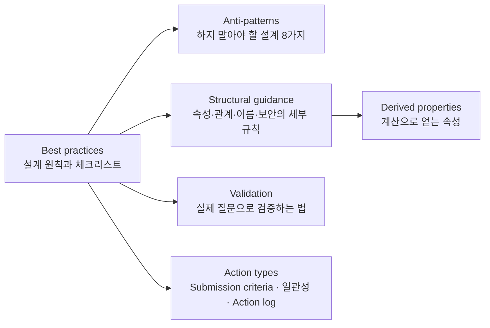

# Palantir 온톨로지 설계 가이드 해설

> 이 문서는 Palantir Foundry 공식 문서 중 **온톨로지 설계 가이드**와 관련 문서를 쉽게 풀어 쓴 해설입니다.
> 보험 온톨로지 PoC를 진행하면서 참고하라고 받은 자료입니다. 읽는 사람은 컴퓨터공학 2학년을 앞둔 학생으로 가정했습니다. 클래스, 객체, if문 정도를 알면 따라올 수 있습니다.
> 원문은 영어이고, 이 문서는 번역이 아니라 **요약과 해설**입니다. 예시는 원문 것을 그대로 옮겼고, 보험 PoC에 적용하는 이야기는 9절에 따로 모았습니다.
> 확인일: 2026-11-02.

---

## 0. 먼저 알아 둘 것

### 0.1 이 자료는 무엇인가

Palantir는 기업 데이터를 온톨로지로 묶어 업무에 쓰게 하는 **Foundry**라는 상용 플랫폼을 만드는 회사입니다. 보험 PoC 명세가 쓰는 Object Type, Property, Link Type, Action Type이라는 용어도 Palantir에서 빌려 왔습니다.

이번에 받은 자료는 Palantir가 공개한 **"온톨로지를 잘 설계하는 법"** 문서 묶음입니다. 문서 네 개가 한 세트이고, Action 관련 문서 몇 개가 함께 참고할 만합니다.

### 0.2 우리 과제와의 관계에서 주의할 점

- 이 가이드는 **Palantir Foundry**를 기준으로 쓴 문서입니다. 우리가 쓰는 도구는 **Ontological Studio**라서 화면도 기능도 다릅니다.
- 그래도 **설계 원칙**(무엇을 Object로 만들지, 이름을 어떻게 지을지, 어떻게 검증할지)은 도구와 상관없이 그대로 쓸 수 있습니다.
- 반대로 **플랫폼 기능**(격리 수준, Action log, Submission criteria 같은 것)은 Foundry가 제공하는 기능입니다. Studio에 같은 기능이 있는지는 따로 확인해야 합니다. 이 문서에서는 그런 부분에 「Foundry 기능」이라고 표시했습니다.

> **정리**
> - 받은 자료는 Palantir의 **온톨로지 설계 가이드 4종 + Action 관련 문서**입니다.
> - **원칙은 그대로 가져오고, 플랫폼 기능은 Studio에서 확인**해야 합니다.

---

## 1. 한 장으로 보는 설계 체크리스트

`Best practices` 문서 첫머리에 있는 8가지 지침입니다. 이 문서 전체의 요약이라고 보면 됩니다.

| 번호 | 지침 | 쉬운 말로 | 근거 원칙 |
|---|---|---|---|
| 1 | Model reality, not systems | 원천 시스템의 표가 아니라 **현실의 대상**을 모델링하라 | 도메인 주도 설계 |
| 2 | Curate intentionally | 속성은 **쓸모 있는 것만** 골라 넣어라 | 정규화, 파생 속성 |
| 3 | Collaborate across teams | 여러 팀이 함께 설계하라. 따로 만들면 중복이 생긴다 | 중복 금지 |
| 4 | Keep object types focused | Object Type 하나는 **대상 하나**만 나타내라 | 도메인 주도 설계 |
| 5 | Choose the right tool | 사람의 결정은 Action, 자동 변환은 파이프라인으로 | 황금 망치 안티패턴 |
| 6 | Use interfaces for abstraction | 공통점은 **인터페이스**로 묶어라. 속성이 잔뜩 비어 있는 넓은 타입을 만들지 마라 | 상속보다 조합 |
| 7 | Document decisions | 왜 그렇게 설계했는지 **기록**하라 | |
| 8 | Validate against real business questions | **실제 업무 질문**으로 검증하라 | 검증 문서 |

> **정리**
> - 8가지를 줄이면 **"현실을 모델링하고, 필요한 것만 넣고, 겹치지 않게, 실제 질문으로 확인하라"입니다**.

---

## 2. 핵심 설계 원칙 4가지

원칙끼리 부딪치면 **번호가 작은 원칙이 이깁니다.**

| 우선순위 | 원칙 | 한 줄 요약 |
|---|---|---|
| 1 | 도메인 주도 설계 (Domain-driven design) | 원천 데이터가 아니라 현실 세계를 모델링한다 |
| 2 | 중복 금지 (Don't repeat yourself, 3의 법칙) | 같은 것을 세 번 만들었으면 리팩터링한다 |
| 3 | 확장에는 열고 수정에는 닫는다 (Open/closed) | 핵심 모델은 보호하고, 다른 팀은 확장해서 쓴다 |
| 4 | 깊은 상속보다 조합 (Composition over deep hierarchies) | 상속 사다리 대신 인터페이스 여러 개를 조합한다 |

### 2.1 도메인 주도 설계 — 표가 아니라 현실을 그린다

온톨로지의 Object는 `Patient`(환자), `WorkOrder`(작업 지시), `Vessel`(선박)처럼 **업무 담당자가 알아듣는 개념**이어야 합니다. 원천 시스템의 테이블, API 응답, 엑셀 시트 탭을 그대로 옮기면 안 됩니다. Link도 **실제 관계**여야 하고, 단지 조인 키가 같다는 이유로 만들면 안 됩니다.

**예시**: 주문, 고객, 상품 컬럼이 한 줄에 다 들어 있는 CSV가 있습니다. 이걸 `OrderData` 하나로 만들면 안 됩니다. 이 CSV에는 **Order, Customer, Product라는 대상 세 개**가 섞여 있습니다.

이런 모습이면 위험 신호입니다.
- Object Type이 원천 테이블과 1:1로 대응한다.
- 컬럼을 고르지 않고 전부 속성으로 옮겼다.
- 이름이 `dtLastInspMod` 같은 원천 시스템 약어 그대로다.
- 원천 한 줄에 대상 여러 개가 섞여 있는데 Object Type 하나로 만들었다.

권장하는 방법은 다음과 같습니다.
1. 원천 스키마를 보기 **전에** 현실의 대상부터 찾는다.
2. **정체(identity)와 관측(observation)을 분리**한다. 측정값이나 사건은 대상과 다른 Object인 경우가 많다.
3. 사람이 읽을 이름을 붙인다 (`equipment.lastInspectionDate`).
4. 도메인을 먼저 모델링하고, 데이터는 그다음에 연결한다.
5. 의미 없는 기술용 타입은 숨김 처리해 기본 화면을 깨끗하게 둔다.

### 2.2 중복 금지 — 3의 법칙

같은 개념의 Object Type이 여럿 있으면 관리가 어렵고, "어느 게 진짜냐"는 혼란이 생깁니다. 개념 하나에는 **정식 표현 하나**, 업무 하나에는 **워크플로 하나**를 목표로 합니다.

**예시**: 영업팀, 고객지원팀, 청구팀이 각자 `Customer` 타입을 만들었습니다. 해결책은 정식 `Customer` 하나로 합치거나, 공통 인터페이스 `CustomerBase`를 만들어 각 팀의 타입이 구현하게 하는 것입니다.

**3의 법칙**: 비슷한 것이 한 번 더 있으면 괜찮고, 두 번 더 있으면 경고, **세 개째가 되면 리팩터링**합니다. 프로그래밍에서 같은 코드를 세 번 복사했으면 함수로 빼라는 규칙과 같습니다.

### 2.3 확장에는 열고 수정에는 닫는다

실제로 쓰이기 시작한 핵심 타입은 **함부로 고치지 않습니다.** 새 요구가 생기면 핵심 타입을 고치지 말고 연결된 타입이나 인터페이스를 **추가**해서 해결합니다. 객체지향 수업에서 배울 SOLID 원칙의 O(Open/Closed Principle)와 같은 생각입니다.

**예시**: `Equipment`(장비)에 인증 관련 필드를 추가해 달라는 요구가 왔습니다. `Equipment`에 필드를 넣는 대신, 연결된 `Equipment Certification` 타입과 `Certifiable` 인터페이스를 새로 만듭니다. `Equipment`는 그대로 둡니다.

핵심 타입을 자꾸 고치면 다른 팀의 기능이 깨지고, 결국 모든 것을 다 담은 **God Object**(4.4)가 됩니다.

### 2.4 깊은 상속보다 조합

Foundry의 인터페이스는 **다중 상속**처럼 여러 개를 동시에 구현할 수 있습니다. 그래서 능력별로 인터페이스를 만들어 조합합니다.

**예시**: `Asset → PhysicalAsset → Building → SchedulableBuilding → Arena`처럼 상속 사다리를 만들지 않습니다. `Arena`가 `Building` 인터페이스와 `SchedulableResource` 인터페이스를 **둘 다 구현**하게 합니다.

`SchedulableBuilding`, `InspectableVehicle`처럼 **능력 이름 + 대상 이름**을 붙인 조합 타입이 보이면 위험 신호입니다. 능력이 하나 늘 때마다 조합이 곱으로 늘어나기 때문입니다. Java의 `class Arena implements Building, Schedulable`을 떠올리면 됩니다.

### 2.5 원칙은 법이 아니다 — 실용주의

원문은 *"These principles are guides, not laws."라고* 말합니다. 마감, 기존 시스템, 플랫폼 제약은 현실입니다. 그래서 다음을 권합니다.

- 지금은 **합리적인 것**을 만들되, 나중에 개선할 길을 열어 둔다.
- 타협한 부분은 **명시적으로 적어 둔다** (예: "규모가 작아서 지금은 비정규화로 충분하다").
- 한 번에 갈아엎기보다 **조금씩** 개선한다.
- 그래도 이름, 의미의 명확성, 보안은 타협하지 않는다.

> **정리**
> - 원칙 4가지: **현실 모델링 > 중복 금지 > 핵심 보호·확장 > 상속 대신 조합**.
> - 우선순위가 정해져 있어서, 부딪치면 앞의 원칙을 따릅니다.
> - 원칙은 가이드입니다. 타협했다면 **이유를 기록**하는 것이 핵심입니다.

---

## 3. 구조 가이드 — 속성, 관계, 이름, 보안의 세부 규칙

`Structural guidance` 문서의 내용입니다. 원칙을 실제 설계로 옮길 때의 규칙입니다.

### 3.1 사실은 한 번만 저장하고, 나머지는 계산한다 (정규화와 파생 속성)

원문의 핵심 문장은 *"Store each fact once. Use derived properties for convenience."입니다*. 같은 값을 여러 곳에 복사해 두면, 원본이 바뀔 때마다 복사본도 모두 고쳐야 하고 하나라도 놓치면 값이 어긋납니다.

| 값의 종류 | 예 | 어떻게 만드나 |
|---|---|---|
| **미리 계산할 값** — 같은 Object 안의 값으로 만들고, 파이프라인으로만 바뀜 | `fullName` = 이름 + 성 | 데이터를 불러오는 파이프라인에서 계산 |
| **동적으로 계산할 값** — 연결된 Object나 Action으로 바뀌는 값에 의존 | `directReportCount` = 연결된 직원 수 | **파생 속성**으로 조회할 때 계산 |

**예시**: `Manager`에 부하 직원 수를 정수로 저장해 두고 사람이 고치는 방식은 나쁩니다. 연결된 `Employee` 수를 세는 파생 속성으로 바꿉니다. `Employee`에 `managerName`을 복사해 두지 말고 `Manager`로 가는 Link를 씁니다.

예외도 있습니다. 한 번에 조회하는 객체가 약 1만 개를 넘으면 파생 속성이 느려질 수 있습니다. 이때는 값을 복사해 저장하는 **비정규화**를 해도 되지만, **원본이 어디인지와 동기화 방법을 문서로 남겨야** 합니다.

### 3.2 파생 속성 (Derived properties) 「Foundry 기능」

파생 속성은 **저장하지 않고 조회할 때 계산하는 읽기 전용 속성**입니다. 원본 데이터가 바뀌면 자동으로 최신 값이 나옵니다.

| 종류 | 예 |
|---|---|
| 연결된 객체들의 집계 | 부서의 평균 연봉 (연결된 직원들의 연봉 평균) |
| 연결된 객체 하나의 값 가져오기 | 직원 화면에 상사 이름 표시 |
| 계산식 | 총 보수 = 연봉 + 보너스 |

꼭 알아 둘 주의점이 하나 있습니다. **파생 속성은 계산에 쓰인 모든 객체의 권한을 물려받습니다.** 그래서 같은 객체의 같은 속성이라도 **사용자마다 다른 값이 보일 수 있습니다.** 내가 볼 수 없는 객체는 계산에서 빠지기 때문입니다. 9절에서 보겠지만, 보험 PoC의 한도 계산에서 이 점이 중요합니다.

### 3.3 구조체 (Structs)

항상 함께 쓰는 필드 여러 개는 **구조체 하나**로 묶습니다. C의 `struct`와 같은 개념입니다.

- 여러 필드가 모여 하나의 값이 되는 경우: 주소(도로명, 도시, 우편번호), 좌표
- **값과 메타데이터를 함께** 저장하는 경우: AI가 뽑은 값 + 신뢰도 + 출처 + 근거
- 여러 개 중에서 하나를 골라 써야 하는 경우: 전화번호 여러 개

### 3.4 인터페이스 (Interfaces)

인터페이스는 여러 Object Type이 공통으로 갖는 **모양**(속성, 링크, 액션)을 정의합니다. Java의 `interface`처럼, 여러 타입이 같은 인터페이스를 구현하면 워크플로를 인터페이스에 대해 한 번만 만들면 됩니다.

**예시**: 타입 세 개가 각자 점검 관련 속성과 점검 일정 액션을 중복으로 갖고 있습니다. `Inspectable` 인터페이스에 공통 속성과 액션 하나를 두고, 세 타입이 이것을 구현하게 합니다.

### 3.5 관계 설계 — 직접 링크 vs 객체를 거친 링크

Link 하나하나는 **명확한 업무 질문에 답해야** 합니다 ("이 환자가 방문한 병원은?").

| 방식 | 언제 | 예 |
|---|---|---|
| **직접 링크** | 관계 자체에 정보가 없을 때 | `Employee → Department` |
| **객체를 거친 링크** (object-backed link) | 관계에 날짜, 역할, 상태 같은 정보가 붙을 때 | `Employee → VentureStaffing → Venture`. 중간 객체에 `role`, `startDate`, `allocation` 저장 |

직원을 프로젝트에 직접 연결하면 "언제부터, 무슨 역할로" 참여했는지 기록할 수 없습니다. 그래서 관계 자체를 객체로 만듭니다. DB의 **연결 테이블**과 같은 발상입니다.

### 3.6 이름 짓기 규칙

이름은 **사람과 AI 에이전트가 모두 읽기 쉬워야** 하고, 한번 쓰이기 시작하면 바꾸기 어렵습니다.

| 대상 | 규칙 | 좋은 예 | 나쁜 예 |
|---|---|---|---|
| Object Type | 단수, 구체적인 명사 | `Patient`, `WorkOrder` | `Data`, `Record` |
| 속성 | 짧고 뜻이 바로 보이게. 자료형이나 구현을 이름에 넣지 않음 | `lastInspectionDate` | `dtLastInspMod` |
| 링크 | **양쪽 방향에서 자연스럽게** 읽히게 | 직원 쪽에서 `department`, 부서 쪽에서 `employees` | `related to` |
| 날짜 | 한 가지 규칙으로 통일 | `createdDate`, `updatedDate` | |
| 모호한 단어 | 무엇의 값인지 붙여 쓰기 | `monetaryValue`, `quantityOnHand`, `riskScore` | `value`, `quantity`, `score` |

### 3.7 보안 설계

보안은 **업무 용어로 표현**하고, 처음에는 **최소 권한**에서 시작합니다.

| 종류 | 무엇을 막나 |
|---|---|
| 행 수준 보안 (row-level) | 어떤 **객체**를 볼 수 있나 |
| 열 수준 보안 (column-level) | 볼 수 있는 객체에서 어떤 **속성**을 볼 수 있나 |
| 셀 수준 보안 (cell-level) | 위 둘의 조합 |

**예시**: 보안 때문에 `PublicPatient`와 `RestrictedPatient`라는 타입 두 개를 따로 만들면 스키마가 둘로 갈라지고 점점 달라집니다. `Patient` 하나만 두고 임상 기록 같은 민감 속성에 열 수준 제한을 걸고, VIP 환자에는 행 수준 정책을 겁니다.

새 링크나 속성을 추가할 때 **링크를 따라가서 제한된 데이터에 닿지 않는지** 다시 확인해야 합니다.

> **정리**
> - **사실은 한 번만 저장**하고, 나머지는 파생 속성으로 계산합니다. 복사했다면 이유를 기록합니다.
> - 파생 속성은 **보는 사람의 권한에 따라 값이 달라질 수 있습니다.**
> - 관계에 정보가 붙으면 **관계 자체를 객체**로 만듭니다.
> - 이름은 구체적으로, 링크는 양방향으로 읽히게 짓습니다.
> - 보안 때문에 타입을 복제하지 말고, **행·열 수준 보안**으로 해결합니다.

---

## 4. 하지 말아야 할 설계 8가지 (Anti-patterns)

안티패턴은 **"흔히 빠지는 나쁜 설계"입니다**. 이름이 붙어 있어서 팀원끼리 "이거 God Object 같은데?"처럼 짧게 말할 수 있습니다.

| 번호 | 이름 | 한 줄 정의 | 원문 예 | 고치는 법 |
|---|---|---|---|---|
| 1 | **System Silos** (시스템별 칸막이) | 같은 대상을 원천 시스템마다 따로 만든다 | 인사 시스템 직원, 출입 시스템 직원, 프로젝트 도구 직원이 각각 타입 | 공통 키(사번)로 합치고, 값이 충돌하면 우선순위를 정해 타입 하나로 |
| 2 | **Kitchen Sink** (잡동사니 싱크대) | 업무 의미 없는 기술용 컬럼까지 다 넣는다 | 고객 타입에 `_crm_extracted_at`, `_crm_sequence`, `last_etl_update_timestamp`까지 | 업무 속성만 남기고, 기술 메타데이터는 원본 데이터셋에 두거나 숨김 |
| 3 | **Department Silos** (부서별 칸막이) | 부서마다 같은 대상을 따로 만든다 | 영업 고객, 지원 고객, 청구 고객, 마케팅 연락처 | 공통 `Customer` 하나 + 부서별 속성과 링크, 권한으로 보이는 범위 조절 |
| 4 | **God Object** (만능 객체) | 타입 하나가 서로 다른 대상 여러 개를 나타낸다 | "가치 있는 모든 것" `Asset`. 속성 150개 이상, 대부분 비어 있음 | 실제 대상별로 타입을 나누고, 진짜 공통점만 인터페이스로 |
| 5 | **Golden Hammer** (황금 망치) | 모든 문제를 도구 하나로 해결하려 한다 | 매일 계산하면 될 지역별 매출 합계를 사용자가 누르는 Action으로 | 일에 맞는 도구 고르기 (아래 표) |
| 6 | **Action Sprawl** (액션 난립) | 속성 하나씩 바꾸는 작은 Action이 잔뜩 있다 | 직원 이름 변경, 이메일 변경, 전화번호 변경… 20여 개 | **업무 단위**로 묶기: "연락처 정보 수정", "부서 이동", "신규 입사 처리" |
| 7 | **Time Machine** (타임머신) | 과거 버전을 별도 객체나 타입으로 만든다 | 계약 v1, v2, v3이 각각 객체 / 계약 2023, 2024, 2025가 각각 타입 | 현재 상태는 객체 하나에, 변경 이력은 연결된 이력 타입(`Contract Amendment`)에 |
| 8 | **Misnomer** (잘못된 이름) | 모호하거나 오해를 부르는 이름 | `Item`, `value`, `type`, `date`, `Item → Related Item` | 구체적인 이름: `Product`, `monetaryValue`, `productCategory`, `orderPlacedDate` |

### 4.1 God Object를 알아보는 신호

- 대부분의 객체에서 **비어 있는(null) 속성이 많다.**
- 속성의 뜻이 `type` 필드 값에 따라 달라진다.
- 업무 규칙이 `if type == ... elif type == ...`처럼 타입별 분기로 가득하다.

### 4.2 Golden Hammer — 일에 맞는 도구 고르기 「Foundry 기능」

"망치만 가진 사람에게는 모든 것이 못으로 보인다"는 속담에서 온 이름입니다.

| 도구 | 언제 쓰나 |
|---|---|
| **Action** | 사람의 결정, 사용자가 시작하는 객체 몇 개의 수정 |
| **배치 파이프라인** | 데이터 정리, 집계, 보강, 미리 계산해 둘 값 |
| **스트리밍 파이프라인** | 센서처럼 계속 최신이어야 하는 데이터 |
| **Automation** (자동화) | 온톨로지 변화에 반응하는 일 (새 알림이 생기면 담당자 배정, 알림 발송) |
| **Function** | 실시간 온톨로지 상태에 의존하는 복잡한 로직 |
| **Schedule** | 정해진 시각에 반복하는 파이프라인 실행 |

도구를 고르기 전에 이렇게 물어봅니다. 사람의 판단이 필요한가? 데이터 변환인가, 업무 처리인가? 미리 계산해 둘 수 있나? 변화에 자동으로 반응하면 되나? 항상 최신이어야 하나?

### 4.3 Action Sprawl을 알아보는 신호

- Object Type 하나에 Action이 **10개를 넘는다.**
- Action들이 **항상 정해진 순서로 연달아** 실행된다.
- 이름이 "Set [속성]" 형태다.
- 사용자가 "클릭할 게 너무 많다"고 불평한다.

데이터베이스의 CRUD(생성, 조회, 수정, 삭제)를 그대로 흉내 내면 이렇게 됩니다. Action은 **업무 행위**("부서 이동")여야지, **컬럼 수정**("부서 필드 변경")이면 안 됩니다.

### 4.4 Time Machine을 알아보는 신호

- 하나의 대상인데 객체가 여러 개다.
- `version`, `revision`, `isCurrent` 같은 속성이 있다.
- 대상 수가 아니라 **변경 횟수만큼** 객체 수가 늘어난다.

이렇게 하면 "지금 유효한 것이 어느 것인지", "다른 객체는 어느 버전에 연결해야 하는지"가 모호해집니다. 고치는 법은 현재 상태를 객체 하나에 두고, 변경 내역은 연결된 **이력 타입**에 쌓는 것입니다. 이 안티패턴은 보험 PoC와 직접 관련이 있어서 9.3에서 자세히 봅니다.

> **정리**
> - 칸막이 두 가지(**시스템별, 부서별**)는 같은 대상을 여러 번 만드는 문제입니다.
> - **Kitchen Sink**는 너무 많이 넣는 것, **God Object**는 너무 많이 합치는 것입니다.
> - **Golden Hammer**는 도구 하나만 쓰는 것, **Action Sprawl**은 Action을 너무 잘게 쪼갠 것입니다.
> - **Time Machine**은 버전을 객체로 만드는 것, **Misnomer**는 모호한 이름입니다.

---

## 5. 검증 — 실제 질문으로 확인하기 (Validation)

### 5.1 구조가 맞다고 쓸 수 있는 것은 아니다

타입 간 연결이 맞고, 대상 수가 맞고, 인터페이스가 잘 공유되는지는 **구조 검토**로 확인할 수 있습니다. 하지만 이것만으로는 **"업무 질문만 가진 사람이 정답까지 찾아갈 수 있는가"를** 알 수 없습니다.

원문이 정리한 다섯 가지 교훈입니다.

| 교훈 | 뜻 |
|---|---|
| 구조가 맞다고 쓰기 쉬운 것은 아니다 | 잘 짜인 모델도 탐색하기 어려울 수 있다 |
| **실제 업무 질문이 최고의 인수 테스트다** | 만든 사람이 고른 질문은 빈틈을 놓친다 |
| 처음 보는 사람이 결정적인 증거다 | 모호한 이름과 숨은 지식을 드러낸다 |
| 답을 찾는 데 걸린 시간도 설계 신호다 | 맞지만 느리면 설계나 성능 문제 |
| 사람과 AI 에이전트는 다른 곳에서 막힌다 | 둘 다 시험해야 한다 |

### 5.2 질문을 어디서 가져오나

만든 사람이 "이건 답할 수 있겠지" 하고 고른 질문만 쓰면 빈틈을 못 찾습니다. 조직의 **실제 업무 리듬**에서 질문을 가져옵니다.

- 리더가 반복해서 묻는 것은?
- 팀이 결정하기 전에 다른 팀에게 받아야 하는 것은?
- **한 명의 숙련자에게만 의존하는 조사**는?
- 답을 모으기 어려워서 생긴 정기 보고서는?

질문은 **넓은 데서 좁은 데로** 이어지게 짭니다.
1. **상황 파악**: 주의가 필요한 대상 찾기
2. **원인 추적**: 관계를 따라 원인이 되는 사건, 자료, 관측으로
3. **영향 평가**: 그 밖에 영향받는 것과 개입할 지점

답할 수 없는 질문은 버리지 않습니다. **"모델에 빠진 개념이나 관계가 있다"는 발견**으로 기록합니다.

### 5.3 검증 훈련(drill) 설계

- **도구**: 미리 만든 전용 앱은 빼고, 범용 분석 도구로 합니다. 전용 앱은 정해진 경로로 안내하기 때문에 모델의 약점을 가립니다.
- **참가자**: 만든 사람(가능한지 확인), **만들지 않은 업무 전문가**(이름과 관계가 스스로 설명되는지 확인), 신규 사용자(배우기 쉬운지 확인).
- **형식**: 퀴즈 게임(넓게, 문제를 미리 공개하지 않고, 여러 단계짜리 문제에 높은 점수) 또는 시간을 재는 연속 질문(깊게, 다음 질문이 앞 답에 의존).

### 5.4 결과 읽기 — 증상으로 원인 찾기

정답 여부는 최소 기준입니다. 질문마다 **정답 여부, 걸린 시간, 망설인 곳, 검색한 단어, 시도한 타입과 링크, 도움이 필요했는지, 데이터를 내보내서 손으로 합쳤는지**를 기록합니다.

| 관찰 | 의심할 곳 |
|---|---|
| 어디서 시작할지 모른다 | 이름, 별칭, 설명, 보이는 타입이 너무 많음 |
| 같은 개념에 다른 타입을 쓴다 | 중복되거나 겹치는 개념 |
| 관련 개념으로 넘어가지 못한다 | 링크가 없거나, 이름이 틀렸거나, 방향이 반대 |
| 내보내서 손으로 합친다 | **빠진 관계**나 재사용할 분석 개념 |
| 합리적인 경로마다 답이 다르다 | 단위, 식별, 날짜, 집계 기준이 모호 |
| 만든 사람만 성공한다 | 원천 시스템 용어, 숨은 관례, 부족한 문서 |
| 경로는 맞는데 항상 느리다 | 질의, 인덱스, 데이터 양, 모델 성능 |
| 어떤 경로로도 답이 없다 | 데이터 없음, 범위 밖, 지원 안 되는 연산 |

모든 실패가 온톨로지 문제는 아닙니다. 권한, 원본 데이터, 도구, 사용자 교육 문제부터 걸러냅니다. 한 번의 실패는 예외일 수 있지만, **같은 타입이나 링크에서 반복해서 헷갈리면 설계 문제**입니다.

### 5.5 사람과 AI 에이전트 비교

사람이 푼 뒤, **같은 질문을 AI 에이전트에게** 사람의 풀이 경로를 알려 주지 않고 시켜 봅니다.

| 결과 | 해석 |
|---|---|
| 둘 다 성공 | 경로가 찾기 쉽고 표현력도 충분하다 |
| AI 성공, 사람 실패 | 사람용 이름, 설명, 화면을 고쳐야 한다 |
| 사람 성공, AI 실패 | **업무 지식이 사람 머릿속에만 있고 모델에 없다** |
| 둘 다 실패 | 데이터, 링크, 의미, 로직이 빠졌다 |

### 5.6 검증은 계속하는 것

작은 질문 묶음으로 시작해서, 고친 뒤 다시 돌리고, **처음 보는 질문**을 추가해 개선이 일반화되는지 확인합니다. 시간이 지나면 질문 묶음이 새 타입, 링크, 데이터를 넣을 때마다 돌리는 **회귀 테스트**가 됩니다.

> **정리**
> - 구조가 맞아도 쓰기 어려울 수 있습니다. **실제 업무 질문이 인수 테스트**입니다.
> - **만들지 않은 사람**과 **AI 에이전트**에게 같은 질문을 풀게 하고, 정답뿐 아니라 시간과 막힌 곳을 기록합니다.
> - 답할 수 없는 질문은 버리지 말고 **설계의 빈틈**으로 기록합니다.

---

## 6. Action 관련 문서 「Foundry 기능」

보험 PoC의 A01\~A11은 이 부분과 가장 많이 겹칩니다. 다만 아래 내용은 **Foundry가 이렇게 동작한다**는 설명이고, Studio가 같은지는 확인해야 합니다.

### 6.1 Action Type이란

Action Type은 **사용자가 한 번에 할 수 있는 변경의 묶음**입니다. 객체, 속성, 링크를 함께 바꾸고, 제출할 때 알림 같은 부수 효과도 일으킵니다. Action 하나를 적용하는 것은 **하나의 트랜잭션**입니다.

**원문 예**: `Assign Employee` Action은 직원의 역할을 바꾸고, 새 역할을 정해진 목록에서 입력받고, 새 상사와 링크를 만들고, 전 상사와 새 상사에게 알리고, 인사팀만 실행할 수 있게 제한합니다.

| 구성 요소 | 뜻 |
|---|---|
| Parameters (입력) | 실행할 때 사용자가 주는 값 |
| Rules (규칙) | 객체, 속성, 링크를 어떻게 바꿀지 |
| **Submission criteria** (제출 조건) | 제출하기 전에 만족해야 하는 조건 |
| Side effects, Webhooks | 제출할 때 일어나는 알림, 외부 호출 |
| Function-backed actions | 로직을 코드(Function)로 작성한 Action |
| Permissions (권한) | 누가 이 Action을 쓸 수 있나 |

같은 Action 로직과 검증을 **모든 화면에서 똑같이** 쓰기 때문에, 어디서 수정하든 결과가 일관됩니다.

### 6.2 Submission criteria — 제출 조건

예전 이름은 "validations"입니다. **모든 조건을 만족해야만** Action을 제출할 수 있습니다.

| 조건 종류 | 무엇을 보나 | 예 |
|---|---|---|
| Current user | 제출하는 사람의 ID, 소속 그룹, 조직 | "운항 관제 그룹 소속인가?" |
| Parameter | 입력값과, 입력으로 받은 객체의 속성 | "선택한 항공기의 운항 상태가 '가능'인가?" |
| Execution context | 시나리오(가상 실험) 안에서 실행 중인가 | |

조건은 AND, OR, NOT으로 묶을 수 있고, 조건마다 **실패 메시지**를 정해 "왜 제출할 수 없는지"를 사용자에게 보여 줍니다.

**중요**: 조건은 **제출하는 순간의 값**으로 검사합니다. 화면을 연 순간이 아닙니다.

**주의**: 그룹 소속에 NOT 조건("이 그룹이 아니면 허용")을 쓰지 마세요. 권한 일부만 담긴 토큰으로 실행하면 그룹 정보가 빠져 있어서 NOT 조건이 통과해 버리고, 의도보다 넓은 권한이 생깁니다.

### 6.3 일관성과 격리 — 동시에 실행될 때

DB 수업에서 배울 **ACID** 중 세 가지를 Action이 어떻게 보장하는지 설명하는 문서입니다.

- **원자성**: Action의 온톨로지 변경은 **전부 되거나 전부 안 됩니다.** 단, 알림, 웹훅, Function이 부르는 **외부 시스템 호출은 이 보장 밖**입니다.
- **일관성**: 필수 속성, 값 제약을 만족해야만 저장됩니다.
- **지속성**: 저장된 변경은 사라지지 않습니다.

여러 Action이 동시에 실행될 때의 규칙은 **격리 수준**으로 정합니다.

| 격리 수준 | 읽기 | 충돌 검사 |
|---|---|---|
| Legacy | 읽을 때마다 다른 시점의 값이 보일 수 있음 | 내가 **쓴** 객체를 남이 바꿨으면 실패 |
| **Snapshot** (새 Action의 기본값) | Action이 시작한 시점의 **한 스냅샷**에서 읽음 | 내가 **쓴** 객체를 남이 바꿨으면 실패 |
| Read committed (예정) | 읽을 때마다 최신 값 | 같은 속성은 나중에 저장한 쪽이 이김 |

충돌이 나면 실패한 Action의 변경은 **통째로 버려집니다.** 잠그지 않고 일단 실행한 뒤 저장할 때 충돌을 검사하므로, 원리는 **낙관적 동시성 제어**와 같습니다.

#### 쓰기 왜곡 (write skew) — 꼭 알아야 할 함정

스냅샷 격리는 **"둘 다 같은 것을 읽고, 서로 다른 것을 쓰는"** 충돌은 잡지 못합니다.

**원문 예**: 당직 엔지니어 두 명이 동시에 "상대가 당직에 남아 있으니 나는 빠져도 되겠다"고 확인한 뒤 각자 자기를 당직에서 뺍니다. 두 Action이 **쓴 객체가 서로 다르므로** 충돌로 잡히지 않고, 결과적으로 당직자가 0명이 됩니다.

**해결책**: 지켜야 할 규칙(불변식)을 **공유 객체에 대한 쓰기**로 만듭니다. 예를 들어 `Rotation` 객체에 `onCallCount` 속성을 두고 두 Action이 모두 이 값을 고치게 하면, 같은 객체를 썼으므로 충돌로 잡힙니다.

#### 자동 재시도

일시적인 충돌은 플랫폼이 **최대 5번** 처음부터 다시 실행할 수 있습니다. 기본 설정에서는 **외부 호출이 있는 Action은 재시도하지 않습니다.** 부수 효과(예: 송금)가 두 번 일어나면 안 되기 때문입니다. 외부 호출이 **멱등**할 때만 재시도를 켜라고 안내합니다.

### 6.4 Action log — 결정 기록

Action log는 **성공한 Action 제출을 객체로 기록**하는 기능입니다. Action Type마다 `[Log] Action 이름`이라는 로그 타입이 생기고, **제출 1번에 로그 객체 1개**가 생겨 수정된 모든 객체와 연결됩니다.

**원문 예**: `Close Alerts`로 알림 10개를 한 번에 닫으면, 로그 객체 **1개**가 생기고 10개 알림 모두와 연결됩니다.

기록하는 것: Action 종류와 버전, 시각, 제출한 사람, 수정된 객체, 호출한 웹훅과 알림, 선택적으로 입력값과 사람이 읽을 요약.

| 알고 싶은 것 | 쓸 기능 |
|---|---|
| 어떤 결정을, 누가, 어떤 맥락에서 했나 | **Action log** |
| 한 객체에 일어난 모든 수정 이력 | Edit history |
| 성공·실패 비율, 걸린 시간 | **Action metrics** |
| Action 되돌리기 | Undo / revert |

**중요**: Action log는 **성공한 제출만** 기록합니다. 실패는 Action metrics에서 봅니다. 또 설정한 시점부터 기록하며, 과거 실행은 채워 넣지 않습니다.

> **정리**
> - Action = 변경 묶음 + 입력 + **제출 조건** + 권한 + 부수 효과, 그리고 **하나의 트랜잭션**입니다.
> - 제출 조건은 **제출하는 순간의 값**으로 검사합니다.
> - 원자성은 **온톨로지 변경까지만**이고, 외부 호출은 보장 밖입니다.
> - 스냅샷 격리는 **쓰기 왜곡**을 못 잡습니다. 불변식은 **공유 객체에 쓰는 것**으로 지킵니다.
> - Action log는 **성공한 결정**의 기록이고, 실패는 따로 봐야 합니다.

---

## 7. 참고: 문서에서 반복되는 키워드

| 키워드 | 반복되는 메시지 |
|---|---|
| 현실 | 원천 시스템이 아니라 현실의 대상을 모델링 |
| 하나 | 개념 하나에 타입 하나, 사실 하나는 한 곳에 |
| 업무 | Action은 업무 행위 단위, 이름은 업무 용어 |
| 근거 | 결정을 기록하고, 설계 결정도 기록 |
| 질문 | 실제 업무 질문으로 검증하고 계속 다시 돌림 |
| 사람과 AI | 사람과 에이전트 모두 이해할 수 있는 모델 |

---

## 8. 원문 목록

| 문서 | 내용 | 주소 |
|---|---|---|
| Ontology design: Best practices | 체크리스트, 원칙 4가지, 실용주의 | <https://www.palantir.com/docs/foundry/ontology/ontology-best-practices> |
| Ontology design: Anti-patterns | 안티패턴 8가지 | <https://www.palantir.com/docs/foundry/ontology/ontology-anti-patterns/> |
| Ontology design: Structural guidance | 정규화, 구조체, 인터페이스, 링크, 이름, 보안 | <https://www.palantir.com/docs/foundry/ontology/ontology-structural-guidance/> |
| Ontology design: Validation | 실제 질문으로 검증하는 법 | <https://www.palantir.com/docs/foundry/ontology/ontology-design-validation/> |
| Derived properties | 파생 속성 | <https://www.palantir.com/docs/foundry/ontology/derived-properties/> |
| Action types overview | Action Type 개요 | <https://www.palantir.com/docs/foundry/action-types/overview> |
| Submission criteria | 제출 조건 | <https://www.palantir.com/docs/foundry/action-types/submission-criteria> |
| Consistency and isolation | 원자성, 격리 수준, 쓰기 왜곡, 재시도 | <https://www.palantir.com/docs/foundry/action-types/consistency-guarantees/> |
| Action log | 결정 기록 | <https://www.palantir.com/docs/foundry/action-types/action-log/> |

---

## 9. 보험 PoC에 적용하면

자세한 설명은 [보험 온톨로지 시나리오 해설](보험_온톨로지_시나리오_해설.md)의 15절에 있습니다. 여기서는 결론만 표로 정리합니다.

### 9.1 명세가 이미 가이드를 따르고 있는 부분

| 가이드 | 보험 명세에서 |
|---|---|
| 현실을 모델링, 정체와 관측 분리 | 입원(`InsuranceEvent`)과 청구(`Claim`)를 분리, 사람(`Party`)을 하나로 통합 |
| System Silos 피하기 | 네 시스템의 고객 ID를 `Party` 하나로 매핑, 불확실하면 병합 보류 |
| 객체를 거친 링크 | `PolicyRole` (역할, 유효 기간이 붙은 관계) |
| 구조체 + AI 출력의 신뢰도 | `EvidenceDocument.extracted_facts` (후보 값 + 추출 신뢰도) |
| 업무 단위 Action (Action Sprawl 피하기) | A01\~A11이 모두 업무 행위 이름 (`ApproveClaim`, `VerifyEvidence`) |
| 실제 질문으로 검증 | Q1\~Q7과 사용성 합격 기준 |
| 보안을 타입 복제 없이 | 역할별 읽기 범위, 객체·속성·문서에 같은 권한 적용 |

### 9.2 가이드와 긴장 관계가 있어 결정을 기록해야 하는 부분

| 가이드 | 명세의 선택 | 기록할 이유 |
|---|---|---|
| Time Machine 피하기 | `CoverageVersion`, `RuleSetVersion`을 버전별 객체로 둠 | 평가가 **그때의 정확한 버전**을 가리켜야 재현 가능 |
| 사실은 한 번만 저장 | `PaymentOrder`에 보장, 피보험자, 수익자 ID를 복사 | 승인 시점의 값을 **고정**하고 한도 집계 키로 씀 |
| Kitchen Sink 피하기 | 모든 객체에 `source_system`, `source_record_id`, 해시 값 | 추적성 요구. 기본 화면에서는 **숨김** 처리 |

### 9.3 가이드를 보고 새로 점검할 부분

| 가이드 | 점검할 것 |
|---|---|
| 쓰기 왜곡 | T18(동시 승인, 한도)은 쓰기 왜곡과 같은 구조입니다. 한도를 **공유 객체**로 만들지 검토 |
| 파생 속성의 권한 | 남은 한도를 보는 사람의 권한으로 계산하면 다른 청구의 예약이 빠질 수 있음 |
| Action log는 성공만 | 명세의 `ActionLog`는 **거절도 기록**해야 하므로 별도 처리가 필요 |
| 외부 호출은 원자성 밖 | 모의 지급 호출은 트랜잭션 밖. 명세의 발송 대기 기록과 지급 키가 이 문제의 답 |
| 사람과 AI 비교 검증 | Q1\~Q7을 **만들지 않은 사람**과 **Studio 질의 에이전트**에게 풀게 하고 시간, 막힌 곳 기록 |

> **정리**
> - 명세는 가이드의 핵심 원칙(**현실 모델링, 칸막이 제거, 업무 단위 Action, 실제 질문 검증**)을 이미 따르고 있습니다.
> - 가이드와 다르게 간 부분(**버전 객체, 값 복사, 추적용 메타데이터**)은 이유가 있으므로 **결정 기록**으로 남깁니다.
> - 새로 얻은 점검 항목은 **쓰기 왜곡(T18), 파생 속성의 권한, 거절 기록, 사람·AI 비교 검증**입니다.

---

## 10. 용어 정리

| 용어 | 뜻 |
|---|---|
| Foundry | Palantir의 데이터·온톨로지 플랫폼 (상용) |
| 안티패턴 | 흔히 빠지는 나쁜 설계 방식에 붙인 이름 |
| 도메인 주도 설계 (DDD) | 소프트웨어 구조를 업무 세계(도메인)의 개념에 맞추는 설계 방법 |
| 도메인 전문가 | 그 업무를 잘 아는 사람 (보험이라면 심사 담당자) |
| 원천 시스템 | 데이터가 처음 만들어지는 업무 시스템 |
| 파이프라인 | 데이터를 불러와 정리, 변환, 집계하는 처리 흐름 |
| 배치 / 스트리밍 | 모아서 한 번에 처리 / 들어오는 대로 계속 처리 |
| ETL | Extract, Transform, Load. 데이터를 뽑고, 바꾸고, 싣는 과정 |
| 정규화 | 같은 사실을 한 곳에만 저장하도록 구조를 나누는 것 |
| 비정규화 | 성능을 위해 일부러 값을 복사해 두는 것 |
| 파생 속성 | 저장하지 않고 조회할 때 계산하는 속성 |
| 구조체 (struct) | 여러 필드를 하나로 묶은 값 |
| 인터페이스 | 여러 타입이 공통으로 갖출 모양(속성, 링크, 액션)의 약속 |
| 다중 상속 | 여러 부모의 특성을 동시에 물려받는 것. 인터페이스로 흉내 냄 |
| 리팩터링 | 동작은 그대로 두고 구조를 개선하는 것 |
| 개방-폐쇄 원칙 | 확장에는 열려 있고 수정에는 닫혀 있어야 한다는 객체지향 원칙 (SOLID의 O) |
| 직접 링크 / 객체를 거친 링크 | 두 객체를 바로 연결 / 관계 정보를 담은 중간 객체를 거쳐 연결 |
| 행·열·셀 수준 보안 | 볼 수 있는 객체 / 속성 / 둘의 조합을 제한 |
| 최소 권한 | 필요한 만큼만 권한을 주는 원칙 |
| 인수 테스트 | 사용자 관점에서 "받아들일 만한가"를 확인하는 테스트 |
| 회귀 테스트 | 고친 뒤 예전에 되던 것이 여전히 되는지 다시 돌리는 테스트 |
| CRUD | Create, Read, Update, Delete. 데이터의 기본 조작 네 가지 |
| Submission criteria | Action을 제출하기 전에 검사하는 조건 |
| 웹훅 (webhook) | 어떤 일이 일어나면 외부 시스템의 주소로 알림을 보내는 방식 |
| ACID | 트랜잭션의 네 성질: 원자성, 일관성, 격리성, 지속성 |
| 격리 수준 | 동시에 실행되는 트랜잭션이 서로의 변경을 얼마나 볼 수 있는지 정한 단계 |
| 스냅샷 격리 | 트랜잭션이 시작한 순간의 데이터만 보고 실행하는 격리 수준 |
| 쓰기 왜곡 (write skew) | 둘이 같은 데이터를 읽고 서로 다른 데이터를 써서, 각자는 맞지만 합치면 규칙이 깨지는 현상 |
| 불변식 (invariant) | 언제나 참이어야 하는 규칙. 예: "지급 + 예약 ≤ 5일" |
| 낙관적 동시성 제어 | 잠그지 않고 실행한 뒤, 저장할 때 충돌을 검사하는 방식 |
| Action log | 성공한 Action 제출을 객체로 남긴 결정 기록 |
| Action metrics | Action의 성공·실패 비율과 소요 시간 통계 |
