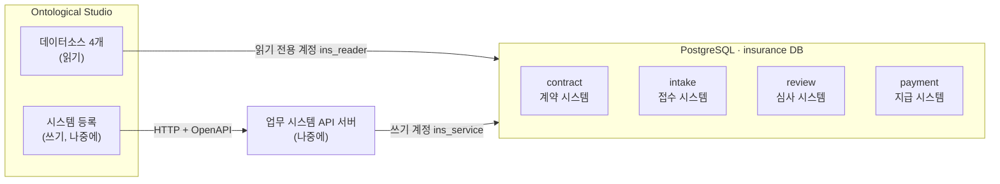

# 보험 온톨로지 PoC — 시스템 구성 보고서

> 작성일 2026-11-02 · 대상: PoC를 함께 검토하는 팀
> 기준 문서: [보험업 온톨로지 설계 시나리오](../00_spec/insurance-ontology-design-scenario.md) (이하 "명세")
> 근거: Ontological Studio 데스크톱 앱 v0.1.1과 공식 튜토리얼. 앱 안의 코드와 설정 파일에서 확인한 사실은 출처를 함께 적었습니다. 해석이나 아직 시험하지 않은 내용은 **(확인 필요)** 로 표시했습니다.

---

## 1. 요약

명세의 업무(입원 정액보험의 청구 심사와 모의 지급)를 Ontological Studio로 구현하기 위해, 먼저 **Studio가 읽어 갈 가상 업무 DB**를 설계했습니다.

- 명세 1절의 전제대로 **계약·접수·심사·지급 시스템**을 PostgreSQL DB 하나(`insurance`) 안의 **스키마 4개**로 나눴습니다. 같은 사람·계약·사고가 시스템마다 **다른 식별자**로 들어 있습니다.
- Studio는 이 DB를 **데이터소스 4개**(스키마당 1개)로 연결해 읽습니다. 상태를 바꾸는 일은 나중에 만들 **업무 시스템 API**를 통해서만 합니다.
- DDL, B0 데이터, 초기화 스크립트를 작성했고, 임시 DB에서 실행해 검증했습니다. B0로 계산한 결과가 명세 10.3절과 같습니다(입원 3일, 지급 후보 300,000원).
- **아직 하지 않은 것**: 실제 DB 설치와 Studio 연결, 테스트별 변형 데이터, 업무 시스템 API와 액션.

| 구분 | 상태 |
|---|---|
| DB 설계 (스키마 4개, 테이블 18개) | 완료 |
| B0 데이터, 초기화 스크립트 | 완료, 임시 DB에서 검증 |
| 실제 DB 설치 | 완료 (Homebrew PostgreSQL 16, `insurance` DB와 B0 생성, Studio와 같은 조건으로 접속 확인) |
| Studio 데이터소스 연결 | 대기 |
| 테스트별 변형 데이터 (T02–T29) | 대기 |
| 업무 시스템 API, 액션 | 보류 (나중에 진행하기로 함) |

---

## 2. 전체 구성

Studio가 DB에 닿는 길은 둘입니다.

| | 데이터소스 (읽기) | 시스템 등록 (쓰기) |
|---|---|---|
| Studio가 연결하는 곳 | DB | API 서버 (HTTP) |
| 입력하는 값 | 호스트, 포트, DB, 스키마, 계정, 비밀번호 | 주소, OpenAPI 스펙, 인증, 상태 점검 경로 |
| 하는 일 | 질의할 때마다 원천을 읽음 (복사하지 않음) | 액션이 API를 호출해 상태를 바꿈 |
| 켜져 있어야 하는 것 | DB | API 서버와 DB |
| 근거 | 튜토리얼 5장 | 튜토리얼 14장, 앱의 예제 시스템 등록 코드 |

이 구조는 Studio에 들어 있는 예제와 같습니다. 예제는 PostgreSQL의 `sample` DB 안에 `erp`, `wms`, `crm` 스키마를 두고, 이것을 데이터소스 3개로 연결합니다. 상태 변경은 같은 DB를 쓰기 계정으로 고치는 FastAPI 서비스 3개가 맡습니다(앱 내부 파일 `resources/sample/fabric.cypher`, `services/*.py`).

**DB 위치**: **Homebrew로 설치한 PostgreSQL 16**에 두었습니다(2026-11-02). 로그인할 때 자동으로 켜지고, `localhost:5432`에서만 접속을 받으며, TCP 접속에는 비밀번호가 필요합니다. 튜토리얼이 안내하는 공식 경로(별도 DB를 데이터소스로 연결)이고, 앱과 따로 관리됩니다. Studio 내장 PostgreSQL에 DB를 추가하는 방법은 문서화되지 않았고 앱 데이터를 초기화하면 함께 사라지므로 쓰지 않았습니다.

---

## 3. Studio와의 연결 방식 — 확인한 사실

| 항목 | 확인한 내용 | 출처 |
|---|---|---|
| 지원 DB | PostgreSQL, MySQL/MariaDB, Oracle, SQL Server. Windows는 PostgreSQL만 | 튜토리얼 5장 |
| 연결 단위 | 데이터소스 하나 = DB의 **스키마 하나** | 튜토리얼 5장, 앱 `fabric.cypher` |
| 데이터 위치 | 복사하지 않고 질의할 때 원천에서 읽음 (`postgres_fdw`). 그래서 DB가 켜져 있어야 함 | 튜토리얼 5장 |
| 쓰기 | 데이터소스와 가상 노드는 읽기 전용. Studio 안에서 테이블을 만들거나 데이터를 넣을 수 없음 | 튜토리얼 5장, 치트시트 |
| 업무 시스템 | REST API + OpenAPI 3.x 또는 Swagger 2.0. 인증은 API 키, Basic, Bearer, OAuth 등 | 튜토리얼 14장, 앱 실행기 `specs.py` |
| 액션의 대상 | Studio 그래프에 **적재된** 인스턴스. 예제도 데이터소스에서 읽어 그래프에 적재함 | 앱 `seed_ontology.py`, 구축 에이전트 지침 `golden-commands.md` |

마지막 줄 때문에, 액션을 만드는 단계에서는 데이터소스로 읽는 것에 더해 **액션 대상 클래스(청구, 서류, 업무, 지급 지시)를 그래프에 적재하는 방법**을 정해야 합니다. 4절의 DB 설계는 그대로 쓰고, 적재 방법만 추가로 정하면 됩니다.

---

## 4. 데이터베이스 설계

파일 위치: [02_data/](../02_data/) — 자세한 설명은 [02_data/README.md](../02_data/README.md)

### 4.1 스키마와 테이블

| 스키마 | 시스템 | 테이블 | 온톨로지 Object |
|---|---|---|---|
| `contract` | 계약 (읽기 전용 원천) | `customer`, `policy`, `policy_role`, `coverage` | Party, Policy, PolicyRole, CoverageVersion |
| `intake` | 접수 (접수 원본) | `claimant`, `claim_receipt`, `document`, `receipt_document` | Party, Claim·InsuranceEvent의 원천, EvidenceDocument(원문) |
| `review` | 심사 (업무 서비스) | `rule_set_version`, `insurance_event`, `document_verification`, `claim`, `assessment`, `assessment_evidence`, `review_task`, `payment_order`, `action_log` | RuleSetVersion, InsuranceEvent, EvidenceDocument(확인값), Claim, Assessment, ReviewTask, PaymentOrder, ActionLog |
| `payment` | 지급 (모의) | `payment_request` | PaymentOrder의 지급 결과 |

명세의 Object 12개가 모두 테이블로 대응됩니다. Party와 EvidenceDocument는 두 시스템에 나뉘어 있고, 온톨로지에서 하나로 합칩니다.

### 4.2 설계 결정

| 결정 | 이유 |
|---|---|
| **청구의 처리 상태와 지급 지시(예약)를 심사 시스템에 둠** | 승인은 지급 지시 생성, 청구 `APPROVED`, 실행 기록을 한 트랜잭션으로 바꿔야 함(명세 8.2절). 서로 다른 시스템에 나뉘면 원자적으로 바꿀 수 없음 |
| 접수 시스템에는 접수된 그대로의 원본만 둠 | 확정 사실과 증빙 확인은 업무 서비스가 관리(명세 4.2, 12.2절) |
| 시스템마다 식별자를 다르게 함 | 명세 1절의 전제 "각 시스템의 고객·계약·사고 식별자가 달라 담당자가 대조해야 한다". 이것을 잇는 것이 온톨로지의 역할 |
| 다른 시스템을 가리키는 참조에는 DB 제약을 걸지 않음 | 실제 회사의 시스템들은 DB 제약으로 묶여 있지 않음. 연결의 일관성은 온톨로지와 업무 서비스가 검사 |
| 평가, 평가 근거, 실행 기록은 수정·삭제 금지 (트리거) | 명세 5.1절 |
| 미해결 심사 업무의 중복 생성 금지 (부분 유일 인덱스) | 명세 5.4절 |
| 사건의 날짜 역전은 DB에서 막지 않음 | T14가 이것을 평가에서 데이터 오류로 판정해야 함 |
| 멱등성 키 저장소, 지급 전송 대기 기록은 나중에 추가 | 업무 서비스(API)를 만들 때 함께 설계 |

### 4.3 같은 대상, 다른 식별자 (B0)

| 명세 ID | 계약 시스템 | 접수 시스템 | 심사 시스템 | 잇는 방법 |
|---|---|---|---|---|
| PT-001 (계약자 A) | `C-10001` | `IP-0001` | 제출자 `IP-0001` | `identity_token` = `TKN-A` |
| PT-002 (피보험자·수익자 B) | `C-10002` | `IP-0002` | 사건 주체 `IP-0002` | `identity_token` = `TKN-B` |
| PO-001 (계약) | `PO-001` | `TEST-POLICY-001` | `PO-001` | 대외 계약 번호 |
| CV-001 (보장) | `CV-001` | `INPATIENT-DAILY-A` | `CV-001` | 계약 번호 + 보장 코드 |
| RV-001 (규칙) | `INPATIENT-DAILY` / `1.0` | — | `RV-001` | (규칙 코드, 버전) |
| CL-001 (청구) | — | `RC-0001` | `CL-001` | 접수 번호 |
| EV-001 (입원 사건) | — | `ACC-0001` | `EV-001` | 사고번호 |
| DC-001 (입퇴원확인서) | — | `DC-001` (원문) | `DC-001` (확인값) | 문서 ID |

### 4.4 B0와 초기화

- B0는 명세 10.1절과 같습니다. 계약자 A, 피보험자·수익자 B, 계약 1건, 보장 1건, 입원 1건(3일), 청구 1건(`RECEIVED`), 확인된 입퇴원확인서 1건이 있고, 평가·업무·지급 지시는 없습니다.
- 서류와 규칙의 해시는 실제 파일([DC-001.txt](../02_data/seed/documents/DC-001.txt), [INPATIENT-DAILY-1.0.yaml](../02_data/seed/rules/INPATIENT-DAILY-1.0.yaml))에서 계산합니다. 평가 로직의 해시는 평가 서비스를 만들 때 채웁니다.
- [reset.sh](../02_data/reset.sh)가 DB를 B0로 되돌립니다. 명세는 모든 테스트가 B0에서 출발하라고 요구합니다(10.1, 11.1절). 테스트는 승인·지급으로 데이터를 바꾸므로, 되돌리지 않으면 앞 테스트의 지급 일수가 다음 테스트의 한도 계산에 섞입니다.

### 4.5 계정

| 계정 | 용도 | 권한 |
|---|---|---|
| `ins_reader` | Studio 데이터소스 | 네 스키마 읽기만 |
| `ins_service` | 업무 시스템 API (나중에) | 계약은 읽기만, 접수·심사·지급은 읽기와 쓰기 |

비밀번호는 초기화 스크립트가 처음 실행될 때 만들어 `02_data/.env.local`(권한 600)에 저장합니다. 파일에는 적지 않습니다.

---

## 5. 검증 결과

Studio에 들어 있는 PostgreSQL 16.15 실행 파일로 **임시 DB 서버를 따로 띄워** 확인했습니다. Studio가 쓰는 DB는 건드리지 않았고, 확인 후 임시 DB는 지웠습니다.

| 확인 항목 | 결과 |
|---|---|
| 스키마 4개, 테이블 18개 생성 | 성공 |
| B0 행 수 (명세 10.1절) | 일치. 평가·업무·지급 지시·지급 내역은 0건 |
| 초기화 스크립트를 두 번 연속 실행 | 같은 결과 |
| Studio용 계정으로 청구 수정 시도 | 거부됨 (권한 없음) |
| 서비스 계정으로 계약 수정 시도 | 거부됨 (명세 12.2절) |
| 실행 기록 수정 시도 | 거부됨 (수정 금지 트리거) |
| 네 시스템을 4.3절의 방법으로 이어 계산 | 입원 3일, 대기 기간 종료 2026-01-31, 지급 후보 300,000원 — **명세 10.3절과 일치** |

**시험하지 못한 것**: Studio가 `postgres_fdw`를 거쳐 `jsonb`, `text[]` 타입 컬럼을 제대로 읽는지. 예제 DB에는 이 타입이 없습니다. 안 되면 해당 컬럼을 문자열로 바꾸면 됩니다. **(확인 필요)**

---

## 6. 명세 중 Studio가 맡는 것과 따로 만들 것

| 구분 | 내용 |
|---|---|
| **Studio로 구현** | Object·Property·Link를 클래스·속성·관계로 정의, 데이터소스 연결과 조회, 근거 탐색과 질의, 액션 정의(단계, 정책, 승인), 업무 시스템 등록, 청구 추적 화면(대시보드·코드 앱) |
| **따로 구현** | 가상 업무 DB와 데이터(이번 작업), 초기화 스크립트(이번 작업), 업무 시스템 API(평가 규칙 R01–R07, 원자적 승인, 동시 승인 제어, 멱등성, 모의 지급), 테스트 실행기 |
| **Studio 기능에 없음** | 역할별 읽기 제한(행·열 수준), 관계의 대상 수 제약, 여러 단계의 원자적 처리(실행기는 실패 시 보상하는 사가 방식), 액션 사이의 동시성 제어, 외부 신호에 반응하는 자동화 |

Studio 기능에 없는 것은 업무 시스템 API와 DB가 대신 맡거나, PoC 결과에 "Studio로는 구현하지 못함"으로 기록합니다. 자세한 근거는 [시나리오 해설 14절](../00_spec/보험_온톨로지_시나리오_해설.md)에 있습니다.

---

## 7. 남은 결정과 확인 사항

| 항목 | 내용 | 권장안 |
|---|---|---|
| `jsonb`·`text[]` 타입 | Studio가 이 컬럼을 읽는지 | 연결한 뒤 바로 확인 |
| 액션 대상의 그래프 적재 | 데이터소스로 읽은 청구 등을 그래프에 적재하는 방법 | 액션 단계에서 정함 |
| 업무 시스템 API 방식 | 직접 작성 / PostgREST 등 자동 생성 | 예제와 같은 FastAPI 직접 작성 (등록이 확인된 방식) |
| 액션 정책의 역할 | 앱 코드에 실행 역할이 `scm_operator` 하나로 고정되어 있고 설정으로 바꿀 수 없음. 명세의 접수·심사·지급 담당자를 역할로 나눌 수 없음 | 정책 조건(`when`)에 담당자 ID를 쓰는 방식으로 우회 검토 |
| 테스트별 변형 데이터 | T02–T29의 B0 대비 차이 | DB 연결 뒤 작성 |

---

## 8. 다음 단계

1. ~~PostgreSQL 설치, `reset.sh`로 `insurance` DB와 B0 생성~~ (완료)
2. Studio 데이터소스 4개 연결 (`contract`, `intake`, `review`, `payment`, 계정 `ins_reader`), 타입 확인
3. 테스트별 변형 데이터 작성 (T02–T15부터)
4. 온톨로지 구축 (클래스·관계, 시스템 간 식별자 연결)
5. 업무 시스템 API와 액션 (보류 중)

---

## 부록. 근거 자료

| 자료 | 위치 |
|---|---|
| 공식 튜토리얼 (5, 6, 11, 12, 14, 15, 16장) | [01_ontological-studio/tutorials/](../../01_ontological-studio/tutorials/ontological-studio-tutorial-full.md) |
| 예제 업무 DB와 데이터소스 연결 | 앱 내부 `Contents/Resources/resources/sample/` (`sample.sql`, `services.sql`, `fabric.cypher`) |
| 예제 업무 시스템 (FastAPI) | 같은 폴더 `services/erp.py`, `wms.py`, `crm.py` |
| 예제 온톨로지 구축 (그래프 적재) | 같은 폴더 `seed_ontology.py` |
| 액션 실행기 | 앱 내부 `runtime/kinetic/app/app/` (`specs.py`, `plans.py`, `dispatch.py`) |
| 구축 에이전트 지침 | 앱 내부 `runtime/studio/app/skills/ontology-build/` |
| 앱 시작 코드 (DB 구성, 역할 목록) | 앱 내부 `app.asar`의 `src/main/postgres.js`, `kinetic.js` |
